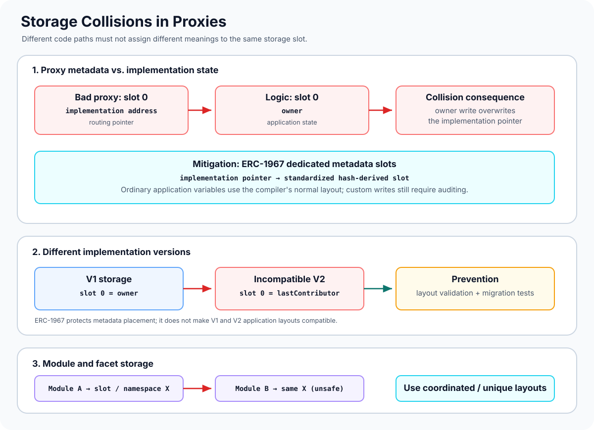

# Storage Collisions in Proxies: When Different Code Writes the Same Slot

> **Stage:** 04 — Smart Contract Architecture  
> **Priority:** 1  
> **Status:** Reviewed  
> **Last reviewed:** 2026-10-17

## 1. Overview

A **storage collision in a proxy system** occurs when two parts of a delegate-call architecture unintentionally use the same storage slot for different purposes. Because `DELEGATECALL` executes implementation code in the proxy's storage context, code in the implementation can overwrite values that the proxy relies on for routing or administration.

There are two especially important collision classes:

1. **Proxy-versus-implementation collision:** the proxy stores metadata—such as its implementation address—in an ordinary slot, and implementation code uses that same slot for application state.
2. **Implementation-version collision:** a new implementation interprets an existing slot differently from the previous implementation, so persisted state is overwritten or misread after an upgrade.

Related collisions can also occur between modules or facets that use shared storage without a coordinated layout. These cases are connected, but not identical. ERC-1967-style unstructured slots help separate proxy metadata from ordinary application storage; storage-layout validation protects the meaning of application state across upgrades.



## 2. Why It Matters to a Developer

Storage collisions can corrupt the mechanism that routes calls to the implementation or silently change the meaning of important state. Depending on the affected slot, a collision may:

- overwrite the implementation address and prevent future calls from reaching valid logic;
- replace an owner or role value with unrelated data;
- corrupt balances, accounting variables, or protocol configuration;
- make previously stored mapping or dynamic-array values appear missing;
- break an upgrade or make rollback unsafe;
- affect modules or facets that unintentionally share a storage location.

A storage collision is particularly dangerous because the EVM does not attach variable names or types to storage bytes. Each piece of code reads or writes a slot according to its own compiled assumptions. If those assumptions disagree, the EVM still performs the operation; it does not know that one write was meant for an implementation pointer and another for an owner address.

## 3. Collision Type A: Proxy Metadata vs. Implementation State

Consider a badly designed proxy that stores its implementation address in the first ordinary storage slot:

```solidity
contract BadProxy {
    address public implementation; // slot 0

    constructor(address impl) {
        implementation = impl;
    }

    // fallback forwards calldata to implementation using DELEGATECALL
}
```

Now consider logic that also expects its first state variable to be in slot 0:

```solidity
contract LogicV1 {
    address public owner; // slot 0

    function setOwner(address newOwner) external {
        owner = newOwner;
    }
}
```

The comments illustrate the typical sequential layout for these simple declarations. When `setOwner` is called through the proxy, the implementation's code writes to slot 0 of the proxy. But slot 0 is also where `BadProxy` stored the implementation address.

That write can replace the proxy's routing pointer with the new owner address. Subsequent fallback calls may then try to delegate to that address, resulting in broken routing or unsafe behavior. This is not merely a name conflict: the two pieces of code physically share the same storage slot in the proxy.

The example is intentionally unsafe and simplified. Do not use it as a proxy implementation.

## 4. Mitigation: Unstructured Storage and ERC-1967 Slots

A common mitigation is to store proxy metadata in dedicated, non-sequential slots instead of ordinary Solidity-declared variables that start at slot 0. **ERC-1967** standardizes locations for metadata such as the implementation address, admin, and beacon address.

For example, the ERC-1967 implementation slot is:

`0x360894a13ba1a3210667c828492db98dca3e2076cc3735a920a3ca505d382bbc`

The standard chooses hash-derived locations designed to avoid collision with ordinary compiler-allocated sequential storage. Proxy code reads and writes the implementation address at that dedicated location, reducing the chance that an ordinary implementation variable will accidentally overwrite it.

This pattern is often called **unstructured storage**. Instead of declaring the implementation pointer as the proxy's ordinary first variable, the proxy reads and writes a designated slot using low-level storage operations or a well-reviewed utility.

However, ERC-1967 does **not** make every collision impossible. Custom assembly can write to arbitrary slots, two custom modules can choose the same namespace or slot, and a deliberately malicious implementation can target known proxy metadata. The standard reduces accidental collisions; it does not replace access control or implementation trust.

## 5. Collision Type B: Storage Collisions Between Implementation Versions

Using ERC-1967 can prevent the classic collision between an implementation pointer and an ordinary application variable, but it does not solve layout incompatibility between V1 and V2.

Imagine a V1 implementation:

```solidity
contract VaultV1 {
    address public owner;   // slot 0
    uint256 public balance; // slot 1
}
```

And an incompatible V2:

```solidity
contract VaultV2Bad {
    address public lastContributor; // slot 0 — different meaning
    address public owner;           // slot 1 — shifted
    uint256 public balance;         // slot 2 — shifted
}
```

The proxy still contains the V1 state. V2 now interprets slot 0 as `lastContributor`, even though it holds the old owner. The old owner value appears under `lastContributor`, and the new `owner` variable reads data from slot 1, which previously held the balance. Depending on the value, this can break authorization and application logic.

This collision is a storage-compatibility problem across implementation versions. It requires preserving the existing storage layout or performing a deliberate and validated migration—not merely adopting ERC-1967.

For more detail about slots, inheritance, packing, storage gaps, and namespaced storage, see [Storage Compatibility](12-storage-compatibility.md).

## 6. Collision Type C: Modules, Facets, and Namespaced State

Modular architectures can introduce another collision surface. If two modules use `DELEGATECALL` and both assume that slot 0 stores their own first variable, they may overwrite each other's state when executed against the same host contract.

This is especially relevant in modular systems such as the **Diamond Pattern (EIP-2535)**, where multiple facets execute in the diamond's storage context. Modules must coordinate storage layout—for example, through shared, deliberately designed storage structs or unique namespace slots.

Namespaced storage, including the convention described in **ERC-7201**, groups a module's state under a designated storage root. A unique, stable namespace can reduce accidental overlap between independent modules. It does not make arbitrary changes within a namespace safe, and reusing a namespace for unrelated state can itself cause collisions.

Storage gaps and namespaced storage solve different problems:

- **Storage gaps:** reserve room within a conventional sequential layout, often to allow a base contract to evolve without shifting derived state.
- **Namespaced storage:** assign a module's state to a dedicated namespace so separate modules can avoid relying on the same sequential storage region.

Use the technique appropriate to the architecture, and still validate the actual layout.

## 7. Other Places Collisions Can Hide

### Inherited contracts

Changing inheritance order or adding a base contract can alter where inherited state is placed. Two contracts that appear separate in source may still contribute variables to one linearized storage layout. An upgrade can then cause one variable to occupy a slot previously used by another.

### Packed variables

Several values can share one 32-byte slot. Changing types or declaration order can alter byte offsets. A collision may therefore affect only part of a slot or change how its bits are interpreted.

### Mappings and dynamic arrays

Mappings and dynamic arrays use a designated base slot combined with hash-based derivation to locate entries. If an upgrade changes the variable's root slot, the new implementation calculates different storage locations. Existing data may look empty even though bytes remain at the old locations.

### Manual assembly writes

Assembly such as `sstore(slot, value)` can target any chosen slot. Incorrect constants, namespace roots, or offset arithmetic can overwrite proxy metadata or application state. Every manual slot calculation should have an explicit documented purpose and tests.

## 8. A Reliable Prevention and Validation Workflow

1. **Identify each storage context.** Determine which contract owns the active storage during every `DELEGATECALL` path and where proxy metadata is stored.
2. **Inspect the proxy mechanism.** Check whether implementation, admin, or beacon addresses use standardized metadata slots such as ERC-1967 rather than ordinary application slots.
3. **Export compiler storage layouts.** Compare slot numbers, byte offsets, types, inherited declarations, structs, mappings, and namespace IDs for the deployed and proposed implementations.
4. **Run upgrade-safety validation.** Use a supported toolchain such as OpenZeppelin Upgrades Core/Plugins with the correct reference implementation and compiled build information.
5. **Investigate every warning.** Do not bypass a collision or layout error solely to make deployment succeed. If a change is intentional, document and implement a safe migration with explicit tests.
6. **Test with realistic existing state.** Deploy V1, initialize it, set owner/roles/balances/mappings to meaningful values, then upgrade in a test environment and verify that those values retain their intended meaning.
7. **Test routing-critical slots.** Where relevant, inspect the implementation slot and ensure normal application functions cannot overwrite proxy metadata.
8. **Exercise module interactions.** If facets or delegated modules share storage, test the modules in the host contract rather than in isolation.
9. **Verify post-upgrade behavior.** Check authorization, key invariants, upgrade events, and the active implementation address through the real proxy.
10. **Keep build artifacts and review evidence.** Preserve the old source, compiler version, dependency versions, reference layout, validation output, and test results.

Automated validation can identify many known layout incompatibilities, but its results depend on correct build data and a valid reference implementation. It cannot prove that arbitrary assembly writes or all behavioral risks are safe.

## 9. Common Mistakes and Security Considerations

1. **Using an ordinary slot for the implementation pointer.** A delegated application variable in that slot can overwrite the routing address.
2. **Assuming ERC-1967 solves all storage collisions.** It helps separate proxy metadata from ordinary storage but does not protect against malicious or incorrect writes to the standardized slot.
3. **Confusing metadata collisions with version incompatibility.** The first is a proxy-versus-application problem; the second is about the old and new implementations interpreting persisted application state differently.
4. **Reordering variables during an upgrade.** Old bytes remain in place and may be read under new meanings.
5. **Ignoring inheritance changes.** A base contract edit can affect derived storage even if the derived source file is unchanged.
6. **Changing a mapping or array root slot.** Existing entries may become unreachable to the updated implementation.
7. **Reusing namespaced storage identifiers.** Two independent modules using the same namespace can read and overwrite the same underlying state.
8. **Writing arbitrary slots in assembly without tests.** A single mistaken constant or offset can overwrite critical metadata or application state.
9. **Assuming a compiler build proves compatibility.** Valid Solidity can still have an incompatible storage layout compared with deployed code.
10. **Skipping a reference layout in the validation tool.** Without the intended previous implementation, the tool may not perform the comparison you expect.
11. **Testing with empty/default state only.** A collision may be invisible until non-zero owner, balance, mapping, or packed-variable values exist.
12. **Treating successful upgrade execution as a guarantee.** A transaction can succeed while corrupting state that breaks later calls.
13. **Failing to verify the actual proxy.** Tests against the implementation contract directly use its own storage and may miss proxy-context collisions.
14. **Relying on storage gaps for every problem.** Gaps help with certain sequential-layout evolution; they do not fix a collision caused by a bad proxy metadata slot or duplicate custom namespaces.

## 10. Developer Review Checklist

- [ ] Explain why implementation code uses the proxy's storage context.
- [ ] Identify the implementation, admin, and beacon storage locations used by the proxy design.
- [ ] Confirm proxy metadata is isolated from ordinary sequential application storage.
- [ ] Compare storage layouts between the actual previous and proposed implementations.
- [ ] Review variable order, type changes, packing, structs, mappings, arrays, and inheritance.
- [ ] Check every custom `sload`/`sstore` slot and namespace identifier.
- [ ] Validate storage gaps or ERC-7201 namespaces according to the architecture.
- [ ] Run storage-compatibility tools with the correct build information and reference implementation.
- [ ] Test a real V1-to-V2 transition after writing meaningful state.
- [ ] Test module/facet interactions in the shared storage context.
- [ ] Verify the implementation pointer and authorization remain intact after common application calls.
- [ ] Record validation results and the rationale for any intentional storage migration.

## 11. Key Takeaways

- A storage collision means separate pieces of delegated code unintentionally use the same physical storage location for different purposes.
- A classic proxy-versus-implementation collision can overwrite the implementation pointer when both use an ordinary slot such as slot 0.
- ERC-1967 assigns standardized hash-derived slots for proxy metadata and reduces accidental conflicts with ordinary sequential storage.
- ERC-1967 does not solve storage-layout incompatibility between different implementation versions.
- Inherited state, packed variables, mappings, dynamic arrays, custom assembly, and namespaced modules all need careful review.
- Storage gaps and ERC-7201 namespaced storage help with different categories of layout risk; neither removes the need for validation.
- Use the exact old implementation as a reference, compile reproducibly, validate layouts, and test the upgrade through the proxy with realistic state.

## References

1. **[OpenZeppelin Upgrades — The Proxy Pattern](https://docs.openzeppelin.com/upgrades-plugins/proxies)** — a detailed explanation of collisions between proxy metadata and implementation variables, plus collisions between implementation versions.
2. **[ERC-1967 — Proxy Storage Slots](https://eips.ethereum.org/EIPS/eip-1967)** — standardized implementation, admin, and beacon slots designed to avoid clashes with compiler-allocated storage.
3. **[Solidity Documentation — Layout of State Variables in Storage](https://docs.solidity.org/en/latest/internals/layout_in_storage.html)** — slot allocation, offsets, packing, inheritance, mappings, arrays, and storage-layout output.
4. **[OpenZeppelin — Writing Upgradeable Contracts](https://docs.openzeppelin.com/upgrades-plugins/writing-upgradeable)** — storage compatibility restrictions, storage gaps, inheritance layout, and ERC-7201 namespaced storage.
5. **[OpenZeppelin Upgrades Core & CLI](https://docs.openzeppelin.com/upgrades-plugins/api-core)** — using build information and a reference implementation to validate upgrade safety and storage compatibility.
6. **[ERC-7201 — Namespaced Storage Layout](https://eips.ethereum.org/EIPS/eip-7201)** — namespace-root conventions for organizing storage by module.
7. **[Storage Compatibility](12-storage-compatibility.md)** — compatibility between old and new implementation layouts.
8. **[Delegatecall-Based Proxy Architecture](10-delegatecall-based-proxy-architecture.md)** — the execution context that makes proxy storage collisions possible.
9. **[Contract Upgradeability](11-contract-upgradeability.md)** — the broader upgrade and validation lifecycle.
