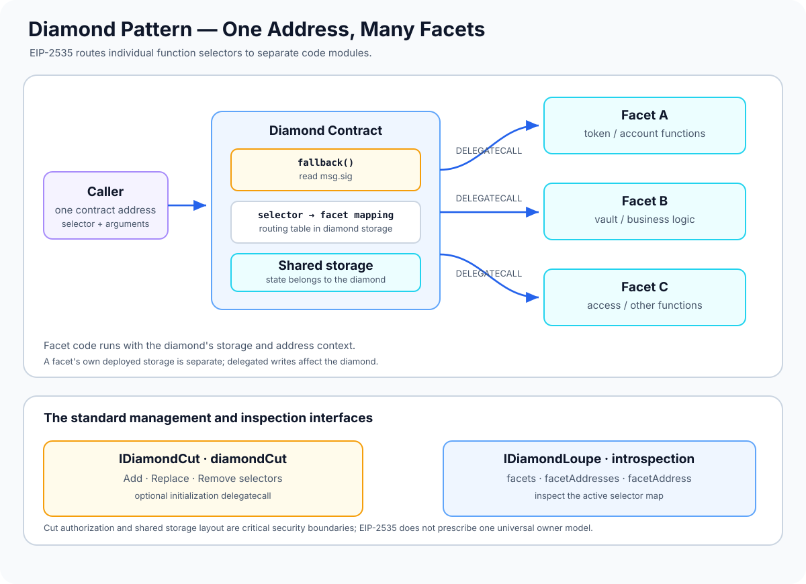

# Diamond Pattern (EIP-2535): Modular Contracts Through Facets

> **Stage:** 04 — Smart Contract Architecture  
> **Priority:** 1  
> **Status:** Reviewed  
> **Last reviewed:** 2026-10-17

## 1. Overview

The **Diamond Pattern**, standardized by **[EIP-2535](https://eips.ethereum.org/EIPS/eip-2535)**, is a modular smart-contract architecture in which one externally visible contract address exposes functions implemented by multiple separate contracts called **facets**.

The diamond uses a fallback function to map each four-byte function selector to a facet address. It then executes the selected facet's code using `DELEGATECALL`. As a result, users interact with one diamond address, while functionality can be split across multiple deployed facet contracts and extended after deployment.

The main components are:

- **Diamond:** the facade and shared storage context that users and integrations call.
- **Facet:** a deployed contract or eligible Solidity library that supplies one or more functions. Its code executes in the diamond's context.
- **Selector-to-facet mapping:** the routing table that identifies which facet implements each external function selector.
- **Diamond cut:** the standard mechanism for adding, replacing, or removing selector routes.
- **Loupe functions:** read-only introspection functions that expose which facets and selectors the diamond currently uses.

The diamond's storage lives at the diamond address. Facets can define state variables in source code, but when their code executes through `DELEGATECALL`, those reads and writes operate on the diamond's storage—not the facet's own storage.

## 2. Why It Matters to a Developer

The Diamond Pattern is useful when an application needs modular functionality behind one address, especially when a single implementation would become difficult to maintain or exceed deployment code-size constraints.

Understanding it helps you:

- split a large application into independently deployed functional modules;
- add, replace, or remove functions without changing the diamond's public address;
- understand how selectors determine which facet executes;
- design shared storage deliberately across facets;
- inspect the current function map with the loupe interface;
- audit upgrade authorization and initialization code that runs with access to diamond storage.

Diamonds add flexibility, but they also add complexity: developers must reason about the diamond's complete selector map, all facets that can execute, their shared storage layout, and the governance that can change function routing.

## 3. How Function Routing Works

When a caller sends a function call to the diamond:

1. The EVM enters a function implemented directly on the diamond, if that selector is handled there.
2. Otherwise, the diamond's `fallback()` reads the first four bytes of the calldata—the function selector.
3. It looks up the facet address associated with that selector in the diamond's routing table.
4. If a facet exists for the selector, the diamond forwards the calldata to that facet using `DELEGATECALL`.
5. The facet's bytecode executes in the diamond's context and can read or write diamond storage.
6. The diamond returns the facet's return data or propagates its revert data to the original caller.

A selector that has no facet mapping normally causes the call to revert unless the diamond deliberately defines a different fallback behavior. Functions implemented directly on the diamond are often called **immutable functions** in the standard's terminology because they cannot be replaced or removed through the normal diamond cut.

The key separation is: the function's code is stored at the facet address, but the externally visible call and storage context belong to the diamond.

## 4. Function Selectors and the Routing Table

A function selector is the first four bytes of the Keccak-256 hash of a canonical function signature. For example, the signature `transfer(address,uint256)` produces a four-byte selector used in calldata.

The diamond maintains a mapping from selectors to facet addresses. This mapping, rather than the facet's contract ABI by itself, determines which code will execute when the corresponding selector is called on the diamond.

This creates an important operational implication: a facet may contain many public or external functions, but only selectors explicitly added to the diamond's routing table are reachable through that diamond. Deploying a facet does not automatically add all of its functions.

Selector collisions are also possible because selectors are only four bytes. Two distinct signatures can theoretically produce the same selector. A correct diamond-cut implementation must reject an attempt to add a selector that already exists and must carefully validate replacements and removals. Developers should inspect the actual selector changes rather than assuming that different function names imply different routing.

## 5. The `diamondCut` Interface

EIP-2535 defines the interoperable `IDiamondCut` interface for changing selector-to-facet associations. Its `FacetCut` structure contains:

- `facetAddress`: the facet address involved in the change;
- `action`: whether to add, replace, or remove selectors;
- `functionSelectors`: the list of selectors affected by the operation.

The standard expresses these actions with the `FacetCutAction` enum in `IDiamondCut` (the action values are Add, Replace, and Remove). The three actions are:

- **Add:** associate selectors that are not already mapped with a facet.
- **Replace:** redirect existing selectors to a different facet, subject to the standard's validation rules.
- **Remove:** remove existing selector mappings.

A diamond cut can update many selectors in one transaction. The standard also defines optional initialization parameters: an `_init` address and `_calldata` bytes. If supplied, the diamond-cut process uses `DELEGATECALL` to execute that calldata against the selected initialization contract or facet. This supports state setup associated with adding or replacing functionality.

The `DiamondCut` event records changes to function routing. A conforming system must emit it whenever external function selectors are added, replaced, or removed—not only when a particular helper is used. This event history helps tooling and users reconstruct how the diamond's exposed functions evolved.

### Authorization is not automatically provided by EIP-2535

EIP-2535 specifies the interface and behavior of diamond cuts, but it does **not** mandate one universal ownership or authorization model. A reference implementation may use a contract owner, while another project may use multisig, timelock, or governance controls.

Because `diamondCut` can cause arbitrary code to execute with access to diamond storage through `DELEGATECALL`, access to it is a critical security boundary. Every deployment must explicitly define and test who is allowed to add, replace, or remove functions and execute initialization calldata.

## 6. Loupe Functions: Discovering the Diamond's API

A diamond's callable interface can change after deployment, so a verified source file for the diamond alone may not reveal all functions currently exposed. EIP-2535 therefore defines the **`IDiamondLoupe`** interface for introspection.

The standard loupe functions are:

- `facets()`: returns the facet addresses and the selectors associated with each facet.
- `facetFunctionSelectors(address)`: returns selectors mapped to a specific facet.
- `facetAddresses()`: returns the facet addresses used by the diamond.
- `facetAddress(bytes4)`: returns the facet address mapped to a particular selector, or the zero address if there is no mapping.

Loupe functions are useful for frontends, deployment scripts, upgrade tooling, monitoring, and security review. They let software inspect the diamond's current function map instead of assuming that a particular facet or selector is present.

EIP-2535 also allows support for ERC-165 interface detection. If implemented, `supportsInterface` should accurately reflect supported interfaces; it is a separate capability from the loupe functions themselves.

On diamond deployment, every immutable external function must be included in a `DiamondCut` event as an `Add` entry, with the diamond's own address as the `facetAddress`. Loupe functions must report these selectors as implemented by the diamond itself. Immutable functions cannot be replaced or removed using `diamondCut`.

## 7. Shared Storage Across Facets

All facets delegated through a diamond execute in the diamond's storage context. That allows facets to read and update the same application state, but creates a strong requirement that storage layout is intentionally coordinated.

Two common organization strategies are:

### Diamond Storage

A library defines a storage struct and accesses it at a fixed, explicitly chosen storage slot. All facets that need the same state use the same library accessor and slot definition.

This gives developers direct control over the layout and can help avoid accidental collisions with ordinary state variables. However, if separate libraries choose the same slot for different data, or if a shared struct is changed incompatibly, storage can still be corrupted.

### AppStorage

Some implementations place application state in a shared struct—often called `AppStorage`—that is accessed consistently across facets. This can make common state easier to reason about, but all facets must agree on the struct's definition and layout. Adding, removing, or reordering fields without a compatible migration can break existing diamond storage.

### Namespaced storage

A project can use carefully designed unique storage namespaces for independent modules. This can reduce accidental overlap, but a namespace identifier and its internal member layout must remain consistent. A namespace is not a substitute for checking the actual slots and testing upgrades.

EIP-2535 does not prescribe one single storage pattern for every diamond. The choice should be documented and enforced in code review and testing. See [Storage Compatibility](12-storage-compatibility.md) and [Storage Collisions in Proxies](14-storage-collisions-in-proxies.md) for related concepts.

## 8. Adding and Reusing Facets

A facet is deployed separately and can be reused by multiple diamonds. A deployment may add all its external selectors or only a subset of them to a specific diamond. Different diamonds can therefore share some facets while exposing different APIs and storage behavior.

When adding or replacing a facet, review:

- which selectors will be added, replaced, or removed;
- whether each selector is unique and maps to the intended function;
- whether the facet expects shared state in a particular storage slot or struct;
- whether the cut needs initialization or migration calldata;
- what authorization controls the cut;
- whether an immutable function on the diamond conflicts with a desired selector.

A facet can share internal logic through inheritance or internal library code, but that does not automatically share persistent storage safely. Shared data access must use a consistent layout and slot strategy.

## 9. Diamond Pattern vs. Conventional Upgradeable Proxies

| Architecture | How logic is selected | Typical upgrade unit | Main trade-off |
|---|---|---|---|
| Transparent Proxy | One implementation address plus proxy admin routing | Entire implementation for one proxy | Easier single-implementation mental model; admin routing must be understood |
| UUPS Proxy | ERC-1967 implementation slot; upgrade logic is in the implementation | Entire implementation for one proxy | Less proxy-side upgrade logic; implementation must preserve a safe upgrade path |
| Beacon Proxy | Shared beacon supplies one implementation address | Shared implementation for a group of proxies | Efficient fleet upgrades, with a wider shared blast radius |
| Diamond (EIP-2535) | Each selector can map to a facet | Individual functions/selectors or groups of functions | Fine-grained modularity but more complex routing and storage coordination |
| Minimal Clone (ERC-1167) | Fixed implementation address embedded in clone bytecode | Fixed target by default | Low-cost deployment of similar instances, not upgradeable by default |

A diamond is not simply a conventional proxy with a different implementation address. Its central abstraction is a **selector-to-facet routing table**: different functions exposed at one address can be implemented by different contracts and updated independently.

Diamonds can help organize a large interface and support modular changes, but each facet is still a deployed code unit subject to the network's contract-code constraints. The architecture does not remove the need to account for code size, gas, storage compatibility, and governance risk.

## 10. Security Considerations

1. **Unrestricted `diamondCut`.** An attacker who can modify selector mappings or supply initialization calldata may replace security-critical functionality or execute malicious code against diamond storage. Restrict this power and test all authorization paths.
2. **Malicious or incompatible facets.** A facet can write to arbitrary diamond storage slots and call external contracts in the diamond's context. Review facet bytecode and source before adding it.
3. **Storage collisions.** Facets that disagree on slot assignments can overwrite ownership, balances, or application configuration. Standardize shared storage definitions and test them together.
4. **Incorrect selector changes.** A mistakenly replaced or removed selector can break an interface or route privileged functions to unintended code. Review the exact cut payload and resulting loupe output.
5. **Selector collisions.** Four-byte selectors can collide. Correct cut logic prevents adding an already-mapped selector, but tooling and review must still verify signatures and mappings carefully.
6. **Immutable function conflicts.** Functions implemented directly by the diamond cannot be replaced or removed through ordinary diamond cuts. Account for them when designing facets and upgrade operations.
7. **Unsafe initialization delegatecall.** The optional `_init` plus `_calldata` path executes with access to diamond storage. Validate its target and input, and restrict who can trigger it.
8. **Broken event history.** Diamond-cut events must accurately record selector changes. Custom routing changes that omit required events make monitoring and off-chain reconstruction unreliable.
9. **Loupe inconsistency.** Incorrect introspection results can mislead frontends, integrators, and security monitoring about which code handles a selector.
10. **Overly complex modularity.** Facets add code routing, deployment, and storage-coordination concerns. Split functionality only when modularity provides a concrete benefit.
11. **Unsafe cross-facet assumptions.** A facet may assume another facet is installed or that a storage value has been initialized. Check dependencies and initialization ordering when changing selectors.
12. **Testing facets in isolation only.** Direct facet calls use the facet's own storage, while calls through the diamond use diamond storage. Integration tests must exercise the actual diamond address.
13. **Overlooking contract-size limits.** A diamond's overall API can be modular, but each facet and the diamond's own bytecode are still subject to applicable chain code-size and deployment limits.
14. **Self-destruct and destructive low-level behavior.** Review dangerous opcodes, arbitrary external calls, and low-level operations in facets against current EVM semantics and the project's trust model.

## 11. Developer Review Checklist

- [ ] Explain why one diamond address can expose functions implemented by multiple facets.
- [ ] Trace a selector from calldata through the routing table to the facet and delegated execution.
- [ ] Identify all immutable functions implemented directly on the diamond.
- [ ] Inspect the proposed `diamondCut` actions and selector list.
- [ ] Verify that `DiamondCut` events describe all function additions, replacements, and removals.
- [ ] Confirm who can authorize cuts and initialization delegatecalls.
- [ ] Verify loupe results after deployment and after each cut.
- [ ] Document the storage strategy used by all facets and validate shared struct/slot assumptions.
- [ ] Test initialization and state migration associated with a cut.
- [ ] Test access control, unknown selectors, revert propagation, and key application invariants through the diamond address.
- [ ] Review deployed facet code and ensure selector mappings point to the intended versions.
- [ ] Check per-facet code size, deployment cost, call overhead, and operational complexity.

## 12. Key Takeaways

- EIP-2535 defines diamonds as modular contracts that use facets to supply functions through one external address.
- The diamond's fallback routes a four-byte function selector to a facet and uses `DELEGATECALL` to execute that facet's code in the diamond's storage context.
- `diamondCut` standardizes adding, replacing, and removing selectors; a cut may also execute initialization calldata.
- `DiamondCut` events record routing changes, while loupe functions let software inspect the current facet and selector map.
- EIP-2535 does not mandate one universal authorization model or storage-layout strategy. Both must be designed carefully.
- Shared storage, selector routing, initialization, and cut authorization are the central security boundaries.
- Diamonds provide fine-grained modularity, but that flexibility adds deployment, monitoring, review, and storage-coordination complexity.

## References

1. **[EIP-2535 — Diamonds, Multi-Facet Proxy](https://eips.ethereum.org/EIPS/eip-2535)** — normative architecture, facet and selector routing, `diamondCut`, `DiamondCut` events, loupe functions, immutable functions, and security considerations.
2. **[EIP-1967 — Proxy Storage Slots](https://eips.ethereum.org/EIPS/eip-1967)** — standardized proxy metadata slots relevant to conventional proxies and useful comparison with diamond storage.
3. **[EIP-7201 — Namespaced Storage Layout](https://eips.ethereum.org/EIPS/eip-7201)** — namespace conventions for organizing module storage.
4. **[Storage Compatibility](12-storage-compatibility.md)** — preserving state layout across implementation changes.
5. **[Storage Collisions in Proxies](14-storage-collisions-in-proxies.md)** — risks of different pieces of delegated code using the same storage slot.
6. **[Delegatecall-Based Proxy Architecture](10-delegatecall-based-proxy-architecture.md)** — execution context and the role of `DELEGATECALL`.
7. **[Contract Upgradeability](11-contract-upgradeability.md)** — authorization, validation, migration, and operational lifecycle of upgrades.
