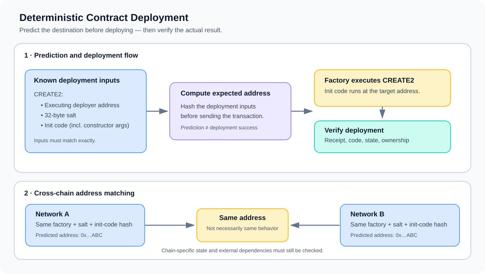

# Deterministic Contract Deployment

> **Stage:** 04 — Smart Contract Architecture  
> **Priority:** 1  
> **Status:** Reviewed  
> **Last reviewed:** 2026-10-17

## 1. Overview

**Deterministic contract deployment** means arranging contract creation so the destination address can be predicted from known inputs before deployment. Instead of treating the deployed address as an unknown result that must be read from a transaction receipt, an application can calculate the expected address in advance and use it in configuration, signatures, off-chain messages, or cross-contract planning.

On Ethereum-compatible EVM networks, there are two important address-creation mechanisms:

- **`CREATE`:** the new address is derived from the creator's address and its creation nonce. The address is deterministic when those inputs and the creation sequence are known, but it is sensitive to the creator's nonce history.
- **`CREATE2`:** introduced by [EIP-1014](https://eips.ethereum.org/EIPS/eip-1014), it derives the new address from the address of the account executing `CREATE2`, a 32-byte salt, and the hash of the contract's initialization code. It does not use the creator's nonce.

In modern EVM development, “deterministic deployment” often refers specifically to using `CREATE2`, deployment factories, or a repeatable deployment scheme to make addresses predictable—sometimes across multiple chains. The exact mechanism matters: determinism is a property of the inputs and deployment process, not a guarantee that any deployment will succeed.

## 2. Why It Matters to a Developer

Being able to predict an address before code is deployed can simplify architecture and coordination. For example, an application may need a contract address before a user completes an interaction, or multiple networks may need corresponding contracts at consistent addresses.

Typical use cases include:

- **Factory patterns:** a factory deploys many instances at predictable addresses, often one per user, market, vault, or account.
- **Counterfactual interactions:** software can refer to an address before the contract exists and deploy the contract only when it is needed.
- **Cross-chain deployments:** a project can target the same address on several EVM networks when the relevant deployment inputs and deployer address match.
- **Address-based integrations:** frontends and other contracts can calculate an expected address before a deployment transaction is sent.
- **Deployment coordination:** off-chain services, signatures, and configuration can be prepared around a known address instead of waiting for deployment to finish.

Predictability can improve coordination, but it does not establish that the expected address contains code, that the code is trustworthy, or that it behaves identically on every network.

## 3. The Inputs That Determine an Address

For deterministic deployment, identify exactly which values determine the resulting address. With `CREATE2`, the core inputs are:

1. **Deployer address:** the address of the account that executes the `CREATE2` opcode. When a factory performs the deployment, this is the factory's address—not automatically the externally owned account that called the factory.
2. **Salt:** a caller- or application-chosen 32-byte value supplied to `CREATE2`. Factories often derive salts from an application identifier, user address, or other deployment-specific data.
3. **Initialization code hash:** the Keccak-256 hash of the init code used to create the contract. For Solidity contracts, this includes the creation bytecode and, where applicable, ABI-encoded constructor arguments.

The address is computed before init code runs. That means the predicted address depends on the initialization code bytes, but not directly on the runtime code that the constructor will eventually return. A constructor can inspect external state, so identical init code does not necessarily guarantee identical resulting runtime behavior across networks or at different times.

The `CREATE2` address formula is described in detail in [EIP-1014](https://eips.ethereum.org/EIPS/eip-1014). A separate concept, CREATE2 Address Derivation, focuses on the exact byte layout and address calculation.

## 4. A Typical Deterministic Deployment Flow

A common factory-based flow looks like this:

1. **Choose deployment inputs.** Select the factory, salt, contract creation bytecode, and constructor arguments.
2. **Calculate the expected address.** Hash the appropriate inputs using the selected creation mechanism.
3. **Check deployment assumptions.** Confirm that the intended factory is present at the expected address, the init code is correct, and the destination is available.
4. **Deploy through the factory.** The factory executes `CREATE2` with the chosen salt and init code.
5. **Verify the result.** Compare the deployed address with the prediction, then inspect code and initialization state as appropriate.
6. **Repeat on other networks, if required.** Reuse the intended deployment inputs and ensure the factory address matches on each target network.

If any input changes, the predicted address can change. With `CREATE2`, a different deployer, salt, or init code hash produces a different derived address. The factory itself must therefore be coordinated when a project wants the same address on multiple chains.

## 5. Same Address Does Not Mean Same Deployment Context

The `CREATE2` formula does **not** include a chain ID. So if the deployer address, salt, and init code hash are identical on two EVM networks, the formula returns the same address on both. That is useful, but it is not a guarantee of identical contract behavior.

Check these conditions before relying on cross-chain address consistency:

- The factory is deployed at the same address on each network.
- The creation bytecode and constructor arguments are byte-for-byte identical.
- Linked library addresses or other embedded deployment values have not changed the creation bytecode.
- Constructor logic does not produce network-dependent state or runtime behavior based on chain-specific state, block properties, or external contracts.
- The target address is available for deployment on every network.
- Each network's configuration and the code actually deployed at the address have been verified independently.

A different compiler version, compiler setting, linked library, or constructor argument can change the init-code hash and therefore the `CREATE2` address. Even when the address is identical, network-specific external dependencies can make the contracts behave differently.

## 6. Address Prediction Is Not Authorization

A predicted address is public information, not a reserved address or a permission system. Anyone who knows the deployer, salt, and init code can calculate the expected result.

This creates a practical factory-design concern: if a deployment must be initiated by a particular user or establish a specific owner, the factory must enforce those requirements. A permissionless attacker may attempt to deploy first using known inputs; whether that is harmful depends on how the factory, salt, constructor, and initialization logic are designed.

Good patterns include:

- bind user-specific deployment salts to an authenticated user or application identifier;
- validate who is allowed to request a deployment;
- ensure ownership and initialization parameters cannot be substituted by an earlier caller;
- handle repeat requests explicitly instead of treating every deployment failure as an unexplained error;
- verify the resulting code and critical configuration after deployment.

The salt is useful for separating deployments, but it does not itself provide secrecy or authorization. If a factory is permissionless by design, document what happens when another party deploys the expected instance first.

## 7. Failure Conditions and Operational Checks

A deterministic address calculation only predicts a destination. Creation can still fail. Common reasons include:

- insufficient gas or a failed init-code execution;
- a constructor revert or invalid deployment parameters;
- insufficient balance when the new contract must receive value;
- a destination-address collision, such as an account that already has nonzero nonce or nonempty code under the relevant EVM rules;
- invalid or empty init code where the factory or helper rejects it;
- incorrect assumptions about the factory address, salt, bytecode, or constructor arguments.

Do not consider a deployment successful solely because the address was calculated correctly. Check the transaction result and inspect the destination. For security-sensitive applications, verify the runtime code hash, initialization state, ownership, and external dependencies expected by the deployment plan.

Also distinguish a **deterministic address** from a **deterministic deployment process**. Repeatable tooling, deployment inputs, factory addresses, and verification steps are required if the whole process—not just the address formula—must be reproducible.

## 8. CREATE vs. CREATE2

| Property | `CREATE` | `CREATE2` |
|---|---|---|
| Main address inputs | Creator address and creator nonce | Executing deployer address, salt, and init-code hash |
| Uses creator nonce in address derivation | Yes | No |
| Can predict address before deployment | Yes, if the required nonce and encoding are known | Yes, from the deployment inputs |
| Sensitive to prior creations by the same creator | Yes, because the nonce changes | Not through the deployer's nonce |
| Useful for repeatable address planning | Possible, but nonce sequencing matters | A primary design goal |

Both mechanisms can be deterministic when their inputs are known. The key difference is which inputs determine the address and how easy it is to keep those inputs stable across independent deployment sequences.

## 9. Developer Review Checklist

- [ ] Identify whether deployment uses `CREATE` or `CREATE2`.
- [ ] Identify the account that actually executes the creation opcode.
- [ ] Record the exact init code, constructor arguments, and salt where applicable.
- [ ] Confirm the factory address on each target network.
- [ ] Check whether constructor behavior depends on chain-specific or external state.
- [ ] Ensure the factory enforces intended authorization, ownership, and initialization.
- [ ] Consider address collisions, failed deployments, and repeat requests.
- [ ] Verify deployed code and critical state rather than relying on the predicted address alone.
- [ ] For cross-chain deployment, verify each network independently even when addresses match.

## 10. Key Takeaways

- Deterministic contract deployment makes a contract address predictable from known creation inputs.
- `CREATE` derives the address from the creator and nonce; `CREATE2` uses the executing deployer, salt, and init-code hash.
- A common use case is deploying corresponding contracts to the same address across chains, provided the relevant inputs—including the deployer address—match.
- The `CREATE2` address formula does not include chain ID, but identical addresses do not guarantee identical runtime behavior or state.
- Prediction does not reserve the address or authorize a deployment. Factories still need correct access control, initialization, collision handling, and verification.
- The companion article, [CREATE2 Address Derivation](17-create2-address-derivation.md), explains the exact `CREATE2` byte-level address formula and calculation.

## References

1. **[EIP-1014 — Skinny CREATE2](https://eips.ethereum.org/EIPS/eip-1014)** — specification, address formula, motivation, init-code hashing, and creation collisions.
2. **[Solidity documentation — Salted contract creations / CREATE2](https://docs.soliditylang.org/en/latest/control-structures.html#salted-contract-creations-create2)** — how Solidity uses salts and init code to create contracts.
3. **[Ethereum.org — Ethereum accounts](https://ethereum.org/en/developers/docs/accounts/)** — overview of contract address creation with `CREATE` and `CREATE2`.
4. **[OpenZeppelin Contracts — Create2](https://docs.openzeppelin.com/contracts/5.x/api/utils#Create2)** — helper utilities for predicting and deploying contracts using `CREATE2`.
5. **[CREATE2 Address Derivation](17-create2-address-derivation.md)** — the companion article focused on the exact formula and address calculation.
