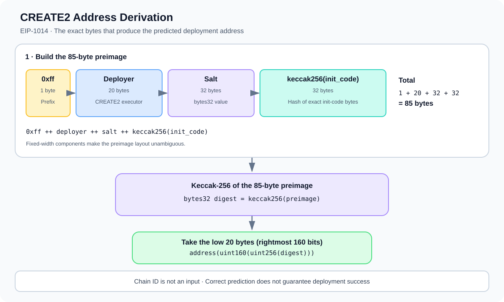

# CREATE2 Address Derivation: The Exact EVM Formula

> **Stage:** 04 — Smart Contract Architecture  
> **Priority:** 1  
> **Status:** Reviewed  
> **Last reviewed:** 2026-10-17

## 1. Overview

**CREATE2 address derivation** is the deterministic formula introduced by [EIP-1014](https://eips.ethereum.org/EIPS/eip-1014). Unlike `CREATE`, whose address depends on the creator's nonce, `CREATE2` derives a contract address from four fixed components: a one-byte prefix, the address executing `CREATE2`, a 32-byte salt, and the hash of the contract's initialization code.

The formula allows a factory, wallet, or off-chain tool to calculate a deployment address before the contract exists. The prediction is exact when all inputs are exact; the formula does not guarantee that deployment will succeed or that the address has not already been occupied.



## 2. The Exact Formula

EIP-1014 defines the address as the **last 20 bytes** of the Keccak-256 hash of the concatenation below:

```text
address = low20(
    keccak256(
        0xff
        ++ deployer
        ++ salt
        ++ keccak256(init_code)
    )
)
```

Where:

- `0xff` is a single byte used as a domain-separation prefix.
- `deployer` is the 20-byte address of the account that executes the `CREATE2` opcode.
- `salt` is exactly 32 bytes (`bytes32`).
- `init_code` is the exact initialization-code byte sequence supplied for contract creation.
- `keccak256(init_code)` is a 32-byte hash of those init-code bytes.
- `low20(...)` means taking the rightmost 20 bytes of the final 32-byte hash.

The components before the final hash have fixed lengths:

- Prefix: 1 byte
- Deployer address: 20 bytes
- Salt: 32 bytes
- Init-code hash: 32 bytes

The preimage is therefore **85 bytes long**. The final hash is 32 bytes; the resulting Ethereum-style address uses its rightmost 20 bytes (160 bits).

## 3. Why Hash the Init Code?

The `CREATE2` formula includes the hash of **init code**, not a hash of the eventual runtime bytecode.

For a Solidity contract, init code normally consists of the compiled creation bytecode plus ABI-encoded constructor arguments. The EVM executes this init code during deployment; the bytes it returns become the deployed runtime code.

This distinction matters because any change to the exact init-code bytes changes `keccak256(init_code)`, which changes the derived address. Differences may come from:

- a different compiler output or compiler configuration;
- different constructor arguments;
- different linked library addresses embedded in creation bytecode;
- a change to the contract or its creation code;
- different encoding of the appended constructor arguments.

Two contracts with the same Solidity contract name do not necessarily have the same init-code hash. The compiled bytes and constructor arguments—not the human-readable name—are what matter.

## 4. The Deployer Is the Account Executing CREATE2

A frequent source of bugs is using the wrong deployer address.

If an externally owned account calls a factory, and the **factory** executes `CREATE2`, then the factory address is the deployer input in the formula. It is not automatically the caller's EOA address.

This is important for prediction and for matching addresses across chains: the factory must be at the intended address on each network. If the actual `CREATE2`-executing address changes, the predicted contract address changes too.

When computing the address inside the factory, `address(this)` is commonly the correct deployer value, provided that the same contract context is the one that will execute the `CREATE2` operation. External prediction tools must supply the factory address explicitly.

## 5. Solidity Example: Predict an Address

The following example illustrates the calculation for a factory deploying `Example` with a constructor argument. It shows the formula, not a complete production-ready factory.

```solidity
// SPDX-License-Identifier: MIT
pragma solidity ^0.8.20;

contract Example {
    address public owner;

    constructor(address owner_) {
        owner = owner_;
    }
}

contract ExampleFactory {
    function predictAddress(
        bytes32 salt,
        address owner_
    ) external view returns (address predicted) {
        bytes memory initCode = abi.encodePacked(
            type(Example).creationCode,
            abi.encode(owner_)
        );

        bytes32 digest = keccak256(
            abi.encodePacked(
                bytes1(0xff),
                address(this),
                salt,
                keccak256(initCode)
            )
        );

        predicted = address(uint160(uint256(digest)));
    }

    function deploy(
        bytes32 salt,
        address owner_
    ) external returns (address deployed) {
        Example instance = new Example{salt: salt}(owner_);
        return address(instance);
    }
}
```

In this example:

1. `type(Example).creationCode` obtains the compiled creation bytecode.
2. `abi.encode(owner_)` produces the ABI-encoded constructor argument.
3. `abi.encodePacked` concatenates the bytecode and constructor arguments into the init code supplied by Solidity for deployment.
4. `keccak256(initCode)` computes the init-code hash used by EIP-1014.
5. The outer hash uses `0xff`, the factory's address, the salt, and the init-code hash.
6. Converting the digest to `uint160` keeps the low 160 bits, which are converted to an address.

Solidity's `new Example{salt: salt}(owner_)` uses the same factory context, salt, creation code, and constructor argument. The prediction matches when the init-code bytes and deployer context match exactly.

This snippet is explanatory and has **not** been compiled or executed as part of this article. In a real project, compile and test the factory, prediction method, deployment path, and error behavior in the project's toolchain.

## 6. Salt Selection and Unique Instances

The salt is a caller- or application-chosen `bytes32` value. It lets a factory derive different addresses from the same deployer and init code by choosing different salts.

A project might derive a salt from a user address, an application ID, or a market identifier:

```solidity
bytes32 salt = keccak256(
    abi.encode(user, applicationId)
);
```

Using `abi.encode` makes the field boundaries explicit for this example. Salt construction is an application design decision; the EVM does not require the salt to follow any particular semantic scheme.

A salt is not a secret, password, or access-control mechanism. If a factory's deployment process is permissionless, an outsider may be able to calculate the same address and attempt the deployment first. Where first deployment or initialization order matters, the factory must explicitly enforce the intended rules.

## 7. What Changes the Predicted Address?

For a fixed chain's EVM address format, changing any one of the formula inputs changes the hash input and therefore normally produces a different address:

- **Different deployer:** deploying from a different factory yields a different result.
- **Different salt:** using another `bytes32` salt yields a different result.
- **Different init code:** changing the creation bytecode or constructor arguments changes the init-code hash.
- **Different encoding:** encoding constructor values differently changes the bytes and therefore the hash.

`CREATE2` does **not** include the chain ID in its address formula. With the same deployer address, salt, and init-code hash, the formula returns the same address across EVM networks. However, this does not guarantee identical behavior across those networks: constructors may observe different chain state or external contracts, and the destination may already be occupied on one network.

## 8. Prediction Versus Successful Deployment

Address derivation is just a calculation. The actual `CREATE2` operation can fail, including when:

- the init code reverts or fails to return valid runtime code;
- the deployment runs out of gas;
- the target address violates the EVM's contract-creation collision rules (including an existing nonzero account nonce or nonempty code);
- the deploying contract's logic rejects the request or supplies different inputs from those used for prediction.

After deployment, verify the actual address and, where relevant, inspect the runtime code, ownership, initialized state, and external dependencies. Do not treat a calculated address as proof that a contract exists there or that its code is trusted.

## 9. Common Mistakes

1. **Using runtime code instead of init code.** The formula hashes the creation/init-code bytes that are supplied to the opcode.
2. **Using the wrong deployer.** When a factory executes `CREATE2`, use the factory address—not simply the transaction sender.
3. **Omitting constructor arguments.** For Solidity contracts, constructor arguments are appended to the creation bytecode in the init code.
4. **Hashing the salt twice or not at all.** The formula accepts a 32-byte salt value directly; it does not automatically hash a salt supplied by the caller.
5. **Taking the wrong bytes.** The address is the rightmost (low) 20 bytes of the final 32-byte hash.
6. **Changing compiler output or linked libraries unknowingly.** These can change creation bytecode and its hash.
7. **Assuming the address is reserved.** Prediction does not reserve the destination or grant exclusive rights to deploy there.
8. **Assuming same address means same behavior.** Chain ID is absent from the formula, but chain-specific state and dependencies can still differ.
9. **Assuming deployment success from prediction alone.** The creation can still revert or collide with an existing account.

## 10. Developer Review Checklist

- [ ] Confirm the exact account that executes `CREATE2`.
- [ ] Record the salt as a 32-byte value.
- [ ] Reconstruct the exact init code, including constructor arguments.
- [ ] Hash init code before constructing the outer hash.
- [ ] Prefix the packed data with exactly one byte `0xff`.
- [ ] Verify the preimage has the intended field lengths and order.
- [ ] Take the rightmost 20 bytes of the final Keccak-256 digest.
- [ ] Compare the predicted address with the address returned by actual deployment.
- [ ] Test repeat deployment, invalid init code, revert behavior, and address collisions.
- [ ] For cross-chain use, verify factory addresses, bytecode, constructor inputs, and deployed code independently.

## 11. Key Takeaways

- EIP-1014 defines the address as the low 20 bytes of `keccak256(0xff ++ deployer ++ salt ++ keccak256(init_code))`.
- The preimage is 85 bytes: 1-byte prefix, 20-byte deployer, 32-byte salt, and 32-byte init-code hash.
- The deployer is the address that executes `CREATE2`; with a factory-based deployment, this is normally the factory.
- Init code includes the exact creation bytecode and, for Solidity contracts, the appended ABI-encoded constructor arguments.
- Chain ID is not part of the formula, but equal addresses across networks do not prove equal code, state, or behavior.
- A predicted address does not mean a successful deployment or an authorized deployment.
- For the broader use cases, factory patterns, and cross-chain considerations, see [Deterministic Contract Deployment](16-deterministic-contract-deployment.md).

## References

1. **[EIP-1014 — Skinny CREATE2](https://eips.ethereum.org/EIPS/eip-1014)** — the normative CREATE2 address formula, input encoding, and deployment collision behavior.
2. **[Solidity documentation — Salted contract creations (CREATE2)](https://docs.soliditylang.org/en/latest/control-structures.html#salted-contract-creations-create2)** — Solidity syntax and examples for salted deployment.
3. **[Ethereum Yellow Paper](https://ethereum.github.io/yellowpaper/paper.pdf)** — formal background on EVM execution and contract creation.
4. **[Deterministic Contract Deployment](16-deterministic-contract-deployment.md)** — overview of use cases, factory deployment, and cross-chain address planning.
