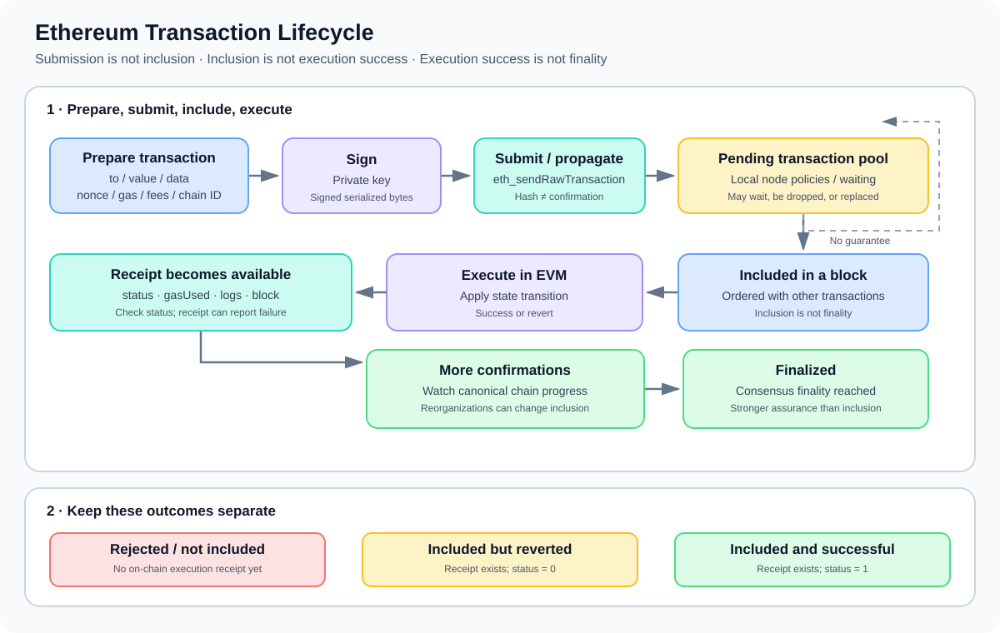

# Transaction Lifecycle: From Signing to Finality

> **Stage:** 05 — Advanced Transactions and Gas  
> **Priority:** 2  
> **Status:** Reviewed  
> **Last reviewed:** 2026-10-17

## 1. Overview

An Ethereum **transaction lifecycle** is the sequence of steps through which a transaction is prepared, signed, submitted to the network, considered for inclusion in a block, executed, recorded in a receipt, and eventually gains stronger confirmation as the chain advances.

A transaction is not simply a function call. It is a signed request that can change blockchain state. A normal user transaction is authorized by an externally owned account (EOA); when it calls a smart contract, that contract may in turn call other contracts during EVM execution. Contract accounts do not independently originate ordinary Ethereum transactions, although protocol features such as EIP-7702 add new capabilities to EOA-signed transactions.

The lifecycle is easier to understand when separated into these phases:

1. **Prepare:** choose the destination or contract-creation operation, calldata, value, nonce, chain ID, and fee/gas parameters.
2. **Sign:** encode the transaction according to its transaction type and sign it with the sender's private key.
3. **Submit and propagate:** send the signed transaction to an execution client, commonly through JSON-RPC, and let it propagate to peers.
4. **Pending:** nodes may retain the transaction in a local transaction pool while it waits for inclusion. Pool policies and propagation are not globally identical.
5. **Include and execute:** a block producer includes the transaction in an ordered block; execution clients validate it and execute it against the state produced by earlier transactions in that block.
6. **Record the result:** a transaction receipt reports information such as its block, gas used, logs, and execution status.
7. **Confirm and finalize:** subsequent blocks and consensus finality make the transaction's inclusion progressively more secure.



A transaction may fail before inclusion, remain pending for a long time, be dropped or replaced from a node's pool, or be included in a block even though its EVM execution reverts. These are different outcomes and must not be confused with one another.

## 2. Preparing a Transaction

A wallet or application first assembles the transaction fields required for the intended operation. Depending on the transaction type, these commonly include:

- **Destination (`to`):** an account or contract address. Contract creation uses a transaction without a normal destination address.
- **Value:** the amount of ETH to transfer with the transaction, if any.
- **Input data (`data`):** empty for a plain ETH transfer in the simplest case, or encoded function-call data for a contract interaction. For contract creation, it contains initialization code and any appended constructor arguments.
- **Nonce:** the sender's sequence number for the transaction. It helps order transactions from that account and prevents replaying the same sender transaction sequence.
- **Gas limit:** the maximum gas the sender allows the execution to consume.
- **Fee fields:** the fee parameters required by the transaction type. For a common EIP-1559 type-2 transaction, these include `maxFeePerGas` and `maxPriorityFeePerGas`.
- **Chain ID and transaction type:** identify the intended network domain and the envelope/format rules that apply.

The wallet may query an execution client for the pending nonce, estimate gas, or retrieve fee information. A gas estimate is only an estimate under the state and assumptions used for the simulation; the actual transaction may encounter different state or execution paths by the time it is included.

For a contract call, a front end commonly ABI-encodes the function selector and arguments into `data`. The transaction does not contain a special field that says “call this Solidity function”; the EVM receives bytes, and contract code interprets those bytes according to its dispatcher and application logic.

### Simulation is not submission

An application may use `eth_call` to simulate a message call without creating a transaction on-chain, and `eth_estimateGas` to estimate a gas limit. Neither method submits a signed transaction or guarantees that a later transaction will succeed. State can change, execution conditions may differ, and simulation does not reserve a place in a block.

## 3. Signing and Transaction Hash

Once prepared, the transaction is signed by the sender's wallet. The signature authorizes the transaction's encoded contents. The signed form contains the signature data required by the corresponding transaction type and can be serialized into bytes for submission.

In a common externally signed workflow:

1. The application constructs the unsigned transaction fields.
2. The wallet signs the transaction using the sender's private key.
3. The signed transaction is serialized in the format for its transaction type.
4. The application submits the serialized transaction to an execution client.

For a submitted signed transaction, the transaction hash is the hash identifier of the encoded signed transaction. Wallets can calculate and display the expected hash as soon as they have the signed bytes; the hash is not proof that the transaction has reached peers, entered a block, or succeeded.

**Protect the signing key.** A wallet should show the meaningful transaction details before authorization. Once signed, the transaction's destination, value, calldata, and other signed fields cannot be edited in place; producing a different transaction requires a new signature.

## 4. Submission and Network Propagation

A common dApp workflow submits a serialized signed transaction with the JSON-RPC method `eth_sendRawTransaction`. The execution client checks the request and may return the transaction hash.

That response should be interpreted carefully: it confirms that the RPC endpoint returned a hash for the submitted transaction. It does **not** guarantee inclusion, successful execution, propagation to every peer, or finality.

After submission, clients may propagate the transaction to peers. Each node applies local validation and transaction-pool policies before retaining or relaying it. The transaction pool is an operational mechanism used by clients; it is not a single globally identical pool that every network participant sees in precisely the same order.

A transaction might not be retained or propagated if, for example, it has an invalid signature, a nonce that is already too low, insufficient balance, fee settings that do not meet local policy, or another validity/policy issue. A transaction with a future nonce may be queued by some clients until earlier nonces are available, while other client or provider policies may differ. Exact RPC errors and pool behavior can vary by client and endpoint.

A useful distinction:

- **Submission:** an application sends the signed bytes to an RPC endpoint.
- **Acceptance by one node:** that endpoint accepts or recognizes the transaction according to its checks.
- **Propagation:** other nodes receive and may retain or relay it.
- **Inclusion:** a block contains the transaction.
- **Execution success:** EVM execution completes without a revert.
- **Finality:** consensus has finalized the block containing the transaction.

These are separate milestones.

## 5. Pending Transactions and Inclusion

Before inclusion, an application may observe the transaction as pending. How long it remains pending depends on such factors as fee competitiveness, nonce ordering, client pool policies, network conditions, and block-space demand.

A transaction usually cannot be included before earlier transactions from the same sender's nonce sequence have been resolved according to the protocol's ordering rules. If the account has already used a nonce on-chain, a new transaction with that same nonce may be intended to replace a pending transaction rather than create a second independent position in the sender's sequence. Replacement policies vary by client and provider.

A block producer chooses transactions for a candidate block, subject to protocol rules and the block's resource limits. When a transaction is included, its position in the block matters: each transaction executes against the state resulting from all prior transactions in that block.

**Inclusion is not the same as execution success.** A valid transaction can be included, consume gas, and finish with a revert status. The block records the transaction and its outcome even though the application's intended state change did not happen.

## 6. Execution: What the EVM Does

When a transaction is executed, Ethereum applies its effects to the state transition for the block. Depending on the transaction, execution can include:

- transferring ETH between accounts;
- creating a contract by running its initialization code;
- entering contract code using the transaction's input data;
- performing internal EVM operations and making further message calls;
- emitting logs when contract execution reaches event-emission operations;
- returning successfully or reverting its execution.

For a contract interaction, the transaction's outer destination is usually the contract address. The contract's dispatcher interprets the calldata, then the selected function and any nested calls execute within the EVM. The transaction can affect multiple accounts or contracts, even though it has a single top-level sender and destination field.

### What if execution reverts?

A revert means the EVM execution of the transaction did not complete successfully. State changes from the reverted execution are rolled back, while the transaction's inclusion and gas accounting still matter. In particular, the sender still pays for the gas consumed by the failed transaction under the applicable fee rules, and the sender's nonce is consumed as part of processing the included transaction.

Do not equate a revert with “the network rejected the transaction before it entered a block.” An invalid transaction rejected before inclusion and an included transaction with failed execution are different cases.

## 7. Receipt and Result Inspection

After a transaction has been included and processed, the execution client can provide a receipt through `eth_getTransactionReceipt`. A receipt is not generally available for a still-pending transaction; an endpoint commonly returns `null` until it has a receipt to report.

Useful receipt fields include:

- `transactionHash`: the transaction's identifier.
- `blockHash` and `blockNumber`: the block containing the transaction according to that receipt.
- `transactionIndex`: the transaction's position in the block.
- `status`: typically `1` for successful execution and `0` for failed execution on post-Byzantium Ethereum.
- `gasUsed`: gas charged for that transaction's execution.
- `effectiveGasPrice`: the effective gas price paid, where reported.
- `logs`: event logs produced by the transaction that were not rolled back by a revert.
- `contractAddress`: the deployed address for a successful contract-creation transaction; otherwise typically `null`.

The receipt is the main starting point for determining whether execution succeeded and where the transaction was included. A transaction hash alone cannot tell you whether it succeeded.

For an application, a robust flow usually watches for the receipt, checks the execution status, decodes relevant event logs if expected, and then waits for the application's chosen confirmation/finality policy.

## 8. Confirmations, Reorganizations, and Finality

A transaction being included in a block does not immediately mean that block is finalized. New blocks build on earlier blocks, and a short-lived chain reorganization can replace a previously observed block with a different canonical history. During such a change, an application must not assume the original inclusion will remain canonical forever.

Developers often distinguish these milestones:

- **Included / mined:** the transaction appears in a particular block.
- **Confirmations:** additional canonical blocks have been built on top of the containing block. The exact confirmation count convention can differ between tools.
- **Safe:** a block identified by the client/consensus view as having stronger safety assurance than the current head but not necessarily finalized.
- **Finalized:** the consensus protocol has finalized the block under Ethereum's proof-of-stake finality mechanism.

An application should select a policy appropriate for the risk and value of the action. Showing a low-risk UI update may use an inclusion receipt; high-value settlement may wait for stronger confirmation or finalized status. The appropriate threshold depends on network, bridge/protocol design, and the cost of acting on a transaction that is later reorganized.

Finality greatly reduces reorganization risk but should not be described as mathematical impossibility under every conceivable failure: reversing finalized Ethereum history would require a severe consensus-level failure or attack with major economic consequences.

## 9. Lifecycle Monitoring with JSON-RPC

The following JSON-RPC methods are commonly useful when investigating the lifecycle:

- `eth_estimateGas`: estimate the gas required for a message call or transaction under the node's simulation conditions.
- `eth_sendRawTransaction`: submit signed transaction bytes.
- `eth_getTransactionByHash`: inspect transaction details when the endpoint knows the transaction.
- `eth_getTransactionReceipt`: retrieve the receipt after inclusion and processing.
- `eth_getBlockByNumber`: inspect blocks and use supported block tags such as `latest`, `safe`, or `finalized` where implemented.
- `eth_getTransactionCount`: query an account's transaction count using an appropriate block tag; `pending` can be useful for a node's view of pending transactions, though providers may differ.

Example request for a receipt:

```json
{
  "jsonrpc": "2.0",
  "method": "eth_getTransactionReceipt",
  "params": ["0xYOUR_TRANSACTION_HASH"],
  "id": 1
}
```

Before inclusion, the result may be `null`. After processing, inspect the returned `status`, block reference, gas fields, and logs. Replace the placeholder with an actual 32-byte transaction hash when making a real request.

RPC data is supplied by the chosen endpoint. For critical operations, consider the trust model of the RPC provider, cross-check important results when appropriate, and account for reorganization/finality semantics instead of treating every returned field as an independent consensus proof.

## 10. Common Mistakes and Security Considerations

1. **Treating the transaction hash as proof of success.** It identifies signed transaction bytes; success must be checked from execution results.
2. **Treating RPC acceptance as inclusion.** An RPC response does not guarantee propagation, block inclusion, or finality.
3. **Confusing simulation with execution.** `eth_call` and gas estimation do not reserve state or guarantee that a later transaction follows the same path.
4. **Ignoring nonce ordering.** A pending transaction with a lower nonce can block later transactions from the same sender from being included in sequence.
5. **Setting an unsuitable gas limit or fee.** An inadequate gas limit can cause execution failure; fee settings may delay or prevent propagation/inclusion under node policies.
6. **Assuming every node has the same mempool.** Transaction-pool content and replacement policies are local and can differ.
7. **Calling a reverted included transaction “not mined.”** An included failed transaction still has a block position and receipt.
8. **Ignoring receipt status.** A receipt can exist for an execution failure; applications must check `status`.
9. **Ignoring reorganization risk.** A previously observed inclusion may cease to be canonical before finality.
10. **Assuming event logs survive a revert.** Logs emitted during a reverted execution are rolled back and are not part of the successful result.
11. **Waiting forever for a receipt without a policy.** Handle pending, dropped, replaced, expired-by-provider, and failed cases explicitly in application UX.
12. **Trusting one RPC endpoint blindly.** RPC views can lag, return incomplete transaction-pool data, or differ during reorganization; use a verification strategy appropriate to the value at risk.
13. **Confusing ETH transfer and contract interaction.** Contract calls run code and can revert; the same top-level transaction envelope can initiate a more complex state transition.
14. **Assuming confirmation count equals consensus finality.** A fixed number of blocks and a protocol's finalized checkpoint are different concepts.

## 11. Developer Review Checklist

- [ ] Identify the transaction type and required signed fields.
- [ ] Check the intended chain ID, sender, destination, value, calldata, nonce, gas limit, and fee parameters.
- [ ] Understand whether the application used `eth_call` or `eth_estimateGas` before submission and what those methods do not guarantee.
- [ ] Distinguish local RPC submission from network propagation and block inclusion.
- [ ] Track the transaction by hash and handle a missing receipt while it is pending.
- [ ] Check the receipt's status rather than assuming inclusion means success.
- [ ] Inspect gas used, effective gas price, and logs when relevant.
- [ ] Handle reverts, replacement transactions, nonce gaps, and delayed inclusion explicitly.
- [ ] Decide whether the application needs inclusion, additional confirmations, safe status, or finality before acting on the result.
- [ ] For important operations, consider canonical-chain changes and the trust assumptions of the RPC provider.

## 12. Key Takeaways

- The lifecycle runs from preparation and signing to submission, pending status, block inclusion, execution, receipt, and eventually confirmation/finality.
- A transaction hash identifies signed transaction data; it does not prove that the transaction has been included or succeeded.
- Transaction pools are local client mechanisms, not a single globally identical mempool.
- EVM execution can succeed or revert. An included reverted transaction still consumes gas and produces a receipt with failure status.
- A receipt contains the main execution result, including status, gas usage, block details, and logs.
- Inclusion and finality are different; applications should choose a confirmation policy appropriate to their risk.
- JSON-RPC methods help observe the lifecycle, but the endpoint's view and the transaction's consensus status are not the same thing.

## References

1. **[Ethereum.org — Transactions](https://ethereum.org/developers/docs/transactions/)** — transaction fields, broadcast, transaction pool, inclusion, execution, and the lifecycle overview.
2. **[Ethereum Execution APIs — `eth_sendRawTransaction`](https://github.com/ethereum/execution-apis/blob/main/docs-api/api/methods/eth_sendRawTransaction.mdx)** — submission of signed transaction bytes through the execution API.
3. **[Ethereum.org — JSON-RPC API](https://ethereum.org/developers/docs/apis/json-rpc/)** — standard RPC methods including `eth_sendRawTransaction`, `eth_getTransactionByHash`, `eth_getTransactionReceipt`, `eth_call`, and `eth_estimateGas`.
4. **[Ethereum.org — Blocks](https://ethereum.org/developers/docs/blocks/)** — transaction ordering within blocks and block production in Ethereum's proof-of-stake system.
5. **[EIP-1559 — Fee market change for ETH 1.0 chain](https://eips.ethereum.org/EIPS/eip-1559)** — type-2 transaction envelope and dynamic fee fields.
6. **[Ethereum Execution API specification](https://github.com/ethereum/execution-apis)** — current interface specifications for execution-layer RPC methods.
7. **Transaction Nonce** — companion concept in this stage covering sender sequence numbers in more detail.
8. **Transaction Receipts** — companion concept in this stage for receipt fields and result inspection.
