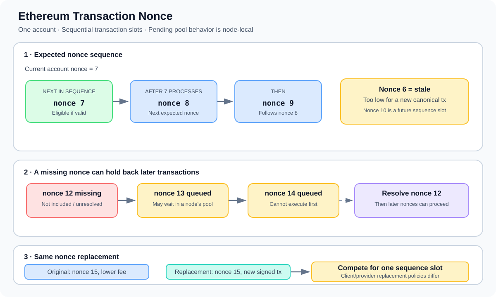

# Transaction Nonce: Ordering Transactions from an Account

> **Stage:** 05 — Advanced Transactions and Gas  
> **Priority:** 2  
> **Status:** Reviewed  
> **Last reviewed:** 2026-10-17

## 1. Overview

A **transaction nonce** is the sequence number included in a transaction sent from an Ethereum account. For a normal externally owned account (EOA), the transaction nonce orders that account's transactions and prevents the same sender-and-nonce slot from being consumed twice on the canonical chain.

The account's current nonce is part of the state. A valid transaction from that account must use the nonce expected by the protocol at the point it is processed. Once an included transaction is processed, its nonce is consumed even if its EVM execution reverts. A transaction rejected before inclusion does not consume the account's on-chain nonce.

The nonce is important both to protocol correctness and to application UX. If an application submits several transactions from one account, the sequence matters: later nonces cannot simply jump ahead of an earlier missing nonce. In the local transaction pool, nodes may queue transactions with future nonces, but exact pool limits and replacement rules are client- and provider-dependent.

This article focuses on the transaction nonce used by the sender. It is distinct from application-level nonce values stored in smart contracts, and it is also distinct from the authorization nonce used by EIP-7702 authorization tuples.



## 2. How a Transaction Nonce Works

Imagine the canonical account state currently expects nonce `7`. A transaction with nonce `7` is the next transaction in the account's sequence. Once that transaction is processed, the account's expected nonce advances to `8`.

| Transaction nonce | Meaning when the account expects nonce 7 |
|---:|---|
| `7` | The next transaction in sequence; eligible if other validity conditions are satisfied |
| `8` | A future transaction; it cannot execute before nonce 7 has been resolved on the canonical chain |
| `6` | A stale nonce; it is too low for a new transaction from this account |

Nonce validity is only one part of transaction validity. Having the expected nonce does not guarantee that a transaction has sufficient balance, acceptable fee fields, valid signature, enough gas, or successful contract execution.

For a normal EOA-signed transaction, the nonce is included in the signed transaction data. Changing the nonce changes the signed message, so the wallet must sign the transaction again. A transaction cannot be edited in place after signing.

## 3. Why Nonces Must Be Sequential

The account nonce establishes a sequence for transactions from the same account. It does not establish a total order among transactions from different senders; block order and other protocol rules determine how transactions from different accounts interact.

Suppose an account wants to submit three transactions:

```text
Current account nonce: 12

Transaction A: nonce 12
Transaction B: nonce 13
Transaction C: nonce 14
```

These transactions may all be submitted before any is included, but their nonces indicate the intended order for that account. A client may keep nonce 13 and 14 transactions queued while nonce 12 is still missing or unresolved. Once the missing nonce is included and the sequence can advance, later transactions may become eligible for inclusion, subject to the node's policies and other validity checks.

If nonce 12 is never included, transactions 13 and 14 cannot simply be processed first on the canonical chain. The sender may need to resend, replace, or otherwise resolve the transaction at nonce 12. Do not assume every RPC provider retains every future-nonce transaction indefinitely.

## 4. Reading the Current Nonce with JSON-RPC

The common JSON-RPC method for reading an account's transaction count is `eth_getTransactionCount`. It accepts an address and a block parameter:

```json
{
  "jsonrpc": "2.0",
  "method": "eth_getTransactionCount",
  "params": [
    "0xYOUR_ACCOUNT_ADDRESS",
    "latest"
  ],
  "id": 1
}
```

The `latest` tag queries the account nonce in the latest block known to the node. A caller may also use `pending` to ask for the node's view of the nonce after accounting for transactions it currently treats as pending.

These views can differ:

- **`latest`:** nonce from the current latest canonical block known to the node.
- **`pending`:** a node-local view that may account for pending transactions it knows about; details can vary with the client's pool and provider implementation.

Neither tag gives a universally shared view of every pending transaction across the network. Different RPC providers can know about different pending transactions, and the view can change as transactions are included, replaced, dropped, or reorganized.

When building a wallet or backend that sends multiple transactions, nonce allocation needs coordination. Two processes independently reading the same pending nonce may both choose the same number. Applications may need a per-account transaction queue or another concurrency-control strategy.

## 5. What Happens When a Transaction Succeeds or Reverts?

The transaction nonce is consumed as part of processing an included valid transaction. The EVM execution result does not decide whether that nonce was used:

- **Included and successful:** the transaction's nonce is consumed, and its state changes persist according to execution.
- **Included but reverted:** the transaction's nonce is still consumed. Its reverted execution changes are rolled back, but the transaction's gas accounting and inclusion remain.
- **Rejected before inclusion:** the transaction does not change the canonical account nonce.
- **Pending but not included:** the transaction has not yet consumed the account nonce in canonical state; a node may nevertheless track it locally and use it when evaluating later transactions.

This distinction matters when debugging a failed transaction. After an included revert, submitting another transaction with the same old nonce is not simply a retry; the account's on-chain nonce has already advanced. The next ordinary transaction normally needs the next nonce.

## 6. Reusing a Nonce to Replace a Pending Transaction

A sender can create a different signed transaction with the same nonce as a pending transaction. This is commonly used to replace a stuck transaction, increase its fee, or submit a cancellation-style transaction.

A same-nonce transaction is not an edit of the original signed transaction. It has different signed contents and a different transaction hash. When the node accepts the replacement, it treats the new candidate as competing for that sender-and-nonce position.

Replacement is not a globally uniform protocol guarantee. Local clients and RPC providers apply policies, often requiring the replacement's fee fields to be sufficiently higher than the pending candidate's fee fields. The exact thresholds and the behavior of hosted providers can differ. A replacement being accepted by one provider does not ensure every peer will immediately replace its copy.

A replacement race also means that applications should not assume a transaction has been cancelled just because they submitted another transaction with the same nonce. The original or replacement may be included, depending on what reaches block production and remains valid.

A deeper discussion of same-nonce replacement is part of the separate **Transaction Replacement** topic later in this stage.

## 7. Nonce and Replay Protection

A transaction nonce prevents the same account sequence slot from being processed again on the same canonical chain after it has been consumed. If someone broadcasts the exact same signed transaction again, its nonce will normally be too low after the first copy has been processed.

However, **a nonce alone is not complete cross-chain replay protection**. Two separate chains can have the same account address and account nonce. If a signed transaction is valid in both domains, it may be replayable across them unless the transaction format or application provides appropriate domain separation.

Ethereum's chain-aware transaction signing rules are designed to separate transactions intended for different chains. EIP-155 introduced chain ID into the signing rules for legacy transactions, and typed transaction envelopes such as EIP-1559 include chain ID in their signed payload. Applications should still check the exact transaction type and signature domain in use instead of assuming that a nonce by itself binds a transaction to a network.

The broader topic of **Chain ID and Replay Protection** is covered separately in this stage.

## 8. Transaction Nonce vs. Other Nonces

“Nonce” is a general term for a value designed to be used in a sequence or only once. The meaning depends on the mechanism using it.

- **EOA transaction nonce:** orders ordinary transactions from the account and contributes to replay protection on that chain.
- **Contract-level nonce:** a value maintained by application code—for example, to prevent a signed order, permit, or request from being used repeatedly. It is not automatically the same as the EOA's transaction nonce.
- **CREATE creation nonce:** the creator account's nonce is used in the address derivation of a contract created with `CREATE`. This is related to account nonce state but serves a different purpose from understanding the nonce field of a transaction.
- **EIP-7702 authorization nonce:** an authorization tuple has its own nonce semantics. This is separate from the outer transaction's sender nonce and must not be treated as interchangeable with it.

For developers, the safe approach is to identify which account or data structure owns the nonce, what action consumes it, and which replay domain it protects.

## 9. Common Mistakes and Security Considerations

1. **Assuming a reverted transaction leaves the nonce unchanged.** An included reverted transaction still consumes the sender's transaction nonce.
2. **Using a stale nonce.** If the account's nonce has advanced, a transaction using an older nonce is no longer eligible as a new canonical transaction.
3. **Skipping a nonce.** A future-nonce transaction cannot execute before earlier nonces from that sender have been processed.
4. **Treating `pending` as global truth.** Pending transaction pools are node-local; RPC providers can report different pending views.
5. **Using the same nonce in concurrent senders or processes.** Independent workers may construct conflicting transactions. Coordinate nonce assignment per account.
6. **Assuming nonce equality guarantees replacement.** Clients may require higher fee fields and impose different replacement policies.
7. **Assuming a replacement cancels the original immediately.** Until one candidate is included and the canonical sequence advances, the competing transactions may race.
8. **Treating the nonce as complete cross-chain replay protection.** Chain ID or another appropriate domain-separation mechanism is needed for transactions that must be chain-specific.
9. **Confusing transaction nonce with a protocol's order nonce.** Application-level orders and permits often use their own counters and rules.
10. **Confusing EIP-7702's authorization nonce with the transaction nonce.** They serve different purposes and are validated in different parts of the transaction process.
11. **Assuming a nonce alone guarantees transaction success.** Signature, balance, gas, fee, execution, and other validity conditions still apply.
12. **Ignoring reorganization effects.** If the block that consumed a nonce is reorganized out, the canonical account nonce and transaction status can change; applications must reconcile their tracking with canonical chain state.

## 10. Developer Review Checklist

- [ ] Identify the sender's current nonce using the intended RPC and block tag.
- [ ] Distinguish the canonical `latest` nonce from the node-local `pending` view.
- [ ] Coordinate nonce allocation when an application sends concurrent transactions from one account.
- [ ] Explain what happens to the nonce when an included transaction reverts.
- [ ] Understand why a missing nonce can block higher nonces from inclusion.
- [ ] Check provider and client policy before relying on same-nonce replacement behavior.
- [ ] Never assume nonce alone protects a signature or transaction from cross-chain replay.
- [ ] Distinguish EOA transaction nonces from contract-level nonces and EIP-7702 authorization nonces.
- [ ] Reconcile tracked transaction state if a relevant block is reorganized out.
- [ ] Handle the possibility that a transaction hash is known but the transaction is not included.

## 11. Key Takeaways

- An Ethereum transaction nonce is a sequence number in the signed transaction, matched against the sender account's current nonce when the transaction is processed.
- Nonces order transactions from the same sender, not all transactions on the network.
- An included reverted transaction still consumes its nonce; rejection before inclusion does not.
- A nonce gap can keep higher-nonce transactions from being included until earlier nonces are resolved.
- The `latest` and `pending` values from `eth_getTransactionCount` answer different questions, and the pending view is node-local.
- Same-nonce replacement is handled through client and provider policies; it does not guarantee immediate cancellation of the original.
- Nonce contributes to replay protection on one chain, but cross-chain domain separation and application-specific nonce semantics must be considered separately.

## References

1. **[Ethereum.org — Transactions](https://ethereum.org/developers/docs/transactions/)** — transaction fields, sender nonce, signing, broadcast, and inclusion.
2. **[Ethereum Execution APIs — `eth_getTransactionCount`](https://github.com/ethereum/execution-apis/blob/main/docs-api/api/methods/eth_getTransactionCount.mdx)** — execution RPC method for reading an account's transaction count.
3. **[EIP-155 — Simple replay attack protection](https://eips.ethereum.org/EIPS/eip-155)** — chain ID and replay-protected signing for legacy transactions.
4. **[EIP-1559 — Fee market change for ETH 1.0 chain](https://eips.ethereum.org/EIPS/eip-1559)** — typed transaction envelope and chain-aware signing fields for type-2 transactions.
5. **[EIP-7702 — Set EOA account code](https://eips.ethereum.org/EIPS/eip-7702)** — the authorization tuple and its nonce rules, distinct from the outer transaction nonce.
6. **[Transaction Lifecycle](01-transaction-lifecycle.md)** — how the nonce fits into preparing, submitting, including, and processing a transaction.
