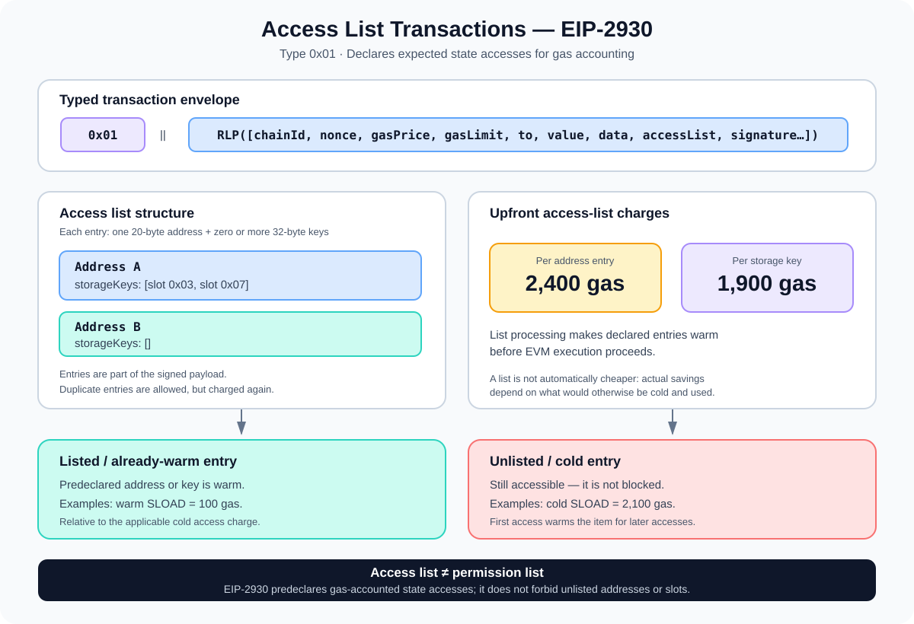

# Access List Transactions (EIP-2930): Addresses, Storage Keys, and Gas

> **Stage:** 05 — Advanced Transactions and Gas  
> **Priority:** 2  
> **Status:** Reviewed  
> **Last reviewed:** 2026-10-17

## 1. Overview

An **access list** is transaction metadata that declares Ethereum addresses and storage keys a transaction expects to access. **EIP-2930** introduced a new typed transaction format, **type `0x01`**, that carries this list alongside the transaction's usual fields.

The purpose is not to restrict execution to the listed items. It is to predeclare some of the state that execution is expected to touch, so the protocol can account for those entries up front and mark them as already accessed ("warm") for gas accounting. Access outside the list remains valid, but may incur the higher cold-access cost.

EIP-2930 builds on the typed envelope introduced by [EIP-2718](https://eips.ethereum.org/EIPS/eip-2718) and the warm/cold state-access accounting introduced by [EIP-2929](https://eips.ethereum.org/EIPS/eip-2929).



The most important idea is this:

> An access list is a gas-accounting hint encoded in the transaction—not an authorization list, a Solidity access-control mechanism, or a rule that forbids unlisted state access.

## 2. Where It Fits in the Transaction Format

EIP-2718 provides the common typed-transaction envelope:

```text
TransactionType || TransactionPayload
```

For an EIP-2930 transaction, the type byte is `0x01`, and its payload is an RLP-encoded list:

```text
0x01 || RLP([
  chainId,
  nonce,
  gasPrice,
  gasLimit,
  to,
  value,
  data,
  accessList,
  signatureYParity,
  signatureR,
  signatureS
])
```

The field `accessList` is therefore part of the signed transaction payload, not a separate RPC hint attached after signing. The EIP-2930 signature signs the type byte together with the unsigned transaction fields, including the access list:

```text
keccak256(
  0x01 || RLP([
    chainId, nonce, gasPrice, gasLimit,
    to, value, data, accessList
  ])
)
```

This ties the signature to the type-1 transaction format and the specific list being signed. Changing the access list after signing changes the signed payload and invalidates that signature.

A type-1 transaction uses the single `gasPrice` field. It does **not** use the EIP-1559 pair `maxFeePerGas` and `maxPriorityFeePerGas`. Those belong to the fee-market transaction format introduced by EIP-1559 (type `0x02`). Type 2 transactions can also contain an access list, so seeing an access list does not by itself mean the transaction is type 1. See [Transaction Types (EIP-2718)](03-transaction-types-eip-2718.md) for the broader comparison.

## 3. What an Access List Contains

An access list is an ordered list of entries. Each entry contains:

- **`address`** — a 20-byte Ethereum address.
- **`storageKeys`** — a list of zero or more 32-byte storage keys associated with that address.

Conceptually, the structure looks like this:

```json
[
  {
    "address": "0x1111111111111111111111111111111111111111",
    "storageKeys": [
      "0x0000000000000000000000000000000000000000000000000000000000000003",
      "0x0000000000000000000000000000000000000000000000000000000000000007"
    ]
  },
  {
    "address": "0x2222222222222222222222222222222222222222",
    "storageKeys": []
  }
]
```

This is an illustrative shape, not a ready-to-broadcast transaction. The addresses and storage slots are placeholders.

Each storage key is the 32-byte key used by EVM storage-access accounting. It is not automatically a Solidity variable name, a function selector, or an arbitrary application-level identifier. For a simple state variable, the key often corresponds to a slot number encoded as 32 bytes. For mappings, dynamic arrays, and packed variables, deriving the actual slot requires understanding Solidity's storage layout. A wrong key can still be syntactically valid; it simply will not pre-warm the storage location the transaction actually accesses.

The access list can include an address with an empty `storageKeys` array when the transaction expects to touch the account but has no known storage slot to predeclare.

## 4. How Access Lists Affect Gas

EIP-2930 works with EIP-2929's distinction between **cold** and **warm** accesses within a transaction. In simplified terms, an address or storage slot is cold the first time it is accessed unless it has already been marked warm; later accesses to the same item in the transaction generally use the warm-access price.

The access list is processed at the start of transaction execution. Its entries are inserted into the transaction's accessed-address and accessed-storage-key sets, and an upfront charge is made for every listed entry.

### EIP-2930 access-list charges

| Entry | Upfront charge |
|---|---:|
| Each address entry | 2,400 gas |
| Each storage-key entry | 1,900 gas |

These are **per-entry** charges. Addresses and keys are allowed to appear more than once; duplicates are charged more than once even though the corresponding accessed set contains the value only once. Duplicate entries therefore usually waste gas and should normally be avoided.

### Warm and cold costs

EIP-2929 introduced these important figures:

| Access kind | Cold first access | Warm access |
|---|---:|---:|
| `SLOAD` storage read | 2,100 gas | 100 gas |
| Account access for relevant `CALL` / `EXT*` operations | 2,600 gas | 100 gas |

The table is a focused summary of the access-related charges, not a complete accounting of every opcode or transaction. Operations can have additional costs, and warm/cold status depends on the transaction's current access sets and execution path.

Pre-listing an otherwise-cold storage key costs 1,900 gas in the access list; reading that now-warm key with `SLOAD` costs 100 gas. For a key that would otherwise have been cold and read once, this is 2,000 gas instead of 2,100, a potential 100-gas saving. Similarly, pre-listing an otherwise-cold address costs 2,400 gas instead of the 2,600-gas cold account-access charge, a potential 200-gas saving for that access. These comparisons are simplified and assume the listed items would otherwise have been cold and actually used.

A key or address already warm by default or earlier in execution may produce no such saving. In particular, the sender, transaction destination (or created contract address for contract creation), and precompiles begin warm under EIP-2929's rules. Paying to add a redundant entry may therefore increase total gas. Access lists are not automatically cheaper; their usefulness depends on the actual execution path, what is already warm, and the list's accuracy.

## 5. Access Lists Are Not an Allowlist

The term "access list" can sound like a permission boundary, but it is not one.

- A listed address or slot is predeclared and charged for up front.
- An address or storage slot not in the list can still be accessed during execution.
- An unlisted first access is normally charged at the applicable cold rate before becoming warm for subsequent access.
- The list does not grant an EOA, contract, or transaction permission to bypass Solidity access control, protocol validation, or other security rules.
- It does not guarantee that every listed item will actually be used; it can include unnecessary entries.

For example, if a contract's execution path calls another contract whose address was omitted, the call is not automatically blocked. The address can be accessed, with cold/warm gas accounting applied as required by the protocol.

Do not confuse EIP-2930's access list with the **authorization list** in EIP-7702. The latter has a different purpose and signature/validation semantics. EIP-2930 records state-access expectations for gas accounting; it is not an access-control policy.

## 6. Generating an Access List

Some Ethereum JSON-RPC clients expose `eth_createAccessList`, which estimates an access list for a supplied transaction call object and may return the estimated gas used with that list. For example, a client may accept a request like:

```json
{
  "jsonrpc": "2.0",
  "method": "eth_createAccessList",
  "params": [
    {
      "from": "0x3333333333333333333333333333333333333333",
      "to": "0x1111111111111111111111111111111111111111",
      "data": "0x"
    },
    "latest"
  ],
  "id": 1
}
```

This is a shape-only example for learning; it does not establish that the call will succeed or produce a useful access list. The method's availability and behavior depend on the node/client implementation.

An RPC-generated list is an estimate based on simulated execution and the chosen state/block context. Execution can differ by block state, call inputs, contract branches, external calls, or later state changes. The returned list may be incomplete or may contain entries that are not needed on the eventual execution path. Compare estimates rather than assuming that adding the returned list always lowers gas.

When building tooling, treat access-list generation as a transaction-construction step: simulate the intended call, inspect the generated list and expected gas, encode the access list into the chosen transaction type, then sign the final transaction. Never edit the access list after signing.

## 7. Type 1 Compared with Type 2

Both type 1 and type 2 transactions can contain `accessList`, but their fee models differ.

| Property | Type 1 — EIP-2930 | Type 2 — EIP-1559 |
|---|---|---|
| Type byte | `0x01` | `0x02` |
| Fee fields | `gasPrice` | `maxPriorityFeePerGas`, `maxFeePerGas` |
| Access list | Yes | Yes |
| Main protocol change | Declared state-access list | Dynamic fee market |
| Typed transaction envelope | EIP-2718 | EIP-2718 |

Access-list semantics are not exclusive to type 1. If an application uses a type-2 transaction, it can still provide an access list, subject to the target network and client rules.

## 8. Common Mistakes and Security Considerations

1. **Treating the list as a permission list.** Unlisted addresses and slots are still accessible; they just may have different gas charges.
2. **Assuming every access list saves gas.** Upfront charges can exceed any savings, especially for redundant or unused entries.
3. **Duplicating entries.** Duplicate address and key entries are permitted but charged again; deduplicate entries unless there is a protocol-specific reason not to.
4. **Using a Solidity variable name as a storage key.** The list needs the actual 32-byte EVM storage key, which depends on storage layout.
5. **Using type-1 fee fields for a type-2 transaction.** Type 1 uses `gasPrice`; type 2 uses EIP-1559 fee-cap fields.
6. **Changing the list after signing.** The access list is part of the signed transaction payload, so such changes require a new signature.
7. **Assuming RPC-generated lists are guaranteed.** Simulation results depend on execution context and client implementation; gas and the actual access path can change.
8. **Confusing access lists with EIP-7702 authorizations.** These are separate structures with different functions.
9. **Forgetting transaction scope.** The relevant warm/cold sets are transaction-scoped, with rollback behavior for accesses introduced inside a reverted execution scope as specified by EIP-2929.
10. **Assuming a valid list means a valid transaction.** Chain ID, nonce, signature, balance, gas, fee rules, and all other transaction validation still apply.

Access lists are primarily a transaction-format and execution-accounting concern. They do not replace contract-level threat modeling, validation, or authorization checks.

## 9. Developer Review Checklist

- [ ] Explain why EIP-2930 introduced typed transaction type `0x01`.
- [ ] Identify the address and storage-key components of an access-list entry.
- [ ] Explain how EIP-2930 relies on EIP-2718 and EIP-2929.
- [ ] Recall the access-list charges: 2,400 gas per address and 1,900 gas per storage key.
- [ ] Compare access-list upfront charges with cold and warm access costs.
- [ ] Explain why duplicate and unused entries can waste gas.
- [ ] Distinguish an access list from an authorization or permission list.
- [ ] Distinguish type-1 `gasPrice` fields from type-2 EIP-1559 fee fields.
- [ ] Explain that an access list is included in the signed transaction payload.
- [ ] Understand the limitations of `eth_createAccessList` estimates.

## 10. Key Takeaways

- EIP-2930 defines Ethereum transaction type `0x01`, which carries an `accessList`.
- Each list entry consists of a 20-byte address and zero or more 32-byte storage keys.
- Access-list entries are charged up front at 2,400 gas per address and 1,900 gas per storage key.
- By pre-warming state entries under EIP-2929, a correctly targeted list can slightly reduce relevant cold-access charges, but it is not guaranteed to reduce the total gas used.
- Duplicate entries are allowed and charged multiple times; entries that are already warm or never accessed may not be beneficial.
- An access list never blocks access to an unlisted address or storage slot and is not a security allowlist.
- Type 1 uses `gasPrice`; type 2 can also include an access list but uses EIP-1559 fee fields.

## References

1. **[EIP-2930 — Optional access lists](https://eips.ethereum.org/EIPS/eip-2930)** — type-1 payload, access-list schema, signing data, and per-entry gas charges.
2. **[EIP-2929 — Gas cost increases for state access opcodes](https://eips.ethereum.org/EIPS/eip-2929)** — warm/cold access sets, default warm entries, storage/account access costs, and revert behavior.
3. **[EIP-2718 — Typed Transaction Envelope](https://eips.ethereum.org/EIPS/eip-2718)** — typed transaction envelope and payload model.
4. **[Ethereum.org — Transactions](https://ethereum.org/developers/docs/transactions/)** — overview of the transaction formats, including types 1 and 2.
5. **[Geth — eth namespace RPC documentation](https://geth.ethereum.org/docs/interacting-with-geth/rpc/ns-eth)** — `eth_createAccessList` request and estimation behavior.
6. **[Ethereum Execution APIs](https://github.com/ethereum/execution-apis)** — JSON-RPC transaction representations.
7. **[Transaction Types (EIP-2718)](03-transaction-types-eip-2718.md)** — comparison of legacy and typed transaction formats.
8. **[Transaction Lifecycle](01-transaction-lifecycle.md)** — context for transaction preparation, signing, submission, and execution.

---

*Editorial note: The JSON-RPC request above is illustrative and was not executed against a live Ethereum node as part of this article's preparation.*
