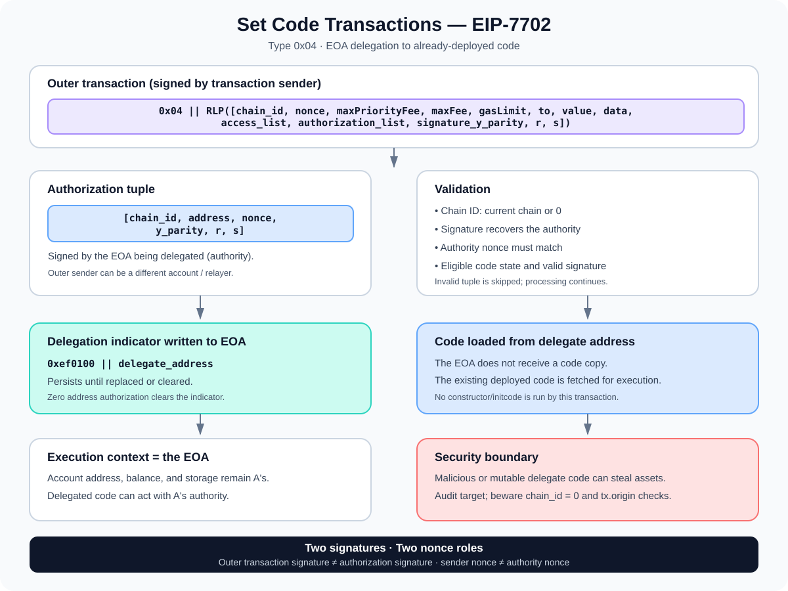

# Set Code Transactions (EIP-7702): Delegating EOA Execution

> **Stage:** 05 — Advanced Transactions and Gas  
> **Priority:** 2  
> **Status:** Reviewed  
> **Last reviewed:** 2026-10-17

## 1. Overview

**EIP-7702 — Set Code for EOAs** introduces Ethereum transaction type **`0x04`**, allowing an externally owned account (EOA) to point to already-deployed smart-contract code and execute that code in the EOA's own account context.

The transaction carries an `authorization_list`. Each authorization is signed by an account that is authorizing a delegation. When a valid authorization is processed, the protocol stores a 23-byte **delegation indicator** in that authority account's code field:

```text
0xef0100 || delegate_address
```

The prefix identifies the account as delegated, and the remaining 20 bytes identify the address whose code should be executed. The target code is not copied into the EOA. The EOA keeps its address, balance, and account storage; code-executing operations resolve the indicator and load the target's code for execution in the EOA's context.

Delegation is **persistent**, not automatically removed at the end of the transaction. It can be replaced by another valid authorization or cleared by authorizing the zero address.



EIP-7702 is a protocol primitive, not a complete smart-account wallet by itself. Features such as batching, sponsored transactions, session permissions, and recovery flows depend on the delegated code and the wallet/application design built around it.

## 2. Why EIP-7702 Exists

Traditional EOAs use a private key to authorize transactions directly. Their account state does not normally contain executable contract code, so account behavior is limited compared with smart-contract wallets.

EIP-7702 lets an existing EOA adopt smart-account-style behavior without migrating to a different address. This can enable, when the delegated code implements it:

- **Batching:** combine multiple operations, such as a token approval followed by a swap, into one transaction.
- **Sponsorship:** let a different transaction sender pay the outer transaction's gas while an EOA separately signs an authorization.
- **Custom wallet logic:** implement controlled spending, session keys, recovery, or other account policies.
- **Compatibility:** reuse deployed wallet code while keeping the authority account's address.

These are possible use cases, not automatic guarantees from the EIP. The delegated code has extensive authority over the account's assets and operations, so its behavior and security design are critical.

## 3. Type-4 Transaction Structure

EIP-7702 uses the typed transaction envelope from [EIP-2718](https://eips.ethereum.org/EIPS/eip-2718). A set-code transaction has type byte `0x04` and an RLP-encoded payload with the following fields:

```text
0x04 || RLP([
  chain_id,
  nonce,
  max_priority_fee_per_gas,
  max_fee_per_gas,
  gas_limit,
  destination,
  value,
  data,
  access_list,
  authorization_list,
  signature_y_parity,
  signature_r,
  signature_s
])
```

The outer transaction uses EIP-1559-style fee fields and can contain an access list. Its destination must be non-null: a type-4 transaction is not a contract-creation transaction.

Two different signature layers are involved:

1. **Outer transaction signature:** authorizes the transaction itself and covers the type byte plus the transaction payload, following the type-4 signing rules.
2. **Authorization signature:** authorizes a particular EOA to delegate to a specific code address. Each tuple can be signed by an account other than the outer transaction sender.

This separation makes it possible for one party to submit and pay for a transaction that includes another account's signed authorization. The outer sender and the account being delegated are not necessarily the same account.

## 4. Anatomy of an Authorization Tuple

Every authorization tuple has this form:

```text
[chain_id, address, nonce, y_parity, r, s]
```

| Field | Meaning |
|---|---|
| `chain_id` | The chain to which the authorization applies; `0` means it can be used on any chain that supports EIP-7702. |
| `address` | The address of the already-deployed code to delegate to. This is not the authority account's address. |
| `nonce` | The expected nonce of the authority account for this authorization. |
| `y_parity, r, s` | The ECDSA signature values used to recover the authority address. |

The authorization signature is calculated over the authorization magic value and the unsigned tuple fields:

```text
keccak256(
  0x05 || RLP([chain_id, address, nonce])
)
```

The protocol recovers the signer from this signature. That recovered address is the **authority**—the account whose delegation will be set or changed.

The authorization is not a signature by the delegate contract address. It is a signature by the account authorizing its own execution to use that delegate's code.

### Chain-specific versus cross-chain authorization

If `chain_id` is the current chain ID, the authorization is constrained to that chain. If `chain_id` is `0`, the authorization is valid for any chain that supports the rules, provided the remaining checks pass. Cross-chain authorization increases flexibility but also increases risk: the address may not contain the same code or provide the same behavior on every chain.

For cross-chain use, verifying the code at the target address on every relevant chain is essential. Prefer a narrowly scoped authorization where possible.

## 5. How a Set-Code Transaction Is Processed

At a high level, processing happens in this order:

1. **Validate the outer transaction.** The client checks the type, outer signature, chain ID, sender nonce, fees, balance, and other transaction validity rules.
2. **Increment the outer sender's nonce.** The outer transaction nonce is handled independently of each authorization tuple.
3. **Process authorizations in list order.** For every tuple, the protocol checks its chain ID, nonce bounds, signature, authority code eligibility, and expected authority nonce.
4. **Apply valid delegations.** A valid tuple writes the delegation indicator to the authority account and increments that authority account's nonce.
5. **Execute the transaction payload.** The transaction's destination, value, and data are processed under the usual execution rules, with delegation resolution applied where required.
6. **Create the receipt.** A type-4 transaction uses a typed receipt payload, while the receipt status records whether the transaction's execution succeeded or reverted.

A crucial detail: **a tuple that fails its authorization checks is skipped, and processing continues with the next tuple.** An invalid authorization does not automatically mean that the entire outer transaction is invalid. This is different from failures in the outer transaction's own validity checks.

Multiple tuples for the same authority may be supplied. The authority nonce changes as valid tuples are applied, so each tuple must satisfy the protocol's nonce checks at the point it is processed. If several valid tuples from the same authority are included, the last valid occurrence determines the final delegation.

Another important detail: a later execution revert does not roll back delegation indicators that were already processed. Authorization processing happens before the normal execution portion and has its own state-transition semantics.

## 6. How Delegated Execution Works

Suppose an EOA `A` authorizes a delegate address `D`. Its code field is set to:

```text
0xef0100 || D
```

When an EVM operation targets account `A` for code execution, the client recognizes the indicator and loads the code at `D`. That code executes **in the context of A**, rather than as if the user had independently called D.

This distinction is fundamental:

- **Account identity and context:** operations retain the authority account's context, including its address, storage, and balance.
- **Code source:** instructions come from the delegate address's deployed code.
- **Assets:** the delegated logic can potentially move ETH or tokens and make external calls with the authority account's permissions.
- **Persistent setting:** the indicator remains after the transaction, until replaced or cleared by another valid authorization.

Delegation does not copy runtime bytecode into the EOA and does not run the target contract's constructor. The delegate code must already be deployed. The EIP also defines how code-executing operations resolve delegation; code-reading operations such as `EXTCODESIZE` do not simply report the delegate's runtime code as if it were the EOA's own bytecode. For example, the authority's code field stores the 23-byte indicator.

## 7. Clearing or Changing a Delegation

An authorization can point to a new delegate address to replace the current delegation. To clear the indicator and restore the account's code field to empty, the authority can authorize the zero address:

```text
address = 0x0000000000000000000000000000000000000000
```

The protocol treats that address as a special clear operation rather than storing a normal delegation indicator to address zero.

Clearing delegation is useful, but it should not be treated as a substitute for careful wallet design. Users and applications must understand which code has authority, how replacement authorizations are obtained, and how the account's nonce affects pending transactions and future authorizations.

## 8. Nonce Rules: Two Separate Sequences

EIP-7702 involves more than one nonce, and mixing them up can cause transaction construction errors.

- **Outer transaction nonce:** belongs to the account that submits the type-4 transaction. It orders that sender's transactions, just as in other Ethereum transaction types.
- **Authorization nonce:** belongs to the authority recovered from a particular authorization signature. It must match that authority's nonce when the tuple is processed and is incremented when that authorization is applied.

These can be different accounts. For example, a relayer can submit a transaction whose outer nonce belongs to the relayer, while the authorization nonce belongs to the user's EOA.

The authorization nonce helps prevent an authorization from being replayed as if it were still current. The authorization's chain ID further scopes where it can be applied; using chain ID zero deliberately allows broader cross-chain use.

For related background, see [Transaction Nonce](02-transaction-nonce.md).

## 9. Gas Costs and Invalid Authorizations

EIP-7702 inherits the baseline intrinsic transaction costs from EIP-2930 and adds an authorization-list charge. Its specified constants include:

| Parameter | Value | Meaning |
|---|---:|---|
| `SET_CODE_TX_TYPE` | `0x04` | Type byte for a set-code transaction |
| `MAGIC` | `0x05` | Prefix used when signing authorization tuples |
| `PER_AUTH_BASE_COST` | 12,500 gas | Base cost used when processing a valid authorization |
| `PER_EMPTY_ACCOUNT_COST` | 25,000 gas | Upfront intrinsic charge per authorization-list item |

The transaction sender pays the upfront authorization-list charge for every tuple, including tuples that turn out to be invalid and duplicate authorizations. When a valid authorization applies to an account that is not empty, the protocol's refund accounting can refund the difference between the empty-account charge and the base authorization cost, according to the EIP rules.

The transaction also pays its normal execution gas, calldata cost, access-list costs when used, and any relevant cold account-access costs involved in resolving delegated code. These values are protocol rules, not a fixed fee for using EIP-7702 overall; actual transaction cost depends on the full transaction and execution.

## 10. Security Considerations

EIP-7702 makes delegated code a critical security boundary. The user is not merely calling a contract once; they are authorizing their account to execute that contract's code when their delegated account is used.

### Delegate-address phishing

If a user authorizes malicious or misunderstood code, it may be able to transfer assets, approve token spending, or make calls using the user's account context. Wallets should prominently display the delegate target and the authority being granted. Users should never sign a delegation solely because a site labels it as an ordinary login, a claim, or a routine transaction.

### Mutable delegate code

A delegation points to an address, not a snapshot of that address's bytecode. If the target is a proxy or otherwise upgradeable, its behavior may change after the authorization is signed. The Ethereum guidance recommends using carefully vetted, immutable delegate code and taking cross-chain deployments into account, particularly when the authorization uses chain ID zero.

### Initialization and storage

Delegated code executes using the EOA's context. Storage assumptions made for a conventional deployed contract may not hold when the code executes for many different EOAs. Initializing an account after setting delegation may require a separate call, so implementations must carefully reason about initialization ordering, front-running, and whether any uninitialized state can be exploited.

### `tx.origin` and reentrancy assumptions

Developers must not treat `msg.sender == tx.origin` as a reliable reentrancy guard. EIP-7702 permits an EOA's delegated code to make calls during a transaction, changing assumptions about call relationships that older contracts may have made. Use established reentrancy protections and explicit authorization checks instead.

### Sponsored transactions and authorization capture

A sponsored transaction means the outer sender can differ from the authority. Wallets and relayers must clearly show what an authorization permits, validate its target and chain scope, and protect authorization-signing flows from phishing or unintended reuse.

### Important operational rules

- Review the delegate's exact deployed code and whether it can change.
- Prefer chain-specific authorizations unless cross-chain use is intentional and safe.
- Treat authorization signatures as high-impact permissions over the account.
- Use audited wallet code, explicit access controls, and robust reentrancy protection.
- Do not assume that a transaction revert will undo an authorization already processed.

## 11. Common Mistakes

1. **Calling EIP-7702 a complete account-abstraction system.** It is a delegation primitive; batching, sponsorship, session keys, and recovery depend on the code and systems layered on it.
2. **Assuming the target's code is copied to the EOA.** The EOA stores a delegation indicator and resolves code from the delegate address.
3. **Confusing the authority and the delegate.** The authority signs the tuple; the address field specifies the code target.
4. **Confusing outer and authorization signatures.** The outer signature authorizes the type-4 transaction; each authorization signature authorizes a delegation.
5. **Confusing the two nonce sequences.** Outer transaction nonce and authority nonce belong to different accounts or roles and are checked separately.
6. **Assuming delegation is automatically temporary.** The indicator persists until validly replaced or cleared.
7. **Assuming a failed tuple invalidates the whole transaction.** An authorization tuple that fails its checks is skipped; other entries can still be processed.
8. **Assuming reverting execution rolls back delegation.** Delegations already processed are not rolled back just because the execution portion reverts.
9. **Authorizing upgradeable or malicious delegate code without review.** The pointer can grant code broad authority over the account's assets and storage context.
10. **Relying on `tx.origin` for reentrancy protection.** Use purpose-built protections rather than assumptions about EOAs.

## 12. Developer Review Checklist

- [ ] Explain why EIP-7702 introduced transaction type `0x04`.
- [ ] Describe the `0xef0100 || address` delegation indicator.
- [ ] Decode the authorization tuple `[chain_id, address, nonce, y_parity, r, s]`.
- [ ] Distinguish the outer transaction signature from authorization signatures.
- [ ] Explain chain-specific versus chain-ID-zero authorization.
- [ ] Distinguish outer transaction nonce from authority authorization nonce.
- [ ] Explain why a failed tuple may be skipped while processing continues.
- [ ] Explain why delegated code executes in the authority's account context.
- [ ] Explain how delegation can be changed or cleared with the zero address.
- [ ] Identify the key risks of malicious, mutable, or cross-chain delegate code.

## 13. Key Takeaways

- EIP-7702 defines Ethereum transaction type `0x04`, with an authorization list.
- A valid authorization installs a 23-byte delegation indicator: `0xef0100 || delegate_address`.
- The EOA's address, balance, and storage context remain its own; code comes from an already-deployed delegate.
- The transaction signature and each authorization signature have different jobs.
- Authorization nonce and outer transaction nonce are distinct; the authority can differ from the outer sender.
- Delegation persists until changed or cleared. Execution failure does not roll back an authorization already processed.
- Delegated code is security-critical because it can act with the EOA's authority. Audit the target, verify its immutability and chain behavior, and do not rely on `tx.origin` as a reentrancy defense.

## References

1. **[EIP-7702 — Set Code for EOAs](https://eips.ethereum.org/EIPS/eip-7702)** — normative transaction structure, authorization processing, delegation indicator, gas rules, and security considerations.
2. **[Ethereum.org — Pectra EIP-7702 guidelines](https://ethereum.org/roadmap/pectra/7702/)** — account behavior, authorization tuple, chain ID, delegation clearing, and wallet security advice.
3. **[EIP-2718 — Typed Transaction Envelope](https://eips.ethereum.org/EIPS/eip-2718)** — type byte and transaction envelope model.
4. **[EIP-2930 — Optional access lists](https://eips.ethereum.org/EIPS/eip-2930)** — inherited access-list format and intrinsic gas accounting.
5. **[EIP-2929 — Gas cost increases for state access opcodes](https://eips.ethereum.org/EIPS/eip-2929)** — warm/cold account access.
6. **[Ethereum.org — Transactions](https://ethereum.org/developers/docs/transactions/)** — context for type-4 transactions and related transaction formats.
7. **[Transaction Types (EIP-2718)](03-transaction-types-eip-2718.md)** — comparison with other Ethereum transaction types.
8. **[Transaction Nonce](02-transaction-nonce.md)** — background on the outer sender's transaction nonce.

---

*Editorial note: This article explains the protocol flow and security properties from the cited specifications. No transaction was signed or broadcast, and no example was executed against a live network as part of this article's preparation.*
