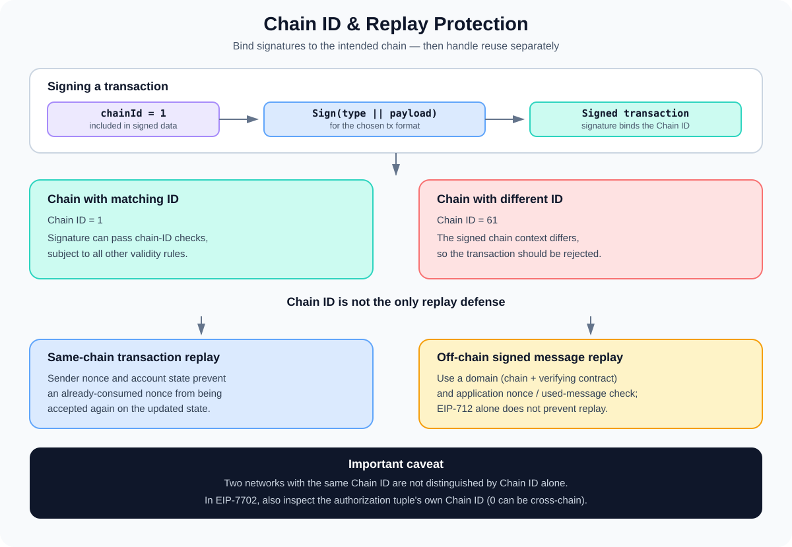

# Chain ID and Replay Protection: Scoping Signatures to a Network

> **Stage:** 05 — Advanced Transactions and Gas  
> **Priority:** 2  
> **Status:** Reviewed  
> **Last reviewed:** 2026-10-17

## 1. Overview

A **Chain ID** is an identifier used by an Ethereum-compatible chain in transaction-signing rules and by applications that need to bind signed data to a particular chain. Its best-known security role is to help prevent **replay attacks**: reusing a valid signed transaction or authorization on a different chain where it was not intended to execute.

For example, if two chains share a common history but use different Chain IDs, a transaction signed for Chain ID `1` should not be valid as the same transaction on a chain configured with Chain ID `61`. This is the purpose of [EIP-155](https://eips.ethereum.org/EIPS/eip-155), which introduced chain-specific signing protection for legacy Ethereum transactions.

Chain ID is not the same as a transaction nonce, network ID, or an application-level authorization nonce. They solve related but different problems:

- **Chain ID** binds a signature to a chain identifier.
- **Transaction nonce** prevents the same sender transaction sequence number from being accepted repeatedly in the same account state.
- **Application nonce / used-message tracking** prevents a contract's signed authorization from being executed more than intended.
- **Deadline / validity window** can limit the time during which a signed authorization may be used.



The key is defense in depth: **Chain ID is an important replay-protection component, but it is not a complete replay-protection design for every signed message.**

## 2. What Is a Replay Attack?

A replay attack occurs when a valid signature or signed operation is captured and submitted again in a context where it should not be valid or should not be executed twice.

Imagine a user signs a transaction to send 1 ETH on one EVM chain. If another chain accepts the exact same signing format and uses compatible account state, a party might attempt to broadcast that signature there too. Without suitable chain separation, the user may not have intended to authorize the second transfer.

Replay risks can arise across:

- Different chains, especially chains that share transaction history or similar state.
- Forks of a chain, depending on their signature rules, Chain IDs, and account state.
- Contract calls authorized through off-chain signatures, if the signature is not properly scoped or marked as used.
- Authorization mechanisms that use a nonce or chain identifier incorrectly or omit one where it is needed.

A valid signature proves that the signer approved the signed data. It does not, by itself, prove that the data is being used on the intended chain, contract, or occasion.

## 3. Chain ID and Legacy Transactions: EIP-155

Before EIP-155, a legacy transaction could use the original six transaction fields as the signing payload:

```text
[nonce, gasPrice, gasLimit, to, value, data]
```

The legacy signature's `v` value historically used `27` or `28`. This format did not inherently bind that signature to a particular Chain ID, which created cross-chain replay risk when another chain accepted the same signature.

EIP-155 changed the signing payload for protected legacy transactions to include the Chain ID and two zero placeholders:

```text
RLP([
  nonce,
  gasPrice,
  gasLimit,
  to,
  value,
  data,
  chainId,
  0,
  0
])
```

The signed transaction's `v` value encodes the Chain ID and the signature parity:

```text
v = chainId * 2 + 35 + yParity
```

Here, `yParity` is `0` or `1`. For example, when the Chain ID is `1`, the protected legacy `v` value is `37` or `38`.

A client can use this information when recovering the signer and validating the transaction. A legacy transaction using the old `v = 27` / `28` scheme does not gain EIP-155 chain protection merely because it is submitted to a chain that has EIP-155 enabled; legacy unprotected signing remains a distinct format.

EIP-155 was introduced to help distinguish Ethereum from chains such as Ethereum Classic. It depends on the chains choosing different identifiers and enforcing the relevant rules.

## 4. Typed Transactions: Chain ID Is a Payload Field

[EIP-2718](https://eips.ethereum.org/EIPS/eip-2718) introduced a typed transaction envelope:

```text
TransactionType || TransactionPayload
```

Modern Ethereum transaction types include a Chain ID as a payload field, and their signing rules include the type byte along with the unsigned transaction fields. For example, a type-2 EIP-1559 transaction signs data shaped like:

```text
keccak256(
  0x02 || RLP([
    chainId,
    nonce,
    maxPriorityFeePerGas,
    maxFeePerGas,
    gasLimit,
    destination,
    value,
    data,
    accessList
  ])
)
```

The example illustrates the signing payload, not a complete raw transaction: signature fields are added after signing. Other typed transactions use their own type byte and fields, defined by their individual EIPs.

This matters for wallet and infrastructure developers:

- A type-1, type-2, type-3, or type-4 transaction has its own field structure and signing rules.
- The Chain ID is part of the signed data, so changing the Chain ID changes the signing payload.
- The transaction type also separates the signature domain between typed transaction formats.
- Clients still need to validate the Chain ID and all other fields according to the target network's protocol rules.

Chain ID in the signed payload does not automatically make every off-chain message safe from replay. Contract-based signature flows require additional care, covered below.

## 5. Chain ID Is Not the Same as Network ID

Chain ID and network ID have related historical uses, but they are not interchangeable concepts.

- **Chain ID** is used in transaction signing and replay-protection rules, and may be checked by contracts and applications.
- **Network ID** is a networking identifier used by peer-to-peer client protocols and discovery contexts.
- **Transaction nonce** orders transactions from an account within its chain state.

Many networks use matching Chain ID and network ID values, but this is a convention rather than a reason to treat the two terms as synonyms. When constructing or signing an Ethereum transaction, use the Chain ID required by the chain's transaction rules.

The JSON-RPC method `eth_chainId` returns the current chain's Chain ID as a hexadecimal quantity. It is generally the appropriate RPC method for a wallet or client to check the signing chain. Do not substitute `net_version` or infer the signing Chain ID from a chain's name.

Chain IDs are configured by the networks and their client implementations. A Chain ID is not a global cryptographic proof of a chain's identity: two networks can choose the same value, intentionally or accidentally. Applications should verify the RPC endpoint and network context rather than trusting a Chain ID as the only authenticity check.

## 6. What Chain ID Does—and Does Not—Protect Against

### Cross-chain replay

If a transaction is signed for Chain ID A and chain B uses a different Chain ID, the chain-specific signing payload differs. A transaction intended for A should therefore fail chain-ID validation on B.

This protection relies on correct signing and validation, and on the networks using different IDs. If two chains share the same Chain ID and accept the same transaction format, Chain ID alone cannot distinguish them.

### Repeated use on the same chain

Chain ID does not stop someone from attempting to submit the exact same signed transaction more than once to the same chain. The sender's transaction nonce and state-transition rules normally ensure that after a transaction with that nonce is included, the same transaction is no longer valid against the updated account nonce.

For off-chain signatures that authorize a contract action, the contract may need its own nonce, consumed-message mapping, deadline, or other one-time-use rule. A transaction nonce does not automatically prevent a reusable message signature from authorizing the same action through different transactions.

### Forks and shared history

If a chain splits into two networks that retain the same Chain ID and compatible signing rules, a transaction can potentially be valid on both sides when their account state and other validity conditions remain compatible. Unique IDs help prevent that kind of cross-fork replay, but the actual protection depends on the fork's protocol changes and state.

### Malicious or misconfigured RPC endpoints

A Chain ID check helps a wallet detect when an endpoint reports an unexpected network, but Chain ID alone is not enough to prove that an endpoint is honest. Wallets and infrastructure should verify trusted network configuration and be cautious when switching RPC providers.

## 7. Chain ID in Smart-Contract Message Signatures

Smart contracts often verify signatures over data that was signed off-chain. Examples include token permits, meta-transactions, order authorizations, delegated actions, and account-abstraction signatures.

For these flows, use a carefully designed signing domain. [EIP-712](https://eips.ethereum.org/EIPS/eip-712) defines structured-data signing and allows the domain to include:

- `name`: the application or protocol name.
- `version`: the domain version.
- `chainId`: the chain identifier.
- `verifyingContract`: the contract that will verify the signature.
- `salt`: an optional additional domain-separation value.

A domain separator can make an otherwise identical message differ between chains, contracts, or application versions. In a conventional EIP-712 flow, wallets should ensure the domain's Chain ID matches the active chain when that field is used.

However, **EIP-712 explicitly does not provide replay protection by itself**. It standardizes typed hashing and signing; the dApp and verifying contract must correctly implement the domain and authorization semantics.

For a one-time authorization, a robust design commonly needs a combination of:

1. **Domain separation:** bind the signature to the intended chain and verifying contract when appropriate.
2. **Nonce or used-message state:** reject an authorization that has already been consumed.
3. **Deadline or validity window:** limit how long the signature can be used when expiration is appropriate.
4. **Clear action binding:** include all relevant fields—such as account, recipient, amount, token, operation, and fee rules—in the signed data.
5. **Correct verification:** validate the signer and all fields, and update the consumed nonce/state atomically with execution.

The exact design depends on the application. Do not simply add a Chain ID to a message and assume every replay scenario is solved.

## 8. The CHAINID Opcode and Solidity

[EIP-1344](https://eips.ethereum.org/EIPS/eip-1344) introduced the `CHAINID` opcode, which returns the current chain's configured Chain ID. Solidity exposes this value through:

```solidity
block.chainid
```

This can be useful when a contract computes or checks a domain separator, verifies a chain-bound signature, or needs to adapt behavior to a configured network.

There is an important distinction: `block.chainid` returns the configured Chain ID of the chain where the code is executing. It does not prove that a remote RPC endpoint is trustworthy, and it does not stop replay attacks unless the contract's relevant validation uses the value correctly.

For signature verification, prefer established, audited EIP-712 or protocol-specific implementations rather than inventing a custom hash format.

## 9. EIP-7702: Two Places Where Chain ID Matters

EIP-7702 introduces a type-4 set-code transaction with an outer transaction Chain ID and an authorization list. Each authorization tuple is:

```text
[chain_id, address, nonce, y_parity, r, s]
```

There are two distinct Chain ID contexts:

- **Outer transaction Chain ID:** scopes the type-4 transaction itself under the outer transaction's signing and validation rules.
- **Authorization tuple Chain ID:** scopes that specific authorization. A value matching the current chain restricts it to that chain. A value of `0` allows it to be used on any chain that supports EIP-7702, subject to the remaining validity checks.

Therefore, a type-4 transaction's outer Chain ID does not automatically make every authorization tuple chain-specific. The tuple's own Chain ID must be reviewed separately.

An authorization signed with `chain_id = 0` is intentionally cross-chain reusable where the protocol rules allow it. This increases flexibility but also means the delegate code and its behavior must be considered on every chain where the authorization might be applied. See [Set Code Transactions (EIP-7702)](05-set-code-transactions-eip-7702.md) for the broader delegation model.

## 10. Practical Developer Checklist

When building a wallet, RPC integration, or smart contract that handles signed actions:

- [ ] Read the intended network's Chain ID from trusted configuration and verify the provider's `eth_chainId` response.
- [ ] Distinguish Chain ID from network ID and the sender's transaction nonce.
- [ ] Use the target transaction type's actual signing rules; do not reconstruct a typed transaction as if it were a legacy transaction.
- [ ] For legacy transactions, understand the difference between EIP-155-protected and old unprotected `v = 27/28` signatures.
- [ ] When verifying EIP-712 data, validate the domain and use the Chain ID and verifying-contract fields where appropriate.
- [ ] For actions that must execute once, enforce a consumed nonce or used-message check in contract state.
- [ ] Add deadlines or validity bounds when the application requires them.
- [ ] Review forks and any possibility that two networks share a Chain ID.
- [ ] For EIP-7702, inspect the authorization tuple's Chain ID separately from the outer transaction's Chain ID.
- [ ] Do not treat Chain ID as a substitute for authentication, signer validation, or a complete replay-protection design.

## 11. Common Mistakes

1. **Thinking Chain ID is a transaction nonce.** Chain ID selects a chain-signing context; nonce handles transaction ordering and can also support one-time authorization rules.
2. **Treating Chain ID and network ID as synonyms.** Their uses differ, even when the values happen to match.
3. **Assuming EIP-155 protects every legacy signature.** The old `v = 27/28` scheme is distinct from EIP-155-protected signing.
4. **Assuming two chains always have different IDs.** Chain IDs are chosen by networks; uniqueness is not globally enforced by cryptography.
5. **Assuming EIP-712 alone prevents replay.** The EIP explicitly leaves replay protection to application-specific design and verification.
6. **Forgetting contract authorization nonces.** A signed message can be replayed in separate transactions unless the application consumes or otherwise constrains it.
7. **Checking the wrong RPC method.** Use `eth_chainId` to retrieve the signing Chain ID; do not substitute the network ID.
8. **Ignoring EIP-7702's inner Chain ID.** A type-4 outer transaction may be chain-specific while an authorization tuple uses `chain_id = 0`.
9. **Using Chain ID as the only trust signal.** It helps scope signatures but cannot establish that an RPC endpoint is honest or that a network configuration is authentic.

## 12. Key Takeaways

- EIP-155 added Chain ID into the signing rules for replay-protected legacy transactions.
- Typed transactions also sign their type-specific payload, including the Chain ID defined by the relevant transaction standard.
- A Chain ID mismatch helps reject a transaction on a different chain, but two networks with the same Chain ID are not distinguished by that field.
- Chain ID, transaction nonce, and application-level authorization nonces address different parts of replay protection.
- EIP-712 allows Chain ID and verifying-contract fields in the signing domain, but EIP-712 does not itself provide replay protection.
- `block.chainid` exposes the executing chain's Chain ID to Solidity code; applications must use it correctly.
- In EIP-7702, the outer transaction's Chain ID and each authorization tuple's Chain ID are separate. A tuple using zero can be valid across chains that support the EIP.

## References

1. **[EIP-155 — Simple replay attack protection](https://eips.ethereum.org/EIPS/eip-155)** — Chain ID in legacy transaction signing and the protected `v` value.
2. **[EIP-2718 — Typed Transaction Envelope](https://eips.ethereum.org/EIPS/eip-2718)** — common envelope and type-specific transaction payloads.
3. **[EIP-1559 — Fee market change for ETH 1.0 chain](https://eips.ethereum.org/EIPS/eip-1559)** — example of a typed transaction signing payload including `chain_id`.
4. **[EIP-1344 — CHAINID opcode](https://eips.ethereum.org/EIPS/eip-1344)** — accessing the current chain's Chain ID within the EVM.
5. **[EIP-712 — Typed structured data hashing and signing](https://eips.ethereum.org/EIPS/eip-712)** — domain separation fields and the explicit limitation that the standard itself does not include replay protection.
6. **[EIP-7702 — Set Code for EOAs](https://eips.ethereum.org/EIPS/eip-7702)** — outer transaction Chain ID and authorization tuple semantics.
7. **[Ethereum.org — Transactions](https://ethereum.org/developers/docs/transactions/)** — overview of legacy and typed transaction formats.
8. **[Transaction Nonce](02-transaction-nonce.md)** — account transaction sequencing and nonce behavior.
9. **[Set Code Transactions (EIP-7702)](05-set-code-transactions-eip-7702.md)** — EIP-7702 delegation, authorization tuples, and the distinction between outer and authorization data.

---

*Editorial note: The signing payloads in this article are conceptual format examples. No transaction was signed, submitted, or executed as part of this article's preparation.*
