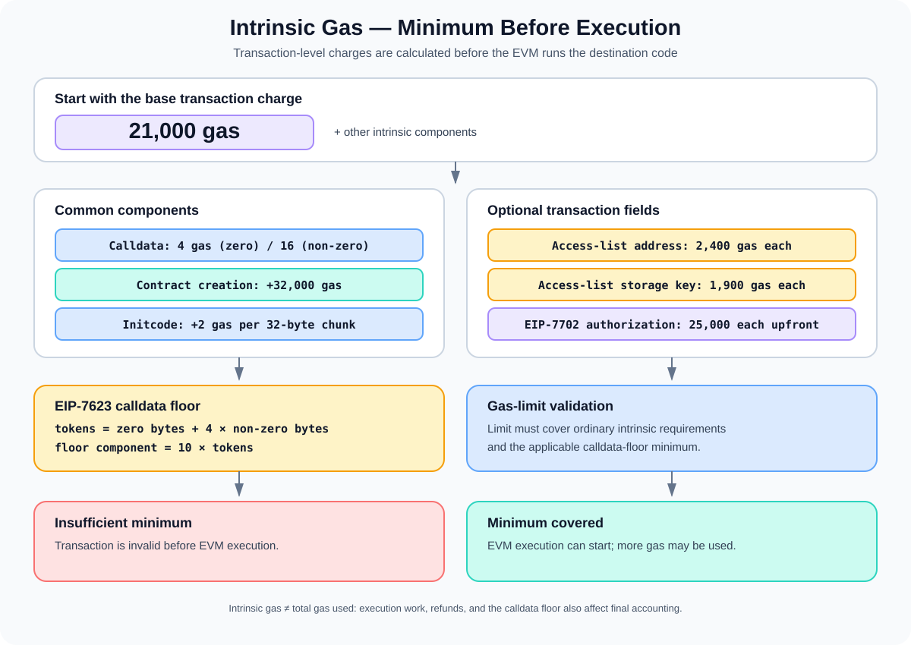

# Intrinsic Gas: The Minimum Gas Required Before Execution

> **Stage:** 05 — Advanced Transactions and Gas  
> **Priority:** 2  
> **Status:** Reviewed  
> **Last reviewed:** 2026-10-17

## 1. Overview

**Intrinsic gas** is the protocol-defined gas cost a transaction must cover before the EVM begins executing the transaction's destination code. It pays for transaction-level work such as the base transaction charge, calldata, contract-creation overhead, an access list, and—where applicable—an EIP-7702 authorization list.

It is not the same as the total gas a transaction uses. After the intrinsic portion is accounted for, EVM execution may consume additional gas through opcodes, memory expansion, storage operations, external calls, and other runtime work.

For a normal Ethereum transaction sent to an existing account with no calldata, access list, or authorization list, the basic transaction cost is **21,000 gas**. This is why a plain ETH transfer is commonly described as a 21,000-gas transaction. A contract call or deployment usually costs more because it carries data, requests additional transaction features, and/or performs EVM execution.



A key rule: **the transaction's gas limit must be high enough to cover the protocol's minimum transaction cost.** A transaction that does not provide enough gas for its intrinsic requirements is invalid for inclusion; the EVM call does not simply begin and run out of gas halfway through the intrinsic calculation.

## 2. Intrinsic Gas Versus Execution Gas

These concepts describe different parts of transaction processing:

- **Intrinsic gas:** required by the transaction's encoded contents and transaction type before normal execution starts.
- **Execution gas:** consumed while EVM execution runs, including opcode work, memory expansion, storage access, calls, and other runtime operations.
- **Gas limit:** the maximum amount of gas the sender permits the transaction to consume.
- **Gas used:** the amount of gas ultimately charged under the protocol's accounting rules, including applicable costs and refunds. For data-heavy transactions, EIP-7623 adds a calldata-based floor that can affect the final charged amount.

A simplified mental model is:

```text
transaction is decoded and validated
        ↓
intrinsic requirements are calculated
        ↓
gas limit must cover required minimums
        ↓
transaction execution begins
        ↓
execution costs, refunds, and any calldata floor
determine final gas accounting
```

This is a conceptual overview. Client implementations follow the exact consensus rules of the active fork and transaction type.

## 3. The Traditional Intrinsic-Gas Components

For ordinary Ethereum transaction formats, the major components are as follows. These are the familiar baseline costs; the destination network's active protocol rules and the selected transaction type still determine the exact calculation.

### Base transaction cost: 21,000 gas

A transaction has a base intrinsic charge of **21,000 gas**. It applies to a plain transfer and also forms the base for contract calls and creation transactions.

The 21,000 gas does not mean every transaction finishes using only 21,000 gas. It is the baseline before accounting for calldata, optional transaction fields, and EVM execution.

### Calldata cost

Under the standard calldata pricing rules, each byte of transaction input data has a cost based on whether it is zero or non-zero:

| Calldata byte | Standard cost |
|---|---:|
| Zero byte (`0x00`) | 4 gas |
| Non-zero byte | 16 gas |

These figures reflect the rules established by [EIP-2028](https://eips.ethereum.org/EIPS/eip-2028) and the post-Istanbul cost schedule. Calldata contains encoded function selectors, arguments, and other input bytes. A function with more dynamic data or a larger payload can therefore have a higher transaction-level charge before the contract's instructions are considered.

For example, if a transaction carries 10 zero bytes and 5 non-zero bytes, the standard byte charge is:

```text
10 × 4 + 5 × 16 = 120 gas
```

This is only the calldata-byte component. It does not include the base transaction cost, access-list entries, creation charges, the calldata floor described later, or EVM execution.

### Top-level contract creation

A transaction that creates a contract rather than targeting an existing `to` address has an additional **32,000-gas** creation charge under the current traditional model, on top of the 21,000 base cost and its data costs.

Contract creation also carries initialization code (initcode). Under [EIP-3860](https://eips.ethereum.org/EIPS/eip-3860), a creation transaction incurs an extra **2 gas per 32-byte chunk of initcode**, rounded up:

```text
initcode_word_cost = 2 × ceil(initcode_bytes / 32)
```

EIP-3860 also limits initcode used for creation to 49,152 bytes under the relevant protocol rules. The initcode-word charge is distinct from the ordinary zero/non-zero calldata byte charges and from the later cost of storing the resulting runtime code.

Do not confuse this top-level creation charge with the cost of the EVM `CREATE` or `CREATE2` opcodes inside an already-running contract. Those instructions have their own runtime gas rules.

### Access-list entries

Type-1 transactions defined by [EIP-2930](https://eips.ethereum.org/EIPS/eip-2930) can include an access list. Access-list entries are charged before execution:

| Access-list item | Cost |
|---|---:|
| Each address entry | 2,400 gas |
| Each storage-key entry | 1,900 gas |

This is charged per entry. Duplicate entries are allowed by the format but can add cost without providing an equivalent extra benefit. An access list does not prohibit access to an address or storage key omitted from it.

Access-list charges are part of the transaction's gas requirements, not the gas consumed by the contract's own Solidity instructions.

### EIP-7702 authorization list

A type-4 set-code transaction under [EIP-7702](https://eips.ethereum.org/EIPS/eip-7702) includes an authorization list. Its transaction-level intrinsic calculation adds **25,000 gas per authorization-list tuple** up front, irrespective of whether the tuple is valid or duplicated. EIP-7702 specifies related accounting rules, including a possible refund difference for valid authorizations depending on the authority account's state.

Do not count this cost as an ordinary EVM opcode cost. It comes from the transaction format and authorization-list processing rules.

## 4. A Simplified Calculation

For a conventional transaction under the standard byte-cost rules, a useful teaching-level expression for the base intrinsic requirement is:

```text
base transaction cost
+ standard calldata byte cost
+ contract-creation charge, if applicable
+ initcode word cost, for top-level creation
+ access-list charges, if present
+ EIP-7702 authorization-list charges, if present
```

For an ordinary transfer to an existing account, with no input data and no optional lists:

```text
21,000 gas
```

For a call containing 10 zero bytes and 5 non-zero bytes, with no optional lists or contract-creation overhead, the standard transaction-level calculation before EVM execution is:

```text
21,000 + (10 × 4) + (5 × 16)
= 21,120 gas
```

That number is not a complete gas estimate for a smart-contract call. EVM execution may add substantial cost, and current Ethereum rules add the calldata floor described below where it applies. In real applications, use an up-to-date node's gas estimation under the intended network rules instead of relying on a hand calculation alone.

## 5. The Calldata Floor: EIP-7623

A key detail for current Ethereum rules is [EIP-7623](https://eips.ethereum.org/EIPS/eip-7623), which introduced a **calldata-based gas floor** to reduce the maximum size of data-heavy execution-layer payloads.

It did not simply replace every transaction's ordinary 4/16 calldata cost with 10/40 gas per byte. Instead, it defines a floor that can affect transactions whose total gas cost is low compared with the size of their calldata.

EIP-7623 defines a calldata token count:

```text
tokens = zero_bytes + 4 × nonzero_bytes
```

The floor component is **10 gas per token**, so its data-based amount is:

```text
calldata_floor = 10 × tokens
```

In simplified terms, the final transaction gas accounting must respect the standard calculation and the applicable calldata floor. The exact rules also account for other transaction costs, creation-related costs, and execution, so the floor is not a substitute for calculating the complete transaction requirements.

### What changes in practice?

- A typical wallet transaction that performs meaningful EVM computation may continue to be priced by the ordinary calculation rather than the calldata floor.
- A transaction that mostly carries calldata and performs little execution may be subject to the higher floor.
- A transaction's gas limit must meet both its ordinary intrinsic requirements and the applicable calldata-floor minimum.
- Gas estimation software needs to support the active network rules; otherwise, data-heavy transactions may be estimated too low.

For the 10-zero-byte, 5-nonzero-byte example:

```text
tokens = 10 + (4 × 5) = 30
calldata floor component = 10 × 30 = 300 gas
```

The example's standard byte charge was 120 gas. The floor's data component is 300 gas, but **this does not mean the transaction's total gas is 300**. The transaction's 21,000 base cost and any applicable execution and format-specific costs still matter. The floor is designed to set a minimum relationship between transaction gas accounting and calldata size, especially for data-heavy transactions.

## 6. Intrinsic Gas and the Gas Limit

A transaction must declare a gas limit that is sufficient for its required minimum charges. The intrinsic requirement is checked before normal EVM execution begins.

That leads to two different failure situations:

1. **Gas limit below the required intrinsic minimum:** the transaction is invalid under the relevant protocol rules and cannot be included as a valid transaction.
2. **Gas limit covers the intrinsic minimum, but execution later runs out of gas:** the transaction can be included and execution can fail with an out-of-gas result. The sender still pays for the gas consumed according to protocol accounting, and normal state changes from the reverted execution are rolled back.

Those two cases should not be confused. Intrinsic gas is a precondition for transaction validity. Runtime out-of-gas is an execution outcome.

The `gas` field in a transaction is a limit, not a request to spend exactly that amount. Unused gas is not charged as if it had been consumed, although fee caps, refunds, and other protocol details determine the final payment.

See the upcoming Stage 05 concept on Gas Limit and Gas Used for a deeper treatment of the distinction between a declared gas limit and actual gas used.

## 7. What Intrinsic Gas Does Not Include

Intrinsic gas is not a complete forecast of every operation that could happen after execution starts. For example, it does not tell you exactly how much gas a particular Solidity function will use for:

- `SLOAD` and `SSTORE` operations;
- memory expansion;
- `CALL`, `DELEGATECALL`, and other call operations;
- loops and other opcode sequences;
- emitted logs;
- interactions with other contracts;
- runtime code returned by contract creation and stored in state.

Such work is charged under runtime execution rules. Actual gas can depend on state, values, branches taken, whether accounts or storage slots are warm or cold, and whether the transaction succeeds, reverts, or receives gas refunds.

For deployments, keep these concepts separate:
- initcode-related transaction charges;
- the gas used to execute initcode;
- the cost of depositing the resulting runtime bytecode into state;
- any additional work performed by constructors or called contracts.

## 8. Common Mistakes

1. **Assuming every transaction costs 21,000 gas total.** It is the base cost, not a full execution estimate.
2. **Confusing intrinsic gas with EVM execution gas.** Intrinsic requirements are calculated from transaction-level features before normal execution begins.
3. **Forgetting calldata byte costs.** Non-zero bytes carry a higher standard cost than zero bytes.
4. **Ignoring the calldata floor.** Under EIP-7623, a data-heavy, low-execution transaction can be subject to a higher floor than the standard calldata calculation alone suggests.
5. **Treating EIP-7623 as a universal 10/40 byte price.** The EIP defines a floor; it does not simply force that cost onto every transaction regardless of execution.
6. **Forgetting creation overhead.** A top-level contract creation transaction has the additional creation charge and initcode-word cost under the applicable rules.
7. **Confusing top-level creation with `CREATE` / `CREATE2`.** The former is a transaction-level cost; the opcodes also have runtime costs.
8. **Ignoring access lists or authorization lists.** Type-1 and type-4 transactions have additional transaction-level charges for their respective entries.
9. **Assuming a low gas limit just causes a normal revert.** A transaction that cannot cover intrinsic requirements is invalid before EVM execution.
10. **Using hard-coded gas estimates across networks.** Fork activation and client rules matter; use current node estimates and account for the active protocol features.

## 9. Developer Review Checklist

- [ ] Explain why a plain transaction has a 21,000-gas base charge.
- [ ] Calculate standard calldata cost using 4 gas per zero byte and 16 per non-zero byte.
- [ ] Explain the top-level contract-creation charge and the EIP-3860 initcode-word cost.
- [ ] Include EIP-2930 access-list charges where the selected transaction type supports them.
- [ ] Explain the EIP-7702 authorization-list intrinsic cost.
- [ ] Describe how the EIP-7623 calldata floor differs from standard calldata pricing.
- [ ] Distinguish an insufficient intrinsic gas limit from runtime out-of-gas.
- [ ] Explain why intrinsic gas alone cannot predict total gas used by a smart-contract call.
- [ ] Use network-aware gas estimation rather than relying on a simplified formula for production transactions.

## 10. Key Takeaways

- Intrinsic gas is the minimum transaction-level gas requirement before normal EVM execution.
- The traditional base charge is 21,000 gas, with additional charges for calldata, contract creation, initcode, and transaction-format features.
- Standard calldata byte costs are 4 gas for zero bytes and 16 for non-zero bytes, but EIP-7623 adds a separate calldata floor that can affect data-heavy transactions.
- EIP-2930 access-list entries and EIP-7702 authorization-list tuples carry their own transaction-level charges.
- A transaction whose gas limit is below required intrinsic/floor minimums is invalid; a transaction that runs out of gas after execution begins is a different case.
- Always verify gas estimates against the intended chain and its active protocol rules.

## References

1. **[EIP-2 — Homestead hard-fork changes](https://eips.ethereum.org/EIPS/eip-2)** — legacy base transaction and contract-creation intrinsic cost.
2. **[EIP-2028 — Transaction data gas cost reduction](https://eips.ethereum.org/EIPS/eip-2028)** — reduction to the standard non-zero calldata byte charge.
3. **[EIP-3860 — Limit and meter initcode](https://eips.ethereum.org/EIPS/eip-3860)** — initcode word cost and maximum initcode size.
4. **[EIP-2930 — Optional access lists](https://eips.ethereum.org/EIPS/eip-2930)** — type-1 access-list entries and their gas costs.
5. **[EIP-7702 — Set Code for EOAs](https://eips.ethereum.org/EIPS/eip-7702)** — authorization-list intrinsic cost and related accounting.
6. **[EIP-7623 — Increase calldata cost](https://eips.ethereum.org/EIPS/eip-7623)** — calldata token definition and the transaction gas floor.
7. **[Ethereum.org — Gas and fees](https://ethereum.org/developers/docs/gas/)** — gas limit and transaction-fee fundamentals.
8. **[Transaction Types (EIP-2718)](03-transaction-types-eip-2718.md)** — transaction envelopes and type-specific payloads.
9. **[Access List Transactions (EIP-2930)](04-access-list-transactions-eip-2930.md)** — access-list structure and gas accounting.
10. **[Set Code Transactions (EIP-7702)](05-set-code-transactions-eip-7702.md)** — type-4 authorization lists and execution behavior.

---

*Editorial note: Gas formulas are presented as teaching-level summaries of the cited specifications. No transaction was simulated or sent to a live node as part of this article's preparation.*
