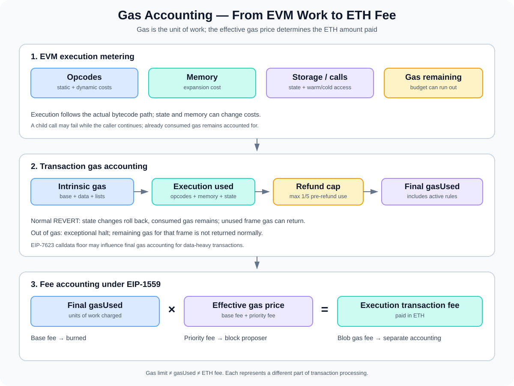

# Gas Accounting: How the EVM Measures Work and Calculates Fees

> **Stage:** 05 — Advanced Transactions and Gas  
> **Priority:** 2  
> **Status:** Reviewed  
> **Last reviewed:** 2026-10-17

## 1. Overview

**Gas accounting** is the protocol's process for measuring the computational and state-access work performed by a transaction, enforcing the transaction's gas limit, applying eligible gas refunds, and determining the ETH charged for that work.

Gas is a unit of work, not a currency. Users pay fees in ETH by multiplying the gas charged by the effective gas price. A transaction can use many units of gas while paying a relatively small amount per unit, or use fewer units while facing a higher gas price.

Gas accounting has three related but distinct layers:

1. **Execution metering:** the EVM charges gas for opcodes, memory expansion, storage access, calls, and other work.
2. **Transaction accounting:** intrinsic requirements, execution consumption, refunds, and calldata-floor rules determine the transaction's final `gasUsed`.
3. **Fee accounting:** the final gas amount is multiplied by the effective gas price; under EIP-1559, the base-fee portion is burned and the priority-fee portion goes to the block proposer.



Understanding these layers helps smart-contract developers reason about gas estimates, out-of-gas failures, optimization trade-offs, transaction receipts, and the fee actually paid by a sender.

## 2. Gas Limit, Gas Consumed, and Gas Charged

These terms should not be used interchangeably:

- **Gas limit:** the maximum gas budget declared by the transaction.
- **Execution gas consumption:** the gas consumed while the EVM runs the transaction, including dynamic opcode and memory costs.
- **Intrinsic gas:** transaction-level gas requirements calculated before normal destination-code execution starts. See [Intrinsic Gas](07-intrinsic-gas.md).
- **Refund counter:** a transaction accounting value increased by certain eligible operations. It is not gas that is immediately returned to code during execution.
- **Final `gasUsed`:** the gas amount charged for the transaction after applicable refunds and protocol rules, including the calldata floor where it applies.
- **Gas price:** the ETH amount paid per gas unit under the transaction's fee model.
- **Transaction fee:** final gas charged multiplied by the effective gas price, with separate accounting for blob fees where applicable.

For example, a transaction can have a gas limit of 100,000 and finish with 62,000 gas charged. It does not pay for all 100,000 merely because that was its limit; the unused budget is not charged as consumed gas. Exact final accounting depends on the transaction type and the active protocol rules.

A gas limit also should not be treated as a promise that execution will succeed. A transaction can have enough gas to begin yet still revert or run out of gas during execution.

## 3. EVM Execution Metering

The EVM does not assign one flat cost to an entire Solidity function. It meters the operations performed by the compiled bytecode. The amount of gas used depends on the actual execution path and sometimes the current state.

### Opcode costs

Each opcode has a gas cost defined by the active Ethereum protocol rules. Some operations have a simple fixed charge; others have dynamic costs or trigger additional calculations. Compiler optimizations can change the number and type of opcodes emitted, so two implementations of the same high-level function can have different gas behavior.

This is one reason developers inspect optimized bytecode or run reproducible gas tests rather than estimating cost by counting Solidity statements.

### Memory expansion

EVM memory expands when instructions access bytes beyond the current memory size. The memory cost is based on the total number of 32-byte words allocated, not only the number of bytes in the latest operation.

Under the familiar EVM memory-cost formula:

```text
C_mem(a) = 3 × a + floor(a² / 512)
```

Here, `a` is the total memory size in 32-byte words after expansion. When an operation expands memory, the incremental memory charge is the new total cost minus the cost already paid for the previous memory size.

This quadratic component means very large memory allocations become increasingly expensive. Memory cost is a runtime execution charge, not a transaction calldata charge.

### Storage operations

Storage gas depends on the operation, the slot's original/current/new values, and whether relevant state has already been accessed in the transaction. A read and a write are not priced identically, and repeated writes to the same slot can have different costs from its first write.

[EIP-2200](https://eips.ethereum.org/EIPS/eip-2200) defines structured net gas metering for `SSTORE`, considering original, current, and new values plus refund accounting. Later changes such as [EIP-2929](https://eips.ethereum.org/EIPS/eip-2929) and [EIP-3529](https://eips.ethereum.org/EIPS/eip-3529) affect access charges and refund rules. Avoid assuming one universal `SSTORE` cost without considering the active fork and slot state.

### Warm and cold access

Under EIP-2929, many account and storage accesses are classified as **warm** or **cold**. For common cases, a cold account access costs 2,600 gas, while a warm account access costs 100 gas; a cold `SLOAD` costs 2,100 gas, while a warm `SLOAD` costs 100 gas.

The list of items already accessed is transaction-scoped, and access-list entries can pre-warm declared addresses and storage keys at their own upfront cost. See [Access List Transactions (EIP-2930)](04-access-list-transactions-eip-2930.md). These values are component charges, not the total cost of every call or storage opcode; other costs may also apply.

### Calls and forwarded gas

Operations such as `CALL`, `DELEGATECALL`, and `STATICCALL` have gas costs and pass a gas budget into a child execution context. The exact amount available to the child depends on the gas requested, the caller's remaining gas, applicable call costs, and EVM rules such as the EIP-150 63/64 rule.

A child call that fails does not necessarily force the whole transaction to fail. The caller can inspect the result and either propagate the failure or handle it. Gas already consumed by the child is still accounted for, even when the child call's state changes are reverted.

## 4. Transaction Accounting: From Intrinsic Gas to Final Gas Used

At a conceptual level, transaction gas accounting proceeds as follows:

1. **Validate the transaction and its gas budget.** The gas limit must satisfy the required intrinsic minimums and the active protocol's additional constraints.
2. **Account for intrinsic transaction costs.** These include the base transaction charge, calldata-related costs, and applicable format-specific entries.
3. **Execute the EVM.** Charge opcode, memory, storage, account-access, and other runtime costs as they occur.
4. **Handle execution failure or success.** A revert rolls back the relevant state changes, while gas already consumed remains accounted for. Exceptional halts such as an out-of-gas condition have their own gas-consumption rules.
5. **Apply eligible refunds.** Refunds affect the final charged gas but are limited by the protocol's refund cap.
6. **Apply the calldata floor where relevant.** EIP-7623 defines a minimum gas-accounting relationship for transactions whose calldata cost would otherwise be too low relative to the data carried.
7. **Record gas usage in the block and receipt.** Each transaction contributes to the block's cumulative gas-used value.

This is a mental model, not a complete consensus-validation algorithm. Ethereum clients apply the formal rules for the active fork and the transaction type.

## 5. Gas Refunds: A Counter, Not an Immediate Payment

Some EVM operations can increase the transaction's **refund counter**. Historically, clearing storage could provide a refund incentive, but refunds do not replenish the gas available to later EVM instructions as soon as the operation occurs.

The refund counter is accounted for when determining final transaction gas usage. [EIP-3529](https://eips.ethereum.org/EIPS/eip-3529) reduced the maximum refund to **one-fifth of gas used before the refund is applied** and removed the `SELFDESTRUCT` refund. As a result, eligible refunds cannot reduce the gas charged without limit.

At a simplified level:

```text
applied_refund = min(refund_counter, gas_used_before_refund / 5)

gas_after_refund = gas_used_before_refund - applied_refund
```

This is a conceptual summary of the refund cap. The final `gasUsed` also needs to follow applicable transaction-level rules such as the EIP-7623 calldata floor. Exact refund-counter changes depend on the particular opcode, storage history, and active fork.

Developers should avoid designing logic whose economics rely on receiving a maximum refund. The final refund can be capped, and protocol changes can alter refund incentives.

## 6. Revert and Out-of-Gas Accounting

A transaction's execution result and gas outcome are connected, but they are not identical.

### `REVERT`

The `REVERT` instruction halts the current execution frame, returns revert data, and rolls back state changes made within that frame. It allows remaining gas in the frame to be returned to its caller. If the failure propagates to the top-level transaction, the receipt indicates failure, but gas already consumed is still charged according to transaction accounting.

A revert does not mean the sender automatically pays the entire gas limit. Nor does it mean the transaction is free: the work performed before the revert consumed gas.

### Out of gas

If an execution frame attempts an operation without enough gas for its required charge, that frame exceptionally halts. Remaining gas available to that frame is not returned as it would be on a normal `REVERT`. For a top-level out-of-gas failure, this usually means the remaining execution budget is consumed, making the final gas charged much higher than in a deliberately handled revert.

When a child frame runs out of gas, the child fails; the caller may be able to handle the failed call if its own frame remains running. The gas accounting follows the gas that was actually available to each frame and the applicable EVM call rules.

### State and transaction fees

If a top-level transaction reverts, its execution state changes and emitted logs do not persist. However, the transaction's inclusion, the sender nonce change, and payment of the applicable gas fees are not rolled back as if the transaction had never happened.

This distinction is important in debugging failed transactions: a receipt status showing failure does not imply zero gas used, and a failed call can still charge a meaningful fee.

## 7. Turning Gas Used into an ETH Fee

Gas measures work; the effective gas price determines the ETH paid per unit of that work.

For ordinary execution gas under the EIP-1559 fee market:

```text
execution transaction fee = gasUsed × effectiveGasPrice
```

The precise amount depends on the transaction's fee fields and the base fee of the block that includes it.

### EIP-1559 effective gas price

A type-2 transaction specifies `maxFeePerGas` and `maxPriorityFeePerGas`. The priority fee actually offered cannot exceed the available amount above the block base fee:

```text
effectivePriorityFee =
  min(maxPriorityFeePerGas, maxFeePerGas - baseFeePerGas)

effectiveGasPrice = baseFeePerGas + effectivePriorityFee
```

These formulas assume the transaction is valid for inclusion and its maximum fee is at least the block base fee. A transaction is not required to pay its full `maxFeePerGas`; that field is the maximum per-gas amount the sender permits.

### Where the fee goes

For execution gas under EIP-1559:

- **Base fee:** burned by the protocol.
- **Priority fee:** paid to the block proposer as the inclusion incentive.
- **Unused gas budget:** not charged as consumed gas; any temporarily reserved balance is released/refunded according to transaction processing.
- **Blob fee:** for blob transactions, blob gas follows a separate fee mechanism and should not be silently combined with the execution gas price calculation above.

Legacy and type-1 transactions use a `gasPrice` field, but on a chain using EIP-1559 rules their fee accounting still distinguishes the base-fee portion from the priority-fee portion. See [EIP-1559](https://eips.ethereum.org/EIPS/eip-1559) for the normative rules.

### Example

Assume a transaction has:

- Final execution `gasUsed`: 50,000 gas
- Block `baseFeePerGas`: 20 gwei
- Effective priority fee: 2 gwei

Then:

```text
effectiveGasPrice = 20 + 2 = 22 gwei

fee = 50,000 × 22 gwei
    = 1,100,000 gwei
    = 0.0011 ETH
```

This example calculates the execution transaction fee only. If the transaction were a blob transaction, its blob fee would need to be accounted for separately.

## 8. Calldata Accounting and EIP-7623

Traditional intrinsic accounting charges calldata bytes at different rates depending on whether they are zero or non-zero. [EIP-7623](https://eips.ethereum.org/EIPS/eip-7623) adds a calldata-based floor so that data-heavy transactions with little execution cannot carry a disproportionately large amount of calldata for a low gas charge.

EIP-7623 defines calldata tokens as:

```text
tokens = zero_bytes + 4 × nonzero_bytes
```

Its floor component uses 10 gas per token. At a simplified level, the transaction gas-used calculation accounts for the standard calldata and execution-related charges while enforcing the defined floor. For a data-heavy transaction with substantial EVM work, the standard calculation can remain dominant; for low-execution data-heavy transactions, the floor can dominate.

The transaction gas limit must satisfy the applicable intrinsic requirement and the calldata-floor minimum. This is why wallets and RPC implementations need to apply the active fork rules in gas estimation. A hand calculation that considers only 4/16 calldata byte pricing may under-estimate gas for some transactions under EIP-7623.

## 9. Developer Implications and Common Mistakes

1. **Confusing gas units with ETH.** Gas measures work; fee fields express ETH per gas unit.
2. **Assuming the gas limit is the fee.** The sender pays for charged gas at the effective gas price, not automatically the entire limit.
3. **Treating all opcodes as fixed-cost.** Storage operations, memory expansion, account accesses, and calls can have state-dependent or dynamic costs.
4. **Ignoring warm/cold state.** Repeated accesses within the transaction may be cheaper than first cold accesses.
5. **Expecting refunds to replenish runtime gas.** Refunds change final accounting; they are not extra gas available during execution.
6. **Assuming a revert consumes the entire limit.** A normal `REVERT` returns remaining gas from that frame; out-of-gas has different behavior.
7. **Assuming failed transactions are free.** The consumed gas is still charged, even if state changes revert.
8. **Ignoring the 20% refund cap.** Under EIP-3529, the applicable refund is capped relative to pre-refund gas used.
9. **Mixing execution gas and blob gas.** Blob fees use a distinct mechanism from execution gas fees.
10. **Ignoring EIP-7623.** Calldata-heavy transactions may be subject to a gas floor not captured by a simple byte-cost formula.
11. **Using a single gas figure across all chains or forks.** Opcode schedules, fee markets, and protocol features can differ.

For production systems, combine static reasoning with tests, profiling, and gas estimation on the intended network and fork. A successful estimate is useful, but actual execution may still differ when state or execution paths change.

## 10. Developer Review Checklist

- [ ] Distinguish gas limit, execution consumption, final `gasUsed`, gas price, and transaction fee.
- [ ] Explain opcode metering and why Solidity source length does not determine gas by itself.
- [ ] Describe memory expansion and the 32-byte-word cost model.
- [ ] Explain why storage gas depends on slot state and warm/cold access status.
- [ ] Distinguish a refund counter from gas available during execution.
- [ ] Explain the EIP-3529 one-fifth refund cap.
- [ ] Compare `REVERT` with an out-of-gas exceptional halt.
- [ ] Calculate an EIP-1559 effective gas price and execution fee.
- [ ] Distinguish execution fees from blob fees.
- [ ] Explain when the EIP-7623 calldata floor can affect final accounting.

## 11. Key Takeaways

- Gas accounting meters EVM work, computes final transaction gas usage, and converts that usage into an ETH fee.
- Intrinsic gas is accounted for before normal contract execution; opcode, memory, storage, and call costs accrue during execution.
- State-dependent rules, warm/cold access, and memory expansion can make two calls to the same function consume different gas.
- Refunds affect the final charged amount but do not replenish execution gas, and EIP-3529 caps refunds at one-fifth of pre-refund gas used.
- A normal revert rolls back state but still charges consumed gas; out-of-gas uses different exceptional-halting rules.
- Under EIP-1559, the effective gas price determines payment per unit, with the base fee burned and the priority fee going to the block proposer.
- Blob gas fees are separate, and EIP-7623's calldata floor can influence final `gasUsed`.

## References

1. **[EIP-1559 — Fee market change](https://eips.ethereum.org/EIPS/eip-1559)** — effective gas price, fee caps, base fee burning, and priority fee.
2. **[EIP-2929 — Gas cost increases for state access opcodes](https://eips.ethereum.org/EIPS/eip-2929)** — warm/cold account and storage access accounting.
3. **[EIP-2200 — Structured definitions for net gas metering](https://eips.ethereum.org/EIPS/eip-2200)** — state-dependent `SSTORE` costs and refund counter logic.
4. **[EIP-3529 — Reduction in refunds](https://eips.ethereum.org/EIPS/eip-3529)** — refund cap and removal of the `SELFDESTRUCT` refund.
5. **[EIP-7623 — Increase calldata cost](https://eips.ethereum.org/EIPS/eip-7623)** — calldata tokens and gas-used floor.
6. **[EIP-3860 — Limit and meter initcode](https://eips.ethereum.org/EIPS/eip-3860)** — initcode charges and creation transaction constraints.
7. **[Ethereum.org — Gas and fees](https://ethereum.org/developers/docs/gas/)** — user-facing gas, base fee, and priority-fee overview.
8. **[Intrinsic Gas](07-intrinsic-gas.md)** — transaction-level minimum charges before EVM execution.
9. **[Access List Transactions (EIP-2930)](04-access-list-transactions-eip-2930.md)** — upfront access-list costs and warm/cold interactions.
10. **[Set Code Transactions (EIP-7702)](05-set-code-transactions-eip-7702.md)** — authorization-list and set-code transaction context.

---

*Editorial note: The calculations and formulas here are educational summaries of the cited protocol specifications. No code was profiled and no transaction was simulated or sent to a live node as part of this article's preparation.*
