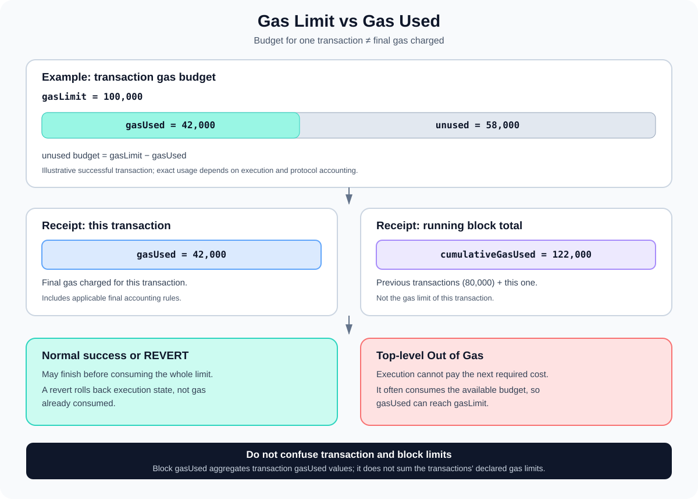

# Gas Limit and Gas Used: Budget Versus Actual Transaction Gas

> **Stage:** 05 — Advanced Transactions and Gas  
> **Priority:** 2  
> **Status:** Reviewed  
> **Last reviewed:** 2026-10-17

## 1. Overview

**Gas limit** and **gas used** are related but different transaction properties:

- **Gas limit** is the maximum amount of gas the sender allows a transaction to consume.
- **Gas used** is the final amount of gas charged for processing that transaction, as reported by the transaction receipt after the applicable protocol accounting rules.

A transaction may have a gas limit of 100,000 and finish with 42,000 gas used. The remaining budget is not charged as though it had been consumed. But if the transaction has too little gas to cover the required initial costs or to complete its execution, it may be rejected before execution or fail with out-of-gas.



Remember three separate measurements:

1. **Transaction gas limit:** the maximum budget for one transaction.
2. **Transaction gas used:** the final charged gas for that transaction.
3. **Block gas limit and block gas used:** the block's execution-gas capacity and the aggregate gas consumed by its included transactions.

These values serve different roles in transaction construction, fee accounting, and block validation.

## 2. Gas Limit: The Transaction's Budget

In a signed Ethereum transaction, the gas limit is encoded as the `gas` field in the transaction object. The term "gas limit" is commonly used when discussing what that field means.

It places an upper bound on gas the transaction can consume. This bound must be large enough for the transaction's required intrinsic costs and, if execution is to succeed, the operations it performs.

The limit is chosen before execution, so the sender usually cannot know the exact final gas used with complete certainty. The path taken by a contract can depend on current state, calldata, storage values, external calls, and protocol rules. Wallets and applications commonly use `eth_estimateGas` to estimate a suitable limit, sometimes adding a safety margin.

Gas estimation is not the same as actual gas usage. It is a simulation-based estimate for a particular input and state context; the transaction's actual execution may differ after state changes or due to different execution paths.

### Why a transaction has a gas limit

The limit provides an execution budget and protects against unbounded execution. If a loop or an unexpected call continues consuming gas, execution cannot consume more gas than the budget available to the frame and transaction.

A transaction cannot set its limit arbitrarily low. It must cover intrinsic costs and other applicable transaction-level minimums, including the calldata floor introduced by EIP-7623 where that rule applies. If the transaction begins execution but its budget is exhausted, it can fail with out-of-gas.

### The sender must be able to afford the maximum

The gas limit also matters when validating the sender's ability to afford the transaction. A sender needs sufficient balance for the transaction's value and its protocol-defined maximum gas cost. For a type-2 transaction, that maximum is based on the gas limit and `maxFeePerGas`; the actual execution fee is generally lower when the effective gas price or gas used is lower than the maximum budget.

Thus, the gas limit affects both execution's maximum allowance and the transaction's up-front affordability checks, even though the sender does not normally pay for unused gas as consumed gas.

## 3. Gas Used: What the Receipt Reports

Once a transaction is included, the receipt reports `gasUsed`. This is the gas charged for that particular transaction under the active protocol rules.

The figure reflects more than just opcode execution. It includes the transaction-level costs, execution costs, and the applicable final accounting—including eligible refunds and the calldata floor if it affects the transaction.

For a successful transaction, gas used is often lower than the limit because execution finished before exhausting the budget. Gas used can also be lower than the limit for a normal revert: a `REVERT` halts the current frame and returns its remaining gas to the caller, but gas consumed before the revert still counts.

If a top-level transaction runs out of gas, it commonly consumes its available execution budget and the reported gas used can reach the transaction gas limit. This differs from a normal revert, which does not automatically spend the entire limit.

### Example

Suppose a transaction is sent with:

```text
gasLimit = 100,000
```

The receipt reports:

```text
gasUsed = 42,000
```

The unused portion is:

```text
unused gas budget = 100,000 - 42,000
                  = 58,000 gas
```

The sender does not pay for all 100,000 gas as if it had been consumed. The actual execution transaction fee is based on the final gas used and the effective gas price, with blob gas fees handled separately for blob transactions.

This is an illustration, not a prediction of the cost of any specific contract call.

## 4. A Receipt Example: `gasUsed` Versus `cumulativeGasUsed`

A mined transaction receipt commonly contains fields such as:

```json
{
  "status": "0x1",
  "gasUsed": "0xa410",
  "cumulativeGasUsed": "0x1dcb0",
  "effectiveGasPrice": "0x4a817c800"
}
```

The numbers are illustrative hexadecimal quantities. They are not taken from a particular live transaction.

- **`status`** indicates whether the transaction execution succeeded (`0x1`) or failed (`0x0`).
- **`gasUsed`** is the gas used by this transaction alone.
- **`cumulativeGasUsed`** is the sum of gas used by this transaction and all preceding transactions in the same block.
- **`effectiveGasPrice`** is the actual per-unit execution gas price charged to the sender under the transaction's fee model.

`cumulativeGasUsed` is not the transaction's gas limit, and it is not the same as the transaction's individual `gasUsed`. It is a running total within the block, used in the receipt/block accounting.

For example, if the previous transactions in a block used 80,000 gas cumulatively and the current transaction uses 42,000 gas, its cumulative gas used is 122,000 gas. The current transaction's own `gasUsed` remains 42,000.

## 5. How Gas Limit and Gas Used Affect the Fee

For ordinary execution gas, the transaction's execution fee is calculated using its final gas used and effective gas price:

```text
execution fee = gasUsed × effectiveGasPrice
```

Under EIP-1559, the effective gas price depends on the block base fee and the transaction's fee caps. The sender specifies `maxFeePerGas` and `maxPriorityFeePerGas`; the transaction does not automatically pay the full `maxFeePerGas`.

Assume the transaction above has:

- `gasUsed` = 42,000 gas
- `effectiveGasPrice` = 22 gwei

Then:

```text
42,000 × 22 gwei
= 924,000 gwei
= 0.000924 ETH
```

This is the execution transaction fee. If the transaction is a blob transaction, the blob gas fee is accounted for separately; do not infer it from the execution gas limit or execution `gasUsed` alone.

The transaction gas limit is not multiplied by the effective gas price to determine the final consumed-gas fee. It sets the allowed budget and influences maximum affordability checks. The actual execution fee uses final gas used.

## 6. Intrinsic Gas, Execution, and the Calldata Floor

The minimum gas a transaction must provide is more involved than simply "base cost plus opcode cost."

### Before execution

Intrinsic requirements account for transaction-level costs such as the base transaction cost, calldata, contract creation and initcode where applicable, and transaction-specific entries such as access-list or authorization-list items. See [Intrinsic Gas](07-intrinsic-gas.md) for the transaction-level components.

If the gas limit cannot cover the required intrinsic cost, the transaction is invalid for inclusion under the relevant rules; normal destination-code execution does not begin.

### During execution

Once execution begins, gas is consumed by opcodes, memory expansion, storage access, external calls, and other runtime work. The execution path can vary with state and inputs, so the actual amount needed is not always known exactly in advance.

### EIP-7623 calldata floor

[EIP-7623](https://eips.ethereum.org/EIPS/eip-7623) introduced a calldata-based floor to discourage transactions that carry a large quantity of calldata while doing relatively little EVM work.

It defines calldata tokens as:

```text
tokens = zero_bytes + 4 × nonzero_bytes
```

The floor component is 10 gas per token. The final gas-used calculation compares the standard transaction accounting with the specified floor, including the applicable execution and creation terms. As a result, some data-heavy transactions may be charged more gas than a simplistic calculation using only the standard 4/16 calldata-byte prices would suggest.

An important nuance: the gas limit must reserve enough to satisfy the applicable floor requirement even though the eventual gas used is based on final transaction accounting. Gas estimates therefore need to follow the active fork's rules and not just infer the limit from opcode execution.

## 7. Transaction Gas Limit Versus Block Gas Limit

Ethereum also has a **block gas limit**. This is a separate parameter controlling the total execution gas capacity of a block.

| Concept | Scope | What it controls or records |
|---|---|---|
| Transaction `gas` / gas limit | One transaction | Maximum gas budget that transaction may consume |
| Receipt `gasUsed` | One transaction | Final gas charged for that transaction |
| Receipt `cumulativeGasUsed` | Transaction's position in a block | Sum of gas used up through that transaction |
| Block `gasLimit` | One block | Block's execution-gas capacity under the relevant rules |
| Block `gasUsed` | One block | Aggregate gas used by transactions in the block |

A block's `gasUsed` reflects the aggregate gas used by its included transactions, not the sum of their declared transaction gas limits. A transaction with a large declared limit may use much less, leaving unused budget that is not counted as consumed block gas.

The block and transaction gas-limit rules also ensure that a transaction can fit within the block's constraints. Do not confuse a wallet's transaction-level gas setting with the block's gas limit, and do not sum transaction limits to calculate a block's actual gas used.

## 8. What Happens on Success, Revert, and Out-of-Gas?

| Outcome | Receipt status | Typical gas-limit relationship |
|---|---|---|
| Execution succeeds | `0x1` | `gasUsed` is often less than `gasLimit` |
| Normal top-level revert | `0x0` | Gas consumed before revert is charged; the full limit is not automatically used |
| Top-level out-of-gas | `0x0` | Usually consumes the available transaction execution budget, so gas used can reach the limit |

These are typical patterns, not a replacement for the formal EVM rules. Gas accounting also depends on transaction-level costs, refund eligibility, calldata-floor rules, and the precise execution outcome.

A failed transaction is not necessarily a transaction that uses all its gas. Conversely, a transaction that consumes almost the entire limit may still succeed if it finishes without running out of gas. The receipt's status tells you success or failure; the `gasUsed` field tells you the final gas charged.

If you need to diagnose a failure, inspect the receipt, revert data when available, execution traces, and the transaction's input/state context. Gas used alone does not identify the root cause.

## 9. Practical Debugging and Estimation

When investigating a transaction's gas behavior:

1. **Check the submitted transaction.** Inspect the transaction's `gas` field (gas limit), fee fields, calldata, destination, value, and type.
2. **Read the receipt.** Compare `gasUsed`, `cumulativeGasUsed`, `status`, and `effectiveGasPrice`.
3. **Compare estimate to actual use.** `eth_estimateGas` is a simulation-based estimate and may differ from the final gas used when state or the execution path changes.
4. **Look at the failure type.** A revert and an out-of-gas halt have different gas behavior; a failed status by itself does not tell the whole story.
5. **Check special transaction costs.** Access lists, EIP-7702 authorization lists, contract creation, calldata floors, and blob gas can affect accounting under the active network rules.
6. **Calculate the fee correctly.** Use final execution `gasUsed` multiplied by `effectiveGasPrice`, and add the separate blob fee when applicable.

For contract development, record gas in repeatable tests and benchmark meaningful scenarios. One call's gas usage may not represent all states, token balances, loop lengths, access patterns, or external-call behaviors that users can encounter.

## 10. Common Mistakes

1. **Treating gas limit as gas used.** The limit is the budget; the receipt reports actual charged gas.
2. **Assuming unused gas is paid as consumed gas.** Unused budget is not charged as execution gas.
3. **Confusing `gasUsed` with `cumulativeGasUsed`.** One is per transaction; the other is a running total within the block.
4. **Assuming any failed transaction spends the full limit.** Normal revert and top-level out-of-gas have different outcomes.
5. **Forgetting intrinsic costs.** A gas limit must cover the minimum requirements before normal EVM execution begins.
6. **Ignoring EIP-7623.** Data-heavy transactions may require enough gas for the calldata floor.
7. **Confusing transaction and block gas limits.** They operate at different scopes.
8. **Multiplying the limit by the fee price to infer the final fee.** The final execution fee uses actual charged `gasUsed` times `effectiveGasPrice`; blob fees are separate.
9. **Treating `eth_estimateGas` as a guarantee.** It is an estimate under a particular simulation context, not a promise of the exact final usage.

## 11. Developer Review Checklist

- [ ] Explain the difference between transaction gas limit and receipt `gasUsed`.
- [ ] Calculate the unused budget as `gasLimit - gasUsed` when applicable.
- [ ] Distinguish `gasUsed` from `cumulativeGasUsed`.
- [ ] Explain why normal revert does not automatically consume the full gas limit.
- [ ] Explain why a top-level out-of-gas failure often consumes the available budget.
- [ ] Distinguish transaction gas limit from block gas limit and block gas used.
- [ ] Calculate the execution fee with `gasUsed × effectiveGasPrice`.
- [ ] Explain how intrinsic gas and EIP-7623's calldata floor constrain a valid gas limit.
- [ ] Describe why `eth_estimateGas` may differ from final gas used.
- [ ] Identify when blob fees require a separate calculation.

## 12. Key Takeaways

- Gas limit is the maximum budget for a transaction; gas used is the final amount charged for processing it.
- Unused gas budget is not charged as though it were consumed.
- `gasUsed` in a receipt is per transaction; `cumulativeGasUsed` adds gas used by earlier transactions in the same block.
- A normal revert often uses less than the limit, while a top-level out-of-gas failure often consumes the available budget.
- Intrinsic costs and the EIP-7623 calldata floor set requirements that the gas limit must cover.
- Transaction gas limit and block gas limit are different scopes.
- Execution transaction fee is based on final `gasUsed` and `effectiveGasPrice`; blob gas fees, when applicable, are separate.

## References

1. **[EIP-1559 — Fee market change](https://eips.ethereum.org/EIPS/eip-1559)** — transaction gas limit, effective gas price, and fee accounting.
2. **[EIP-7623 — Increase calldata cost](https://eips.ethereum.org/EIPS/eip-7623)** — formal gas-used formula and calldata-floor validity requirements.
3. **[EIP-3529 — Reduction in refunds](https://eips.ethereum.org/EIPS/eip-3529)** — refund cap and final gas accounting.
4. **[Ethereum Execution APIs — Transaction receipts](https://github.com/ethereum/execution-apis/blob/main/src/schemas/receipt.yaml)** — definitions of per-transaction `gasUsed` and block-position `cumulativeGasUsed`.
5. **[Ethereum Execution APIs — RPC transaction methods](https://github.com/ethereum/execution-apis/blob/main/src/eth/transaction.yaml)** — transaction objects and `eth_getTransactionReceipt`.
6. **[Ethereum.org — Gas and fees](https://ethereum.org/developers/docs/gas/)** — transaction gas budget and fee fundamentals.
7. **[Intrinsic Gas](07-intrinsic-gas.md)** — transaction-level minimum gas requirements.
8. **[Gas Accounting](08-gas-accounting.md)** — execution metering, final gas accounting, refunds, and fee calculation.

---

*Editorial note: The receipt values are illustrative. No transaction was submitted to or inspected on a live network as part of this article's preparation.*
