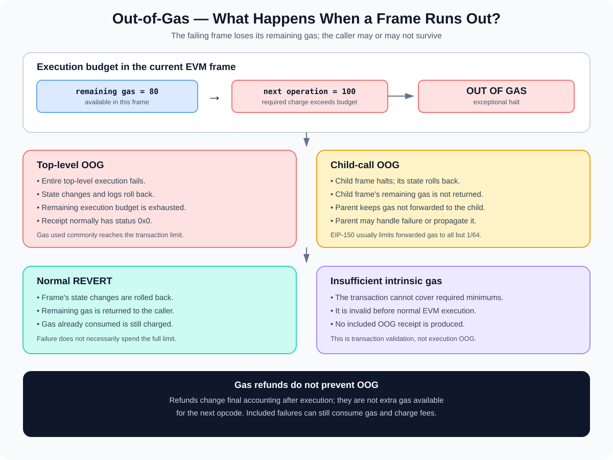

# Out-of-Gas: When EVM Execution Exhausts Its Gas Budget

> **Stage:** 05 — Advanced Transactions and Gas  
> **Priority:** 2  
> **Status:** Reviewed  
> **Last reviewed:** 2026-10-17

## 1. Overview

An **out-of-gas (OOG)** condition occurs when an EVM execution frame cannot pay the gas required for the next operation. The operation cannot proceed, so that frame halts exceptionally and its state changes are reverted.

The key behavior is that **the gas remaining in the frame that runs out of gas is not returned to its caller**. For a top-level transaction, this normally means the transaction's available execution budget is exhausted and the transaction fails. For an inner call, only the gas budget allocated to that child frame is lost; its parent may still have gas to continue and can decide how to handle the failed call.

Out-of-gas is not the same as a transaction being invalid because its gas limit is below the intrinsic minimum. An insufficient intrinsic gas limit is rejected before normal EVM execution; an OOG condition during execution can be recorded as an included failed transaction whose sender pays for the gas consumed.



## 2. What Causes Out-of-Gas?

The EVM meters computation as it executes bytecode. An OOG condition occurs when the remaining gas is below the charge required for an operation or for a dynamic cost associated with that operation.

Common causes include:

- **Gas limit too low:** the transaction's execution path needs more gas than the declared limit provides.
- **Expensive loops:** execution performs more iterations than the estimate or available gas budget allows.
- **Storage operations:** `SSTORE` and state-dependent access costs can be higher than expected.
- **Cold account or storage access:** first access to some accounts or slots can cost more than a warm access, depending on protocol rules and what has already been accessed.
- **Memory expansion:** accessing additional memory incurs a cost based on the total memory size.
- **External calls:** a callee can require more gas than the amount forwarded to it.
- **Contract creation:** initcode execution or runtime code-deposit costs may exceed the supplied budget.

The same high-level Solidity function can use different amounts of gas depending on storage values, calldata, array lengths, branches taken, external calls, and current EVM access state. A gas estimate is therefore contextual rather than a guarantee.

## 3. Gas Is Metered During Execution

Each EVM operation has a defined cost, and some operations include dynamic charges. The EVM checks that the current frame has enough gas before it performs the operation.

A simplified example:

```text
remaining gas: 80
next operation requires: 100

80 < 100 → OUT OF GAS
```

The EVM does not let the frame proceed with a negative gas balance. The exceptional halt causes the frame's state changes to roll back and its remaining gas to be consumed.

This is different from an opcode that executes successfully and leaves a small amount of gas remaining. A transaction does not have to spend its entire limit to succeed; it only needs enough gas for the actual execution path and all required transaction-level costs.

## 4. Top-Level Out-of-Gas

When the top-level EVM execution of a transaction runs out of gas:

1. The transaction has already passed transaction-level validation and was included in a block.
2. EVM execution reaches an operation that the remaining gas cannot pay for.
3. Top-level execution halts exceptionally.
4. State changes and logs from the reverted execution do not persist.
5. The receipt records failure (normally `status = 0x0`).
6. The gas budget available to the top-level execution is exhausted; reported `gasUsed` commonly reaches the transaction's gas limit.

The transaction is still a real included transaction. Its nonce progression and gas-fee payment are not rolled back as if the transaction had never been included. The sender pays for the gas charged even though the intended operation failed.

### Example

Suppose a transaction is sent with:

```text
gasLimit = 100,000
```

The contract's execution requires more than the execution budget available after intrinsic costs. If it reaches OOG at the top level, the transaction normally ends with a failed receipt and uses the available gas budget, often resulting in:

```text
gasUsed ≈ 100,000
status  = 0x0
```

This is illustrative, not a promise that every failed transaction uses its entire limit. A normal `REVERT`, for example, commonly uses less gas than the limit.

## 5. Out-of-Gas in an Inner Call

A smart contract can call another contract through instructions such as `CALL`, `DELEGATECALL`, or `STATICCALL`. The call creates a child execution frame with an allocated gas budget.

If the child frame runs out of gas:

- The child frame halts exceptionally.
- State changes and logs from that child execution are reverted.
- The gas remaining in that child frame is not returned.
- The caller's own remaining gas is not automatically all consumed; gas not forwarded to the child remains in the caller's frame.
- If the caller has enough gas to continue, it may inspect the call's failure result and handle it or deliberately propagate failure.

This distinction matters when debugging nested protocol calls. A failed inner call does not necessarily mean the whole transaction must fail. However, if the caller assumes success or explicitly reverts when the child call fails, the failure can propagate to the top-level transaction.

### EIP-150 and the 63/64 rule

[EIP-150](https://eips.ethereum.org/EIPS/eip-150) limits how much gas a caller can forward to a child call. Under the familiar rule, at most all but one sixty-fourth of the available gas after relevant call costs can be forwarded.

Conceptually:

```text
max forwarded gas = available gas - floor(available gas / 64)
```

This keeps some gas in the caller's frame so it can perform follow-up work, such as handling a failed call or returning data. The actual forwarded amount also depends on requested gas and other call costs, so this simplified formula is not a complete implementation of CALL gas calculation.

Do not assume a child call receives all gas remaining in its parent, even when the caller asks for a very large amount.

## 6. Out-of-Gas Versus REVERT

Both OOG and `REVERT` can make a transaction or call fail, but the gas behavior differs.

| Behavior | Normal `REVERT` | Out-of-gas |
|---|---|---|
| Execution outcome | Frame stops and reports failure/revert data | Frame stops exceptionally |
| State changes in the failing frame | Reverted | Reverted |
| Remaining gas in the failing frame | Returned to the caller, if any remains | Not returned |
| Can a parent call continue? | Yes, if the parent has gas and handles failure | Yes, if the parent retains gas and handles failure |
| Top-level receipt | Failed status if failure reaches transaction level | Failed status |
| Typical gas used | Less than the limit is possible and common | Top-level OOG commonly consumes the available budget |

A contract that deliberately executes `revert("reason")` has a normal failure path. The unused gas from the failing frame is available to the caller, while gas already spent is still counted.

An OOG failure is an exceptional halt. If a child frame runs out of gas, the caller generally does not receive the child's unspent frame budget, so trying to forward too much gas to a child can leave too little for later work even if the caller requested a large amount.

## 7. Out-of-Gas Versus Insufficient Intrinsic Gas

A transaction can fail before EVM execution for a different reason: its gas limit might not cover the required intrinsic charges.

### Insufficient intrinsic gas

If the submitted gas limit is below the required minimum for transaction-level costs, the transaction is invalid under the applicable rules. It is not included as a valid transaction, and the EVM's normal destination-code execution does not start. This is not an execution OOG receipt.

### Out-of-gas during execution

If the transaction passes validity checks, covers its intrinsic requirements, and is included, but a running EVM frame later exhausts its budget, it can be included with a failed receipt. The transaction's gas usage and fee are still recorded.

A third case is a call simulation such as `eth_call` or an `eth_estimateGas` request that reports an OOG-style error. Those are RPC simulations, not necessarily mined transactions; they do not create an on-chain receipt by themselves.

See [Intrinsic Gas](07-intrinsic-gas.md) for the transaction-level minimums and [Gas Limit and Gas Used](09-gas-limit-and-gas-used.md) for receipt and budget terminology.

## 8. How Gas Refunds Interact with OOG

Refunds do not give the EVM additional gas to continue execution. They are part of final transaction accounting after execution.

For example, a contract cannot clear storage, expect a future refund, and then use that anticipated refund to pay for an operation that currently lacks sufficient gas. If execution runs out of gas, it halts before a later refund could help.

Eligible refunds are also capped by protocol rules. [EIP-3529](https://eips.ethereum.org/EIPS/eip-3529) limits applied refunds to one-fifth of gas used before the refund is applied and removed the `SELFDESTRUCT` refund. Consequently, refunds should not be treated as a safety buffer for an execution path.

OOG in a child frame also rolls back that frame's state, including changes that might otherwise have affected accounting. The parent frame continues according to the remaining gas available to it and its handling of the failed call.

## 9. Debugging and Preventing Out-of-Gas

When a transaction fails with OOG, start by identifying which execution frame exhausted its gas and what operation or call was underway.

### Practical debugging steps

1. **Inspect the receipt.** Check the status and `gasUsed`. A top-level OOG often consumes almost or all of the transaction limit, but gas usage alone does not reveal the exact cause.
2. **Inspect traces or a debugger.** Locate the opcode or call frame where the gas budget was exhausted.
3. **Compare estimate and actual transaction.** Confirm the submitted `gas` value and the `eth_estimateGas` result for the intended input and state.
4. **Check state-dependent costs.** Examine storage values, array lengths, loop bounds, cold/warm accesses, memory expansion, and external-call paths.
5. **Check nested calls.** Verify how much gas can be forwarded and whether the caller has enough remaining gas to handle success or failure.
6. **Reproduce the exact path.** Run tests using realistic states, input sizes, and failure conditions rather than relying on only the simplest happy path.

### Prevention practices

- Use current gas estimators, but allow an appropriate safety margin when the application needs one.
- Write tests for worst-case inputs and state-dependent branches.
- Bound loops and user-controlled iteration counts.
- Reduce unnecessary storage writes and repeated external calls where possible.
- Design callers to check and handle the failure of low-level calls.
- Avoid assuming all requested gas is forwarded to a nested call.
- Use traces and gas snapshots to detect expensive changes during development.

Increasing the limit may resolve a genuinely under-budgeted transaction, but it is not a universal fix. If the execution always exceeds a protocol or block constraint, loops are unbounded, or the call path is logically incorrect, the contract design may need to change.

## 10. Common Mistakes

1. **Thinking every failed transaction is OOG.** A transaction may fail because of a normal revert, validation failure, or another exceptional condition.
2. **Assuming all failed transactions consume the full limit.** A normal `REVERT` usually returns unused gas from the failing frame.
3. **Assuming an inner OOG consumes every gas unit in the parent.** The child frame loses its remaining gas; the parent may retain enough to continue.
4. **Assuming a child receives the entire amount requested in `CALL`.** EIP-150's 63/64 rule constrains forwarded gas.
5. **Counting refunds as usable execution gas.** Refunds affect final accounting, not the gas available to the next opcode.
6. **Confusing insufficient intrinsic gas with OOG.** The former fails transaction validation before normal execution; the latter happens during execution.
7. **Using only estimated gas without testing the real path.** State and execution can change, leading to a different gas requirement.
8. **Ignoring fee consequences.** A failed included OOG transaction still consumes gas and charges the sender.
9. **Assuming the transaction's reverted state means nothing happened.** State changes and logs from the failed execution roll back, but the transaction remains included, its nonce is consumed, and fees are charged.

## 11. Developer Review Checklist

- [ ] Define out-of-gas as an exceptional halt when a frame cannot pay the required gas charge.
- [ ] Explain why the remaining gas in the failing frame is not returned.
- [ ] Distinguish top-level OOG from OOG in a child call.
- [ ] Explain how a caller can handle a failed inner call if it retains gas.
- [ ] Describe the EIP-150 63/64 gas-forwarding rule.
- [ ] Compare OOG with `REVERT` and insufficient intrinsic gas.
- [ ] Explain why gas refunds cannot prevent an operation from running out of gas during execution.
- [ ] Explain why a failed included transaction can still consume gas and fees.
- [ ] Use traces and realistic tests to find the execution frame and operation that exhausted the budget.

## 12. Key Takeaways

- Out-of-gas happens when an EVM frame cannot pay for the required next operation.
- The failing frame's remaining gas is not returned, and its state changes are rolled back.
- Top-level OOG commonly consumes the available transaction budget; child-call OOG consumes the child's allocated budget while the parent may retain gas.
- A normal `REVERT` returns unused gas from its frame, making it different from OOG.
- Insufficient intrinsic gas is a transaction-validity failure before normal EVM execution, not an OOG receipt.
- Gas refunds affect final accounting and cannot be spent to continue an already-running execution.
- OOG transactions that are included still consume the sender's nonce and charge the gas used.

## References

1. **[EIP-150 — Gas cost changes for IO-heavy operations](https://eips.ethereum.org/EIPS/eip-150)** — CALL gas forwarding and the all-but-one-64th rule.
2. **[EIP-140 — REVERT instruction](https://eips.ethereum.org/EIPS/eip-140)** — normal revert semantics and preservation of remaining gas.
3. **[Ethereum.org — Gas and fees](https://ethereum.org/developers/docs/gas/)** — gas limits, intrinsic validation, and what happens when execution runs out of gas.
4. **[EIP-3529 — Reduction in refunds](https://eips.ethereum.org/EIPS/eip-3529)** — refund cap and removal of the SELFDESTRUCT refund.
5. **[EIP-7623 — Increase calldata cost](https://eips.ethereum.org/EIPS/eip-7623)** — calldata floor and valid transaction gas requirements.
6. **[Gas Accounting](08-gas-accounting.md)** — execution metering, refunds, and final fee accounting.
7. **[Gas Limit and Gas Used](09-gas-limit-and-gas-used.md)** — transaction gas budget and receipt semantics.
8. **[Intrinsic Gas](07-intrinsic-gas.md)** — required transaction-level gas before normal execution begins.

---

*Editorial note: This article explains protocol behavior and debugging practices. No Solidity example was compiled and no transaction was sent to a live network as part of this article's preparation.*
