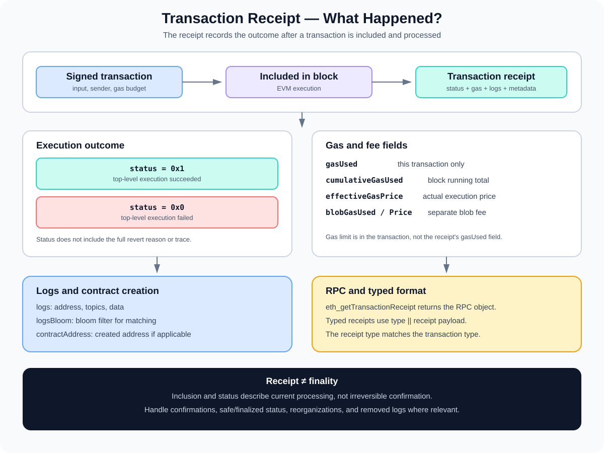

# Transaction Receipts: Reading the Result of an Ethereum Transaction

> **Stage:** 05 — Advanced Transactions and Gas  
> **Priority:** 2  
> **Status:** Reviewed  
> **Last reviewed:** 2026-10-17

## 1. Overview

A **transaction receipt** is the execution result record returned for a transaction after it has been included and processed in a block. It reports information such as whether execution succeeded, how much gas the transaction used, which logs it emitted, and which block contains it.

On Ethereum JSON-RPC, applications usually request a receipt with `eth_getTransactionReceipt`:

```json
{
  "jsonrpc": "2.0",
  "method": "eth_getTransactionReceipt",
  "params": ["0x<transaction-hash>"],
  "id": 1
}
```

The hash above is a placeholder, not a real transaction hash. Receipts are not available for pending transactions; if a transaction has not been included or cannot be found, an RPC request can return `null`.



A receipt answers an important question: **what happened when this transaction was processed?** It does not, on its own, explain every reason why execution failed, prove that the containing block is finalized, or include the full return data from a contract call.

## 2. The Receipt and the Transaction Are Different Objects

The transaction contains the signed intent sent by the user: sender, destination, value, calldata, nonce, gas limit, fee fields, transaction type, and signature data.

The receipt contains information reported after inclusion and execution. For example:

- The transaction's `gas` field is its declared gas budget.
- Receipt `gasUsed` is the final gas charged for processing that specific transaction.
- The transaction's calldata describes the input; the receipt's logs describe persistent EVM log events produced during successful execution frames.
- The transaction signature proves authorization of the signed transaction; the receipt records the execution outcome but is not a replacement for the signed transaction.

Some receipt fields provided by JSON-RPC, such as `transactionHash`, `blockHash`, `blockNumber`, `transactionIndex`, `from`, and `to`, are convenient metadata used to locate and relate the result to its transaction and block. They are not all part of the consensus receipt payload itself.

## 3. Important Receipt Fields

An Ethereum JSON-RPC receipt commonly includes fields like these. Exact optional fields depend on transaction type and the API specification implemented by the node.

| Field | Meaning |
|---|---|
| `transactionHash` | Hash identifying the transaction this receipt belongs to. |
| `transactionIndex` | Index of the transaction inside its containing block, usually represented as a hexadecimal quantity in JSON-RPC. |
| `blockHash` | Hash of the block that currently contains the transaction. |
| `blockNumber` | Number of the block containing the transaction. |
| `from` | Address that submitted the transaction. |
| `to` | Destination address; `null` for a top-level contract-creation transaction. |
| `status` | `0x1` for successful top-level execution or `0x0` for failure, for post-Byzantium receipts. |
| `gasUsed` | Gas charged for this transaction alone after applicable accounting. |
| `cumulativeGasUsed` | Gas used by this transaction plus all earlier transactions in the same block. |
| `effectiveGasPrice` | Actual per-unit execution gas price charged to the sender under the transaction's fee rules. |
| `contractAddress` | Address of a contract created by this transaction, when applicable; otherwise `null`. |
| `logs` | Log entries that persisted from this transaction's execution. |
| `logsBloom` | 256-byte bloom filter built from the log addresses and topics, used to help filter candidate blocks. |
| `type` | Transaction type associated with the receipt, such as legacy `0x0`, type 1 `0x1`, or type 2 `0x2`. |
| `blobGasUsed`, `blobGasPrice` | Blob-gas usage and price fields for transactions that use blobs, when provided by the API. |

The JSON-RPC receipt can include fields that are derived from the transaction or block to make application development convenient. The consensus receipt payload itself is more compact and is defined by the protocol.

## 4. Understanding `status`

For receipts under the post-Byzantium format, the `status` field indicates the top-level execution outcome:

- **`0x1` — success:** the transaction's top-level execution completed successfully.
- **`0x0` — failure:** the transaction's top-level execution failed, for example by propagating a revert or running out of gas.

A successful status does **not** mean that every internal operation succeeded. A contract can make a low-level external call, receive a failure result, handle it, and then finish the overall transaction successfully. The receipt status reflects the overall transaction outcome, not a summary of every internal call.

Similarly, `status = 0x0` does not explain the specific revert reason. A receipt usually does not contain the revert data or a human-readable failure message. To investigate a failed transaction, developers may need the transaction input, a node trace/debug API, an explorer's execution trace, or a simulation against the appropriate state. Such tools may not be available on every RPC provider.

### Pre-Byzantium historical receipts

Before the Byzantium upgrade, receipts used a post-transaction state root (`root`) instead of the `status` field. Modern receipts generally use `status`, but historical data and tooling that handles old blocks may need to account for the older form. [EIP-658](https://eips.ethereum.org/EIPS/eip-658) introduced the status code in receipts.

## 5. `gasUsed` Versus `cumulativeGasUsed`

These two fields are related but have different meanings.

- **`gasUsed`** is the amount charged for the current transaction.
- **`cumulativeGasUsed`** is the sum of gas used by this transaction and every earlier transaction in the same block.

For example, suppose transactions earlier in a block have used 80,000 gas, and the current transaction uses 42,000 gas:

```text
gasUsed           = 42,000
cumulativeGasUsed = 80,000 + 42,000
                  = 122,000
```

The current transaction's own gas usage remains 42,000. The cumulative field is a running block total, not a second measurement of the current transaction.

This distinction matters when interpreting receipts, deriving a transaction's position in the block gas accounting, and building indexers. A block's aggregate `gasUsed` is not calculated by summing each transaction's declared gas limits.

See [Gas Limit and Gas Used](09-gas-limit-and-gas-used.md) for a deeper comparison of the gas limit, per-transaction gas usage, and block-level gas usage.

## 6. Logs and Events

The receipt's `logs` array contains the EVM log entries that persisted from the transaction. Solidity events commonly produce these entries using EVM logging opcodes.

Each log object commonly includes:

- **`address`** — the address of the account whose execution emitted the log.
- **`topics`** — up to four 32-byte topics, where Solidity event logs commonly place the event signature hash and indexed event parameters. Anonymous events have different topic conventions.
- **`data`** — the ABI-encoded non-indexed event parameters.
- **`blockNumber`, `blockHash`, `transactionHash`, `transactionIndex`, `logIndex`** — metadata used to locate the log in its block and transaction.
- **`removed`** — a field used by log-filter/subscription APIs to indicate a log was removed because of a chain reorganization; it is commonly false or omitted in ordinary mined receipt results.

A receipt's `logsBloom` is a bloom filter derived from the log addresses and topics. It helps clients quickly identify blocks that may contain logs matching a filter. It is a probabilistic filter, not a full list of events and not proof that a specific event exists; matching blocks' log entries still need to be inspected.

### What happens to logs on revert?

Logs emitted inside a frame whose state changes are reverted do not persist in the final receipt. If a child call reverts and the parent catches the failure, logs from the reverted child frame are rolled back while the parent may continue and emit its own logs. If the top-level transaction fails, logs from its reverted execution are not retained as successful state effects.

Events are therefore useful for indexing state transitions that actually persisted, but should not be treated as a complete trace of every attempted operation inside reverted execution.

## 7. Contract Creation and `contractAddress`

When a transaction creates a contract at the top level, the receipt's `contractAddress` field may contain the address created by that transaction. For ordinary transactions sent to an existing account, the field is `null`.

Do not confuse the receipt's creation address with the `to` field in the transaction object: for a top-level creation transaction, `to` is `null` because the transaction does not target an existing destination address.

A failed contract-creation transaction does not leave a successfully created contract from the reverted creation execution, so the receipt's `contractAddress` is normally `null`. To check a creation, inspect the transaction, receipt status, and resulting chain state rather than inferring success from the submitted initcode alone.

For deterministic creation mechanisms such as `CREATE2`, the address can be predicted from the creation inputs, but a predicted address is not itself evidence that deployment succeeded. The receipt and state after execution provide the outcome context.

## 8. Receipt Fields and Fees

The `effectiveGasPrice` field reports the actual execution gas price charged per gas unit. For transactions using EIP-1559-style fee rules, it reflects the block's base fee plus the priority fee actually paid within the transaction's fee caps. It is not necessarily the transaction's declared `maxFeePerGas`.

For an ordinary execution fee calculation:

```text
execution fee = gasUsed × effectiveGasPrice
```

The sender's transaction gas limit does not replace `gasUsed` in this calculation. If the transaction is a blob transaction, the receipt may also contain `blobGasUsed` and `blobGasPrice`; the blob fee is separate from the execution-gas fee. Do not infer total blob transaction cost from `gasUsed` alone.

Receipt fields can help a block explorer or accounting system calculate execution charges, but the transaction type and network's active fee rules still matter.

## 9. Typed Receipts

[EIP-2718](https://eips.ethereum.org/EIPS/eip-2718) defines typed receipt encoding in parallel with typed transaction encoding. A typed receipt has the high-level form:

```text
TransactionType || ReceiptPayload
```

The receipt's type must match the type of its corresponding transaction. The payload is type-specific as defined by the relevant EIP. Legacy receipts retain their legacy representation rather than being encoded as a typed receipt with an extra zero byte.

For the consensus receipt payload, the legacy form is RLP-encoded as:

```text
RLP([
  status,
  cumulativeGasUsed,
  logsBloom,
  logs
])
```

For pre-Byzantium history, `status` in that list is the historical post-transaction state root rather than a success/failure status code. In the JSON-RPC response, clients expose additional transaction and block metadata alongside the receipt payload, so the RPC object is not byte-for-byte the raw consensus receipt encoding.

This distinction is important for execution clients, block explorers, light clients, and indexers processing raw block data or verifying receipts against the block header's receipt root.

## 10. Receipt Availability, Inclusion, and Reorganizations

A receipt represents a transaction that has been processed in a block. A pending transaction normally has no receipt yet; `eth_getTransactionReceipt` returns `null` when the receipt is not available.

Even when a receipt is available, inclusion is not the same as finality:

- **Included:** a block currently contains the transaction and the receipt provides its execution outcome.
- **Confirmations:** additional blocks have been built on top of the block containing the transaction.
- **Reorganization:** the canonical chain can change, and a transaction's original block may no longer be canonical. Logs may be reported as removed by subscription/filter APIs.
- **Safe / finalized:** consensus-related milestones provide stronger assurances than mere inclusion, according to the network's fork-choice and finality rules.

Apps handling high-value operations should not treat a receipt's existence or `status = 0x1` as universal proof of irreversible finality. They should check the relevant chain's confirmation, safe, or finalized policy and handle reorgs correctly.

A `blockHash` in the receipt identifies the block currently associated with the receipt; after a reorganization, clients may need to re-query transaction and block information. Persistent indexing systems should be designed to undo logs and derived state when their source block is removed from the canonical chain.

## 11. Example Receipt and How to Read It

This sample uses illustrative hexadecimal values:

```json
{
  "transactionHash": "0xaaaaaaaaaaaaaaaaaaaaaaaaaaaaaaaaaaaaaaaaaaaaaaaaaaaaaaaaaaaaaaaa",
  "transactionIndex": "0x2",
  "blockHash": "0xbbbbbbbbbbbbbbbbbbbbbbbbbbbbbbbbbbbbbbbbbbbbbbbbbbbbbbbbbbbbbbbb",
  "blockNumber": "0x100",
  "from": "0x1111111111111111111111111111111111111111",
  "to": "0x2222222222222222222222222222222222222222",
  "status": "0x1",
  "gasUsed": "0xa410",
  "cumulativeGasUsed": "0x1dcb0",
  "effectiveGasPrice": "0x4e3b29200",
  "contractAddress": null,
  "logs": [],
  "logsBloom": "0x..."
}
```

Interpretation:

- `status = 0x1`: the overall transaction execution succeeded.
- `gasUsed = 0xa410`: hexadecimal for 42,000 gas.
- `cumulativeGasUsed = 0x1dcb0`: hexadecimal for 121,008 gas used by transactions up through this transaction in the block.
- `to` is a non-null address, so this example represents a call to an existing destination rather than a top-level contract creation.
- An empty `logs` array means this receipt reports no persisted EVM logs for the transaction.

The `0x...` bloom value above is shortened for readability and is not a valid complete 256-byte bloom field. Real JSON-RPC responses include full-length encoded values and may include additional fields such as `type`, `blobGasUsed`, or `blobGasPrice` when applicable.

## 12. Common Mistakes

1. **Treating a receipt as the original transaction.** The transaction contains signed intent; the receipt records execution outcome and related metadata.
2. **Confusing gas fields.** `gasUsed` is per transaction, while `cumulativeGasUsed` is a running total within the block.
3. **Assuming status explains why execution failed.** `status = 0x0` reports failure but usually not the full revert reason or trace.
4. **Assuming every internal call succeeded if status is 1.** The top-level execution can catch and handle an internal call failure.
5. **Assuming reverted logs remain in the receipt.** Logs from reverted execution frames are rolled back.
6. **Treating logsBloom as the log array.** It is a bloom filter for efficient matching, not a definitive list of events.
7. **Assuming contractAddress is the transaction's destination.** For top-level creation, `to` is null and `contractAddress` represents the created address when successful.
8. **Treating a receipt as proof of finality.** A receipt indicates inclusion and processing, not irreversible confirmation.
9. **Expecting a receipt for a pending transaction.** A pending transaction generally does not have a receipt yet.
10. **Decoding a typed receipt as a legacy receipt.** EIP-2718 uses a type prefix for typed receipts; its type must match the corresponding transaction.

## 13. Developer Review Checklist

- [ ] Explain the difference between a signed transaction and its receipt.
- [ ] Identify the key RPC receipt fields and their meanings.
- [ ] Distinguish `status`, gas fields, block metadata, and log data.
- [ ] Explain why `gasUsed` differs from `cumulativeGasUsed`.
- [ ] Describe log topics, data, address, and logsBloom.
- [ ] Explain how reverted execution affects persisted logs.
- [ ] Describe `contractAddress` for creation and non-creation transactions.
- [ ] Explain typed receipt encoding under EIP-2718.
- [ ] Distinguish receipt availability and inclusion from safe/finalized status.
- [ ] Explain how to investigate a failed transaction beyond reading the receipt status.

## 14. Key Takeaways

- A transaction receipt records the execution outcome and metadata after transaction inclusion.
- `status` indicates overall success or failure for post-Byzantium receipts, but does not provide a full revert trace.
- `gasUsed` belongs to the current transaction; `cumulativeGasUsed` includes earlier transactions in the same block.
- Logs and logsBloom support event indexing, but logs from reverted execution frames do not persist.
- `contractAddress` describes a contract created by a successful top-level creation transaction, not the destination address of an ordinary call.
- Typed receipts use the EIP-2718 type envelope, and their type must match the corresponding transaction type.
- Receipt existence and successful status do not guarantee finality; robust apps should handle confirmations and reorganizations.

## References

1. **[Ethereum Execution APIs — receipt schema](https://github.com/ethereum/execution-apis/blob/main/src/schemas/receipt.yaml)** — fields returned by the receipt API and their meanings.
2. **[Ethereum Execution APIs — `eth_getTransactionReceipt`](https://github.com/ethereum/execution-apis/blob/main/src/eth/transaction.yaml)** — JSON-RPC method behavior and example response.
3. **[Ethereum.org — JSON-RPC API](https://ethereum.org/developers/docs/apis/json-rpc/)** — transaction receipt field descriptions and request example.
4. **[EIP-2718 — Typed Transaction Envelope](https://eips.ethereum.org/EIPS/eip-2718)** — typed receipt encoding and receipt/transaction type matching.
5. **[EIP-658 — Status code in receipts](https://eips.ethereum.org/EIPS/eip-658)** — introduction of receipt status codes.
6. **[EIP-1559 — Fee market change](https://eips.ethereum.org/EIPS/eip-1559)** — effective gas price and transaction fee rules.
7. **[Transaction Lifecycle](01-transaction-lifecycle.md)** — context for transaction inclusion, execution, receipt, and finality.
8. **[Gas Limit and Gas Used](09-gas-limit-and-gas-used.md)** — gas budget, receipt gas usage, and block cumulative totals.
9. **[Gas Accounting](08-gas-accounting.md)** — execution gas, refunds, and fee calculation.

---

*Editorial note: JSON-RPC examples are illustrative and were not queried from a live node as part of this article's preparation.*
