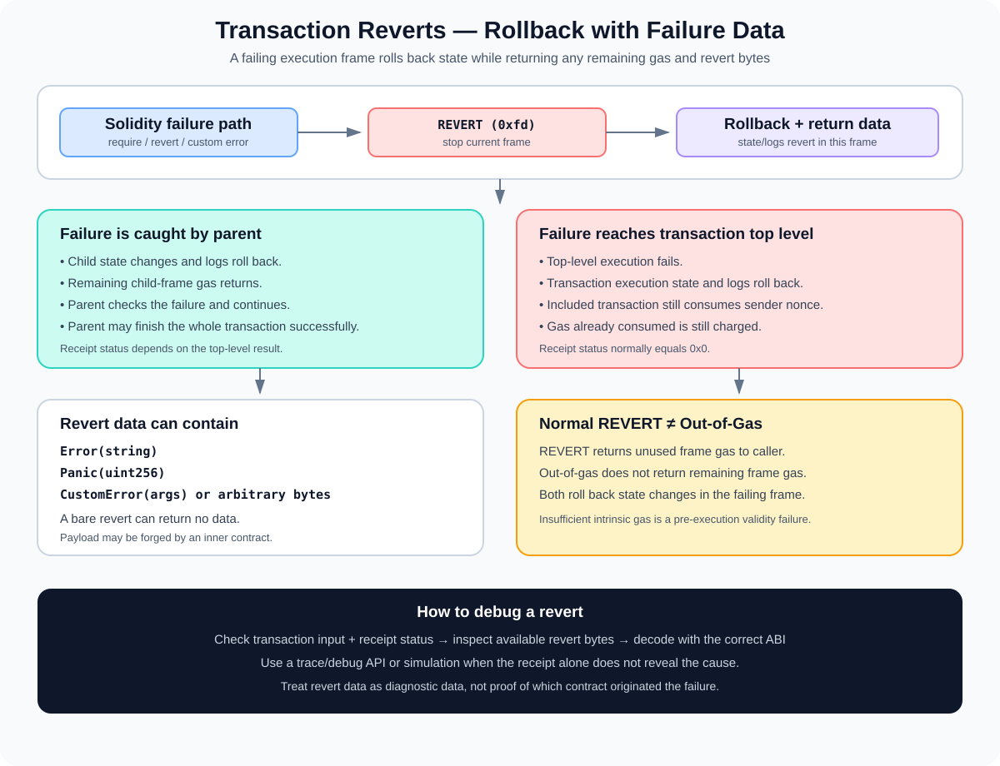

# Transaction Reverts: Rollback, Revert Data, and Failure Handling

> **Stage:** 05 — Advanced Transactions and Gas  
> **Priority:** 2  
> **Status:** Reviewed  
> **Last reviewed:** 2026-10-17

## 1. Overview

A **revert** means that an EVM execution frame deliberately or indirectly stops with failure and rolls back state changes made within that frame. In Solidity, reverts commonly happen when a `require` condition is false, a `revert` statement is executed, an error is propagated from an external call, or an `assert` fails.

The EVM's `REVERT` instruction, standardized by [EIP-140](https://eips.ethereum.org/EIPS/eip-140), gives a contract a way to stop execution, return failure data, and preserve the gas that remains in the failing frame. That is an important difference from out-of-gas, where the remaining gas in the failing frame is not returned.

A revert is not the same as saying that no transaction happened. If a top-level transaction is included and execution reverts, its state changes and logs from the reverted execution do not persist, but the transaction still consumes the sender's nonce and the sender still pays for the gas charged.



The key questions when debugging a revert are: **which execution frame failed, which state changes were rolled back, whether the failure was caught or propagated, and what revert data—if any—was returned.**

## 2. What Can Cause a Revert?

Solidity and the EVM can enter a revert path for many reasons:

- A `require(condition)` check evaluates to false.
- A contract executes `revert` explicitly.
- A custom error is raised to report a structured failure.
- An `assert` fails and produces a `Panic(uint256)` error.
- An external call reverts and the caller propagates the failure instead of handling it.
- A called function or protocol invariant rejects the input or state.
- A high-level call's expected return-data decoding fails or another runtime error causes the execution to fail.

Not all failures are deliberate `REVERT` instructions. For example, running out of gas is an exceptional halt with different gas behavior. Invalid transaction fields may cause rejection before the transaction is included at all. See [Out-of-Gas](10-out-of-gas.md) for that separate failure mode.

## 3. What the REVERT Instruction Does

At EVM level, `REVERT` (opcode `0xfd`) takes a memory offset and a memory length. It stops the current execution frame and returns the selected memory bytes as **revert data**.

Conceptually:

```text
REVERT(memoryOffset, memoryLength)
        ↓
halt the current frame with failure
        ↓
roll back state changes in this frame
        ↓
return the selected bytes as failure data
        ↓
return remaining frame gas to caller
```

The instruction does not consume all the remaining gas simply because a revert happened. Gas already spent—including relevant memory expansion costs—remains spent, and the caller receives any remaining gas from that frame if there is a caller. At the top level there is no contract caller to continue execution, so the overall transaction fails.

Rollback is scoped to the failing frame and its subcalls. If a child call reverts, its state changes and logs are undone; the parent frame can still continue if it handles the failed call. If the failure is propagated all the way to the top-level transaction, the top-level execution is reverted too.

## 4. Solidity Error Patterns

Solidity provides several ways to trigger and describe reverts.

### `require`

Use `require` for input validation, authorization checks, and other conditions that must hold for the operation to proceed.

```solidity
function withdraw(uint256 amount) external {
    require(amount > 0, "Amount is zero");
    require(balanceOf[msg.sender] >= amount, "Insufficient balance");

    balanceOf[msg.sender] -= amount;
    // Continue with withdrawal logic...
}
```

If either condition is false, that call frame reverts. State updates performed earlier in the same reverted frame would also be rolled back. The example is illustrative and omits full token or payment handling.

### Explicit `revert`

The `revert` statement makes the failure path explicit:

```solidity
if (amount > balanceOf[msg.sender]) {
    revert("Insufficient balance");
}
```

A bare `revert()` produces a revert without a reason string. `revert("...")` encodes the built-in `Error(string)` error format.

### Custom errors

Custom errors provide a compact, typed way to describe expected failure cases:

```solidity
error InsufficientBalance(uint256 available, uint256 requested);

function withdraw(uint256 amount) external {
    uint256 available = balanceOf[msg.sender];

    if (amount > available) {
        revert InsufficientBalance(available, amount);
    }

    balanceOf[msg.sender] = available - amount;
}
```

This snippet demonstrates the error path, not a complete withdrawal implementation. The exact security checks and asset transfer behavior depend on the surrounding contract.

A custom error's encoded revert data starts with a four-byte selector, derived from the first four bytes of the Keccak-256 hash of the error signature, followed by ABI-encoded arguments. Custom errors can often be more gas-efficient than long revert strings, especially when errors carry structured arguments.

### `assert` and Panic

`assert` is intended for conditions that should be true if the contract's internal logic is correct. When an assertion fails, Solidity produces a `Panic(uint256)` error. Commonly, a failed `require` or explicit `revert` represents an expected input/state condition; a failed `assert` usually indicates an invariant or programming assumption was violated.

This is a design guideline rather than a rule that all unexpected failures must use `assert`. Choose the failure mechanism that correctly describes the condition and helps reviewers understand the contract's invariants.

## 5. Revert Data: What Gets Returned?

A revert can carry bytes to explain the failure. The data may be:

- Empty, when a bare `revert()` is used or the failing code provides no data.
- An ABI-encoded `Error(string)` reason, commonly associated with `require(condition, "reason")` or `revert("reason")`.
- An ABI-encoded custom error, containing a four-byte error selector and encoded arguments.
- An ABI-encoded `Panic(uint256)`, associated with certain Solidity runtime checks and failed assertions.
- Arbitrary bytes returned by code written in Solidity, inline assembly, or another implementation.

For example, the standard error selectors include:

```text
Error(string)   → 0x08c379a0
Panic(uint256)  → 0x4e487b71
```

A custom error selector depends on its exact signature. A caller with the matching ABI can decode the selector and parameters into a readable description.

### Revert data is not proof of who caused the error

The caller should treat revert data as an error payload, not a cryptographic proof of its origin. An inner or untrusted contract can return bytes shaped like a familiar custom error, including one declared by another contract. External-call revert data can be propagated up through several call frames.

Do not use the presence of a particular revert selector as the only security-critical authorization or control-flow test unless the overall call path and origin are otherwise trusted. Validate the actual result and the invariants needed by the application.

### Return data and revert data

EIP-211 introduced `RETURNDATASIZE` and `RETURNDATACOPY`, enabling callers to inspect the data returned by the most recent call—including failure data after a call reports failure. The same return-data buffer mechanism can carry normal return bytes or revert bytes, depending on the call result.

The meaning of those bytes is determined by the ABI or calling convention in use; they are not automatically a human-readable string.

## 6. What Happens to State, Logs, and Gas?

### State changes

A reverted frame does not commit its state changes. For a top-level transaction revert, the transaction's EVM state changes are rolled back. If a child frame reverts and the parent catches the failure, only the child frame's changes are rolled back; the parent can still make other changes and return successfully.

This frame-scoped behavior is what allows a contract to attempt an external operation, catch a failure, and continue with an alternative path.

### Logs and events

Logs emitted during a reverted execution frame do not persist. If a child emits an event and then reverts, that event is not retained in the final receipt—even if a parent catches the child failure and continues. Events from the parent's later successful execution can still persist.

As a result, a receipt is not a complete trace of every operation that was attempted. It contains only logs that persisted from the final transaction execution.

### Gas and fees

A normal revert preserves the remaining gas in the failing frame and returns it to the caller if one exists. Gas already consumed is not refunded merely because state changes roll back.

If a top-level transaction reverts after inclusion, it still uses the sender's transaction nonce and incurs the gas fee for its final charged gas usage. The caller's transaction does not become free just because the intended contract action failed.

Refund accounting, including eligible storage refunds and the protocol refund cap, is separate from the execution's remaining gas. Refunds are applied during final accounting; they cannot be used as extra gas to continue execution.

## 7. Caught Revert Versus Propagated Revert

The same inner failure can produce different top-level outcomes, depending on what the caller does next.

### Propagated failure

If contract A calls contract B and B reverts, A can propagate the failure. For a high-level call, a revert from the called contract normally propagates unless the caller handles it. If the failure reaches the transaction's top level, the overall transaction receipt reports failure.

### Caught failure

A low-level call returns a success flag and return/revert data. The caller can examine the flag and continue with a fallback behavior if the call failed.

Illustrative Solidity pattern:

```solidity
(bool success, bytes memory result) = target.call(payload);

if (!success) {
    // Inspect or record the failure, then choose a deliberate fallback.
    // Do not blindly trust result as proof of the error's origin.
}
```

This is a pattern only. Low-level calls must be used carefully: the caller should validate the target, data, expected state changes, and failure behavior. Silently ignoring a failed call can break important invariants or create misleading success states.

### `try/catch`

Solidity's `try/catch` is for external calls and contract creation expressions. It is not a general-purpose handler for reverts from an internal function call in the same execution flow. Internal failures propagate within the current execution context unless they are handled by the surrounding logic's design.

Even when `catch` receives an error, the catch clause should not assume all revert data is trustworthy. It should make a decision based on the application's validated conditions, not just an unverified payload.

## 8. Reverts and Transaction Receipts

For post-Byzantium receipts, the `status` field indicates whether top-level execution succeeded (`0x1`) or failed (`0x0`). A failed receipt does not normally include a decoded revert string or the full revert bytes as a standard receipt field.

To understand why a transaction reverted, developers may need:

- the transaction input and target contract ABI;
- a node trace or debug API that replays the transaction;
- a simulation at the relevant block/state;
- revert data returned by a call simulation or external-call path, when available.

A simulated call such as `eth_call` can return an RPC error with revert data, but it is not the same thing as reading a standardized revert-reason field from a mined receipt. RPC clients and wallets may decode known error formats for display, but a human-readable message depends on the available data and decoding ABI.

See [Transaction Receipts](11-transaction-receipts.md) for status, gas usage, logs, and receipt fields.

## 9. Revert Versus Other Failure Types

| Failure type | What happens | Remaining gas behavior |
|---|---|---|
| Normal `REVERT` | Current frame fails; state changes roll back; revert data may be returned | Remaining gas in the frame is returned to caller if present |
| Out-of-gas | Frame cannot pay required gas and halts exceptionally | Remaining gas of the failing frame is not returned |
| Invalid opcode / exceptional halt | EVM frame halts exceptionally under the applicable rule | Generally consumes the failing frame's remaining gas |
| Transaction validation failure | Transaction does not meet protocol validity rules | No normal included execution receipt is produced |
| Caught inner-call failure | Child frame fails, but parent handles it and continues | Parent retains gas not consumed or forwarded to child |

These are simplified categories. Details depend on the specific opcode, call structure, and current protocol rules. For OOG, see [Out-of-Gas](10-out-of-gas.md).

## 10. Common Mistakes and Security Considerations

1. **Assuming revert means the entire transaction never happened.** An included top-level revert still consumes the sender's nonce and charges gas, even though execution state changes roll back.
2. **Assuming every failed external call fails the whole transaction.** A parent can catch a low-level call's failure and continue.
3. **Assuming a revert always includes a reason string.** Revert data can be empty or arbitrary bytes.
4. **Treating revert data as trusted provenance.** Inner contracts can forge bytes that resemble an error declared by another contract.
5. **Confusing a normal revert with out-of-gas.** A normal revert returns remaining frame gas; OOG does not.
6. **Expecting logs from reverted execution to appear in a receipt.** Logs from a reverted frame are rolled back.
7. **Using `assert` for every validation failure.** Prefer explicit validation errors for expected user or protocol conditions; reserve assertions for invariants that should always hold.
8. **Ignoring low-level call failures.** Check the success flag and apply a deliberate policy for success or failure.
9. **Using try/catch for internal calls.** Solidity's try/catch handles external calls and contract creation, not ordinary internal function calls.
10. **Assuming the receipt contains the revert reason.** The receipt normally reports status; traces, simulations, and returned error data may be needed for diagnosis.
11. **Treating custom errors as globally unique.** The selector is derived from the error signature, not a cryptographically unique contract identity; collisions and ambiguous declarations are possible.

## 11. Developer Review Checklist

- [ ] Explain what EVM `REVERT` does to the current execution frame.
- [ ] Distinguish top-level revert from a caught inner-call revert.
- [ ] Explain which state changes and logs roll back.
- [ ] Explain why a reverted included transaction still charges gas and consumes its sender nonce.
- [ ] Decode the high-level structure of `Error(string)`, `Panic(uint256)`, and custom-error revert data.
- [ ] Explain why revert data does not prove which contract originated it.
- [ ] Compare normal `REVERT` and out-of-gas gas behavior.
- [ ] Use low-level call results and try/catch correctly for external failure handling.
- [ ] Know when to use traces or simulation rather than relying only on the receipt status.

## 12. Key Takeaways

- `REVERT` stops the current EVM frame, rolls back that frame's state changes, and can return error bytes.
- A revert preserves the frame's remaining gas, unlike out-of-gas.
- If an inner failure is caught, the parent can continue; if propagated to the top level, the transaction fails.
- A reverted included transaction still consumes its transaction nonce and charges the gas used.
- Reverted state changes and logs do not persist.
- Revert data may contain a reason string, custom error, panic code, arbitrary bytes, or no data at all.
- Treat revert data as diagnostic information, not proof of origin or a standalone security decision.
- Use receipts for outcome and gas information; use traces or simulations when the failure's detailed cause is needed.

## References

1. **[EIP-140 — REVERT instruction](https://eips.ethereum.org/EIPS/eip-140)** — EVM revert semantics and remaining gas behavior.
2. **[EIP-211 — Return data opcodes](https://eips.ethereum.org/EIPS/eip-211)** — `RETURNDATASIZE`, `RETURNDATACOPY`, and failure-data handling.
3. **[Solidity documentation — Errors and custom errors](https://docs.solidity.org/en/latest/contracts.html#custom-errors)** — custom error formats, propagation, and security notes.
4. **[Solidity documentation — Revert and try/catch](https://docs.solidity.org/en/latest/control-structures.html#revert)** — revert statements and exception handling.
5. **[EIP-658 — Status code in receipts](https://eips.ethereum.org/EIPS/eip-658)** — top-level execution status in post-Byzantium receipts.
6. **[Ethereum Execution APIs — Receipt schema](https://github.com/ethereum/execution-apis/blob/main/src/schemas/receipt.yaml)** — standard receipt fields, including status and gas usage.
7. **[Transaction Receipts](11-transaction-receipts.md)** — reading the top-level status, gas use, and logs from a receipt.
8. **[Out-of-Gas](10-out-of-gas.md)** — exceptional gas exhaustion and its distinct behavior.
9. **[Gas Accounting](08-gas-accounting.md)** — how consumed gas, refunds, and final fees are accounted for.

---

*Editorial note: Solidity examples are explanatory snippets and were not compiled or executed as part of this article's preparation.*
