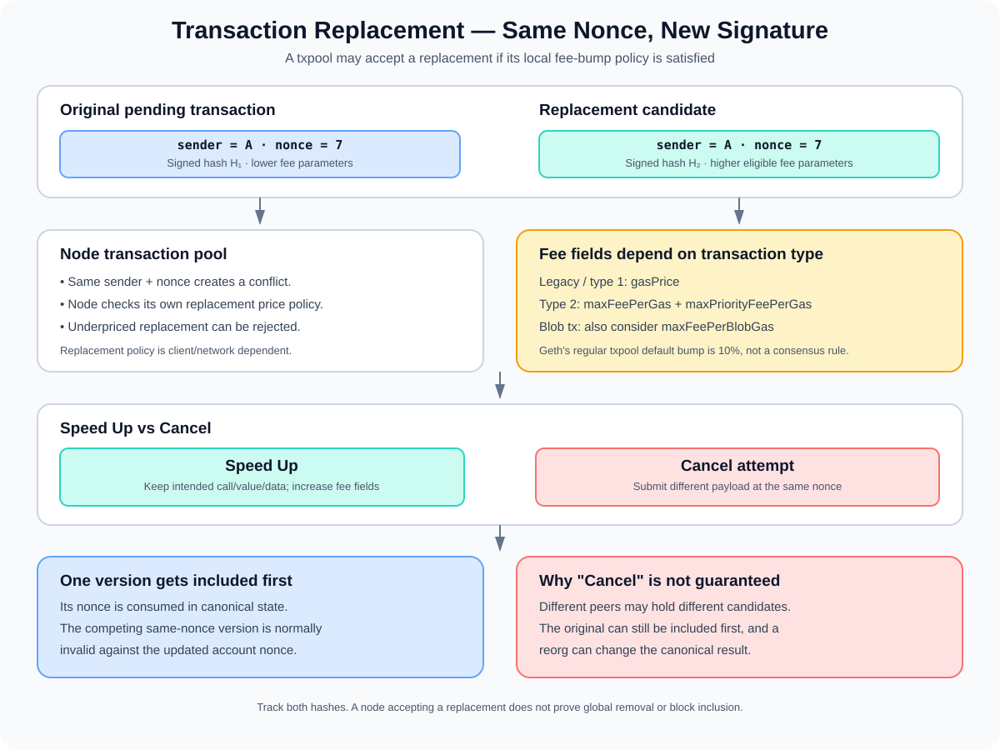

# Transaction Replacement: Replacing a Pending Transaction

> **Stage:** 05 — Advanced Transactions and Gas  
> **Priority:** 2  
> **Status:** Reviewed  
> **Last reviewed:** 2026-10-17

## 1. Overview

**Transaction replacement** means submitting a new transaction from the same sender with the **same nonce** as a transaction that is still pending, typically while offering higher fees. A transaction pool (txpool) may accept the new transaction in place of the old pending transaction if it satisfies that node's replacement policy.

Wallets commonly expose this as **Speed Up** or **Cancel**:

- **Speed Up:** resubmit the intended operation with the same nonce and higher fee parameters, hoping it is included sooner.
- **Cancel:** submit a different transaction—often a zero-value transaction to the sender's own address—with the same nonce and higher fees, hoping this one is included instead.

Replacement is a transaction-pool behavior, not a special transaction type defined by Ethereum consensus. Nodes can enforce different replacement-price thresholds and policies. Even when a replacement is accepted by one node, it is not a guarantee that every peer has discarded the original transaction or that the replacement will be mined first.



## 2. Why the Same Nonce Matters

Ethereum transactions from an account are ordered by the account's transaction nonce. A valid transaction normally has to use the account nonce expected by the chain state. See [Transaction Nonce](02-transaction-nonce.md).

Suppose an account with current nonce `7` broadcasts a transaction using nonce `7`, but the transaction remains pending. It can submit another signed transaction with nonce `7` and different fee parameters. A txpool that accepts the replacement can keep the new transaction as its candidate for nonce `7`.

The key is the combination of **same sender + same nonce**. Raising fees on a transaction with nonce `8` does not replace the earlier nonce-`7` transaction; it is a separate later transaction and may wait until nonce `7` is included.

Conceptually:

```text
Original:    sender A, nonce 7, lower fee → pending
Replacement: sender A, nonce 7, higher fee → may replace original

Nonce 7 can normally be consumed only once in the canonical account sequence.
```

The sender signs each transaction independently. Replacement does not edit the original signed transaction or change its transaction hash; it creates a new signed transaction with a different hash.

## 3. Replacement Is a Txpool Policy, Not a Consensus Rule

Ethereum consensus validates blocks and transactions according to protocol rules. It does not prescribe one universal mempool policy requiring every node to accept replacements after a specific percentage increase.

A node's transaction pool decides whether to accept a new same-nonce transaction as a replacement for one it already holds. That policy may consider:

- whether the sender and nonce match a transaction already in the pool;
- whether the new fee fields are increased enough;
- whether the transaction is otherwise valid and affordable;
- whether the node considers it executable given the account's state and earlier pending transactions;
- the selected transaction type and its fee fields;
- node-specific queue, replacement, local-transaction, and pool-capacity policies.

For example, **Geth's default `--txpool.pricebump` setting is 10% for its regular transaction pool**, while its blobpool has a separate `--blobpool.pricebump` setting. These are implementation defaults, not a consensus-wide Ethereum constant. Other clients, networks, providers, and configured nodes may behave differently. See the official [Geth command-line options](https://geth.ethereum.org/docs/fundamentals/command-line-options).

Therefore, do not teach "every Ethereum transaction can always be replaced by raising the fee by 10%" as a protocol rule. A wallet or application should account for the actual RPC endpoint, client behavior, and target network.

## 4. Which Fee Fields Need to Increase?

The replacement's fee fields depend on the transaction type.

### Legacy and type-1 transactions

Legacy transactions and EIP-2930 type-1 access-list transactions use the `gasPrice` field. A replacement generally needs a sufficiently higher `gasPrice` to satisfy the receiving node's replacement policy.

### EIP-1559 type-2 transactions

Type-2 transactions use:

- **`maxFeePerGas`** — the maximum total per-gas price the sender allows, including the base fee.
- **`maxPriorityFeePerGas`** — the maximum priority fee per gas offered to the block proposer.

A txpool may require both fee caps to increase enough relative to the transaction being replaced. Raising only one field may be rejected as underpriced. Geth's pool logic checks the fee cap and tip cap when replacing dynamic-fee transactions; exact thresholds and rules depend on the client and configuration. See the [Geth transaction pool implementation](https://github.com/ethereum/go-ethereum/blob/master/core/txpool/legacypool/legacypool.go) and its command-line policy documentation.

Increasing `maxFeePerGas` does not mean the sender necessarily pays that full amount. The effective gas price for an included transaction depends on the block base fee and the valid fee caps. Increasing fee fields improves eligibility or economic attractiveness under the relevant pool and block conditions; it cannot guarantee immediate inclusion.

### Blob transactions and other types

Blob transactions include a separate `maxFeePerBlobGas` in addition to execution-gas fee fields. Blob pools can apply replacement checks specific to blob-fee parameters. Do not assume that increasing only execution gas fees is enough for every blob transaction replacement. Consult the target client and network's current rules.

The general rule is to understand the fee fields that apply to the transaction type and the replacement policy of the node receiving the replacement.

## 5. Speed Up: Keep the Intended Operation

A speed-up transaction usually preserves the intended operation—destination, value, calldata, and other semantically important fields—while using the same nonce and more competitive fee parameters.

For example:

```text
Original:
  sender = A
  nonce  = 7
  to     = DEX
  value  = 0
  data   = swap(...)
  fee    = lower

Replacement:
  sender = A
  nonce  = 7
  to     = DEX
  value  = 0
  data   = swap(...)
  fee    = higher
```

The replacement must be signed again because changing fee fields changes the signed transaction and its hash. Keeping the same application intent is a wallet convention for the "Speed Up" action, not a consensus requirement for same-nonce replacement. The node's replacement mechanism primarily identifies the sender/nonce conflict and enforces pool acceptance rules; the application should still verify the replacement's destination, value, data, chain ID, and access/authorization fields.

A higher fee does not guarantee that the replacement wins the race. Another peer may already have propagated the original transaction, a block producer may include either valid version, or the replacement may fail pool policy or validity checks.

## 6. Cancel: Why It Is Not Guaranteed

A wallet's "Cancel" feature often constructs a new transaction using the same nonce but changing the target operation, such as sending zero ETH to the sender's own address. If that cancellation transaction is accepted and included first, it consumes the nonce, causing the original transaction to become invalid against the updated account nonce.

But cancellation is a **race**, not a chain-level cancellation command:

1. The original transaction may already be known to peers or a block producer.
2. The cancellation transaction might fail the local txpool's price-bump rule.
3. The original might be included before the cancellation replacement.
4. Different nodes may hold different candidate transactions for the same nonce.
5. A chain reorganization can change which transaction is included on the canonical chain.

So a wallet cannot truthfully guarantee that "Cancel" has removed the original transaction until the nonce has been consumed on the canonical chain and the result has sufficient confirmation for the user's risk model. Even then, reorganization risk must be considered.

The safest mental model is that the cancellation transaction competes with the original for the same nonce; it does not reach into the blockchain and erase a transaction that has already been included.

## 7. Can a Mined Transaction Be Replaced?

Normally, transaction replacement is intended for transactions still pending in a txpool. Once one transaction with a sender/nonce has been included in the canonical chain, the account nonce advances. A second transaction from that sender with the same nonce is then invalid against that updated state.

The situation can change if the block is reorganized away. If the transaction's inclusion is removed from the canonical chain, its nonce may become available again depending on the new canonical state, and the transaction or another same-nonce candidate may be considered again.

A transaction hash alone does not tell an application whether a transaction is pending, included, replaced, dropped, or removed by a reorganization. Applications should inspect transaction and receipt status, compare the sender's nonce and canonical chain state, and respond to reorgs appropriately.

## 8. Replacement, Dropped, Rejected, and Reverted Are Different

These terms are frequently confused:

- **Rejected:** a node did not accept the submitted transaction, for example because it was underpriced, invalid, or unaffordable. It may never have entered that node's pool.
- **Pending:** the transaction is held by a node's pool but has not yet been included in a block.
- **Replaced in a local txpool:** a node accepted a same-nonce candidate under its local policy and removed or superseded the prior pool entry.
- **Dropped:** a node no longer retains the pending transaction, for example due to pool eviction, expiry, invalidity under changed state, or replacement. This does not mean every node dropped it.
- **Included:** a block contains the transaction and it has been processed.
- **Reverted:** execution of an included transaction failed at the EVM level. A reverted transaction still consumes the sender's nonce and pays for gas used.

A wallet UI may label a transaction "replaced" even though another node still has the original, so the application's view of the pool should not be mistaken for a consensus-level fact.

See [Transaction Receipts](11-transaction-receipts.md) for the receipt fields that help distinguish inclusion and execution outcome.

## 9. Practical Replacement Workflow

When building or debugging a wallet, a safe workflow is:

1. **Check whether the original is pending.** Read its status where supported and inspect the sender's confirmed and pending nonce views. RPC providers can show different pool contents.
2. **Identify the exact original transaction.** Record the sender, nonce, chain ID, transaction type, destination, value, calldata, and fee fields.
3. **Build a same-nonce replacement.** Choose the new fee values according to the transaction type and the receiving node's replacement policy.
4. **Revalidate affordability and validity.** The sender must be able to afford the replacement and its maximum costs; the transaction must satisfy all current chain rules.
5. **Sign and broadcast the replacement.** It receives a new transaction hash. A successful RPC submission means a node accepted the request—not that a block has included it.
6. **Track both transaction hashes.** Continue checking until one is included in the canonical chain, and handle a potential reorganization.
7. **Verify the final operation.** For a speed-up, check that the intended payload executed. For a cancellation attempt, verify which same-nonce transaction was included before reporting that the original action was prevented.

Wallets should expose clear UX around this race. They should not promise immediate replacement, cancellation, or inclusion based solely on the RPC response to a submission request.

## 10. Common Mistakes and Security Considerations

1. **Assuming replacement is a consensus feature.** It is primarily a node transaction-pool policy; different nodes may make different acceptance decisions.
2. **Changing the nonce.** A new nonce creates a different place in the sender's sequence rather than replacing the original pending nonce.
3. **Raising only one EIP-1559 fee field.** Some pools require both `maxFeePerGas` and `maxPriorityFeePerGas` to be bumped sufficiently.
4. **Treating 10% as a universal rule.** It is Geth's default for its regular txpool, not an Ethereum consensus constant.
5. **Assuming the original disappeared globally.** Acceptance by one node does not guarantee other peers have discarded their copies.
6. **Assuming cancellation is guaranteed.** The original and the cancellation candidate race until one consumes the nonce in the canonical chain.
7. **Ignoring blob fee fields.** Blob transactions have a separate blob gas fee cap and may use a distinct replacement pool policy.
8. **Tracking only one transaction hash.** Save both original and replacement hashes and follow their state until inclusion is clear.
9. **Confusing a dropped transaction with a reverted one.** Dropped/rejected pool transactions are not necessarily mined; a reverted transaction is included and consumes gas and nonce.
10. **Ignoring reorgs.** An included transaction can be removed from the canonical chain by a reorganization, changing the replacement situation.

## 11. Developer Review Checklist

- [ ] Explain why a replacement uses the same sender and nonce.
- [ ] Distinguish txpool replacement policy from consensus validity rules.
- [ ] Explain why replacement produces a new transaction hash.
- [ ] Identify the fee fields to adjust for legacy/type-1, type-2, and blob transactions.
- [ ] Explain why a 10% bump is a client policy example rather than a universal rule.
- [ ] Distinguish speed-up from cancellation and explain why cancellation is not guaranteed.
- [ ] Explain why a same-nonce transaction is normally invalid after another one consumes that nonce in canonical state.
- [ ] Track original and replacement hashes and handle inclusion, dropped state, and reorgs.
- [ ] Distinguish rejected, pending, replaced, dropped, included, and reverted transactions.

## 12. Key Takeaways

- A transaction replacement uses the same sender and nonce as a pending transaction, usually with higher fee fields.
- Replacement is governed mainly by the receiving node's txpool policy, not by a universal consensus-level replacement percentage.
- Legacy/type-1 transactions use `gasPrice`; type-2 replacements typically need appropriate increases to both EIP-1559 fee caps under the node's policy.
- Blob transactions also have a separate blob-fee cap that can affect replacement acceptance.
- Speed-up and cancellation produce new signed transactions with different hashes.
- Cancellation is not a guarantee: the original and replacement compete until one is included and consumes the nonce on the canonical chain.
- Once one same-nonce transaction is canonically included, another transaction with that nonce is normally no longer valid against the updated account state.
- Applications should track both hashes and handle pool differences, confirmations, and reorgs.

## References

1. **[Geth — Command-line options](https://geth.ethereum.org/docs/fundamentals/command-line-options)** — `--txpool.pricebump` and separate blobpool replacement policy defaults.
2. **[Geth — Legacy transaction pool implementation](https://github.com/ethereum/go-ethereum/blob/master/core/txpool/legacypool/legacypool.go)** — replacement checks for existing same-nonce transactions and fee fields.
3. **[Geth — Blob transaction pool implementation](https://github.com/ethereum/go-ethereum/blob/master/core/txpool/blobpool/blobpool.go)** — replacement checks for execution and blob fee caps.
4. **[Ethereum.org — JSON-RPC API](https://ethereum.org/developers/docs/apis/json-rpc/)** — transaction submission and nonce fields; a reused nonce can target an existing pending transaction.
5. **[Ethereum Execution APIs](https://github.com/ethereum/execution-apis)** — transaction object and RPC method schemas.
6. **[Transaction Nonce](02-transaction-nonce.md)** — sender transaction sequence and nonce gaps.
7. **[Transaction Receipts](11-transaction-receipts.md)** — inclusion, execution status, gas usage, and receipt fields.
8. **[Gas Limit and Gas Used](09-gas-limit-and-gas-used.md)** — transaction gas budget and actual gas accounting.

---

*Editorial note: Replacement examples describe transaction-pool behavior. No transaction was signed, broadcast, or tested against a live node as part of this article's preparation.*
