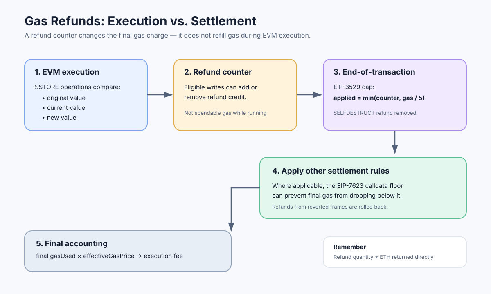

# Gas Refunds: Refund Counter, Storage Clearing, and Final Gas Used

> **Stage:** 05 — Advanced Transactions and Gas  
> **Priority:** 2  
> **Status:** Reviewed  
> **Last reviewed:** 2026-10-17

## 1. Overview

A **gas refund** is a protocol accounting adjustment that can reduce the gas charged for a transaction after EVM execution finishes. Refunds are not ETH payments sent back to the sender, and they are not extra gas that the EVM can spend while the transaction is running.

Some operations can increase a transaction's **refund counter**. At transaction settlement, the protocol applies the eligible refund subject to the applicable cap and other gas-accounting rules. The final gas amount is then used for fee calculation and receipt accounting.

Modern Ethereum refund rules are substantially different from the original rules. **EIP-3529** removed the refund for `SELFDESTRUCT`, reduced the storage-clear refund, and lowered the maximum applied refund from one-half to one-fifth of gas used before the refund.



This concept matters when estimating transaction costs, reasoning about `SSTORE`, analyzing reentrancy guards and temporary state changes, and understanding why a refund counter does not equal the amount ultimately deducted from the transaction's gas charge.

## 2. The Three Values You Must Distinguish

Do not treat the following as synonyms:

- **Gas consumed before refunds:** the transaction's gas accounting amount before the refund is applied.
- **Refund counter:** the net refund amount accumulated by eligible execution operations. It can be increased or decreased as a storage slot is changed and restored.
- **Final gas charged:** the amount after applying the allowed refund and other applicable settlement rules. The receipt's `gasUsed` reflects final transaction gas accounting.

A refund is not an execution-time gas top-up. If a function needs more gas at an opcode or call frame, a large refund counter does not provide more gas for that operation. Refunds are applied after transaction execution.

The refund counter also is not always monotonically increasing. Under the `SSTORE` net-metering rules, later writes can reverse an earlier refund when a slot is restored or changed again.

## 3. Why Storage Writes Can Produce Refunds

EIP-2200 introduced structured net gas metering for `SSTORE`. The accounting considers three values for a storage slot:

- **Original value:** the slot value at the start of the transaction.
- **Current value:** the slot value immediately before the current `SSTORE`.
- **New value:** the value the current `SSTORE` is trying to write.

This history matters. Two writes that end with the same final value can have different gas accounting depending on the slot's original value and the writes earlier in the transaction.

### Case A — Clearing a nonzero original value

If a slot's original value is nonzero and it is changed to zero, the storage-clear refund schedule can add a refund to the counter. Under EIP-3529, the `SSTORE_CLEARS_SCHEDULE` amount is defined as:

```text
SSTORE_RESET_GAS + ACCESS_LIST_STORAGE_KEY_COST
```

With the EIP-2929 / EIP-2930 parameters used by EIP-3529, this amount is **4,800 gas**. It is not the historical 15,000-gas refund.

### Case B — A slot written from zero and then reset to zero

If a slot began at zero, was made nonzero during this transaction, and is set back to zero, the net-metering rules can add a refund corresponding to part of the earlier storage-write charge. The exact amount is expressed in terms of gas schedule constants, such as `SSTORE_SET_GAS - SLOAD_GAS`; it should not be treated as a universally fixed number independent of the active gas schedule.

This pattern can occur in temporary state, including some lock patterns. It does **not** mean Solidity variables in memory receive a storage refund: the relevant rules concern EVM storage operations.

### Case C — Restoring the original value

If a slot is changed and later reset to its original value, the refund counter can increase to account for undoing part of the earlier write cost. The amount depends on whether the original slot value was zero and on the applicable `SSTORE` and `SLOAD` costs.

### Case D — Reversal of an earlier clear

If a nonzero original slot is cleared and then changed back to nonzero during the same transaction, the refund associated with clearing can be removed from the counter. This is why it is more accurate to think of the counter as **net accounting**, not a pile of independent coupons earned by each `SSTORE`.

The detailed transition rules are defined in [EIP-2200](https://eips.ethereum.org/EIPS/eip-2200) and modified by [EIP-2929](https://eips.ethereum.org/EIPS/eip-2929) and [EIP-3529](https://eips.ethereum.org/EIPS/eip-3529).

## 4. EIP-3529: The Modern Refund Policy

EIP-3529 changed refund economics in three important ways.

### 4.1 The maximum applied refund is one-fifth

The maximum refund applied at transaction settlement is:

```text
appliedRefund = min(refundCounter, gasUsedBeforeRefund // 5)
```

Here, `gasUsedBeforeRefund` means the transaction gas amount before applying the refund cap. The one-fifth cap replaced the previous one-half cap.

For a simplified example, suppose gas used before refunds is **100,000** and the refund counter is **30,000**:

- One-fifth cap: `100,000 / 5 = 20,000`
- Refund counter: `30,000`
- Applied refund: `min(30,000, 20,000) = 20,000`
- Gas after this refund step: `80,000`

The remaining 10,000 in the counter does not reduce the charge for this transaction. This is an illustration of the cap, not a full calculation for a specific transaction; other applicable rules can affect final accounting.

### 4.2 Clearing storage earns a smaller refund

EIP-3529 changed `SSTORE_CLEARS_SCHEDULE` to 4,800 gas under the EIP-2929 / EIP-2930 parameters, rather than the former 15,000 gas. The refund remains meaningful but is no longer as large as under the older schedule.

### 4.3 The `SELFDESTRUCT` refund was removed

EIP-3529 removed the gas refund previously associated with `SELFDESTRUCT`. Do not include a `SELFDESTRUCT` refund in modern gas estimates.

This statement is about the refund. It does not mean every other aspect of `SELFDESTRUCT` semantics or gas cost can be understood from EIP-3529 alone; consult the relevant fork rules and specifications for the operation's current behavior.

## 5. Refunds and Reverted Call Frames

EVM execution is organized into call frames. When a call frame reverts, its state changes are rolled back, and refund-counter changes made inside that reverted frame are also discarded as part of the frame's rollback.

For example:

1. A contract clears a storage slot and its execution path increases the refund counter.
2. A later operation in the same call frame reverts.
3. The storage change is reverted and the refund adjustment from that reverted frame does not survive as though the clear had committed.

A child call can fail and be caught by its caller. In that case, the child frame's changes are rolled back, while the parent may continue. Whether a refund survives therefore depends on which frame performed the relevant operations and whether that frame's execution was committed or reverted.

For transaction-level failure behavior, see [Transaction Reverts](12-transaction-reverts.md) and [Out-of-Gas](10-out-of-gas.md).

## 6. Refunds Do Not Refill Gas During Execution

Suppose a transaction has consumed most of its available gas and has accrued a large refund counter. The remaining EVM execution still cannot spend that future refund. A subsequent operation can still run out of gas.

This separation prevents contracts from using a future refund as an execution-time budget. EIP-3529 explicitly notes that refunds are applied only after execution and cannot affect the gas available to any call frame during execution.

Practical consequences:

- Do not use the refund counter as a reason to lower a transaction's required gas limit.
- Do not interpret a large refund counter as proof a transaction cannot run out of gas.
- When testing gas behavior, inspect the actual path and gas costs before settlement as well as the final charged amount.
- A revert or out-of-gas exception is not undone merely because earlier operations might otherwise have earned a refund.

## 7. Interaction With the Calldata Gas Floor

EIP-7623 introduced a calldata-based floor for transaction gas accounting. Where this floor applies, the final charged gas amount cannot be pushed below the required floor merely because a transaction accrued refunds.

EIP-7623's formula is more specific than taking the maximum of a generic post-refund total and an undefined “floor cost.” Define:

```text
tokens = zero_bytes + 4 * nonzero_bytes
standardCalldataCost = 4 * tokens
calldataFloorCost = 10 * tokens
executionGasUsed = EVM execution gas after the applied refund
creationCost = 32000 + 2 * words(calldata), for top-level creation
```

Then, conceptually for the execution-gas part of transaction accounting:

```text
finalGasUsed = 21000 + max(
    standardCalldataCost + executionGasUsed + creationCost,
    calldataFloorCost
)
```

For a non-creation transaction, `creationCost` is zero. The applied refund is still constrained by EIP-3529's one-fifth cap, computed from gas used before the refund; `executionGasUsed` here means execution gas after that allowed refund. This formula is a readable summary of EIP-7623's accounting, not a replacement for the complete fork-specific state-transition specification or all transaction-type rules.

This matters for transactions with substantial calldata: the refund counter may be nonzero, but the final gas charge can still be bounded by the calldata floor. See [Intrinsic Gas](07-intrinsic-gas.md) and [Gas Accounting](08-gas-accounting.md).

**Protocol-change note (reviewed 2026-10-17):** [EIP-7976](https://eips.ethereum.org/EIPS/eip-7976) proposes raising the calldata floor from EIP-7623's 10/40 model to a 64-gas-per-byte floor. As of this review date, the proposal is in Draft / Last Call and should not be treated as an active mainnet rule. If it is accepted and scheduled in a future fork, the parameters and applicable network rules may change; always check the target chain's activated fork specifications.

## 8. Refunds and ETH Fees

A refund changes the amount of gas charged; it does not change the transaction's effective gas price formula.

For the execution-gas component:

```text
execution fee = final gasUsed × effectiveGasPrice
```

Under EIP-1559 accounting, the base-fee portion is burned and the priority-fee portion is paid to the block proposer. The sender's maximum fee cap is not necessarily the effective price paid for each gas unit. Blob transactions may also incur a separate blob fee, which is accounted for separately from ordinary execution gas.

Refunds therefore affect the gas quantity used in the execution-fee calculation, subject to the active settlement rules. They do not refund an independently defined number of ETH directly, and they do not increase the transaction's `effectiveGasPrice`.

See [Transaction Receipts](11-transaction-receipts.md) for `gasUsed` and `effectiveGasPrice`.

## 9. Why Gas Tokens Lost Their Old Advantage

Earlier refund rules helped motivate gas-token designs, which attempted to perform work or occupy storage when gas was cheap and later use clearing refunds when gas was expensive. These designs also created unwanted incentives to expand persistent state and could amplify block gas usage.

EIP-3529 reduced this opportunity by sharply limiting the refund amount and removing the `SELFDESTRUCT` refund. It specifically aimed to make classic gas-token mechanisms no longer economically viable under the new refund rules.

The broader developer lesson is not to design contract economics around the assumption that clearing state produces a large future discount. Treat refunds as a bounded accounting adjustment, and compare the full cost of writing, retaining, clearing, and later reusing storage.

## 10. Common Mistakes

1. **Treating refunds as gas available during execution.** They are applied after execution, not used to fuel later opcodes.
2. **Assuming the full refund counter will be applied.** EIP-3529 caps the applied refund at one-fifth of gas used before refunds.
3. **Using the historical 15,000-gas storage-clear refund.** The EIP-3529 schedule is 4,800 gas with its referenced EIP-2929 / EIP-2930 parameters.
4. **Expecting a `SELFDESTRUCT` refund.** EIP-3529 removed it.
5. **Ignoring write history.** `SSTORE` refunds depend on original, current, and new slot values.
6. **Assuming a reverted clear still earns its refund.** State and refund-counter adjustments inside a reverted frame are rolled back.
7. **Assuming the refund determines final `gasUsed` by itself.** Other settlement rules, including the EIP-7623 calldata floor when applicable, must be considered.
8. **Confusing gas refunded with ETH refunded.** The protocol adjusts the gas quantity charged; the fee is calculated using final gas usage and effective gas price.
9. **Optimizing solely for refunds.** State growth, execution cost, security, future reuse, and the active fork rules matter more than a headline refund number.

## 11. Developer Review Checklist

- [ ] Explain the difference between gas consumed before refunds, the refund counter, and final gas charged.
- [ ] Explain the original/current/new storage-value model used by EIP-2200.
- [ ] Describe the effect of EIP-3529: 1/5 cap, reduced storage-clear refund, and no `SELFDESTRUCT` refund.
- [ ] Explain why the refund counter cannot provide additional gas during execution.
- [ ] Explain why refunds accumulated in a reverted frame do not survive that rollback.
- [ ] Identify why EIP-7623's calldata floor can affect final gas accounting.
- [ ] Explain how refunds affect the gas quantity used in fee calculation without changing the effective gas price itself.
- [ ] Avoid using historical gas-token incentives or pre-EIP-3529 refund amounts as current assumptions.

## 12. Key Takeaways

- Gas refunds are settlement-time accounting adjustments, not extra gas available to executing code.
- The EIP-2200 `SSTORE` rules consider a slot's original, current, and new values, so earlier writes in the same transaction matter.
- EIP-3529 caps the applied refund at one-fifth of gas used before refund, reduces the storage-clear refund schedule to 4,800 gas under the referenced parameters, and removes the `SELFDESTRUCT` refund.
- A reverted call frame rolls back its storage changes and associated refund-counter changes.
- EIP-7623's calldata floor can constrain the final gas charged when it applies.
- The final gas quantity, not the raw refund counter, is used for execution-fee accounting.

## References

1. [EIP-3529 — Reduction in refunds](https://eips.ethereum.org/EIPS/eip-3529) — refund cap, storage-clear schedule, and removal of the `SELFDESTRUCT` refund.
2. [EIP-2200 — Structured Definitions for Net Gas Metering](https://eips.ethereum.org/EIPS/eip-2200) — the `SSTORE` original/current/new-value rules and refund counter.
3. [EIP-2929 — Gas cost increases for state access opcodes](https://eips.ethereum.org/EIPS/eip-2929) — warm/cold access accounting and revised storage gas costs.
4. [EIP-2930 — Optional access lists](https://eips.ethereum.org/EIPS/eip-2930) — access-list storage-key cost referenced by EIP-3529.
5. [EIP-7623 — Increase calldata cost](https://eips.ethereum.org/EIPS/eip-7623) — calldata floor affecting final transaction gas accounting.
6. [Ethereum.org — Gas and fees](https://ethereum.org/developers/docs/gas/) — gas usage and transaction fee concepts.
7. [Gas Accounting](08-gas-accounting.md) — related execution and fee accounting.
8. [Gas Limit and Gas Used](09-gas-limit-and-gas-used.md) — transaction budget and final gas-used value.
9. [Transaction Reverts](12-transaction-reverts.md) — state rollback when execution reverts.

---

*Editorial note: Examples are explanatory accounting illustrations, not results from a live transaction or a gas profiler. No contract was compiled and no transaction was executed as part of this article's preparation.*
