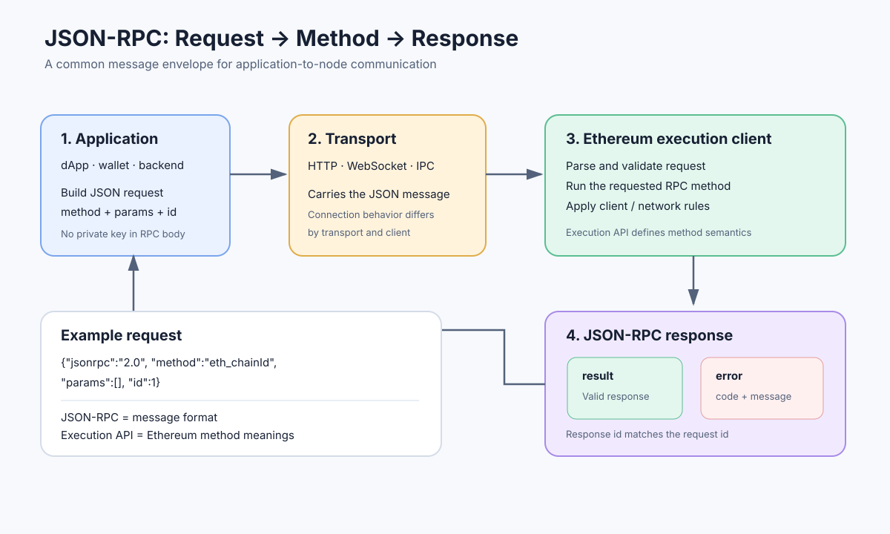

# JSON-RPC: The Interface Between Applications and Ethereum Nodes

> **Stage:** 06 — Application Connectivity  
> **Priority:** 2  
> **Status:** Reviewed  
> **Last reviewed:** 2026-10-17

## 1. Overview

**JSON-RPC** is a lightweight remote procedure call protocol that lets one program request an operation from another program. In Ethereum development, applications use the JSON-RPC interface exposed by an execution node to read blockchain data, query account state, simulate contract calls, submit signed transactions, and observe transaction results.

JSON-RPC defines the common request-and-response envelope. Ethereum's **Execution API** defines the Ethereum-specific methods, parameters, result schemas, and error behavior carried inside that envelope. This separation is important: JSON-RPC itself does not define what `eth_getBalance`, `eth_call`, or `eth_sendRawTransaction` mean.



For a smart-contract developer, JSON-RPC is the foundation beneath wallets, browser libraries, backend services, block explorers, indexers, scripts, and development tools. Libraries such as ethers or web3.js provide a more convenient interface, but they still communicate with an Ethereum node or RPC service under the hood.

## 2. The Two Layers: Protocol and Ethereum Methods

Think of the interface as two layers:

1. **JSON-RPC protocol:** defines how to represent a request, identify it, and return either a result or an error in JSON.
2. **Ethereum RPC method:** defines the requested blockchain operation, its parameters, its result, and its Ethereum-specific rules.

For example, the protocol can carry a request with method `eth_chainId`, but JSON-RPC itself does not know what a Chain ID is. Ethereum's Execution API defines the method and says that the result is returned as a hexadecimal quantity.

This is also why a node may support the JSON-RPC protocol but not expose every method you expect. Method availability can depend on the client, enabled API namespaces, network, provider policy, and whether the method is standard, client-specific, or privileged.

## 3. Anatomy of a JSON-RPC Request

A typical Ethereum JSON-RPC request has this shape:

```json
{
  "jsonrpc": "2.0",
  "method": "eth_chainId",
  "params": [],
  "id": 1
}
```

The fields mean:

- **`jsonrpc`** — protocol version; for JSON-RPC 2.0, its value is the string `"2.0"`.
- **`method`** — the method name the client wants the server to execute.
- **`params`** — an array of positional parameters or, where the specification allows it, a parameter object. Ethereum's standard examples commonly use an array.
- **`id`** — a value used to match a response to its request. It is not a transaction hash, account nonce, or blockchain sequence number.

The response to the example might look like this on Ethereum Mainnet:

```json
{
  "jsonrpc": "2.0",
  "id": 1,
  "result": "0x1"
}
```

The example illustrates the expected shape and the Mainnet Chain ID; it is not a response captured from a live node. The important link is that the response repeats request ID `1`.

A client can make many requests over time and use their IDs to associate each response with the operation that produced it. Do not assume that a request ID is unique across all clients or meaningful to the blockchain; it only belongs to the RPC interaction.

## 4. A Real Request With curl

The following example calls `eth_chainId` through an HTTP JSON-RPC endpoint. Replace the environment variable with an RPC URL supplied by a node you trust or a provider you use.

```bash
export RPC_URL="https://your-ethereum-rpc.example"

curl -sS "$RPC_URL" \
  -H "Content-Type: application/json" \
  --data '{"jsonrpc":"2.0","method":"eth_chainId","params":[],"id":1}'
```

The hostname is deliberately a placeholder, so this command will not work until you replace it with a real endpoint. The request body is JSON; HTTP is simply the transport carrying that JSON-RPC message.

Here is a second example that asks for the balance of an address at the latest block:

```json
{
  "jsonrpc": "2.0",
  "method": "eth_getBalance",
  "params": [
    "0x0000000000000000000000000000000000000000",
    "latest"
  ],
  "id": 2
}
```

A possible response shape is:

```json
{
  "jsonrpc": "2.0",
  "id": 2,
  "result": "0x0"
}
```

The result above is illustrative; it is not a claim about the current balance of that address. `eth_getBalance` returns a balance as a hexadecimal quantity denominated in **wei**, not a decimal ETH string.

These examples demonstrate the raw interface before using a library. Later concepts in this stage will cover individual RPC methods and operations such as reading state, calling contracts, estimating gas, and submitting signed transactions in greater depth.

## 5. A Response Contains Either a Result or an Error

A successful JSON-RPC response usually has a `result` field:

```json
{
  "jsonrpc": "2.0",
  "id": 2,
  "result": "0x0"
}
```

If the request fails at the RPC layer, the response instead contains an `error` object:

```json
{
  "jsonrpc": "2.0",
  "id": 2,
  "error": {
    "code": -32602,
    "message": "Invalid params"
  }
}
```

This is a generic example of an invalid-parameters error, not a response captured from a particular client. Under JSON-RPC 2.0, a response contains either `result` or `error`, not both. A server returns the request's `id` when it can associate an error with that request.

Common standard JSON-RPC error codes include:

| Code | Meaning |
|---:|---|
| `-32700` | Parse error — the request body could not be parsed as JSON. |
| `-32600` | Invalid Request — the JSON value does not form a valid request object. |
| `-32601` | Method not found — the method name is not recognized or exposed. |
| `-32602` | Invalid params — the parameters do not match the method's expectations. |
| `-32603` | Internal error — a generic server-side error. |

Ethereum execution clients and providers can also return method-specific or implementation-specific errors. Error codes and messages should be interpreted in the context of the method and client; do not assume every failure uses one universal Ethereum-specific code.

A response with `"result": null` is not the same thing as a response containing `"error"`. For example, some lookup methods return `null` when a transaction or receipt is not currently available. Your application should handle both explicit RPC errors and valid results that happen to be `null`.

## 6. Ethereum Hex Encoding: Quantity Is Not Data

Ethereum JSON-RPC represents many numbers and byte sequences using hexadecimal strings, but two common categories follow different formatting rules.

### QUANTITY — an integer

Quantities use a `0x` prefix and the shortest hexadecimal representation. They must not have unnecessary leading zeroes; zero is written as `0x0`.

Examples:

```text
Decimal 0  → 0x0
Decimal 1  → 0x1
Decimal 65 → 0x41
Decimal 1024 → 0x400
```

Values such as `0x00` for integer zero or `0x0400` for 1024 are not canonical quantity encodings.

### DATA — a byte sequence

Data values represent bytes. They use a `0x` prefix and two hexadecimal digits for each byte; leading zero bytes must be preserved. Empty data is represented as `0x`.

```text
One byte, 0x41          → 0x41
Three bytes: 00 42 00   → 0x004200
Empty byte array        → 0x
```

The string `0x004200` represents three bytes of data; it is not the canonical quantity encoding of the integer 16896. Quantity and DATA encodings may look similar but are not interchangeable.

This distinction is fundamental when working with block numbers, balances, storage slots, addresses, hashes, calldata, bytecode, and transaction data. An incorrectly padded integer or a truncated byte sequence can make a request invalid or change its meaning.

## 7. Parameters and Block Identifiers

Ethereum RPC methods define their own parameter lists. For example, a state-query method may accept both an address and a block parameter:

```json
{
  "jsonrpc": "2.0",
  "method": "eth_getBalance",
  "params": [
    "0x0000000000000000000000000000000000000000",
    "latest"
  ],
  "id": 3
}
```

Common block references include:

- **A block number** encoded as a hexadecimal quantity, for example `"0x10"`.
- **`"latest"`** — the latest block head according to the node.
- **`"safe"`** — a safe block reference, where supported.
- **`"finalized"`** — a finalized block reference, where supported.
- **`"earliest"`** — the earliest block, usually the genesis block.
- **`"pending"`** — the node's pending-state view, where the method supports it.

The exact accepted parameter shape is method-specific. Do not append a block tag to every RPC call or assume all methods accept the same tags. Historical reads can also depend on whether the node retains the requested state; provider plans and node configuration may impose additional limits.

For applications that need consistent data across multiple calls, choose block references deliberately. Calling one method at `"latest"` and then another after the chain head advances may give values from different blocks. Where supported, using the same explicit block number or block hash can help make related reads consistent.

## 8. How JSON-RPC Gets to a Node: HTTP, WebSocket, and IPC

JSON-RPC defines the message structure, not one mandatory transport. Ethereum clients commonly expose the interface through different transports:

| Transport | Typical use | Important characteristic |
|---|---|---|
| **HTTP** | Web apps, backends, scripts, provider endpoints | Request-response pattern; well supported by common tooling. |
| **WebSocket (WS)** | Apps that need a persistent connection and supported subscriptions | Keeps a connection open and can deliver notifications, such as new-head or log events. |
| **IPC** | Local tools communicating with a node on the same machine | Local socket or named pipe; availability and configuration depend on the client and operating system. |

Not every client or hosted provider enables every transport or method. For example, Ethereum subscriptions such as `eth_subscribe` are generally associated with WebSocket or IPC, not ordinary stateless HTTP polling. Subscription support and available event types depend on the client and service.

Transport choice does not change the meaning of a standard method, but it changes connection behavior, event delivery options, deployment configuration, and security exposure. A reconnect can interrupt a subscription, so an application that needs reliable event processing should have a recovery strategy—for example, resuming from a known block and querying logs where appropriate.

## 9. JSON-RPC Is Not a Transaction or a Smart Contract

These concepts operate at different layers:

- **JSON-RPC request:** a message asking an endpoint to perform an operation.
- **Ethereum RPC method:** a named operation exposed by the node, such as reading a balance or accepting a signed transaction for propagation.
- **Ethereum transaction:** a signed protocol object that may be included in a block and consume the sender's nonce.
- **Smart-contract call:** execution of code in a particular state context, which can be simulated or triggered within a transaction depending on the method and workflow.

For example, `eth_call` asks the node to execute a call without submitting an on-chain transaction. By contrast, `eth_sendRawTransaction` submits a serialized signed transaction to the node for validation and propagation. A successful RPC response from the latter usually provides a transaction hash; it does not prove that the transaction has been included, that the EVM execution succeeded, or that the block is finalized.

JSON-RPC also does not mean that the application itself holds or sends a private key to the node. A common wallet workflow constructs and signs a transaction locally, then sends the signed transaction bytes through a method such as `eth_sendRawTransaction`. Never put a private key in an RPC request.

## 10. Batch Requests and Notifications

The JSON-RPC 2.0 specification defines batch requests: an array of individual request objects sent together. A server that supports batching can return an array of corresponding responses. Responses are correlated by their `id`, not necessarily by their position in the response array.

Batching can reduce round trips, but support, size limits, ordering assumptions, and provider behavior can differ. Applications must handle partial failures and match each response using its ID. A batch is not automatically an atomic blockchain operation; each JSON-RPC call retains its own semantics.

JSON-RPC also defines **notifications**, which are requests without an `id`. Because there is no request ID, the server does not send a normal JSON-RPC response for a notification. Ethereum application code more commonly relies on ordinary requests and WebSocket subscription notifications, which are a distinct use of the word “notification.” Do not confuse these two patterns.

Unless you have verified support and behavior on your target endpoint, prefer clear individual calls or the provider's documented batch interface rather than assuming every hosted RPC service handles batch requests identically.

## 11. Reliability, Security, and Provider Trust

JSON-RPC provides a communication interface; it does not guarantee that the endpoint is honest, available, up to date, or unlimited.

When building an application:

1. **Validate results.** Check the response ID, expected result shape, hex encoding, and method-specific fields.
2. **Handle errors and null values.** Implement bounded retries for transient failures, but do not blindly retry invalid parameters or non-idempotent application workflows.
3. **Expect rate limits.** Public endpoints and hosted services may enforce request, data-size, concurrent-connection, or subscription limits.
4. **Treat the RPC endpoint as a trust boundary.** The endpoint provides you with data and may simulate execution; critical applications should consider provider trust, stale responses, independent cross-checks, or proof verification appropriate to their threat model.
5. **Protect credentials and endpoints.** Do not commit API keys, tokens, or private infrastructure URLs with secrets to a public repository.
6. **Restrict privileged interfaces.** Do not expose debugging, administrative, or engine methods to untrusted networks. Enable only necessary namespaces and follow the node/provider's access-control guidance.
7. **Do not confuse CORS with authentication.** CORS controls which browser origins can make certain cross-origin requests; it is not a complete authorization mechanism for an RPC endpoint.
8. **Design for reconnection.** Connections can drop, subscriptions can end, and a request can time out after the server has processed it. For transaction submission, record the signed transaction and hash so you can query its status instead of assuming a timeout means it was never accepted.

These precautions are especially important when an application can submit transactions or access private infrastructure. Read methods may still disclose sensitive operational data, while unrestricted write or debug endpoints can introduce serious risks.

## 12. Common Mistakes

1. **Thinking JSON-RPC is the Ethereum blockchain protocol.** It is an application-facing RPC interface; execution and consensus rules are defined elsewhere.
2. **Treating the request ID as a transaction hash.** They serve different purposes and belong to different layers.
3. **Assuming every Ethereum node exposes every method.** Implementations, provider policies, enabled namespaces, and network support can differ.
4. **Mixing up QUANTITY and DATA.** Integers use compact hex; byte arrays preserve leading zero bytes and have even-length hex data.
5. **Treating a JSON-RPC success response as on-chain success.** Receiving a hash from transaction submission does not prove block inclusion or successful contract execution.
6. **Assuming `null` means an RPC error.** A null result can be a valid response for a lookup with no current result.
7. **Assuming HTTP, WS, and IPC have identical capabilities.** Subscriptions, deployment, configuration, and access controls vary by transport and client.
8. **Assuming retries are always harmless.** A timed-out write request may have been processed; check by hash or use an application-specific idempotency strategy.
9. **Exposing privileged namespaces.** Broad RPC access can expose sensitive data or dangerous operations.
10. **Putting a private key in an RPC call.** Sign locally or use a dedicated signing system with an explicit, secure trust model.

## 13. Developer Review Checklist

- [ ] Explain the difference between JSON-RPC protocol and Ethereum's Execution API.
- [ ] Identify `jsonrpc`, `method`, `params`, and `id` in a request.
- [ ] Distinguish a successful `result` from an `error` response and a valid `null` result.
- [ ] Recognize the standard JSON-RPC error codes and know that clients may add method-specific errors.
- [ ] Correctly encode Ethereum `QUANTITY` and `DATA` values.
- [ ] Explain block tags and the importance of a consistent block reference for related reads.
- [ ] Compare HTTP, WebSocket, and IPC transports.
- [ ] Explain what a response from `eth_sendRawTransaction` does and does not guarantee.
- [ ] Describe safe handling of credentials, provider trust, retries, subscriptions, and RPC exposure.

## 14. Key Takeaways

- JSON-RPC is the standard message interface many applications use to communicate with Ethereum execution clients.
- The JSON-RPC envelope defines request/response structure; Ethereum's Execution API defines the meaning of methods and their data.
- Match responses using the request `id`; do not confuse it with an account nonce or transaction hash.
- Ethereum JSON-RPC distinguishes compact integer `QUANTITY` encodings from byte-oriented `DATA` encodings.
- HTTP, WebSocket, and IPC can carry RPC messages, but they differ in connection behavior and support for subscriptions.
- Successful RPC communication is not the same as on-chain transaction success or finality.
- Applications must handle errors, rate limits, provider trust, reconnection, and secure endpoint configuration.

## References

1. **[Ethereum.org — JSON-RPC API](https://ethereum.org/developers/docs/apis/json-rpc/)** — Ethereum method conventions, `QUANTITY` versus `DATA`, block parameters, and method examples.
2. **[Ethereum Execution APIs specification](https://github.com/ethereum/execution-apis)** — standard execution-client API definitions and request/result schemas.
3. **[JSON-RPC 2.0 Specification](https://www.jsonrpc.org/specification)** — request objects, response objects, errors, IDs, notifications, and batch requests.
4. **[Geth — JSON-RPC server](https://geth.ethereum.org/docs/interacting-with-geth/rpc)** — HTTP, WebSocket, and IPC transports; namespace and endpoint configuration.
5. **[Execution API documentation](https://ethereum.github.io/execution-apis/)** — reference documentation for standard Ethereum execution RPC methods.
6. **[Ethereum RPC methods checklist](../06-application-connectivity/02-ethereum-rpc-methods.md)** — the next concept in this stage, once that article is published.

---

*Editorial note: Request and response bodies are educational examples. The placeholder endpoint was not contacted, and no live RPC request or transaction was submitted as part of this article's preparation.*
