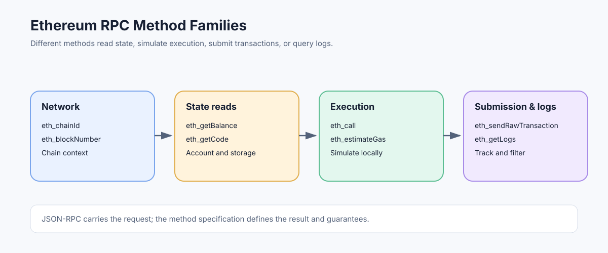

# Ethereum RPC Methods: Reading Data and Interacting with Nodes

> **Stage:** 06 — Application Connectivity  
> **Priority:** 2  
> **Status:** Reviewed  
> **Last reviewed:** 2026-10-17

## 1. Overview

Ethereum RPC methods are named operations exposed by an execution client or RPC provider. They let applications query chain metadata, inspect blocks and accounts, simulate contract execution, submit signed transactions, and retrieve transaction outcomes. JSON-RPC provides the request/response envelope; the Ethereum method specification defines the meaning and schema of each operation.



## 2. Method Families

The `eth_*` namespace contains most execution-layer methods commonly used by dApps and developer tools. The most useful first grouping is by purpose:

| Goal | Common methods | What they do |
|---|---|---|
| Network context | `eth_chainId`, `eth_blockNumber`, `net_version` | Identify the chain and observe the current head. |
| Account state | `eth_getBalance`, `eth_getTransactionCount`, `eth_getCode`, `eth_getStorageAt` | Read account data at a specified block context. |
| Blocks and transactions | `eth_getBlockByNumber`, `eth_getBlockByHash`, `eth_getTransactionByHash`, `eth_getTransactionReceipt` | Inspect canonical chain data and transaction results. |
| Execution without submission | `eth_call`, `eth_estimateGas` | Simulate a call or estimate a gas limit. |
| Transaction submission | `eth_sendRawTransaction` | Submit a serialized, already-signed transaction. |
| Logs | `eth_getLogs`, filter methods | Query logs emitted by contract execution. |

These methods do not all share the same parameters or guarantees. Read the method specification before building requests, and verify provider support for less common or client-specific methods.

## 3. A Typical Request

A balance query specifies an address and a block identifier:

```json
{
  "jsonrpc": "2.0",
  "method": "eth_getBalance",
  "params": [
    "0x0000000000000000000000000000000000000000",
    "latest"
  ],
  "id": 7
}
```

The result is a hexadecimal `QUANTITY` representing wei. It is not a decimal ETH string and it is not a byte-array `DATA` value. See [JSON-RPC](01-json-rpc.md) for request envelopes and quantity/data encoding.

A query at `latest` may observe a different state on the next call because the chain head can advance. When several reads must refer to the same state, select a common block reference and use it consistently where the method supports it.

## 4. Method Semantics Matter

The name of a method does not by itself explain its security or state effects.

- `eth_call` simulates execution against a selected state and does not submit an on-chain transaction.
- `eth_estimateGas` estimates a gas limit using simulation; it is not a promise that later execution will consume that exact amount.
- `eth_sendRawTransaction` asks the endpoint to accept a signed transaction for processing and propagation; a returned hash is not an inclusion receipt.
- `eth_getLogs` reads logs matching a filter; it does not execute a contract function or return every possible historical state change.
- `eth_getTransactionCount` can accept different block tags such as `latest` and `pending`; those answer different questions.

Related concepts: [Reading Blockchain State](03-reading-blockchain-state.md), [eth_call](06-eth-call.md), [eth_estimateGas](07-eth-estimategas.md), [eth_sendRawTransaction](08-eth-sendrawtransaction.md), and [Log and Event Filtering](09-log-and-event-filtering.md).

## 5. Standard, Optional, and Provider-Specific Methods

The Execution API specification defines a standard set of methods, but actual availability depends on the client, enabled namespaces, network, and hosted-provider policies. Debug and trace APIs are often client-specific or separately enabled, and may be unavailable on public endpoints.

Do not assume that a method present in one development node will be available on every production RPC URL. Treat capability discovery as part of integration testing, and use the provider's documentation for limits, supported block tags, archive access, batching, and subscriptions.

## 6. Common Mistakes

1. Using `net_version` when the application needs the transaction-signing Chain ID; prefer `eth_chainId` for that purpose.
2. Treating every returned hexadecimal string as the same encoding. Quantities and byte data follow different rules.
3. Assuming a read at `latest` is a permanent snapshot.
4. Treating a transaction-submission hash as evidence that execution succeeded.
5. Depending on tracing or debug methods without checking that the target node supports them.
6. Assuming provider limits and historical-data access are identical across services.

## 7. Developer Review Checklist

- [ ] Group methods into network, state, block/transaction, execution, submission, and log categories.
- [ ] Choose a block reference deliberately for state queries.
- [ ] Explain why `eth_call`, `eth_estimateGas`, and `eth_sendRawTransaction` have different semantics.
- [ ] Verify method support and service limits on the intended endpoint.
- [ ] Distinguish standard Execution API methods from debug or provider-specific extensions.

## 8. Key Takeaways

- RPC methods are the operations; JSON-RPC is the message format that carries them.
- Method parameters, result schemas, block context, and failure modes must be understood individually.
- The common `eth_*` families cover reads, simulation, transaction submission, and logs.
- Support and operational limits can vary by client and provider.

## References

- 1. [Ethereum.org — JSON-RPC API](https://ethereum.org/developers/docs/apis/json-rpc/) — common method names, parameters, and result formats.
- 2. [Ethereum Execution APIs](https://github.com/ethereum/execution-apis) — maintained method schemas and API specifications.
- 3. [JSON-RPC](01-json-rpc.md) — the request/response protocol underlying these methods.
- 4. [Reading Blockchain State](03-reading-blockchain-state.md) — using read methods against a particular state.
- 5. [Sending Transactions](04-sending-transactions.md) — lifecycle and safety of transaction submission.

---

*Editorial note: Examples are educational illustrations. No live RPC request or transaction was sent while preparing this article.*
