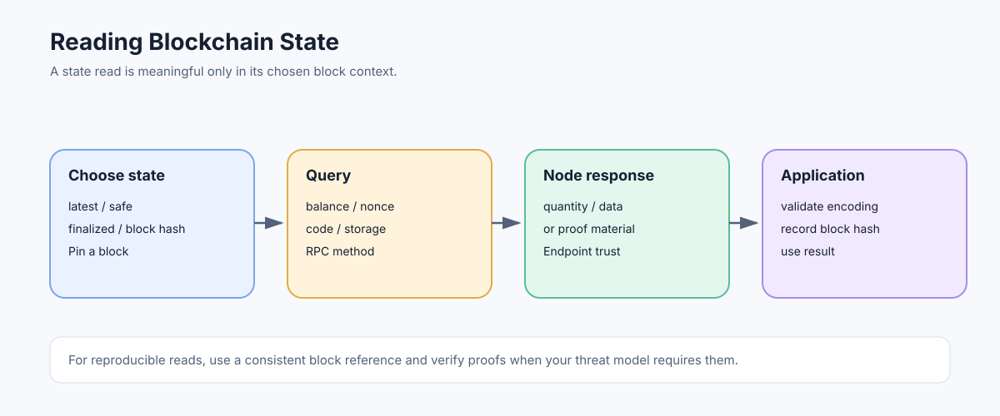

# Reading Blockchain State: Accounts, Storage, Code, and Block Context

> **Stage:** 06 — Application Connectivity  
> **Priority:** 2  
> **Status:** Reviewed  
> **Last reviewed:** 2026-10-17

## 1. Overview

Reading blockchain state means asking an Ethereum execution client for account or contract information as it existed at a particular block context. Most reads are off-chain RPC requests: they do not send a transaction, consume an on-chain nonce, or mutate canonical state. Their reliability still depends on the node, requested block, and data the node retains.



## 2. What Counts as Ethereum State?

At a high level, account state includes:

- **Nonce** — the account's transaction sequence value, with special protocol behavior for different account types and transaction flows.
- **Balance** — the account's ETH balance, represented by JSON-RPC as a hexadecimal quantity in wei.
- **Code** — deployed runtime code associated with a contract account; an EOA normally has no ordinary runtime code, though EIP-7702 delegation changes how code is resolved for execution.
- **Storage** — 32-byte values addressed by 32-byte storage keys in the account's storage trie.

The execution state also includes the relationships and roots needed to validate these values. A storage slot number in Solidity source is not always the same as the storage key used in the trie: mappings and dynamic arrays use derived keys. See the project's [Storage and Data Layout stage](../03-storage-data-layout/README.md).

## 3. Read Methods

Typical JSON-RPC methods include:

| Method | Purpose |
|---|---|
| `eth_getBalance` | Read an address's ETH balance at a block reference. |
| `eth_getTransactionCount` | Read an account nonce, often using `latest` or `pending`. |
| `eth_getCode` | Return runtime code at an address and block context. |
| `eth_getStorageAt` | Read a 32-byte storage word at an explicit storage key and block reference. |
| `eth_getBlockByNumber` / `eth_getBlockByHash` | Read block metadata and, optionally, transaction objects or hashes. |
| `eth_getProof` | Request account and storage proof material where supported by the execution API. |

For example, this reads an account balance at the latest block:

```json
{
  "jsonrpc": "2.0",
  "method": "eth_getBalance",
  "params": [
    "0x0000000000000000000000000000000000000000",
    "latest"
  ],
  "id": 1
}
```

The response is a `QUANTITY` in wei. Convert it to ETH only in application code with arbitrary-precision integer arithmetic; JavaScript floating-point numbers are not appropriate for exact on-chain integer amounts.

## 4. State Is Always Relative to a Block

The word “current” is ambiguous when a chain is advancing. Common block references include `latest`, `safe`, `finalized`, `earliest`, and, for methods that support it, `pending`. A request may alternatively identify a concrete block number or hash.

- **`latest`** asks about the latest head known to the endpoint, which may change between calls.
- **`safe`** and **`finalized`** allow applications to request stronger consensus-related block milestones where supported.
- **`pending`** uses the endpoint's pending-state view and can differ across nodes.
- **A fixed block number or hash** helps make multiple related queries refer to a consistent chain position.

When a workflow needs reproducible reads, record the block number and hash with the result. A block number alone can later refer to a different block after a reorganization; the hash identifies the particular block the application observed.

## 5. Reading Is Not the Same as Proving

An RPC response is a statement made by the node or service. A self-operated node reduces dependence on a third-party provider, while proof-based approaches can let an application verify certain account or storage values against a trusted state root. The existence of `eth_getProof` does not mean every RPC response is automatically proof-verified.

For high-value or adversarial settings, consider the endpoint's trust model, verify proofs where the application can do so correctly, or cross-check critical results. A response from an untrusted provider can be stale, incomplete, or fabricated even if it is syntactically valid JSON.

## 6. Historical State and Pruning

A node can retain old blocks and transaction receipts while pruning the full account state associated with old blocks. Therefore, historical transaction data being available does not guarantee that an arbitrary old-state query will be served quickly—or at all.

Archive nodes retain historical states for low-latency historical queries; ordinary full nodes may need to reconstruct older states if the required data is available, and provider policies may impose additional restrictions. See [Full Nodes](13-full-nodes.md) and [Archive Nodes](12-archive-nodes.md).

## 7. Common Mistakes

1. Reading values at `latest` across multiple calls and assuming they came from the same block.
2. Confusing wei with ETH or losing precision by using floating-point arithmetic.
3. Assuming a Solidity variable's slot is always the literal key to pass to `eth_getStorageAt`.
4. Treating an RPC result as a cryptographic proof.
5. Assuming a normal full node can answer every historical-state query.
6. Confusing account state reads with logs, receipts, or transaction traces.

## 8. Developer Review Checklist

- [ ] Describe account balance, nonce, code, and storage at the RPC level.
- [ ] Choose and record a block reference for consistent reads.
- [ ] Distinguish a valid RPC response from independently verified state.
- [ ] Explain why historical state availability differs from historical block availability.
- [ ] Know when `eth_getProof` or a different data source is necessary.

## References

- 1. [Ethereum.org — JSON-RPC API](https://ethereum.org/developers/docs/apis/json-rpc/) — state-query methods and block parameters.
- 2. [Ethereum Execution APIs](https://github.com/ethereum/execution-apis) — formal request and response schemas.
- 3. [Ethereum.org — Archive Nodes](https://ethereum.org/developers/docs/nodes-and-clients/archive-nodes) — historical-state retention and archive use cases.
- 4. [Storage and Data Layout](../03-storage-data-layout/README.md) — storage layout and storage keys.
- 5. [JSON-RPC](01-json-rpc.md) — request structure and quantity/data encodings.

---

*Editorial note: Examples are educational illustrations. No live RPC request or transaction was sent while preparing this article.*
