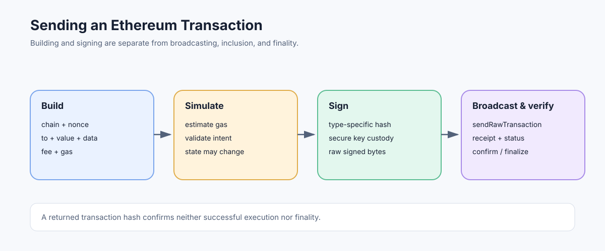

# Sending Transactions: From Intent to Inclusion

> **Stage:** 06 — Application Connectivity  
> **Priority:** 2  
> **Status:** Reviewed  
> **Last reviewed:** 2026-10-17

## 1. Overview

Sending an Ethereum transaction is a multi-step workflow, not a single RPC call. An application constructs a transaction, chooses a chain and nonce, determines gas and fee parameters, obtains a valid signature, submits the encoded transaction to an execution node, and then tracks its status through inclusion and confirmation.



## 2. The Transaction Workflow

A practical transaction pipeline has distinct stages:

1. **Resolve network context.** Query `eth_chainId` and ensure the RPC endpoint is the intended network.
2. **Build the transaction intent.** Select destination or contract creation, value, calldata, nonce, transaction type, and applicable access or authorization lists.
3. **Estimate gas and choose fees.** Use simulation and the current fee market as inputs, with a safety margin appropriate to the call and application's risk.
4. **Sign the exact payload.** Sign locally or through a secure signing system. Any field change after signing requires a new signature.
5. **Submit the signed bytes.** Send the serialized signed transaction using `eth_sendRawTransaction`.
6. **Track the transaction.** Record the returned hash, query for the transaction and receipt, inspect status and logs, and handle reorgs.
7. **Apply a confirmation policy.** Decide whether inclusion, additional confirmations, a safe block, or finality is required before the application treats the operation as complete.


## 3. Constructing the Transaction

Common transaction fields include chain ID, sender nonce, destination, value, input data, gas limit, and fee fields. The exact schema depends on the transaction type:

- Legacy and type-1 transactions use `gasPrice`.
- EIP-1559 type-2 transactions use `maxFeePerGas` and `maxPriorityFeePerGas`.
- Blob transactions have separate blob-fee fields and network encoding requirements.
- EIP-7702 type-4 transactions include an authorization list, which must not be confused with the outer transaction signature.

Do not copy a transaction template without checking the active network and type-specific rules. See [Transaction Types](../05-advanced-transactions-gas/03-transaction-types-eip-2718.md).

## 4. Gas and Fee Preparation

`eth_estimateGas` can simulate the proposed call and estimate a suitable gas limit, but it cannot guarantee future gas use or success. State may change between estimation and inclusion, and a transaction can take a different execution path later. Fee fields determine the maximum acceptable per-gas price and the effective price used if included.

The sender must satisfy protocol affordability checks for the selected transaction type. Estimate execution gas and calculate a fee budget carefully; blob transactions add a separate blob fee that should not be folded into execution gas as though it were the same meter.

Related: [eth_estimateGas](07-eth-estimategas.md), [Gas Limit and Gas Used](../05-advanced-transactions-gas/09-gas-limit-and-gas-used.md), and [Gas Accounting](../05-advanced-transactions-gas/08-gas-accounting.md).

## 5. Signing and Submission

The transaction must be signed according to its type-specific signing payload. Most wallet workflows sign in the wallet or application signing layer and pass only the raw signed bytes to the RPC endpoint.

```json
{
  "jsonrpc": "2.0",
  "method": "eth_sendRawTransaction",
  "params": ["0x<signed-transaction-bytes>"],
  "id": 1
}
```

The payload shown is a placeholder. Never put a private key in the request. A valid response usually returns a transaction hash, which identifies the submitted transaction; it does not prove that the transaction was included, executed successfully, or finalized.

Some wallet APIs expose a higher-level `eth_sendTransaction` flow where a node or wallet manages signing. Support and key custody assumptions vary. When using hosted endpoints, make sure the signing path is explicit and trusted.

See [Transaction Signing](05-transaction-signing.md) and [eth_sendRawTransaction](08-eth-sendrawtransaction.md).

## 6. Tracking, Timeouts, and Replacements

Persist the signed transaction and its hash before or as part of submitting it. If the network call times out, the node may already have accepted the transaction; a timeout is not proof of rejection. Query by hash before constructing a second transaction with a different nonce.

A pending transaction may be replaced under a node's transaction-pool rules using the same sender and nonce. Cancellation is a race rather than a network-wide erase command. A transaction may also be dropped from one provider's pool while still being known elsewhere.

After inclusion, inspect the receipt's status, gas usage, and logs. If a reorganization occurs, the transaction can leave the canonical chain, so confirmation and finality policies matter. See [Transaction Lifecycle](../05-advanced-transactions-gas/01-transaction-lifecycle.md), [Transaction Replacement](../05-advanced-transactions-gas/13-transaction-replacement.md), and [Transaction Receipts](../05-advanced-transactions-gas/11-transaction-receipts.md).

## 7. Common Mistakes and Security Considerations

1. Sending to the wrong Chain ID or trusting an unknown RPC endpoint.
2. Signing one set of fields and later altering the transaction.
3. Assuming gas estimation guarantees execution.
4. Treating an RPC hash response as proof of inclusion.
5. Retrying a timed-out submission with a fresh nonce without checking the original hash.
6. Storing private keys in app logs, environment dumps, source code, or RPC payloads.
7. Reporting success before checking receipt status and the application's confirmation policy.

## Developer Review Checklist

- [ ] Separate building, simulation, signing, submission, inclusion, execution outcome, and finality.
- [ ] Verify Chain ID, sender nonce, destination, value, calldata, transaction type, and fee fields before signing.
- [ ] Understand that gas estimation is contextual and may differ from actual execution.
- [ ] Submit serialized signed bytes only through the intended endpoint; never include a private key in an RPC payload.
- [ ] Handle timeouts by tracking the same raw transaction/hash before creating a replacement.
- [ ] Inspect receipt status, logs, and the application's confirmation/finality policy before reporting success.

## Key Takeaways

- Sending a transaction is a multi-step workflow; RPC acceptance is not on-chain success.
- The exact signed fields are immutable: changing a field requires a new signature.
- A timeout does not prove the node rejected the submitted transaction.
- Replacement, inclusion, and finality are separate states that applications must track.

## References

- 1. [Ethereum.org — JSON-RPC API](https://ethereum.org/developers/docs/apis/json-rpc/) — transaction submission and related RPC methods.
- 2. [Ethereum Execution APIs — eth_sendRawTransaction](https://github.com/ethereum/execution-apis/blob/main/docs-api/api/methods/eth_sendRawTransaction.mdx) — raw signed transaction submission.
- 3. [Transaction Lifecycle](../05-advanced-transactions-gas/01-transaction-lifecycle.md) — inclusion, receipt, reorganization, and finality.
- 4. [Transaction Signing](05-transaction-signing.md) — signatures and serialized payloads.
- 5. [Transaction Replacement](../05-advanced-transactions-gas/13-transaction-replacement.md) — same-nonce replacement behavior.

---

*Editorial note: Examples are educational illustrations. No live RPC request or transaction was sent while preparing this article.*
