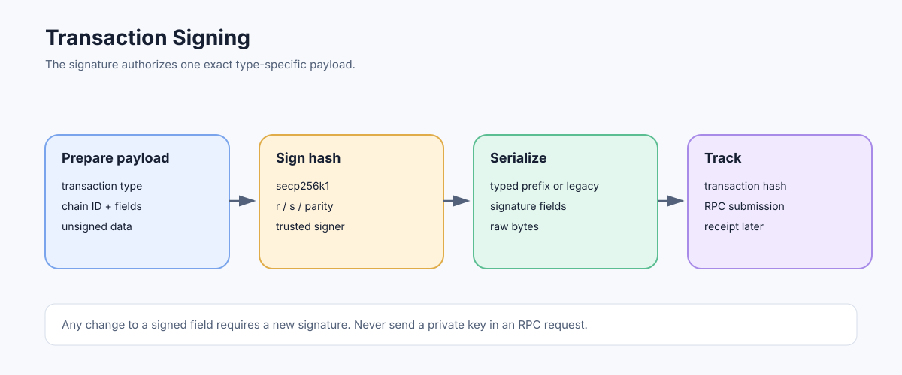

# Transaction Signing: Signing Payloads, Keys, and Serialized Transactions

> **Stage:** 06 — Application Connectivity  
> **Priority:** 2  
> **Status:** Reviewed  
> **Last reviewed:** 2026-10-17

## 1. Overview

Transaction signing proves that the holder of an account's private key authorized a particular transaction payload. In Ethereum, the signature is tied to the transaction's type and fields; changing a fee, nonce, destination, calldata, or other signed field requires signing again. Signing is not the same thing as broadcasting, inclusion, or execution.

## 2. What Is Signed?

The signing input is not simply the final raw transaction including its signature fields. Each transaction type defines an **unsigned signing payload**. The signer signs its hash using the required signature scheme; the signed transaction then includes the signature components in the type-specific serialized form.

For example, an EIP-1559 type-2 transaction includes fields such as Chain ID, nonce, priority fee cap, maximum fee cap, gas limit, destination, value, input data, and access list in its signing payload. The type byte is part of the typed signing domain. The signature fields are then added to form the signed transaction.

Legacy, type-1, type-2, type-3 blob, and type-4 set-code transactions have different field structures and signing rules. Never infer a signing preimage from a different transaction type's schema.

## 3. Signature Components

Ethereum externally owned account signatures conventionally use the secp256k1 curve and are represented by components commonly exposed as `r`, `s`, and a recovery/parity value. Typed transactions generally use `yParity`; legacy transaction encoding uses the historical `v` representation, with chain-aware legacy signing affected by EIP-155.

The signature allows a verifier to recover or validate the signing account according to protocol rules. The signer should use a trusted implementation that correctly handles deterministic nonce generation, signature canonicalization requirements, chain ID, transaction type, and the exact serialization format.

A transaction signature is authorization for the signed bytes; it is not encryption. Anyone who receives a raw signed transaction can generally inspect its public fields and may broadcast it before the signer intended.

## 4. Chain ID and Replay Protection

The Chain ID is included in modern typed transaction signing payloads and in EIP-155-protected legacy signing. This separates ordinary transaction signatures across networks with different Chain IDs, but it does not prove that an RPC endpoint is honest or globally unique. Two networks can use the same Chain ID.

Check the expected network before signing, then make sure the signed payload includes the intended Chain ID. The transaction nonce prevents reuse against the same account sequence in a given chain state, while Chain ID helps distinguish transactions intended for different chains.

For off-chain signatures, use the appropriate domain separation standard instead of assuming a transaction Chain ID automatically protects every message. EIP-712 typed-data signatures and EIP-7702 authorization signatures have their own semantics.

## 5. Private-Key Handling

A secure workflow keeps the private key inside an approved wallet, hardware signer, key-management service, or isolated signer process. The application should receive the signed transaction or signature result, not unnecessary copies of the private key.

Never:
- place a private key in JSON-RPC parameters;
- commit it to a repository or sample config;
- print it in logs, error traces, or analytics;
- send it to a generic RPC provider;
- reuse the same secret in development examples and production.

If an external signing service is used, validate the exact transaction fields shown for approval and enforce policy around destinations, value, chain ID, nonce, and maximum fee.

## 6. From Signature to Raw Transaction

The output is a serialized signed transaction. For legacy transactions, the raw encoding uses the legacy RLP form. Typed transactions use their transaction type prefix followed by that type's payload encoding. A signed transaction hash is calculated from the serialized transaction according to Ethereum's transaction rules.

Signing libraries typically provide a serialized byte string and a hash, but developers should understand which one is suitable for which task:

- **Signing payload/hash:** data authorized by the signature.
- **Raw signed transaction:** serialized bytes suitable for broadcast.
- **Transaction hash:** identifier used for tracking the transaction on the network.
- **Receipt:** execution result available after inclusion.

Broadcast raw signed bytes through [eth_sendRawTransaction](08-eth-sendrawtransaction.md). To understand lifecycle status after submission, see [Sending Transactions](04-sending-transactions.md).

## 7. EIP-7702 Has an Additional Signature Concept

An EIP-7702 set-code transaction has the ordinary outer transaction signature and may also carry separately signed authorization tuples. The outer signature authorizes the transaction being submitted; each authorization tuple authorizes a delegation under EIP-7702's specific validation rules.

These signatures are not interchangeable. Their signed payloads, nonce checks, and roles differ. Wallet interfaces should clearly distinguish the outer transaction fields from the delegation being authorized.

## 8. Signing Does Not Guarantee Inclusion

A valid signature is necessary but not sufficient for inclusion. A node or block producer still evaluates transaction validity, balance, nonce, fee conditions, gas requirements, type support, and other protocol rules. Even an accepted raw transaction can remain pending, be replaced, be dropped by a node, or be included later.

If submission times out, retain the exact raw bytes and transaction hash if available. Query the hash before creating another transaction with a different nonce. Do not assume that a network timeout means the signature or transaction was discarded.

## 9. Developer Review Checklist

- [ ] Identify the exact type-specific signing payload before computing a signature.
- [ ] Distinguish signing hash, raw signed transaction, transaction hash, and receipt.
- [ ] Verify Chain ID and all economic/semantic fields before approval.
- [ ] Keep private keys inside a trusted wallet, hardware signer, or key-management system.
- [ ] Distinguish the outer transaction signature from EIP-7702 authorization signatures.
- [ ] Remember that a valid signature does not guarantee node acceptance or inclusion.

## 10. Key Takeaways

- A transaction signature authorizes a specific payload; it does not encrypt transaction data.
- Typed and legacy transaction formats have different signing/serialization rules.
- Chain ID helps scope transaction signatures but does not authenticate an RPC endpoint.
- Broadcast only the correct serialized signed transaction, not the private key or unsigned payload.

## References

- 1. [EIP-155 — Simple replay attack protection](https://eips.ethereum.org/EIPS/eip-155) — chain-aware signing for legacy transactions.
- 2. [EIP-2718 — Typed Transaction Envelope](https://eips.ethereum.org/EIPS/eip-2718) — typed transaction formats and signing domain guidance.
- 3. [EIP-1559 — Fee market change for ETH 1.0 chain](https://eips.ethereum.org/EIPS/eip-1559) — type-2 transaction signing payload.
- 4. [EIP-7702 — Set EOA account code](https://eips.ethereum.org/EIPS/eip-7702) — authorization tuple signing and validation.
- 5. [Ethereum Execution APIs](https://github.com/ethereum/execution-apis) — method and transaction structures.
- 6. [Chain ID and Replay Protection](../05-advanced-transactions-gas/06-chain-id-and-replay-protection.md) — replay-protection concepts.
- 7. [eth_sendRawTransaction](08-eth-sendrawtransaction.md) — submitting signed bytes.

---

*Editorial note: Examples are educational illustrations. No live RPC request or transaction was sent while preparing this article.*
