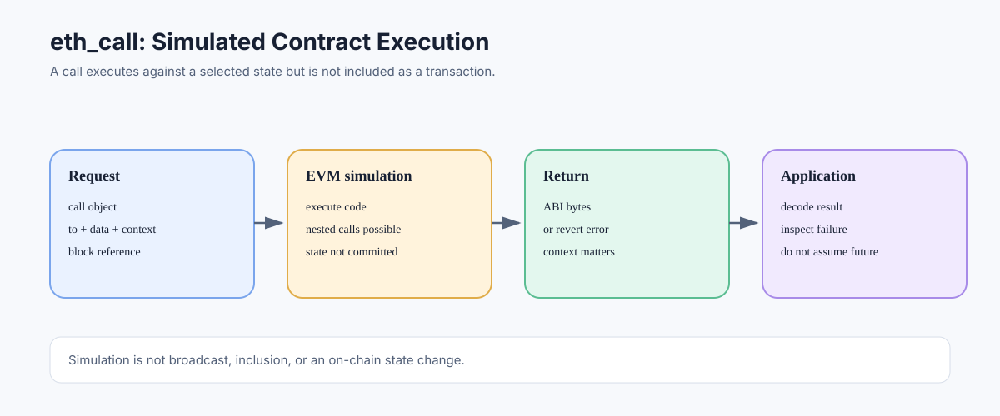

# eth_call: Simulating Contract Execution Without a Transaction

> **Stage:** 06 — Application Connectivity  
> **Priority:** 2  
> **Status:** Reviewed  
> **Last reviewed:** 2026-10-17

## 1. Overview

`eth_call` asks an execution client to run a message call against a selected state and return the output bytes, without submitting a transaction to the chain. It is a core tool for reading contract data and simulating contract behavior. Even when the called code attempts state changes, those changes are part of the simulation and are not committed as an on-chain transaction.



## 2. What Happens During eth_call?

A caller supplies a call object containing fields such as `to`, `data`, and optionally `from`, `value`, and gas-related fields. The method also accepts a block parameter, commonly `latest`, to select the state context.

```json
{
  "jsonrpc": "2.0",
  "method": "eth_call",
  "params": [
    {
      "to": "0x1111111111111111111111111111111111111111",
      "data": "0x18160ddd"
    },
    "latest"
  ],
  "id": 1
}
```

The four-byte selector in this example is commonly associated with an ERC-20-style `totalSupply()` function, but the target address is a placeholder and the request is illustrative. The return value is ABI-encoded bytes; the caller must decode it using the expected ABI.

The node executes the call in its EVM using the selected state and supplied call context. It then returns output data or an error/revert response. No normal signed transaction is broadcast, no on-chain sender nonce is consumed, and no state changes from the simulation are committed.

## 3. eth_call Is Not the Same as a Solidity view Function

Solidity's `view` and `pure` modifiers are language-level restrictions checked by the compiler and EVM execution rules. `eth_call` is an RPC execution mode. It can simulate a call whose target function is not declared `view`; attempted state modifications remain uncommitted when the call is used as a simulation.

This does not make arbitrary simulation equivalent to a harmless query. Contract code may perform expensive computation, revert, or make nested calls as part of the simulation. The node consumes resources to execute it and may enforce gas caps, timeouts, or provider-specific limits.

## 4. Call Context and Block State

The outcome can depend on more than the target and calldata. The call object's `from`, `value`, gas-related fields, and block context can affect execution. Contracts can read values such as `msg.sender`, `msg.value`, `block.timestamp`, and `block.number`, so simulating under a different context can produce a different result.

A query at `latest` can also become stale as new blocks arrive. For repeatable reads, specify a particular block number or hash where supported and record the context. State overrides or block overrides may be offered by some clients for advanced simulation, but they are not interchangeable with the standard baseline method and support can vary.

## 5. Return Data and Reverts

A successful `eth_call` returns hexadecimal `DATA`, not automatically decoded Solidity values. Use the contract ABI to decode returned bytes. If execution reverts, the RPC endpoint typically reports an error and may include revert data; availability and formatting of that data can vary by client and provider.

Do not treat a revert reason as authenticated proof of which contract caused it. Revert data is produced by execution and can be propagated or fabricated by a callee. For general error handling, see [Transaction Reverts](../05-advanced-transactions-gas/12-transaction-reverts.md).

## 6. Common Use Cases

- Reading values from contracts whose functions return encoded data.
- Previewing a swap, quote, or protocol operation against a specific state.
- Testing whether an operation is likely to revert before asking a wallet to sign it.
- Debugging call context and ABI input/output.
- Supporting UI flows without submitting an on-chain transaction.

Simulation remains conditional on the state, endpoint, and call parameters. It is not a guarantee that a later transaction will succeed, because state or ordering can change before inclusion.

## 7. Common Mistakes and Security Considerations

1. Assuming `eth_call` commits storage changes or consumes a transaction nonce.
2. Treating `eth_call` as inherently restricted to Solidity `view` functions.
3. Forgetting to decode the returned ABI bytes.
4. Using `latest` for several related calls and assuming they share one state snapshot.
5. Assuming simulation guarantees future transaction success.
6. Confusing an RPC execution error with a mined transaction receipt.
7. Ignoring provider gas caps, timeouts, and data-access policies.

## Developer Review Checklist

- [ ] Explain why `eth_call` simulates execution without committing on-chain state.
- [ ] Identify the call fields and block reference that can affect execution.
- [ ] Decode successful return bytes with the correct ABI.
- [ ] Distinguish a simulation error from a mined transaction receipt.
- [ ] Explain why a successful simulation does not guarantee a later transaction will succeed.
- [ ] Consider provider gas caps, timeouts, and trust assumptions.

## Key Takeaways

- `eth_call` executes code in a simulation context; it does not submit an on-chain transaction.
- The result depends on call context and the selected state.
- Successful output is encoded bytes and usually needs ABI decoding.
- Simulation is useful for preview/debugging, not a guarantee of future inclusion or success.

## References

- 1. [Ethereum.org — JSON-RPC API](https://ethereum.org/developers/docs/apis/json-rpc/) — `eth_call` request schema and block parameters.
- 2. [Ethereum Execution APIs](https://github.com/ethereum/execution-apis) — canonical method schema.
- 3. [Solidity documentation — View Functions](https://docs.soliditylang.org/en/latest/contracts.html#view-functions) — language-level view and pure restrictions.
- 4. [JSON-RPC](01-json-rpc.md) — RPC request and response structure.
- 5. [Reading Blockchain State](03-reading-blockchain-state.md) — state context and block references.

---

*Editorial note: Examples are illustrative. No live RPC request or transaction was submitted while preparing this article.*
