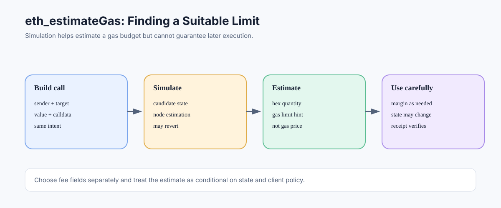

# eth_estimateGas: Estimating a Transaction's Gas Limit

> **Stage:** 06 — Application Connectivity  
> **Priority:** 2  
> **Status:** Reviewed  
> **Last reviewed:** 2026-10-17

## 1. Overview

`eth_estimateGas` asks an execution client to estimate the gas required for a proposed transaction or call to complete under a simulated state. It helps applications choose a transaction gas limit, but it is not a fixed gas price quote, a guarantee of success, or a promise that the same amount will be used when the transaction is eventually included.



## 2. Request Shape

A common request provides a transaction-like call object and optionally a block parameter:

```json
{
  "jsonrpc": "2.0",
  "method": "eth_estimateGas",
  "params": [
    {
      "from": "0x1111111111111111111111111111111111111111",
      "to": "0x2222222222222222222222222222222222222222",
      "data": "0x"
    },
    "latest"
  ],
  "id": 1
}
```

The addresses are placeholders and the example is not a measured estimate. A successful response returns a hexadecimal `QUANTITY` representing the estimated gas limit. The endpoint simulates execution; it does not broadcast a transaction.

## 3. How Estimation Works Conceptually

A client runs simulations against a candidate state and uses its implementation's estimation algorithm to find a gas value that can execute the supplied call successfully under those conditions. The exact strategy, search bounds, caps, error handling, and block-context support are implementation details; applications should not assume that all providers calculate estimates identically.

The estimate is contextual. It can change when any of these changes:

- sender, destination, calldata, or value;
- storage state, balances, nonces, or contract code;
- block timestamp, number, base fee, or other environment data;
- access list, authorization data, or transaction type;
- the target node's rules, client version, or provider configuration.

## 4. Estimation Is Not Actual gasUsed

The estimate is a suggested gas limit, while receipt `gasUsed` records the final gas charged after execution and protocol accounting. A transaction may consume less than its gas limit and return unused gas. If state changes between estimation and inclusion, the later execution path can require more gas or revert even if estimation previously succeeded.

Most applications choose a suitable limit based on the estimate and their risk tolerance, often with a small margin. A margin should not be applied blindly to every transaction: protocol constraints, maximum allowable limits, block capacity, provider policy, and user experience must also be considered.

## 5. Gas Limit Versus Fee Price

Do not confuse `eth_estimateGas` with fee-market suggestions. It estimates a gas quantity. Methods such as `eth_gasPrice` or fee-history methods provide different inputs for choosing fee parameters, while EIP-1559 transactions specify `maxFeePerGas` and `maxPriorityFeePerGas`.

A rough execution-fee budget is based on gas limit multiplied by an applicable maximum per-gas fee, but blob transactions have a separate blob fee component. Actual charged execution fee is based on final gas used and effective gas price. See [Gas Limit and Gas Used](../05-advanced-transactions-gas/09-gas-limit-and-gas-used.md) and [Gas Accounting](../05-advanced-transactions-gas/08-gas-accounting.md).

## 6. What If Estimation Reverts?

If the simulated call reverts or fails under the candidate parameters, the endpoint may return an RPC error instead of an estimate. Such a failure can reveal useful debugging information, but error formatting and revert data are provider-dependent. It does not mean a real transaction was submitted.

Investigate calldata, ABI encoding, sender permissions, balances, allowance, expected state, and the target block context before increasing the gas limit. More gas does not fix a logical revert, invalid parameters, insufficient funds, or a protocol-level invalid transaction.

## 7. Recommended Workflow

1. Build the intended call with the correct sender, value, calldata, and chain context.
2. Simulate with `eth_call` when useful for understanding return data or revert behavior.
3. Call `eth_estimateGas` with the same meaningful transaction fields.
4. Choose a gas limit appropriate for estimate variance and the active network rules.
5. Choose fee fields separately using the current fee-market context.
6. Sign and submit, then compare receipt `gasUsed` with the estimate and monitor failures.

## 8. Common Mistakes

1. Treating an estimate as a guarantee.
2. Using the estimate as the gas price.
3. Estimating with a different sender or value than the real transaction.
4. Ignoring state changes that occur before inclusion.
5. Increasing gas limit to “fix” a revert caused by contract logic or access control.
6. Assuming every node or provider uses the same estimation algorithm.
7. Forgetting protocol-level requirements such as intrinsic costs and applicable calldata-floor rules.

## 9. Developer Review Checklist

- [ ] Distinguish the estimated gas limit from gas price and final receipt `gasUsed`.
- [ ] Use the same sender, value, calldata, and meaningful transaction context as the intended transaction.
- [ ] Explain why state changes can make a prior estimate stale.
- [ ] Distinguish an estimation revert from a transaction that was included and reverted.
- [ ] Choose a limit with a reasoned margin and account for active network rules.
- [ ] Choose fee fields separately from gas estimation.

## 10. Key Takeaways

- `eth_estimateGas` estimates a gas budget; it does not calculate the execution fee price.
- An estimate is contextual and may differ from actual gas use.
- A failed estimate can expose execution problems without submitting a transaction.
- Increasing the limit does not fix logical reverts, invalid fields, or insufficient balance.

## References

- 1. [Ethereum.org — JSON-RPC API](https://ethereum.org/developers/docs/apis/json-rpc/) — `eth_estimateGas` schema and caveats.
- 2. [Ethereum Execution APIs](https://github.com/ethereum/execution-apis) — method interface.
- 3. [Gas Limit and Gas Used](../05-advanced-transactions-gas/09-gas-limit-and-gas-used.md) — limit versus final use.
- 4. [Intrinsic Gas](../05-advanced-transactions-gas/07-intrinsic-gas.md) — transaction-level minimum costs.
- 5. [eth_call](06-eth-call.md) — simulation and call context.

---

*Editorial note: Examples are illustrative. No live RPC request or transaction was submitted while preparing this article.*
