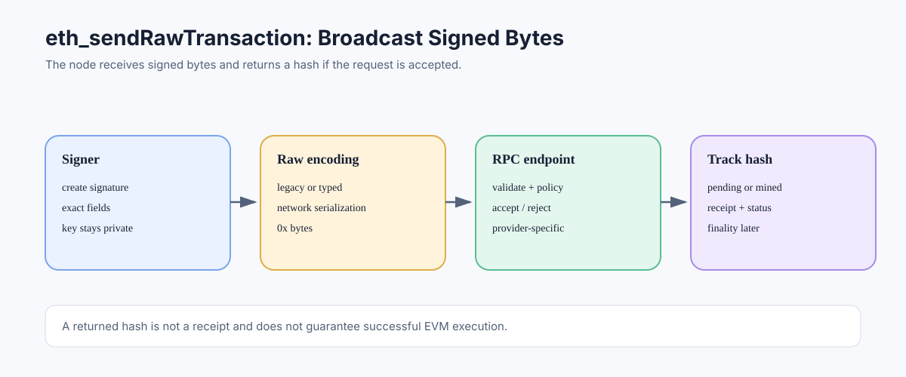

# eth_sendRawTransaction: Submitting Signed Transaction Bytes

> **Stage:** 06 — Application Connectivity  
> **Priority:** 2  
> **Status:** Reviewed  
> **Last reviewed:** 2026-10-17

## 1. Overview

`eth_sendRawTransaction` submits a serialized, already-signed Ethereum transaction to an execution client's RPC endpoint. The node validates the transaction under its current rules and local policy, and if accepted, normally returns the transaction hash. That response is not proof of block inclusion, successful EVM execution, or finality.



## 2. Request and Response

The request parameter is one hexadecimal byte string representing the signed transaction's raw network encoding:

```json
{
  "jsonrpc": "2.0",
  "method": "eth_sendRawTransaction",
  "params": ["0x<raw-signed-transaction>"],
  "id": 1
}
```

The placeholder is not a valid transaction. A successful response typically looks like this:

```json
{
  "jsonrpc": "2.0",
  "id": 1,
  "result": "0x<transaction-hash>"
}
```

The transaction hash is a useful tracking identifier. It does not tell the application whether the transaction has reached every peer, is currently pending, will be included, or will execute successfully.

## 3. What Must Be Encoded?

The raw bytes must match the transaction type's specified format. Legacy transactions use the legacy signed encoding; typed transactions include the type prefix followed by the type-specific payload. The signer must have signed the exact fields being broadcast, including the network context and relevant fee/gas parameters.

For blob transactions under EIP-4844, the network form includes the required blob data, commitments, and proofs rather than only the execution payload. Applications using advanced transaction types must rely on a library that supports the exact network serialization format and must validate that the target endpoint supports that type.

## 4. Submission Is Not Signing

This method expects signed bytes. It does not ask the node to sign for the user and should not be used as a place to send a private key. A common workflow signs through a wallet, local signer, hardware device, or key-management system, then broadcasts only the raw transaction.

If the application instead uses a higher-level wallet interface such as `eth_sendTransaction`, signing may be managed by the wallet or node that has access to the account. Custody and permission assumptions differ, so the application's signing architecture must be explicit.

## 5. Common Errors and Their Meaning

Depending on the client and provider, submission can fail for reasons including:

- malformed transaction encoding or invalid signature;
- wrong chain ID or unsupported transaction type;
- nonce too low, nonce gap policy, or replacement transaction underpriced;
- insufficient balance for the transaction's protocol-defined maximum cost;
- fee caps that are invalid relative to the current base fee;
- gas limit or transaction fields that fail protocol validity checks;
- transaction already known to the node;
- rate limits, endpoint outage, or provider policy rejection.

Error strings and codes are not uniform across all providers. Handle the method-specific response and use known client documentation for provider-specific cases. A duplicate-known response may mean the node has already seen the transaction; query the hash rather than assuming a new transaction was created.

## 6. Timeout and Retry Safety

A network timeout is ambiguous: the server may have received and accepted the bytes even if the client never received the response. Retrying the same exact signed bytes is meaningfully different from creating a new transaction with a new nonce. Keep the raw bytes and computed hash so that the application can check whether the transaction is pending or included.

Do not build a retry policy that blindly creates new nonces after submission timeouts. Doing so can duplicate an intended operation or leave unexpected transactions queued behind earlier nonces. See [Sending Transactions](04-sending-transactions.md) and [Transaction Replacement](../05-advanced-transactions-gas/13-transaction-replacement.md).

## 7. After Submission

A safe application workflow is:

1. Save the signed raw transaction and its hash securely.
2. Submit it to the intended chain's RPC endpoint.
3. Record the RPC result or error, while treating timeouts as ambiguous.
4. Query the transaction hash and receipt as the transaction progresses.
5. Inspect receipt status and any expected logs after inclusion.
6. Apply an appropriate confirmation/finality policy and handle reorganizations.

A transaction can be included with a failed status. The sender's nonce and gas fees are still consumed according to protocol accounting. Successful submission does not mean a smart contract call succeeded.

## 8. Security Considerations

- Verify the chain ID and destination/calldata before signing.
- Keep private keys and signing secrets out of RPC requests and logs.
- Protect RPC API keys and rate limits.
- Do not expose an unrestricted node endpoint to untrusted callers.
- Treat the returned hash as an identifier, not as proof of finality.
- For high-value operations, define exactly what your system considers “sent,” “included,” “successful,” and “finalized.”

## Developer Review Checklist

- [ ] Explain that the method expects serialized, signed transaction bytes.
- [ ] Validate transaction type, Chain ID, signature, nonce, fee parameters, and affordability before signing.
- [ ] Interpret a returned hash as a tracking identifier, not proof of inclusion.
- [ ] Handle already-known, underpriced, invalid, and provider-specific errors.
- [ ] Treat a timeout as ambiguous and check the existing transaction hash before rebuilding.
- [ ] Keep private keys, provider credentials, and raw signed bytes out of unsafe logs.

## Key Takeaways

- `eth_sendRawTransaction` broadcasts signed bytes; it does not sign for the sender.
- A returned transaction hash is not a receipt or a guarantee of successful execution.
- Retries and nonce management should avoid duplicating the intended operation.
- Track the transaction through receipt status and the appropriate confirmation/finality policy.

## References

- 1. [Ethereum Execution APIs — eth_sendRawTransaction](https://github.com/ethereum/execution-apis/blob/main/docs-api/api/methods/eth_sendRawTransaction.mdx) — raw signed transaction submission semantics.
- 2. [Ethereum.org — JSON-RPC API](https://ethereum.org/developers/docs/apis/json-rpc/) — Ethereum RPC method references.
- 3. [EIP-4844 — Shard Blob Transactions](https://eips.ethereum.org/EIPS/eip-4844) — blob transaction network encoding.
- 4. [Sending Transactions](04-sending-transactions.md) — end-to-end workflow.
- 5. [Transaction Receipts](../05-advanced-transactions-gas/11-transaction-receipts.md) — checking inclusion and execution outcome.

---

*Editorial note: Examples are illustrative. No live RPC request or transaction was submitted while preparing this article.*
