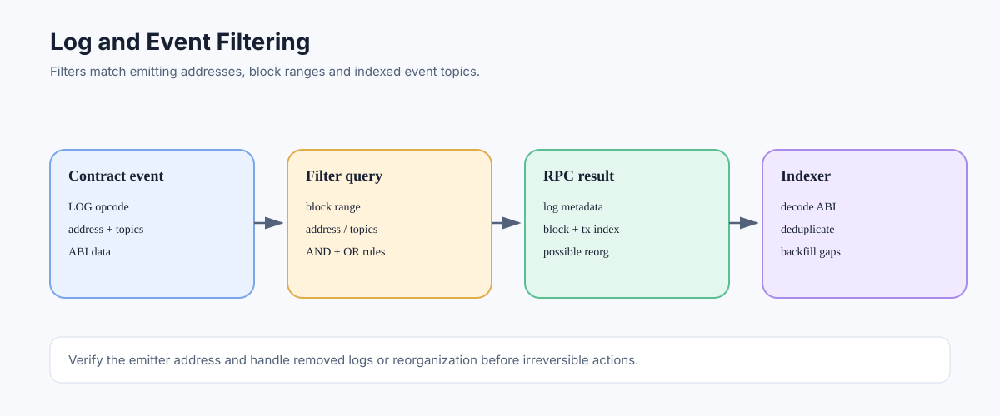

# Log and Event Filtering: Finding Contract Activity

> **Stage:** 06 — Application Connectivity  
> **Priority:** 2  
> **Status:** Reviewed  
> **Last reviewed:** 2026-10-17

## 1. Overview

Ethereum logs are records emitted by EVM execution through the `LOG0`–`LOG4` opcodes. Solidity events are the common high-level way to produce them. Applications query logs to build activity feeds, index contract events, react to protocol changes, and reconstruct application-specific histories. A log is not the same thing as a transaction receipt, a storage proof, or a complete snapshot of contract state.



## 2. Anatomy of a Log

A log contains an emitting address, an array of indexed topics, and a data byte string. JSON-RPC responses commonly add metadata such as block hash/number, transaction hash/index, log index, and a `removed` flag used when a log is reported as removed after a reorganization.

For a Solidity event:

```solidity
event Transfer(address indexed from, address indexed to, uint256 value);
```

The event signature is usually encoded as topic 0 for a non-anonymous event. Indexed arguments are represented in topics; non-indexed arguments are ABI-encoded in `data`. For common value types this allows efficient matching, but indexed dynamic or complex values are represented by hashes rather than directly decodable original values.

## 3. Filtering with eth_getLogs

A basic filter can specify a contract address, block range or block reference, and topics:

```json
{
  "jsonrpc": "2.0",
  "method": "eth_getLogs",
  "params": [{
    "fromBlock": "0x100",
    "toBlock": "0x120",
    "address": "0x1111111111111111111111111111111111111111",
    "topics": ["0xddf252ad..."]
  }],
  "id": 1
}
```

The address and topic in the example are illustrative; the topic is abbreviated and therefore is not a complete valid hash. For a real request, use the full 32-byte topic value. Query limits can apply to block ranges, response size, or execution cost depending on the provider.

### How topics are combined

- Different topic positions are combined with **AND**: a log must satisfy each specified position.
- Multiple alternatives inside one topic position are combined with **OR**.
- A `null` topic position acts as a wildcard for that position.
- The address filter can accept one address or a list of addresses where supported by the API.

For example, a filter can require a particular event signature in topic 0 while accepting either one sender topic or another in topic 1. It does not generally decode arbitrary event fields for you; the application still needs the ABI and must interpret topics/data correctly.

## 4. Topic Encoding and Indexed Parameters

For a non-anonymous event, topic 0 is the Keccak-256 hash of the canonical event signature, such as `Transfer(address,address,uint256)` without parameter names or spaces. Indexed parameters occupy subsequent topics according to the event definition. The exact ABI encoding rules matter, especially for dynamic types.

An address indexed parameter is left-padded to a 32-byte word in a topic. A uint256 topic represents the value as a 32-byte word. Dynamic values such as strings and dynamic arrays are hashed for indexed filtering; the original value cannot generally be recovered from that topic alone.

Do not infer that a matching event signature proves a log came from the expected token or protocol. Different contracts can emit logs with the same signature. Verify the emitting address and, when necessary, code/proxy context and the block/transaction that contained it.

## 5. Reorganizations and Removed Logs

Logs are tied to particular blocks. If a block is removed from the canonical chain by a reorganization, the log may no longer belong to the canonical history. Some subscriptions may deliver a log with `removed: true`; historical filter behavior and notification details depend on the method and client.

Indexers should use block hashes and transaction/log indexes to deduplicate records, track their canonical status, and roll back or compensate data when a reorganization removes a block. Waiting for more confirmations or finality may be appropriate for irreversible off-chain actions.

## 6. Polling, Filters, and Historical Queries

`eth_getLogs` performs a query over logs using the supplied filter and range. Filter lifecycle methods such as `eth_newFilter`, `eth_getFilterChanges`, and `eth_uninstallFilter` are polling-oriented RPC mechanisms and are not uniformly supported or retained by every hosted service.

For long-running services, use a documented subscription/polling architecture and be prepared to backfill missed ranges. Providers often limit range size or response volume, so applications should chunk historical requests and checkpoint progress.

## 7. Common Mistakes and Security Considerations

1. Treating logs as a complete representation of all contract storage changes.
2. Forgetting to verify the emitting address.
3. Assuming every event parameter is available as readable topic data.
4. Constructing an incomplete or incorrectly hashed event-signature topic.
5. Ignoring provider query limits and rate limiting.
6. Treating an observed log as irreversible before considering reorganizations.
7. Assuming subscription delivery is a durable event queue.
8. Decoding logs with the wrong ABI or with an ABI for a different contract version.

## References

- 1. [Ethereum.org — JSON-RPC API](https://ethereum.org/developers/docs/apis/json-rpc/) — `eth_getLogs` and filter-method schemas.
- 2. [Solidity documentation — Events](https://docs.soliditylang.org/en/latest/contracts.html#events) — event declarations, topics, and data.
- 3. [Ethereum Execution APIs](https://github.com/ethereum/execution-apis) — current API schemas.
- 4. [JSON-RPC](01-json-rpc.md) — parameter and response conventions.
- 5. [WebSocket Subscriptions](10-websocket-subscriptions.md) — streaming logs and recovery after disconnects.

---

*Editorial note: Examples are illustrative. No live RPC request or transaction was submitted while preparing this article.*
