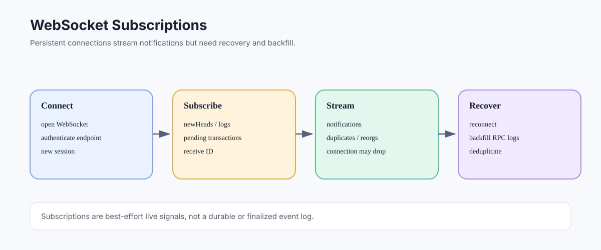

# WebSocket Subscriptions: Streaming Ethereum Events

> **Stage:** 06 — Application Connectivity  
> **Priority:** 2  
> **Status:** Reviewed  
> **Last reviewed:** 2026-10-17

## 1. Overview

WebSocket subscriptions let an application keep a persistent connection to an Ethereum RPC endpoint and receive notifications about selected changes, rather than polling for every update. Common subscriptions include new block headers, logs matching a filter, and pending transactions where supported. They are useful for responsive UIs and live indexers, but they should not be treated as a durable event queue.



## 2. How a Subscription Works

A client opens a WebSocket connection and sends a JSON-RPC `eth_subscribe` request. If the endpoint accepts the subscription, it returns a subscription identifier. Later, the server sends notifications referencing that identifier as matching events occur.

A simplified request for new block headers:

```json
{
  "jsonrpc": "2.0",
  "method": "eth_subscribe",
  "params": ["newHeads"],
  "id": 1
}
```

A simplified notification has a method such as `eth_subscription` and includes the subscription ID and result. The result schema depends on the subscription type. This is different from an ordinary request/response pair because updates can arrive later without a new client request.

## 3. Common Subscription Types

- **`newHeads`** — notifies the client about new block headers. Reorganizations can cause additional headers for competing or replacement chain branches.
- **`logs`** — notifies about logs matching a log filter. A subscription can report logs later marked as removed due to a reorganization, depending on the client/API semantics.
- **`newPendingTransactions`** — may notify about transactions observed by a node before inclusion. Pending-pool visibility differs between nodes and providers; notifications are not a complete global mempool feed.

Exact support and returned data may vary by client and provider. Subscriptions are commonly supported over WebSocket and IPC; ordinary HTTP JSON-RPC is generally request/response oriented and does not provide the same persistent subscription stream.

## 4. Disconnects and Recovery

The most important operational detail is that a WebSocket subscription is not a durable message log. If the connection drops, the process restarts, or the provider removes a subscription, the application may miss notifications. Depending on the provider, a subscription ID may not survive reconnecting.

For reliable processing:

1. Track the last fully processed block number and hash.
2. Reconnect and create fresh subscriptions.
3. Query missed blocks or logs through methods such as `eth_getLogs`.
4. Deduplicate by block hash, transaction hash, and log index where appropriate.
5. Roll back or mark records when a reorganization removes previously observed data.
6. Periodically reconcile your local view against canonical RPC queries instead of trusting that every notification arrived.

This “stream plus backfill” design is much safer than assuming a live subscription alone provides completeness.

## 5. Ordering, Duplicates, and Finality

Notifications are useful observations of a node's view, not a guarantee of canonical finality. A log may first arrive in one block and later be reported as removed if that block loses canonical status. A transaction observed in a pending pool may be replaced, dropped, or included differently by another node.

Applications should identify what their downstream action requires: rapid visibility, confirmed inclusion, safe state, or finality. Irreversible actions such as crediting deposits may need a confirmation or finality policy and reorg handling.

## 6. Cleanup and Resource Management

Use `eth_unsubscribe` when a subscription is no longer needed. Avoid opening an unbounded number of connections and subscriptions, and follow service limits. Reconnect with exponential backoff and jitter in production systems; do not create a reconnect storm after provider outages.

Protect WebSocket endpoints and API keys. A publicly exposed endpoint can be abused, and subscriptions can generate significant traffic. Avoid logging credentials embedded in URLs.

## 7. Common Mistakes

1. Treating notifications as guaranteed complete or exactly-once delivery.
2. Assuming subscription IDs persist after reconnects.
3. Forgetting to backfill blocks/logs after a disconnect.
4. Ignoring removed logs and chain reorganizations.
5. Treating pending-transaction notifications as a complete mempool view.
6. Opening subscriptions over a transport that does not support them.
7. Failing to unsubscribe or enforce connection limits.

## 8. Developer Review Checklist

- [ ] Create subscriptions over a supported persistent transport and store the returned subscription ID.
- [ ] Explain the differences between `newHeads`, `logs`, and pending-transaction notifications.
- [ ] Implement reconnect and subscription recreation after connection loss.
- [ ] Backfill missed blocks/logs and deduplicate repeated notifications.
- [ ] Handle removed logs, reorgs, and a suitable confirmation/finality policy.
- [ ] Apply connection limits, timeouts, backoff, and endpoint credential protection.

## 9. Key Takeaways

- WebSocket subscriptions provide live notifications, not a durable exactly-once queue.
- Provider mempool visibility and subscription behavior can differ.
- Disconnects require recovery and backfill.
- Logs and heads must be treated as reorganization-aware until the application's required confidence level is reached.

## References

- 1. [Ethereum.org — JSON-RPC API](https://ethereum.org/developers/docs/apis/json-rpc/) — subscription methods and filter data.
- 2. [Geth — Pub/Sub](https://geth.ethereum.org/docs/interacting-with-geth/rpc/pubsub) — subscription semantics, supported notification types, and reorganization behavior.
- 3. [Ethereum Execution APIs](https://github.com/ethereum/execution-apis) — execution RPC method specifications.
- 4. [Log and Event Filtering](09-log-and-event-filtering.md) — log topics, decoding, and backfill.
- 5. [JSON-RPC](01-json-rpc.md) — requests, responses, and transport concepts.

---

*Editorial note: This article describes protocol and node architecture. No client was launched or RPC endpoint queried while preparing it.*
