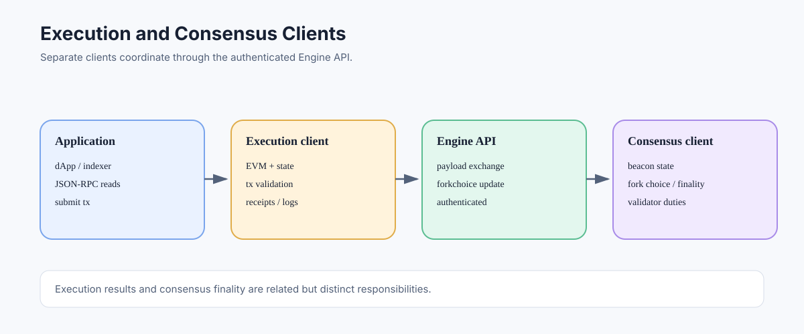

# Execution Clients: Ethereum's Transaction and State Engine

> **Stage:** 06 — Application Connectivity  
> **Priority:** 2  
> **Status:** Reviewed  
> **Last reviewed:** 2026-10-17

## 1. Overview

An Ethereum execution client implements the execution layer: transaction validation and execution, EVM state transitions, block execution, and the execution-facing RPC interface. After Ethereum's transition to proof of stake, the execution client works alongside a consensus client. The two clients have separate responsibilities and communicate through the Engine API.

## 2. What an Execution Client Does

The execution client is responsible for the EVM and the execution-layer data/state needed to process Ethereum transactions. Its responsibilities include:

- receiving and validating transactions according to execution rules;
- executing transactions and calculating state changes, receipts, logs, and gas usage;
- validating the execution payload of a proposed block;
- maintaining the execution state and block/transaction database;
- participating in execution-layer peer-to-peer networking and transaction propagation;
- exposing supported user-facing JSON-RPC methods such as balance reads, contract calls, log queries, and transaction submission.

The execution client does not independently determine the full proof-of-stake fork choice and finality mechanism. Those responsibilities belong to the consensus layer.

## 3. Execution Client and Consensus Client

Post-Merge Ethereum node operation generally combines two client processes:

- **Execution client (EL):** executes transactions, validates execution payloads, maintains EVM state, and exposes execution RPC.
- **Consensus client (CL):** participates in proof-of-stake consensus, tracks beacon-chain state and fork choice, and communicates block-building/selection duties to the execution client.

The clients communicate through the authenticated Engine API. The consensus client drives which execution payloads are relevant to the canonical chain and coordinates with the execution client to obtain or validate payloads. The execution client cannot simply invent consensus finality from its own execution state.

## 4. Examples of Execution Clients

The Ethereum ecosystem includes multiple execution-client implementations, for example Geth, Nethermind, Besu, Erigon, and Reth. Their language, architecture, database layout, performance characteristics, supported extensions, and operational defaults differ. This list is illustrative rather than a claim that every client has identical maturity or feature support.

Multi-client diversity matters because a consensus-critical bug in a single implementation should not affect the whole network if operators are distributed across independent implementations. Operators should follow each selected client's release notes, security guidance, hardware recommendations, and fork-upgrade instructions.

## 5. RPC and Operational Configuration

Execution clients commonly provide JSON-RPC over HTTP, WebSocket, or IPC, but each transport and method namespace may need to be enabled explicitly. Expose only the APIs needed by the application. Administrative, debug, trace, and engine interfaces have different risk profiles from a public read-only RPC endpoint.

When running both execution and consensus clients, configure the Engine API endpoint and JWT authentication consistently. The Engine API should not be exposed to untrusted networks. For user-facing reads, use the ordinary execution JSON-RPC interface rather than confusing it with the internal Engine API.

## 6. Sync Modes and Data Retention

Execution clients can support different synchronization modes and storage/retention configurations. A node may verify recent execution state while pruning old historical state, or run in an archive configuration that retains historical states. These modes affect historical queries, disk requirements, and startup/synchronization cost.

A client binary is not itself synonymous with a full or archive node: those terms also depend on how the client is configured and synchronized. See [Full Nodes](13-full-nodes.md) and [Archive Nodes](12-archive-nodes.md).

## 7. Common Mistakes and Security Considerations

1. Treating the execution client as the whole proof-of-stake Ethereum node.
2. Confusing the public Ethereum JSON-RPC API with the internal Engine API.
3. Assuming all client implementations or versions expose identical extensions.
4. Exposing the Engine API or debug endpoints publicly.
5. Assuming every execution client retains all historical state.
6. Ignoring client diversity and upgrade compatibility.
7. Treating a successful execution result as equivalent to consensus finality.

## 8. Developer Review Checklist

- [ ] Explain the execution client's responsibilities for EVM execution, transaction validation, state, receipts, and execution RPC.
- [ ] Distinguish execution-client duties from consensus-client fork choice and finality.
- [ ] Describe how the clients communicate through the authenticated Engine API.
- [ ] Distinguish public Execution JSON-RPC from Engine API and privileged/debug endpoints.
- [ ] Explain why a client binary alone does not determine full/archive data retention.
- [ ] Identify operational needs: fork upgrades, sync monitoring, endpoint security, and client diversity.

## 9. Key Takeaways

- Execution clients execute transactions and maintain execution-layer state.
- Consensus clients track proof-of-stake fork choice and finality; they cooperate through the Engine API.
- Client implementations and configurations can differ.
- The Engine API is a protected client-to-client interface, not a public dApp API.

## References

- 1. [Ethereum.org — Nodes and Clients](https://ethereum.org/developers/docs/nodes-and-clients) — Ethereum node roles and client architecture.
- 2. [Ethereum Execution APIs](https://github.com/ethereum/execution-apis) — execution-layer JSON-RPC and Engine API specifications.
- 3. [Ethereum Consensus Specifications](https://github.com/ethereum/consensus-specs) — consensus-layer protocol behavior.
- 4. [Engine API](17-engine-api.md) — execution/consensus client communication.
- 5. [Execution API](15-execution-api.md) — user-facing execution methods.

---

*Editorial note: This article describes protocol and node architecture. No client was launched or RPC endpoint queried while preparing it.*
