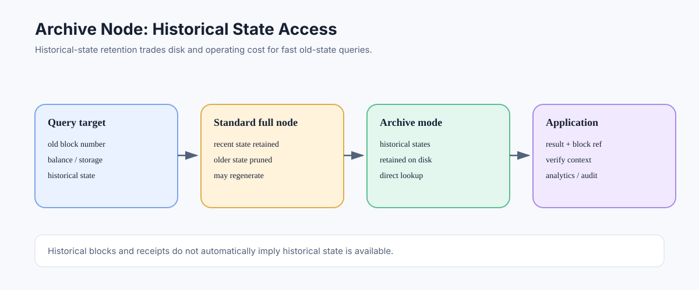

# Archive Nodes: Querying Historical Ethereum State

> **Stage:** 06 — Application Connectivity  
> **Priority:** 2  
> **Status:** Reviewed  
> **Last reviewed:** 2026-10-17

## 1. Overview

An archive node is an execution-node configuration that retains historical account and contract state so applications can query state as it existed at older blocks without reconstructing it on demand. Archive access is valuable for analytics, block explorers, historical contract queries, research, and some testing workflows; it is not required for ordinary current-state dApp interactions.



## 2. State History Versus Block History

Ethereum's state changes after transactions are executed. A block and its transactions describe how the chain progressed; a historical state query asks for the account balances, nonces, code, or storage values that existed at a particular point in that progression.

These are different storage needs. A node can retain historical blocks, transactions, and receipts while pruning many older intermediate states. Therefore, being able to retrieve an old block or receipt does not guarantee that a node can answer `eth_getBalance(address, oldBlock)` quickly—or at all.

An archive configuration retains historical execution states generated over time, usually at a substantially larger storage cost. Exact archival capabilities, storage layout, pruning strategy, and query behavior depend on the client and configuration.

## 3. What Archive Access Enables

Typical archive-oriented workloads include:

- querying balances and storage at a historical block;
- reading old contract code or storage values for analysis;
- reconstructing historical protocol positions or application state;
- supporting block explorers, analytics systems, forensic investigations, and research;
- testing contract behavior against older state snapshots;
- serving historical-state RPC queries without replaying the chain to reconstruct each requested state.

Archive state is not a substitute for every historical data tool. Transaction tracing, full opcode traces, call traces, and custom indexes may require additional methods, configuration, or separately maintained data.

## 4. Example Historical Read

An account-balance read can target an explicit block number:

```json
{
  "jsonrpc": "2.0",
  "method": "eth_getBalance",
  "params": [
    "0x0000000000000000000000000000000000000000",
    "0x100000"
  ],
  "id": 1
}
```

The address and block number are illustrative. The request asks for the balance at block `0x100000`, not the latest balance. Whether the endpoint can serve the historical state depends on the node's data retention and provider policy.

When reproducing results, record the network, block number, and preferably block hash. An explicit block hash helps identify the exact historical block if a chain reorganization affected a recent observation.

## 5. Full Node Versus Archive Node

Both are execution-client configurations and can validate the chain according to their sync mode. The key difference is data retention and historical-state access:

- A typical full node retains current/recent state and may prune older states to manage storage.
- An archive node retains historical states so that a query can access them directly rather than rebuilding each requested state from nearby retained data.

The term “full node” does not mean “stores every historical version of every state forever.” Nor is an archive node automatically an independent indexer with every possible query optimized.

## 6. Costs and Operational Trade-offs

Archive workloads need much more storage and can increase synchronization time, disk I/O, maintenance needs, and backup complexity. The exact hardware requirements vary significantly across clients, versions, data formats, and network growth. Use the selected implementation's current requirements rather than relying on a single permanent disk-size figure.

If the application's historical query load is small, a hosted archive provider may be cheaper than operating one. If queries are high volume, security-sensitive, or central to the product, operating a controlled archive service or combining RPC with an indexer may offer more predictable access. Hosted access introduces provider trust, cost, rate-limit, and retention assumptions.

## 7. Common Mistakes

1. Assuming historical block availability implies historical state availability.
2. Treating “archive” as a universal query accelerator for traces or analytics.
3. Assuming all client implementations use the same storage requirements.
4. Using an unpinned `latest` state when historical reproducibility is needed.
5. Forgetting to record block hash and chain context for historical results.
6. Operating archive infrastructure without planning for disk growth, backups, and sync time.

## Developer Review Checklist

- [ ] Distinguish historical block/receipt retention from historical state retention.
- [ ] Explain when an old-state RPC query may require an archive configuration.
- [ ] Record chain and block context for reproducible historical queries.
- [ ] Distinguish archive access from transaction tracing and custom indexing.
- [ ] Compare self-hosted and hosted archive access in cost, trust, and query-limit terms.
- [ ] Consider storage growth, sync time, backups, and disk I/O before operating an archive node.

## Key Takeaways

- Archive nodes retain historical execution states for direct old-state queries.
- A node may serve old blocks and receipts without retaining every old state.
- Historical RPC availability depends on client configuration and provider policy.
- Archive state is not a substitute for every trace, index, or analytics service.

## References

- 1. [Ethereum.org — Archive Nodes](https://ethereum.org/developers/docs/nodes-and-clients/archive-nodes) — historical-state retention and use cases.
- 2. [Ethereum.org — Nodes and Clients](https://ethereum.org/developers/docs/nodes-and-clients) — full and archive node distinctions.
- 3. [Reading Blockchain State](03-reading-blockchain-state.md) — selecting a historical block reference.
- 4. [Ethereum Execution APIs](https://github.com/ethereum/execution-apis) — standard read methods and schemas.
- 5. [Execution Clients](11-execution-clients.md) — clients and configuration.

---

*Editorial note: This article describes protocol and node architecture. No client was launched or RPC endpoint queried while preparing it.*
