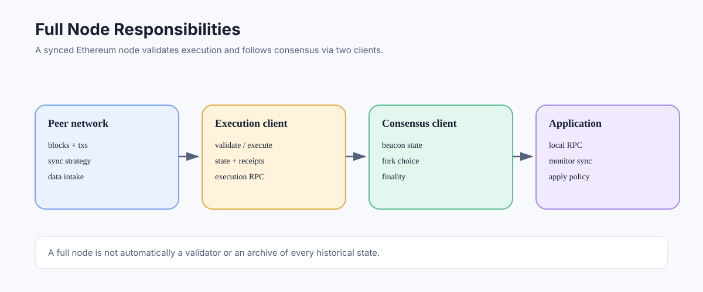

# Full Nodes: Validating and Serving Ethereum Data

> **Stage:** 06 — Application Connectivity  
> **Priority:** 2  
> **Status:** Reviewed  
> **Last reviewed:** 2026-10-17

## 1. Overview

A full node runs Ethereum client software that follows the chain and validates blocks and state transitions according to its synchronization mode and the rules of the network. Full nodes let operators query local blockchain data, verify execution instead of blindly trusting a third-party RPC provider, and participate in the peer-to-peer network. In proof-of-stake Ethereum, a typical full node combines an execution client and a consensus client.

## 2. What a Full Node Does

A full Ethereum node commonly performs these jobs:

- downloads or receives block and state data from peers;
- validates blocks and transactions according to the applicable protocol rules;
- executes transactions to derive state transitions and receipts;
- tracks the latest chain head and, with its consensus client, fork choice and finalized checkpoints;
- serves data to local applications through supported APIs;
- propagates and receives network data according to its client configuration.

Sync strategies differ. Some modes perform extensive historical verification; others use a trusted recent checkpoint or snapshot-like data to reach the current state faster and then continue validating new blocks. “Full node” should therefore be understood in the context of the selected client and sync mode, not as a claim that every node independently re-executed every block from genesis during startup.

## 3. Execution and Consensus Components

A post-Merge node generally includes two connected components:

- **Execution client:** EVM execution, transaction pool, execution state, blocks, receipts, and user-facing execution RPC.
- **Consensus client:** beacon-chain state, proof-of-stake fork choice, attestations, proposer duties, and finality tracking.

The clients communicate through the Engine API. Running an execution client alone does not provide the complete proof-of-stake consensus view required for an ordinary synchronized Ethereum node. A node used for a particular task may omit some components, but its guarantees and capabilities must be described accordingly.

## 4. Pruning and Historical Data

A full node typically keeps recent state needed for normal processing and chain reorganization handling, while older intermediate state may be pruned. It may still retain historical blocks, transactions, and receipts. When old state is needed, the client may be able to regenerate it from available data, but the process can be computationally expensive and may not be supported under every configuration.

This is why archive nodes exist: they trade more disk space for direct access to historical states. See [Archive Nodes](12-archive-nodes.md).

## 5. Full Node, Validator, and RPC Provider Are Different Roles

- **Full node:** maintains and validates chain data according to its mode.
- **Validator:** participates in proof-of-stake duties and requires validator keys plus a validator client, coordinated with a consensus client.
- **RPC provider:** operates infrastructure and exposes an API to applications; it may run full nodes, archive nodes, load balancers, caches, and indexers behind its endpoint.

A full node does not need to be a validator. A hosted RPC URL does not reveal the provider's exact architecture or data-retention mode unless the provider documents it.

## 6. Why Developers Might Run One

Running a node gives an application direct control over its RPC endpoint and reduces dependency on a single hosted service. It can improve privacy for reads, remove some provider-specific rate limits, and offer more reliable access to the chain's head. It also creates operational responsibilities: updates, monitoring, disk-space planning, peer connectivity, backups where appropriate, API security, and response to network upgrades.

A self-run node is not automatically infallible. It can be misconfigured, behind the chain head, out of disk space, or exposed to untrusted network inputs. Applications should monitor sync status, verify that the endpoint is on the intended chain, and check consistency and finality for critical workflows.

## 7. Common Mistakes

1. Assuming a full node must have retained every historical state.
2. Confusing running an execution client with running a complete post-Merge node.
3. Treating full-node operation as equivalent to validator operation.
4. Assuming a node cannot return stale data or be misconfigured.
5. Exposing RPC, debug, or Engine API endpoints without appropriate access controls.
6. Ignoring hardware, updates, synchronization, and monitoring needs.

## Developer Review Checklist

- [ ] Explain the difference between execution and consensus components of a post-Merge node.
- [ ] Distinguish a full node from a validator, RPC provider, and archive node.
- [ ] Explain how sync strategy affects which historical data was verified or retained.
- [ ] Describe why a full node can still be stale, misconfigured, or unavailable.
- [ ] Identify operational tasks: upgrades, sync monitoring, storage, peers, and API protection.
- [ ] Restrict debug, administrative, and Engine API access appropriately.

## Key Takeaways

- A full node validates and serves chain data according to its mode and configuration.
- A full node is not automatically a validator or an archive node.
- Post-Merge execution and consensus roles are separate but coordinated.
- Self-hosting can reduce provider dependence, but it also creates operational and security responsibilities.

## References

- 1. [Ethereum.org — Nodes and Clients](https://ethereum.org/developers/docs/nodes-and-clients) — node modes and sync behavior.
- 2. [Ethereum.org — Archive Nodes](https://ethereum.org/developers/docs/nodes-and-clients/archive-nodes) — distinction between state retention and ordinary full nodes.
- 3. [Ethereum Consensus Specifications](https://github.com/ethereum/consensus-specs) — consensus-layer behavior.
- 4. [Execution Clients](11-execution-clients.md) — execution-client responsibilities.
- 5. [Consensus API](16-consensus-api.md) — accessing consensus-layer data.

---

*Editorial note: This article describes protocol and node architecture. No client was launched or RPC endpoint queried while preparing it.*
