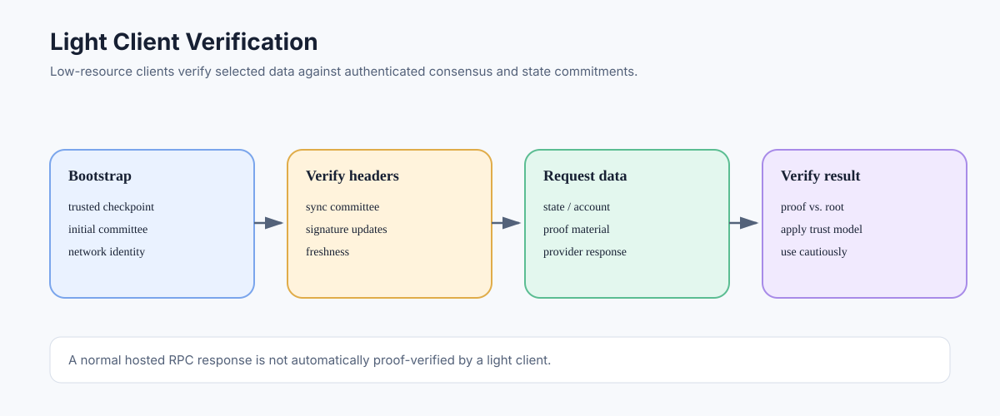

# Light Clients: Verifying Ethereum with Less Data

> **Stage:** 06 — Application Connectivity  
> **Priority:** 2  
> **Status:** Reviewed  
> **Last reviewed:** 2026-10-17

## 1. Overview

A light client aims to interact with Ethereum while downloading and storing much less data than a full node. Rather than independently retaining and executing all chain data, a light client typically tracks authenticated headers or summaries and requests selected data from other nodes. The security goal is to verify the data that matters against trusted or cryptographically authenticated commitments instead of blindly trusting every response from a provider.

## 2. Why Light Clients Exist

Full nodes provide strong independent validation and direct network access, but can require substantial storage, bandwidth, and CPU. Light clients aim to reduce these resource requirements so applications, browsers, and constrained devices can still check relevant blockchain information.

A light design trades broad local data availability for selective verification and data requests. The degree of “lightness” varies: consensus light clients, execution light clients, and hybrid designs can have different capabilities and assumptions. There is no single universal implementation model that covers every execution-layer light client.

## 3. Consensus Light-Client Idea

On proof-of-stake Ethereum, the consensus protocol includes light-client support based on sync committees. The client verifies committee signatures on relevant beacon headers and uses authenticated updates to learn which committee should sign subsequent updates. The header commits to consensus data, allowing a light client to track the chain without downloading and independently processing every block body.

The client still needs to correctly initialize its trusted checkpoint or bootstrap data and verify updates under the protocol rules. A light client is not secure simply because it stores few bytes; its security depends on signature verification, authenticated state transitions, update freshness, and the trust assumptions of its bootstrap.

## 4. Reading Execution Data

Execution-layer state—balances, contract code, and storage—is committed by roots in execution block headers. A light-client design can request account or storage data along with a proof and verify it against an authenticated state root, rather than trusting a provider's bare answer. The exact level of execution support differs across projects and approaches.

A standard JSON-RPC endpoint does not automatically become a verified light client just because it serves balance queries. A conventional app asking a hosted RPC provider for `eth_getBalance` is trusting that provider unless it independently validates a proof or uses another verifiable data path.

## 5. Trust Model and Limitations

Compared with relying only on one RPC server, a properly implemented light client can reduce trust by verifying authenticated headers and proofs. It still has assumptions: correct client code, secure bootstrap data, sufficient network/update availability, and the rules used to evaluate consensus signatures and proofs.

Light clients may not offer the same query breadth as a full node. Some rely on remote providers for data; others verify specific results locally. Historical queries, transaction submission, traces, or advanced execution behavior may require additional infrastructure.

## 6. Light, Full, and Archive Modes

- **Light client:** prioritizes low local resource usage and selective verification.
- **Full node:** maintains and validates chain data according to its sync mode and serves broad local data access.
- **Archive node:** retains historical execution states for direct old-state queries.

These labels describe different resource/security/data-retention trade-offs. A light client is not simply a full node with a smaller database, and an archive node's purpose is not to provide light-client verification.

## 7. When a Developer Should Consider One

Light-client approaches can be useful for mobile applications, browser wallets, embedded systems, and designs that need stronger verification than an unverified third-party read without running full-node infrastructure. Before adopting one, assess implementation maturity, supported network/fork features, proof verification, bootstrap trust, data availability, and supported operations.

Do not assume every light-client project is production-ready or provides complete execution-layer coverage. Verify the current project's release status and security model before using it for security-critical decisions.

## Developer Review Checklist

- [ ] Explain what data a light client verifies locally and what it requests from providers.
- [ ] Describe the role of authenticated headers, sync-committee updates, and trusted bootstrap data.
- [ ] Distinguish consensus light clients from execution-layer light-client approaches.
- [ ] Explain why a standard RPC response is not automatically proof-verified.
- [ ] Identify limitations involving data availability, query coverage, bootstrap trust, and implementation maturity.
- [ ] Evaluate whether the selected light-client implementation is suitable for the required threat model.

## Key Takeaways

- Light clients lower local resource costs by verifying selected data rather than processing everything.
- Security depends on authenticated updates, proofs, bootstrap trust, and correct implementation.
- There is no single universal execution-light-client design.
- Merely querying a hosted RPC provider does not provide the same guarantee as locally verifying its data.

## References

- 1. [Ethereum.org — Light Clients](https://ethereum.org/developers/docs/nodes-and-clients/light-clients) — light-client goals, sync committees, and verification model.
- 2. [Ethereum.org — Nodes and Clients](https://ethereum.org/developers/docs/nodes-and-clients) — light, full, and archive node trade-offs.
- 3. [Ethereum Consensus Specifications](https://github.com/ethereum/consensus-specs) — consensus and light-client protocol definitions.
- 4. [Ethereum Execution APIs](https://github.com/ethereum/execution-apis) — execution state and proof-related RPC methods.
- 5. [Reading Blockchain State](03-reading-blockchain-state.md) — state reads and proof verification.

---

*Editorial note: This article summarizes protocol and API concepts from official documentation. No client was run and no live node endpoint was queried while preparing it.*
