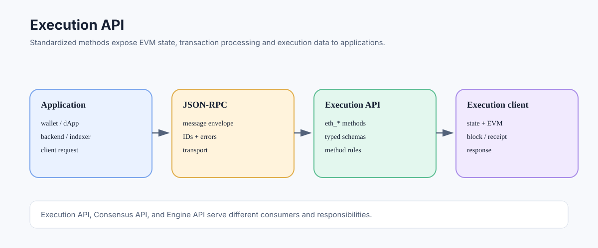

# Execution API: The Standard Interface to Ethereum Execution Clients

> **Stage:** 06 — Application Connectivity  
> **Priority:** 2  
> **Status:** Reviewed  
> **Last reviewed:** 2026-10-17

## 1. Overview

The Ethereum Execution API is the standard application-facing interface implemented by execution-layer clients. It defines the methods and data schemas used to query execution state, inspect blocks and transactions, simulate calls, submit signed transactions, and retrieve logs. Most developers access these operations through JSON-RPC; JSON-RPC provides the message envelope while the Execution API defines Ethereum-specific method semantics.

## 2. What the Execution API Covers

Common method families include:

- **Chain and block metadata:** `eth_chainId`, `eth_blockNumber`, `eth_getBlockByNumber`, and `eth_getBlockByHash`.
- **Account and state reads:** `eth_getBalance`, `eth_getCode`, `eth_getStorageAt`, and `eth_getTransactionCount`.
- **Transaction and receipt inspection:** `eth_getTransactionByHash` and `eth_getTransactionReceipt`.
- **Execution simulation:** `eth_call` and `eth_estimateGas`.
- **Submission:** `eth_sendRawTransaction`.
- **Log queries:** `eth_getLogs` and related filter methods.

The specification also defines request/response encoding and method-specific schemas. The exact method set supported by a node can vary with client version, network rules, configuration, and provider policy; client-specific debug or tracing APIs should not be assumed to be part of the standard public API.

## 3. Execution API Versus JSON-RPC

The two concepts are connected but not synonymous:

- **JSON-RPC 2.0** defines generic request/response mechanics, IDs, errors, notifications, and batch messages.
- **Ethereum Execution API** defines methods such as `eth_call`, their parameter objects, result types, and Ethereum-specific behavior.
- **Transport** such as HTTP, WebSocket, or IPC carries messages between the application and endpoint.

For example, JSON-RPC can represent a request with method `eth_getBalance`; the Execution API defines that the method takes an address and a block parameter and returns the account's balance as a hexadecimal quantity.

See [JSON-RPC](01-json-rpc.md) and [Ethereum RPC Methods](02-ethereum-rpc-methods.md).

## 4. Execution API Versus Consensus API

The Execution API serves execution-layer data and operations such as EVM state, transaction execution, and logs. The Consensus API, commonly exposed by beacon nodes through a separate REST API specification, serves consensus-layer objects and state such as beacon blocks, validators, duties, and attestations.

The two layers cooperate to form Ethereum after the Merge, but their APIs are designed for different responsibilities. Do not use an execution RPC method as though it returns every consensus-layer field, or confuse beacon-node endpoints with standard `eth_*` methods.

## 5. Execution API Versus Engine API

The Engine API is a separate, authenticated interface used internally between the execution client and consensus client. It lets the consensus layer communicate fork-choice updates and exchange execution payloads with the execution layer.

Although Execution API and Engine API specifications live in the same broader repository, they are not the same API surface. Applications and public dApps normally use the execution JSON-RPC API; node operators configure the Engine API for client-to-client communication and protect it with JWT authentication.

## 6. Schema and Versioning

API schemas evolve as Ethereum protocol upgrades introduce new transaction types, payload fields, and behaviors. Clients need compatible versions and must implement the rules active on the network. Optional fields may appear for particular transaction or block types, and legacy methods or fields may have historical semantics.

When integrating:

1. Use the current specification and check the target client's supported version.
2. Validate response shapes and optional fields instead of assuming every result has one fixed shape.
3. Pin related reads to an appropriate block reference when consistency matters.
4. Separate standardized methods from client-specific debugging endpoints.
5. Test behavior against the actual chain and provider configuration.

## 7. Operational and Security Considerations

A standard API does not guarantee that a remote provider is honest, available, or free of rate limits. An RPC provider may apply request budgets, historical-state restrictions, maximum log ranges, and access controls. Applications should implement timeouts, bounded retries, validation, endpoint monitoring, and appropriate verification for critical data.

Node operators should expose only the methods necessary for their consumers. Privileged namespaces and the Engine API should not be treated as ordinary public dApp endpoints.

## 8. Developer Review Checklist

- [ ] Explain the difference between JSON-RPC's envelope and the Execution API's method schemas.
- [ ] Group methods by state reads, blocks/transactions, simulation, submission, and logs.
- [ ] Distinguish the public Execution API from the Consensus/Beacon API and Engine API.
- [ ] Check supported methods, schemas, optional fields, and provider limits on the target client.
- [ ] Pin related state reads to a consistent block reference when needed.
- [ ] Avoid exposing privileged or debug methods as public application endpoints.

## 9. Key Takeaways

- The Execution API standardizes Ethereum execution-layer methods and their schemas.
- JSON-RPC carries the request; the Execution API defines the method's meaning.
- Consensus/Beacon and Engine APIs have different roles and security boundaries.
- Client version, fork rules, and provider policy affect actual availability and behavior.

## References

- 1. [Ethereum Execution APIs](https://github.com/ethereum/execution-apis) — canonical specification repository.
- 2. [Execution API rendered documentation](https://ethereum.github.io/execution-apis/) — browsable method reference.
- 3. [Ethereum.org — JSON-RPC API](https://ethereum.org/developers/docs/apis/json-rpc/) — common method documentation and examples.
- 4. [JSON-RPC](01-json-rpc.md) — generic protocol envelope.
- 5. [Consensus API](16-consensus-api.md) — beacon-node interface.
- 6. [Engine API](17-engine-api.md) — internal execution/consensus client interface.

---

*Editorial note: This article summarizes protocol and API concepts from official documentation. No client was run and no live node endpoint was queried while preparing it.*
