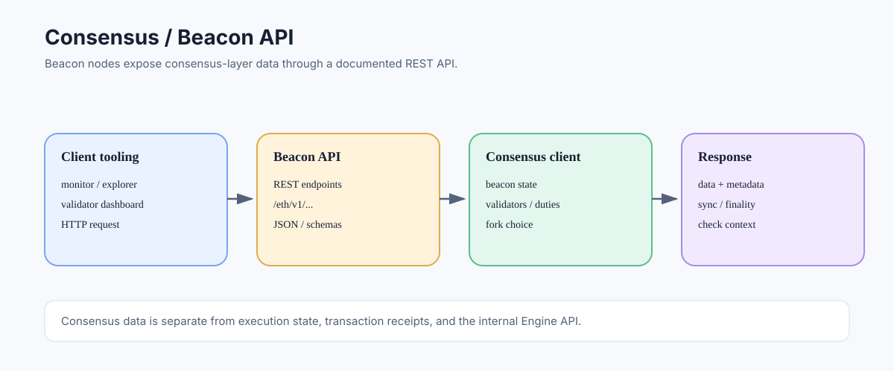

# Consensus API: Accessing Beacon-Chain Data and Operations

> **Stage:** 06 — Application Connectivity  
> **Priority:** 2  
> **Status:** Reviewed  
> **Last reviewed:** 2026-10-17

## 1. Overview

The Ethereum Consensus API is the beacon-node interface for applications that need consensus-layer data and operations. The standardized Beacon API is primarily an HTTP REST interface with JSON responses, separate from the execution client's JSON-RPC API. It exposes selected information about beacon blocks, validators, duties, attestations, finality, and related consensus state.

## 2. Which Component Exposes It?

A consensus client maintains and follows beacon-chain state and communicates with peer consensus clients. Its Beacon API can provide information to monitoring tools, explorers, validator tooling, and other applications. Validator signing and duties are conceptually separate: validator clients use consensus-node information to perform validator operations with key-management safeguards.

The Beacon API is not a general-purpose private-key interface. An application should not assume that a beacon node holds validator signing keys or will sign validator duties simply because it serves consensus data.

## 3. Typical API Categories

The standardized API includes endpoints for categories such as:

- **Beacon chain data:** blocks, headers, genesis information, and state information.
- **Fork choice and finality indicators:** head, justified/finalized checkpoints, and related chain metadata.
- **Validator information:** validator records, balances, and status queries.
- **Validator duties and participation data:** proposer duties, attester duties, and attestation-related information according to API and fork version.
- **Network and node status:** sync status, peer information, and health-related endpoints where specified.

Endpoint paths and schemas are versioned by the Beacon API specification. Use the official API browser or OpenAPI specification rather than hardcoding response assumptions across protocol upgrades.

## 4. Request and Response Shape

A Beacon API request commonly uses HTTP GET for read methods and returns a JSON object whose data is often wrapped under a `data` field. Some operations use POST or other HTTP verbs and may require SSZ or other supported encodings rather than JSON alone; follow the endpoint schema.

A path may look like `/eth/v1/beacon/genesis` or `/eth/v1/node/syncing`, depending on the endpoint being queried. Exact schemas, versions, and supported routes should be read from the official Beacon API specification. This article intentionally avoids presenting one response body as universal for every endpoint.

## 5. Consensus API Versus Execution API

The consensus layer handles beacon-chain state, validators, attestations, proposer duties, fork choice, and finality. The execution layer handles transactions, EVM execution, accounts, logs, and execution state.

An application can need both APIs. For example, a monitoring service might read finalized checkpoint information from a beacon node while using the execution API to inspect transaction receipts or contract logs. These data sources describe related but different layers; they must be correlated carefully by slot, block root, execution block hash, or other specified identifiers.

## 6. Consensus API Versus Engine API

The Consensus API is intended for applications and tooling that need beacon-node data and supported operations. The Engine API is an authenticated internal protocol between consensus and execution clients, used to coordinate execution payload construction, validation, and fork-choice updates.

Do not expose the Engine API as a substitute for the Beacon API, and do not treat Beacon API endpoints as the private interface through which consensus clients instruct execution clients.

## 7. Versioning and Fork-Aware Clients

Consensus APIs evolve with protocol changes. New forks can change beacon data structures, validator-related behavior, and endpoint schemas. Applications should use maintained client libraries or generate types from the current specification when possible, and handle optional or fork-dependent fields deliberately.

If two beacon nodes are at different sync states, they may report different heads or temporarily different observations. For critical work, distinguish head from safe/finalized data, check sync status, and define how the application responds to reorgs or delayed nodes.

## 8. Security Considerations

The official Beacon API documentation warns that endpoints should not be exposed to the public Internet without additional protection, because some operations can trigger expensive processing or create denial-of-service risk. Put suitable authentication, network controls, rate limiting, and request validation in front of endpoints according to the deployment.

Keep validator signing keys in the appropriate secure validator/signing setup. A Beacon API response is data from a node, not automatically a cryptographic proof of every field; high-value systems should define a trust and verification model.

## 9. Developer Review Checklist

- [ ] Explain what the Beacon API exposes and which component serves it.
- [ ] Distinguish consensus data such as validators/finality from execution data such as transactions/logs.
- [ ] Use the official versioned endpoint schema instead of assuming every response has the same shape.
- [ ] Distinguish the public Beacon API from the internal Engine API.
- [ ] Check sync status and distinguish chain head from safe/finalized state.
- [ ] Protect endpoints against excessive requests and keep validator keys in the appropriate signing setup.

## 10. Key Takeaways

- The Beacon API is an HTTP REST interface for selected consensus-layer data and operations.
- It is separate from execution JSON-RPC and the authenticated Engine API.
- Endpoint schemas and fields can change with protocol forks.
- API responses still require an explicit trust and verification model for critical applications.

## References

- 1. [Ethereum Beacon APIs repository](https://github.com/ethereum/beacon-APIs) — official Beacon API specification and schemas.
- 2. [Beacon API rendered reference](https://ethereum.github.io/beacon-APIs/) — endpoint catalogue and examples.
- 3. [Ethereum Consensus Specifications](https://github.com/ethereum/consensus-specs) — consensus protocol and state transition rules.
- 4. [Execution API](15-execution-api.md) — transaction and EVM state interface.
- 5. [Engine API](17-engine-api.md) — internal EL/CL communication.

---

*Editorial note: This article summarizes protocol and API concepts from official documentation. No client was run and no live node endpoint was queried while preparing it.*
