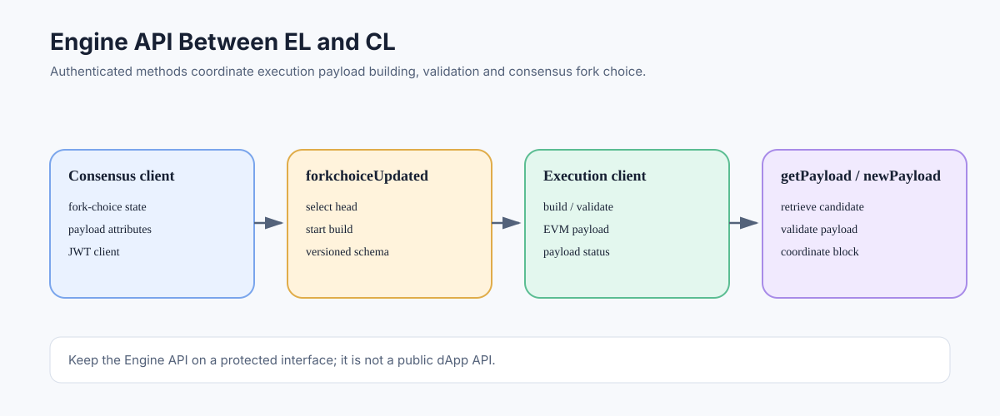

# Engine API: Communication Between Execution and Consensus Clients

> **Stage:** 06 — Application Connectivity  
> **Priority:** 2  
> **Status:** Reviewed  
> **Last reviewed:** 2026-10-17

## 1. Overview

The Engine API is the authenticated interface through which Ethereum's execution client and consensus client coordinate after the Merge. It allows the consensus layer to provide fork-choice updates and coordinate execution payload construction, while the execution layer validates or builds payloads and returns execution status. It is an internal client-to-client API, not the ordinary interface for a dApp to read a token balance.

## 2. Why the Engine API Exists

Post-Merge Ethereum divides execution and consensus responsibilities across different client software. The consensus client follows beacon-chain fork choice and finality, while the execution client runs EVM transactions and maintains execution state. They need a standardized way to agree on execution payloads and how those payloads fit into the current chain.

The Engine API uses JSON-RPC message mechanics but defines separate `engine_*` methods and fork-versioned data schemas. It is distinct from the public user-facing `eth_*` Execution API and from the Beacon API served to consensus-layer applications.

## 3. Core Method Families

Method names and versions depend on the active protocol specification. The principal operations include:

- **`engine_newPayload`** — provide an execution payload to the execution client for validation and processing under the applicable version.
- **`engine_forkchoiceUpdated`** — tell the execution client about the consensus client's current fork-choice state and, when requested, provide payload attributes to start building a new payload.
- **`engine_getPayload`** — retrieve a payload that the execution client has built in response to a payload-building request.
- **Transition/capability methods** — exchange configuration or supported Engine API versions/capabilities where specified by the relevant API version.

The exact parameter structures, status values, and version availability change with protocol upgrades. For implementation work, consult the current Engine API specification and the relevant fork documents rather than copying a method version from an older blog post.

## 4. A Simplified Payload-Building Cycle

A simplified proposer payload workflow can be understood as:

1. The consensus client selects the relevant head/fork-choice context.
2. It calls `engine_forkchoiceUpdated` and provides payload attributes when it wants the execution client to build a candidate payload.
3. The execution client starts building the payload and returns a payload identifier or a status defined by the applicable version.
4. The consensus client later calls `engine_getPayload` to retrieve the candidate payload.
5. The consensus client incorporates the execution payload into a beacon block proposal and participates in consensus duties.
6. The execution client validates payloads received from the consensus side through the relevant `engine_newPayload` flow.

This is a high-level conceptual path. Real behavior includes version-specific validation, status handling, asynchronous payload construction, fork-choice transitions, and error cases.

## 5. Authentication and Network Exposure

Engine API implementations use JWT-based authentication, and the specifications require it to be separated from ordinary public RPC exposure. The common default Engine API port is 8551, but actual bind address, port, and security configuration depend on node configuration. The JWT secret must be shared only between the authorized execution and consensus client processes.

Never expose the Engine API to the public Internet. A malicious caller able to invoke privileged engine methods could disrupt or manipulate the local node's execution/consensus coordination. Use a protected local interface, strict firewall rules, secure JWT secret permissions, and the client's official setup guidance.

## 6. Engine API Versus the Other APIs

| API | Main role | Typical consumer |
|---|---|---|
| Execution API (`eth_*`) | EVM state, transactions, logs, execution data | dApps, wallets, backends |
| Consensus / Beacon API | Beacon-chain data, validators, duties, finality | consensus-layer tooling and monitors |
| Engine API (`engine_*`) | Payload exchange and fork-choice coordination | execution client and consensus client |

These APIs cooperate but have different data models, consumers, and security boundaries. They should not be treated as interchangeable RPC namespaces.

## 7. Versioning and Fork Upgrades

Engine API methods and data structures are versioned to support protocol upgrades. Both connected clients must support compatible versions for the active fork, and operators must follow the upgrade instructions for their selected execution and consensus clients.

An error during the Engine API handshake or payload processing may indicate mismatched client versions, unsupported payload fields, JWT configuration failure, incorrect port or endpoint, or an execution-validity issue. Debug by checking client logs, fork-upgrade compatibility, endpoint accessibility, and authentication settings—not by exposing the Engine API publicly.

## 8. Operational Checklist

- [ ] Pair a compatible execution client with a compatible consensus client.
- [ ] Configure the protected Engine API endpoint and matching JWT secret.
- [ ] Restrict Engine API access to the authorized local client or trusted private network.
- [ ] Upgrade both clients according to the network's fork schedule.
- [ ] Monitor payload status and client logs during sync and upgrades.
- [ ] Use the public Execution API for ordinary dApp requests, not Engine API methods.

## Key Takeaways

- The Engine API coordinates execution payloads and fork-choice-related communication between execution and consensus clients.
- Its methods and schemas are versioned alongside protocol upgrades.
- It uses JWT authentication and an endpoint separate from ordinary public JSON-RPC.
- Keep the interface protected and configure both connected clients compatibly.
- dApps should use user-facing Execution/Beacon APIs rather than calling Engine methods directly.

## References

- 1. [Ethereum Execution APIs — Engine API](https://github.com/ethereum/execution-apis/tree/main/src/engine) — current Engine API specification and versioned methods.
- 2. [Engine API — common definitions](https://github.com/ethereum/execution-apis/blob/main/src/engine/common.md) — transport, JWT authentication, and shared rules.
- 3. [Engine API — Paris methods](https://github.com/ethereum/execution-apis/blob/main/src/engine/paris.md) — foundational method families such as newPayload, forkchoiceUpdated, and getPayload.
- 4. [Ethereum Consensus Specifications](https://github.com/ethereum/consensus-specs) — consensus client responsibilities.
- 5. [Execution Clients](11-execution-clients.md) — EL/CL architecture.
- 6. [Execution API](15-execution-api.md) and [Consensus API](16-consensus-api.md) — comparison with application-facing APIs.

---

*Editorial note: This article summarizes protocol and API concepts from official documentation. No client was run and no live node endpoint was queried while preparing it.*
