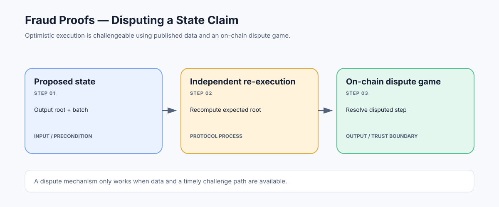

# Fraud Proofs: Disputing Invalid Rollup State Transitions

> **Stage:** 07 — Advanced Layer 2 and Cross-Chain  
> **Priority:** 3  
> **Status:** Reviewed  
> **Last reviewed:** 2026-10-18

## 1. Overview

A fraud proof is evidence, within an optimistic rollup's dispute protocol, that a proposed state transition or execution claim is incorrect. Optimistic systems generally accept a sequencer's claim provisionally rather than requiring a validity proof for every batch up front. A challenger can dispute a suspicious claim, and the protocol resolves the dispute using an on-chain verification process. Some projects increasingly use the term *fault proof*, because the mechanism proves a computation was faulty rather than detecting fraud as a statement about intent.

## 2. Why It Matters to a Developer

Fraud proofs are part of the security model behind optimistic rollups. A developer must know which state is provisional, when a withdrawal is safe to finalize, who is permitted to challenge an output, and what assumptions remain about data availability, honest challengers, game contracts, and upgrade keys.

## 3. How It Works

1. A proposer publishes a batch or assertion and commits to a post-state, often through a state/output root.
2. An independent verifier re-executes the available L2 data and checks whether the claimed result follows from the prior state and the protocol rules.
3. If the verifier disagrees, it starts a dispute before the applicable deadline and posts the required bond or collateral, if the system requires one.
4. In an interactive fault-proof game, participants narrow a large computation down to a specific disputed step. The on-chain verifier checks that step under the rollup's execution rules.
5. The game outcome determines which claim remains valid; a losing party may lose a bond or face another protocol-defined consequence.

The L1 contract does not normally replay every L2 transaction in full. Modern interactive designs aim to reduce the on-chain work to a small, verifiable dispute step.

## 4. Example or Experiment

Suppose an L2 block begins at state root `R0`. A proposer claims that processing batch `B` produces `R1`. An independent node executes `B` from `R0` and derives `R1'`. If `R1' != R1`, the node needs the rollup's challenge path, sufficient published data, and a live dispute window to challenge the claim. A hash mismatch alone is not automatically an accepted fraud proof; the protocol's game and verifier decide the dispute.

## 5. Common Mistakes and Security Considerations

A fraud-proof system does not help if nobody can obtain the transaction data needed to re-execute the chain, if honest challengers cannot submit disputes in time, or if an upgrade/admin mechanism can bypass the proof system. Check permissionlessness, bond economics, game deadlines, preimage availability, the exact VM being proven, and the system's current fault-proof maturity. Do not treat 'fraud proofs enabled' as a complete security verdict.

## 6. Key Takeaways

- The proof challenges a proposed computation or state claim; it does not prove malicious intent.
- Independent re-execution and data availability are essential to meaningful challenges.
- Read the actual dispute-game specification: timelines, participants, verifier, and trust assumptions vary by rollup.

## 7. References

- [Ethereum.org — Optimistic Rollups](https://ethereum.org/developers/docs/scaling/optimistic-rollups/)
- [Optimism Specs — Fault Proof](https://specs.optimism.io/fault-proof/index.html)
