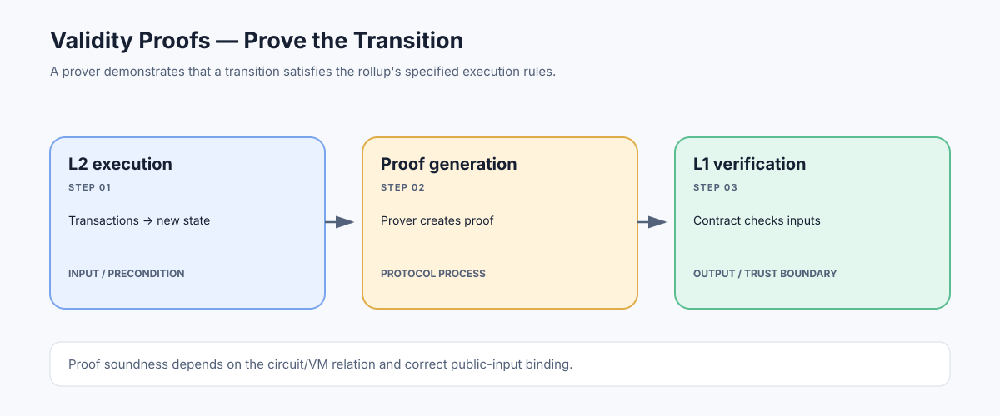

# Validity Proofs: Cryptographically Verifying Rollup Execution

> **Stage:** 07 — Advanced Layer 2 and Cross-Chain  
> **Priority:** 3  
> **Status:** Reviewed  
> **Last reviewed:** 2026-10-18

## 1. Overview

A validity proof is a cryptographic proof that a computation satisfies a specified relation. In a validity rollup, a prover constructs a proof that a batch of transactions correctly transforms an agreed pre-state into a claimed post-state according to the rollup's execution rules. A verifier contract on Ethereum checks that proof before accepting the relevant state update.

## 2. Why It Matters to a Developer

Validity proofs change how an L2 establishes correctness. They can remove the need for a multi-day fraud-challenge process for an accepted state transition, but they do not automatically guarantee data availability, censorship resistance, contract correctness, or a secure bridge. Those are separate properties.

## 3. How It Works

1. Transactions are executed by an L2 execution engine against a known prior state.
2. The proving system encodes the execution as a constraint system or another formally specified relation.
3. A prover generates a proof that the public inputs (such as state roots, batch commitments, and protocol metadata) are consistent with a valid execution.
4. The L1 verifier contract checks the proof against the exact public inputs and verification key.
5. If verification succeeds and all other contract rules pass, the rollup can accept the new state commitment.

SNARKs and STARKs are broad proof-system families with different assumptions, proof sizes, verification costs, and prover requirements. 'Zero knowledge' is often used in the rollup category name, but the central scaling property is validity verification; not every design hides user transaction details.

## 4. Example or Experiment

Conceptually, a verifier might accept `(oldRoot, newRoot, batchHash, proof)` only when the proof demonstrates that the batch transitions `oldRoot` to `newRoot` under the rollup's specified state-transition function. The verifier must bind every public input to the same batch and chain context. This tuple is illustrative, not a universal Solidity ABI.

## 5. Common Mistakes and Security Considerations

A proof only establishes the statement that the circuit or VM actually encodes. Circuit bugs, unsound assumptions, a compromised proving setup (where relevant), incorrect public-input binding, verifier bugs, upgrade authority, and unavailable transaction data can still create risks. Also distinguish proof generation latency from L1 finality: a proof being generated off-chain does not itself finalize anything.

## 6. Key Takeaways

- The verifier checks execution correctness relative to a specific statement and verification system.
- Validity proofs and data availability solve different problems.
- Audit the circuit/VM semantics, public inputs, verifier contract, and upgrade controls—not only the proof-system brand.

## 7. References

- [Ethereum.org — Zero-Knowledge Rollups](https://ethereum.org/developers/docs/scaling/zk-rollups/)
- [EIP-4844 — Blob-carrying Transactions](https://eips.ethereum.org/EIPS/eip-4844)
