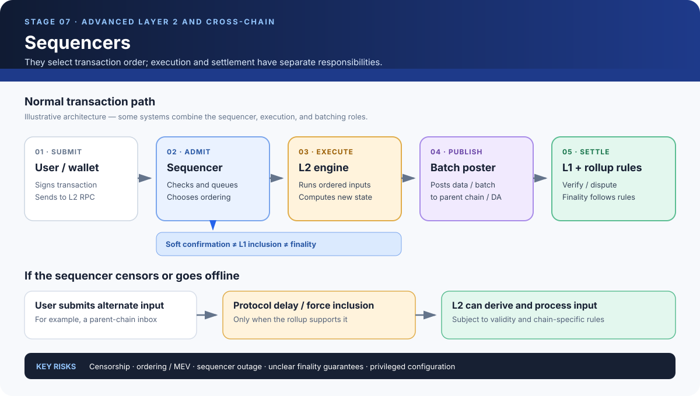

# Sequencers: Ordering Transactions on a Rollup

> **Stage:** 07 — Advanced Layer 2 and Cross-Chain  
> **Priority:** 3  
> **Status:** Reviewed  
> **Last reviewed:** 2026-10-18

## 1. Overview

A **sequencer** is a component or service that receives Layer 2 (L2) transactions, decides which transactions to accept and in what order, and emits an ordered sequence of L2 blocks or transactions. In many Ethereum rollups, a sequencer provides the fast path users experience: a wallet submits a signed transaction, the sequencer orders it, and the user may receive a quick acknowledgement or a soft confirmation before the relevant data and commitments have been fully settled through Ethereum Layer 1 (L1).

Sequencing and execution are related but different jobs:

- **Sequencing** determines the canonical order of inputs to be processed.
- **Execution** applies those ordered transactions to the current state according to the chain's rules.
- **Batch submission / data publication** sends the required transaction data or commitments to the parent chain or another data-availability layer.
- **Settlement** applies the rollup's proof or dispute rules and determines when state claims or messages can be relied on.

Some implementations combine several of these roles in one operator or service; others separate them. This article focuses on transaction ordering and its security consequences.

## 2. Why Sequencers Matter to a Developer

Sequencer design affects user experience and the trust assumptions of an L2. It can influence how quickly a dApp sees a transaction acknowledged, how transactions compete for inclusion, who can censor or reorder transactions, and what happens if the normal operator goes offline.

For a smart-contract developer, a transaction appearing in a wallet UI is not enough to understand its status. It matters whether the transaction has been:

1. received by an RPC endpoint;
2. admitted and ordered by a sequencer;
3. executed into an L2 block;
4. included in data or a batch published to the parent chain;
5. accepted under the rollup's settlement rules and the parent chain's consensus.

Different systems use different status terminology. Applications should not describe a sequencer's acknowledgement as if it were equivalent to L1 finality or finalized withdrawal eligibility.

## 3. A Transaction's Path Through a Sequencer

A simplified rollup transaction path looks like this:

1. **Submission.** A user signs a transaction and sends it to an L2 RPC endpoint. The endpoint forwards it to the sequencer or its admission layer.
2. **Admission checks.** The system checks basic requirements such as transaction encoding, signature, chain ID, nonce-related rules, fee conditions, and any chain-specific admission policies. Exact validation may occur at different layers.
3. **Ordering.** The sequencer chooses which admitted transactions go into an L2 block and in what order. This ordering can affect state-dependent outcomes such as AMM swap prices.
4. **Execution.** The ordered transactions are passed to the L2 execution engine. The engine applies the chain's state-transition rules and derives a resulting state.
5. **Fast feedback.** The system may return a sequencer receipt, soft confirmation, or L2 block reference before the batch has been published and settled on L1. The meaning of this signal is rollup-specific.
6. **Data publication.** A batcher, batch poster, or combined operator publishes the necessary data to the parent chain or the configured data-availability layer.
7. **Settlement and finality.** The system's validity-proof or fraud/fault-proof rules and the parent chain's consensus determine when the relevant state or message can be considered finalized under the protocol.

This is a conceptual workflow, not a claim that every rollup uses separate services or follows exactly these steps. For example, the [Arbitrum Sequencer documentation](https://docs.arbitrum.io/how-arbitrum-works/deep-dives/sequencer) describes receipt, admission, ordering, execution handoff, and publication via the sequencer feed and batch poster. Other rollups use different components and interfaces.

## 4. What Does the Sequencer Actually Decide?

### Admission and inclusion

A sequencer may accept a transaction into its queue, reject it, or delay its inclusion. Rejection may be caused by malformed data, insufficient fees, invalid signatures, nonce issues, chain-specific filtering, capacity policies, or other admission rules. A valid transaction may still be censored or delayed for reasons unrelated to its execution validity.

### Ordering

Ordering is economically important. Consider two users submitting swaps to the same automated market maker (AMM). If Alice's swap changes the pool price before Bob's swap executes, Bob may receive a different output than he would have received if the order were reversed. A sequencer that can choose order can affect execution outcomes and may capture value through transaction ordering.

A blockchain's deterministic execution rules ensure that nodes derive the same result from the same ordered transactions. They do not, by themselves, guarantee that the selected order is fair, neutral, or resistant to manipulation.

### Soft confirmations

Some systems return early signals that a transaction has been accepted or ordered. These signals can be valuable to applications because they reduce perceived latency. But their guarantees depend on the protocol and the actor providing them.

A soft confirmation may mean only that a sequencer has committed to an order. It may not mean that data has been published to L1, that the parent-chain transaction is final, or that a bridge withdrawal can be finalized. A dApp should distinguish these statuses in its user interface and backend logic.

## 5. Centralized and Decentralized Sequencing

### Single-operator sequencing

Many rollups began with a single sequencer or a tightly controlled operator. This can make operation simpler and provide fast, consistent user experience, but it concentrates several powers: transaction admission, ordering, block production, and sometimes the publication pipeline.

A single operator can potentially censor transactions, reorder them, extract ordering-related MEV, or halt the chain by going offline. The system may still preserve asset safety through its settlement and data-availability rules, but liveness and censorship resistance can degrade.

### Sequencer sets and rotating operators

Other designs use a set of participants, a leader-selection mechanism, or rotation to distribute sequencing responsibility. This can reduce dependence on a single service, but it introduces coordination rules and new assumptions: quorum thresholds, network timing, leader failure, equivocation handling, incentives, slashing, and governance.

Having multiple sequencer operators is not sufficient on its own. The important questions are how their ordering decisions are authorized, how a conflicting sequence is resolved, what happens if a quorum stops responding, and whether a user has a practical path around censorship.

### Shared sequencing and based rollups

Sequencing can also be shared across multiple rollups, or it can use the L1 proposer path as the primary source of order.

- **Shared sequencing** coordinates ordering for participating rollups through a common sequencing system. This can support coordination but introduces shared trust and correlated failure risks.
- **Based rollups** derive sequencing from the base chain's proposer/block-building path. They can align ordering with L1 but still need rollup execution, data availability, and settlement mechanisms.

Neither design automatically provides atomic cross-chain execution or removes every MEV, liveness, and governance concern. See [Shared Sequencing](17-shared-sequencing.md) and [Based Rollups](16-based-rollups.md) as related concepts in this roadmap.

## 6. Censorship Resistance and the Fallback Path

A sequencer can refuse to include a specific transaction or stop producing blocks. An L2's response depends on its protocol architecture. Potential protections include:

- **Forced inclusion:** users submit a message or transaction through a parent-chain contract or queue, and protocol rules require it to be included after a defined delay.
- **Delayed inbox / alternative input path:** messages submitted outside the sequencer's fast path are recorded on the parent chain and become inputs to L2 derivation according to the protocol.
- **Sequencer rotation or recovery:** a governance or protocol mechanism selects another sequencer or restores block production.
- **Exit mechanisms:** users can prove claims or withdrawals through a protocol-defined path if the ordinary sequencer is unavailable, subject to data availability and settlement conditions.

The existence of a fallback mechanism does not mean transactions are included immediately or for free. The delay, cost, eligibility, queue semantics, and activation permissions must be checked in the target rollup's documentation and contracts.

For a concrete example, Arbitrum Nitro documents a **Delayed Inbox** and a **force-inclusion** route: a message can be sent through the parent-chain inbox, and anyone can force-include an eligible delayed message once the protocol's configured window has elapsed. Exact behavior and timing are chain-configuration-dependent. See [Arbitrum's forced-transactions documentation](https://developer.arbitrum.io/how-arbitrum-works/deep-dives/forced-transactions).

A robust application should not assume that a sequencer outage makes funds immediately withdrawable. It should understand which data has been published, which state is accepted, and what proof and finalization steps the exit path requires.

## 7. Sequencers and MEV

**Maximal Extractable Value (MEV)** is value that can be gained by choosing, changing, or exploiting transaction inclusion and ordering within the block-production process. Sequencers can have privileged access to pending transactions and the ability to choose their order, so they can influence who receives favorable execution.

Examples include:

- **Front-running:** inserting a transaction before a known user transaction to benefit from its expected effect.
- **Back-running:** placing a transaction immediately after another transaction to capture an effect caused by it.
- **Sandwiching:** arranging transactions before and after a user's trade to exploit the price movement created by that trade.
- **Censorship or selective delay:** withholding a transaction until the market or protocol state changes.

These are different behaviors, and not every sequencing system permits or rewards all of them. Some chains use private submission channels, auctions, ordering rules, or other policies to change the incentives. Such mechanisms must be evaluated on their own terms: a private order flow endpoint, for example, may improve privacy from public mempools while concentrating trust in its operator.

Smart-contract developers should avoid assuming that transactions arrive in user-submission order or that inclusion is fair. For contracts handling swaps, liquidations, auctions, or time-sensitive state, consider slippage limits, deadlines, commit/reveal patterns where suitable, access control, oracle assumptions, and other protocol-specific mitigations.

## 8. Sequencer, Batcher, Prover, and Settlement Layer Are Different Roles

These roles often cooperate, but they answer different questions:

| Role | Primary responsibility | Question it answers |
|---|---|---|
| Sequencer | Admits and orders L2 transactions; may produce fast confirmations or L2 blocks | Which transactions are next, and in what order? |
| Execution engine | Runs ordered transactions and computes the resulting state | What state follows from these inputs? |
| Batcher / batch poster | Publishes data or commitments to the parent chain or data-availability layer | Can the relevant inputs be made available to reconstruct the chain? |
| Prover | Produces a validity proof or supporting proof artifacts where applicable | Can the transition be proven under the specified relation? |
| Dispute game / fault-proof system | Resolves challenged optimistic claims where applicable | Which disputed claim follows the protocol rules? |
| Settlement contracts and L1 | Apply verification/finalization rules and anchor state claims | When can the relevant state or message be relied on under the protocol? |

One organization may operate several of these components, but treating the jobs as conceptually separate helps identify trust boundaries. A sequencer can order transactions without itself being the component that produces a validity proof or finalizes an L1 withdrawal.

## 9. Common Mistakes and Security Considerations

### Equating speed with finality

A fast acknowledgement is useful, but it does not automatically mean the transaction has been published to L1 or reached the finality required by a bridge. Check the exact guarantee behind each status.

### Assuming valid transactions cannot be censored

A transaction can be valid under execution rules and still be excluded by a sequencer's admission or ordering policy. Validity and inclusion are distinct properties.

### Assuming sequencer decentralization solves MEV

A decentralized sequencer set can still choose profitable ordering, coordinate, censor, or suffer quorum-level failures. Evaluate its selection and ordering rules, not just the number of operators.

### Treating the sequencer feed as settlement

A sequencer feed or streaming interface can provide rapid access to ordered blocks. It does not replace the rollup's canonical data-publication path or the settlement rules.

### Ignoring fallback constraints

Forced inclusion or delayed-inbox mechanisms have specific preconditions, timeouts, and costs. The route may still require valid transaction data and the correct protocol format.

### Overlooking configuration and administrative powers

Some chains permit configurable filtering or inbox restrictions. Review who can change those settings, pause the system, upgrade its contracts, or alter the sequencing configuration.

## 10. Developer Review Checklist

When evaluating an L2 sequencer, ask:

- Who can operate the sequencer, and who can change or replace it?
- What does a sequencer acknowledgement guarantee: receipt, ordering, execution, or something else?
- How are transactions admitted, queued, ordered, and propagated?
- What prevents or limits censorship, and what is the exact forced-inclusion path?
- Where and when is transaction data published, and what can independent nodes reconstruct?
- What are the sequencer's MEV powers and ordering policies?
- How does the chain recover during sequencer outage, network partition, or operator compromise?
- Which event or state proves that an L2 action is settled enough for a bridge or application to rely on it?

Answering these questions gives a more useful picture of sequencing security than merely calling a chain centralized or decentralized.

## 11. Key Takeaways

- A sequencer controls the admission and ordering path for L2 transactions; execution computes state from that order.
- Fast sequencer confirmations, L2 execution, L1 data publication, settlement acceptance, and bridge finalization are distinct milestones.
- Sequencer design affects censorship resistance, liveness, transaction ordering, and MEV.
- A credible censorship-resistance design documents its alternate input path, deadlines, costs, and exit requirements.
- Decentralized or shared sequencing changes the trust model but does not automatically guarantee fair ordering or atomic cross-chain execution.
- Always examine the target rollup's active specifications and deployed configuration.

## 12. References

- [Ethereum.org — Optimistic Rollups](https://ethereum.org/developers/docs/scaling/optimistic-rollups/) — overview of sequencers, batch publication, censorship resistance, and settlement.
- [Ethereum.org — Zero-Knowledge Rollups](https://ethereum.org/developers/docs/scaling/zk-rollups/) — role of rollup operators, sequencers, data publication, and censorship considerations.
- [Arbitrum Docs — The Sequencer and Censorship Resistance](https://docs.arbitrum.io/how-arbitrum-works/deep-dives/sequencer) — transaction admission, ordering, execution handoff, sequencing feed, and batch posting.
- [Arbitrum Developer Docs — Forced Transactions](https://developer.arbitrum.io/how-arbitrum-works/deep-dives/forced-transactions) — delayed inbox and force-inclusion behavior.
- [Arbitrum Docs — Sequencer Chain Information](https://docs.arbitrum.io/chain-info) — documented distinction between public RPC endpoints and sequencer endpoints.

[Back to Stage 07 index](README.md) · [Full roadmap](../../roadmap/roadmap.md)
