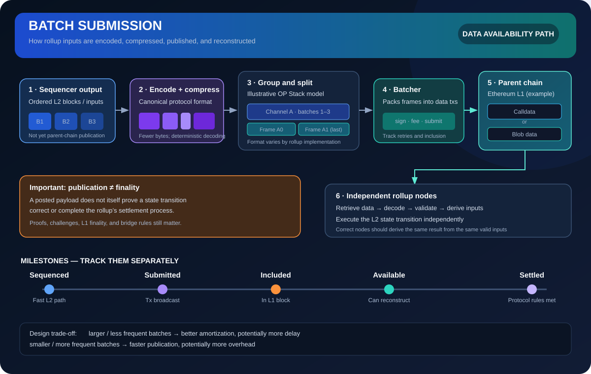

# Batch Submission: Publishing Rollup Data to the Parent Chain

> **Stage:** 07 — Advanced Layer 2 and Cross-Chain  
> **Priority:** 3  
> **Status:** Reviewed  
> **Last reviewed:** 2026-10-18

## 1. Overview

**Batch submission** publishes the data needed to reconstruct a Layer 2 (L2) rollup’s canonical history to its parent chain or chosen data-availability layer. In an Ethereum rollup, a component commonly called a **batcher**, **batch submitter**, or **batch poster** takes L2 data produced by the sequencing system, encodes and often compresses it, packages it for transport, and submits it to Ethereum or another configured data-availability provider.

The key idea is aggregation. Rather than paying the full fixed overhead of a parent-chain transaction for every L2 transaction, a rollup combines many L2 inputs into fewer publications. Compression can reduce the bytes published, while batching spreads transaction overhead across many users.

Batch submission is closely related to—but distinct from—sequencing, execution, state commitments, validity proofs, and settlement:

- **Sequencing** establishes an order for L2 transactions or block inputs.
- **Execution** applies those inputs to the L2 state machine.
- **Batch submission** publishes the data that lets independent nodes reconstruct those inputs.
- **State commitments** summarize a state, often through a state root.
- **Validity or fault-proof systems** establish or challenge the correctness of state transitions.
- **Settlement** is the process by which the parent-chain protocol accepts relevant commitments and resolves disputes under its rules.

Publishing a batch is not, by itself, proof that every state transition is correct, nor does it automatically mean the L2 result has reached finality.

## 2. Actors and responsibilities

A typical rollup data path involves several actors. One process may implement multiple roles, but the protocol responsibilities are conceptually different.

1. **Users and applications** create signed L2 transactions and submit them to an RPC endpoint.
2. **The sequencer** accepts transactions, chooses their order, and emits L2 blocks or ordered inputs. It may provide a fast, provisional confirmation.
3. **The batcher** reads sequencer data that still needs publication, encodes and compresses it, groups it into transport units, and submits parent-chain transactions.
4. **The parent chain or data-availability provider** includes or accepts the payload according to its own rules.
5. **Independent rollup nodes** retrieve published data, validate its format, derive L2 inputs, and execute them according to the protocol.
6. **The commitment and dispute/proof system** determines how state claims are checked and when protocol-defined finality conditions are satisfied.

The batcher does not have to be the sequencer. In systems such as Arbitrum Nitro, batch posting can be a separate node role that publishes queued sequencer messages received from a feed. Separating the roles can improve operational flexibility, though it introduces coordination and key-management considerations.

## 3. What exactly is a “batch”?

The word **batch** is overloaded. It can refer to a group of L2 transactions, a protocol-level set of block inputs, or the parent-chain transaction that transports some of those inputs. These are not always the same object.

The OP Stack specification provides a useful concrete example:

- A **sequencer batch** represents the inputs needed to derive an L2 block, subject to protocol rules and other inputs such as deposits where applicable.
- A **channel** groups a sequence of sequencer batches and compresses them together, improving compression efficiency.
- A **channel frame** is a chunk of a channel. A channel may be too large for one parent-chain data transaction, so it is split into frames.
- A **batcher transaction** carries one or more frames to the configured data-availability layer. A single transaction can contain frames from more than one channel, depending on protocol rules.

This layered design lets a rollup pack data efficiently. For example, a transaction may carry the final frame of one channel alongside a frame from another channel instead of leaving available space unused. The exact terminology, wire format, and validation rules are implementation-specific; not every rollup uses OP Stack’s channel-and-frame format.

## 4. Batch submission lifecycle

The following stages describe a general workflow. A specific rollup may combine, reorder, or name them differently.

### Step 1 — Identify unpublished L2 inputs

The batcher determines which sequencer-produced data still needs publication. It must distinguish data seen on the fast sequencer feed from data already submitted or confirmed sufficiently for the implementation’s bookkeeping.

Submitting a parent-chain transaction does not instantly update the rollup node’s view of which L2 blocks are safe. The batcher must avoid accidentally resubmitting data or incorrectly marking it as published while the parent-chain transaction is pending or has been reorganized.

### Step 2 — Encode and compress

The batcher converts L2 data into the protocol’s required encoding and compresses suitable fields or sequences. Repeated values, predictable structure, and compact transaction formats can make an aggregated payload much smaller than the sum of individually published transactions.

Compression cannot be changed arbitrarily: every independent node must decode the result deterministically under the protocol rules. Implementations also need bounded decompression and parsing resources so a malicious payload cannot force unbounded memory or CPU use.

### Step 3 — Build channels or equivalent groups

Where channels are supported, the batcher accumulates multiple sequencer batches into a compressed channel. Larger channels often achieve better compression, but waiting for more data can delay publication. A channel that is too large for one data transaction is split into frames.

Channel lifecycle rules matter. Nodes need to recognize which frames belong together, which frame closes a channel, and how to handle missing, duplicated, late, malformed, or out-of-order frames. Timeouts and derivation rules prevent incomplete channel data from being buffered indefinitely.

### Step 4 — Construct a parent-chain data transaction

The batcher places one or more transport units into a transaction addressed to the protocol’s configured inbox or destination. The transaction is signed by an authorized batch-submitter account where required. In a real deployment, signing authority, transaction nonce management, gas estimation, fee bidding, account funding, and retry policy are part of the batcher’s reliability design.

In OP Stack, the derivation specification defines the batcher transaction and frame wire formats. The batcher specification separately describes an operational loop: select unpublished L2 blocks, open and compress a channel, fill data transactions with frames, and submit them to L1.

### Step 5 — Publish the data

For Ethereum rollups, data has historically been published in transaction calldata, and many rollups can now use blob-carrying transactions introduced by EIP-4844. Calldata is part of execution-layer transaction data and remains in Ethereum’s historical chain data. Blob data uses a separate data-availability mechanism, is not directly readable by EVM execution, and is not intended as permanent execution-layer storage.

Rollups may choose between available publication routes according to protocol configuration and network conditions. Other architectures can use a different data-availability provider, but that changes the trust and verification assumptions; it should not be described as equivalent to Ethereum-enforced data availability without examining the design.

### Step 6 — Reconstruct and validate

Independent rollup nodes retrieve parent-chain inputs and decode the batches. They check protocol constraints such as transaction destination, authorized sender where relevant, supported format version, frame validity, ordering, channel completeness, and the validity of included L2 transaction data.

The nodes then use these inputs—alongside other protocol-defined inputs—to derive the L2 chain and execute transactions. Two correct nodes using the same valid inputs and protocol rules should derive the same canonical result. This is why data publication must be specified precisely rather than treated as arbitrary bytes.

## 5. Why batching reduces costs

A parent-chain transaction has overhead beyond its payload: transaction inclusion consumes blockspace, the sender pays fees, and the rollup must manage the publication process. If each L2 transaction were posted independently, much of this overhead would be paid repeatedly.

Batching can lower average publication cost in two ways:

- **Amortization:** one parent-chain transaction can carry data for many L2 transactions.
- **Compression:** a combined representation may require fewer bytes than separate representations.

A simplified mental model is:

**Average publication cost per L2 transaction ≈ (parent-chain transaction overhead + data fee) ÷ number of L2 transactions represented**

This is not a complete fee formula. Actual user fees may also include L2 execution and operator fees, and the parent-chain data fee depends on publication route, payload size, base fees, and demand. A small batch may not fill available capacity; a large batch may save overhead but delay publication.

Blob-carrying transactions have a separate fee market from ordinary execution gas. This can materially change rollup data costs, but it does not make publication free, permanent, or unlimited.

## 6. The latency–cost trade-off

Batchers balance low publication cost, low delay before data becomes available on the parent chain, and reliable operation under congestion.

**Larger and less frequent batches** can improve compression and amortize transaction overhead. However, users and independent verifiers may wait longer before sequencer inputs are published. Large batches can also be harder to fit into available data capacity and may require more attempts during congestion.

**Smaller and more frequent batches** can reduce the delay between a fast L2 confirmation and parent-chain publication. They may use data space less efficiently and incur more fixed transaction overhead.

Submission timing is bounded by protocol requirements, such as sequencing windows, channel timeouts, or rules for forcing delayed inputs. Operational policy must stay within those constraints. There is no universal “correct batch interval” for all rollups; it depends on the protocol, data rate, parent-chain conditions, and the guarantees the rollup is designed to provide.

## 7. Publication, availability, and finality are different

Track these milestones separately:

1. **Sequenced:** the sequencer has ordered the transaction or included it in an L2 block, possibly providing a fast provisional acknowledgement.
2. **Submitted:** the batcher has broadcast a parent-chain transaction. It may still be pending, replaced, or dropped.
3. **Included:** the transaction has been included in an L1 block. It has not necessarily reached L1 finality.
4. **Available and reconstructable:** independent nodes can obtain the data and derive the corresponding L2 inputs under protocol rules.
5. **Safe or input-finalized under the rollup’s rules:** the rollup client has observed required parent-chain conditions. Terminology varies by rollup.
6. **State claim accepted or settled:** the state commitment has satisfied the rollup’s proof, challenge, and settlement requirements.

These milestones are not interchangeable:

- **Data availability** asks whether independent participants can obtain data needed to reconstruct or verify the rollup.
- **Execution correctness** asks whether the state transition follows the L2 state machine.
- **Validity proofs or fault proofs** address correctness according to their verification model.
- **L1 finality** concerns the parent chain’s consensus guarantees.
- **L2 settlement or withdrawal finality** depends on the rollup’s contracts and protocol rules.

On Ethereum, blob data is served for a protocol-defined window, not kept forever as execution-layer storage. Rollup operators and node providers must account for this lifecycle; long-term archival access can require additional infrastructure.

## 8. Security and reliability considerations

Batch submission is a critical part of the rollup’s data-availability path. A robust implementation should address the following risks.

### Censorship and delayed publication

If the only batcher stops publishing, users may face delays even if the sequencer continues to provide fast confirmations. Protocols commonly define bounds and recovery mechanisms, such as sequencing-window rules or forced-inclusion paths. The exact ability of users or alternative operators to advance the chain depends on the rollup’s design and must be verified rather than assumed.

### Invalid, incomplete, or misordered data

Malformed transaction formats, missing frames, invalid compression output, duplicated data, and incorrect ordering can prevent correct derivation. Independent nodes must apply canonical validation rules rather than trust the batcher’s interpretation.

### Data-availability assumptions

Publishing to Ethereum calldata or blobs gives different storage and fee properties, but both have protocol-defined retrieval requirements. A rollup using an external data-availability committee, separate network, or off-chain store inherits additional availability assumptions. A state commitment alone cannot replace the transaction data needed for reconstruction.

### Parent-chain reorganizations and retry logic

A submitted transaction may not remain in the canonical parent-chain history. The batcher must handle replacements, retries, confirmation tracking, and possible reorgs without permanently skipping data or treating an unconfirmed publication as final.

### Key compromise and inadequate funding

A batcher may need a funded parent-chain account and a recognized signer. Compromised keys can disrupt publication or permit unauthorized actions within the protocol’s permissions. Insufficient balance, fee-estimation failures, nonce conflicts, RPC outages, and an unreliable signing service can all reduce liveness.

### Resource-exhaustion attacks

Parsers should enforce limits on encoded and decompressed data, channel sizes, frame counts, and buffering. Compression should reduce cost without creating a path where a tiny payload expands into unbounded work. Implementations should monitor channel timeouts and clear incomplete data according to protocol rules.

## 9. Developer and operator review checklist

When reviewing a rollup’s batch-submission design, ask:

- What exact data is published: full transaction data, compressed block inputs, state differences, or another representation?
- Which component sequences, executes, compresses, signs, and submits data? Are these roles coupled or independent?
- What are the encoding, versioning, channel, frame, ordering, timeout, and decompression-limit rules?
- Which publication mechanism is used: calldata, blobs, or another provider?
- Can independent nodes reconstruct the canonical L2 chain from published data and public protocol rules?
- What are the tolerated delays, sequencing-window constraints, and recovery or forced-inclusion paths?
- How does the system handle congestion, transaction replacement, reorgs, retries, and duplicate submissions?
- Who controls batch-submitter keys, pays parent-chain fees, and monitors balances and failed publications?
- Which milestones count as sequenced, published, safe, finalized, and settled for users and bridges?
- If an external data-availability service is used, what additional trust assumptions and failure modes does it introduce?

For smart-contract developers, this matters because bridges, withdrawal flows, state commitments, challenge systems, and monitoring services may depend on knowing which L2 inputs have actually been published and what guarantees that publication provides.

## 10. Key takeaways

- Batch submission publishes rollup inputs so independent nodes can reconstruct the L2 chain.
- Batching and compression reduce average data-publication costs, but publication frequency creates a cost–latency trade-off.
- A logical L2 batch, a compression channel, a channel frame, and a parent-chain batcher transaction may be different objects.
- Calldata and blobs have different storage, access, and fee properties; blob data is not permanent execution-layer storage.
- Submission is not the same as inclusion, availability, correct execution, proof acceptance, or finality.
- A secure design needs canonical decoding rules, data-availability guarantees, robust retries, bounded resource use, and a defined recovery path.

## References

1. [Ethereum.org — Optimistic Rollups](https://ethereum.org/developers/docs/scaling/optimistic-rollups/)
2. [Ethereum.org — Zero-Knowledge Rollups](https://ethereum.org/developers/docs/scaling/zk-rollups/)
3. [Ethereum.org — Data Availability](https://ethereum.org/developers/docs/data-availability)
4. [EIP-4844 — Shard Blob Transactions](https://eips.ethereum.org/EIPS/eip-4844)
5. [OP Stack Specification — Batch Submitter](https://specs.optimism.io/protocol/batcher.html)
6. [OP Stack Specification — Derivation and Batch Submission Wire Format](https://specs.optimism.io/protocol/derivation.html)
7. [OP Stack Specification — Glossary](https://specs.optimism.io/glossary.html)
8. [Arbitrum Docs — Assign Node Roles](https://docs.arbitrum.io/run-a-node/assign-node-roles)
9. [Arbitrum Docs — L1 Ethereum Beacon Chain RPC Providers](https://docs.arbitrum.io/run-a-node/l1-ethereum-beacon-chain-rpc-providers)
