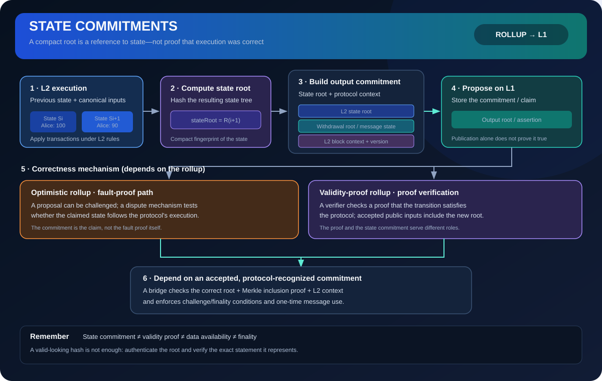

# State Commitments: Representing Rollup State with Cryptographic Roots

> **Stage:** 07 — Advanced Layer 2 and Cross-Chain  
> **Priority:** 3  
> **Status:** Reviewed  
> **Last reviewed:** 2026-10-18

## 1. Overview

A **state commitment** is a compact cryptographic value that commits to a particular representation of a system's state. Instead of copying every account, balance, contract-storage value, and other state item into a settlement contract, a rollup can publish a short root hash that cryptographically represents that state. With the appropriate data and proof, another system can check whether a claimed value belongs to the committed state.

In Ethereum, the execution-layer state is organized using a Merkle-Patricia trie. The trie's root is called the **state root** (**stateRoot**). It is included in the execution block header and represents the global account state after the block has been executed. A rollup can use a similar state commitment for its own L2 state, then publish an L2-specific commitment to L1.

The important distinction is that a commitment represents a state; it does not, on its own, prove that the state was reached correctly. A hash is a compact reference, not an execution trace, a data-availability guarantee, or a validity proof. Rollup protocols combine commitments with other mechanisms—such as public transaction data, validity proofs, fault-proof games, challenge periods, and settlement contracts—to determine what claims can safely be accepted.

## 2. Why state commitments are useful

An L2 may process thousands of transactions off the parent chain. Replaying every transaction inside an L1 contract simply to learn the L2's latest state would be expensive or infeasible. A state commitment gives the protocol a small value that can be stored, compared, referenced, and challenged.

State commitments support several important tasks:

- **Tracking state transitions:** each committed checkpoint represents a particular L2 state, usually associated with a block number or output index.
- **Verifying specific data:** a Merkle proof can show that an account, storage value, or other item is included under a committed root.
- **Bridging and withdrawals:** L1 contracts can verify evidence about an L2 message or withdrawal against a commitment they recognize.
- **Dispute resolution:** a fault-proof system can identify and challenge an incorrect claim about the L2 state.
- **Validity-proof verification:** a verifier can accept a new root when a proof establishes that the state transition satisfied the rollup's rules.
- **Compact cross-system references:** another contract or chain can refer to a state checkpoint without storing the entire state.

The commitment's value depends on the surrounding protocol. The system must define what the root commits to, which block or time it represents, how it is constructed, and what evidence is required before it can be trusted.

## 3. How a state root works

Conceptually, a Merkle-based state structure groups state data into a tree of hashes. Leaf values represent encoded state entries; internal nodes commit to their children. Hashing the structure up to its top produces a root.

For Ethereum's execution-layer state, account entries are organized in a modified Merkle-Patricia trie. An account entry includes fields such as the account nonce, balance, storage root, and code hash. Each contract also has its own storage trie. A rollup may use different internal data structures, but the same general idea applies: a root compactly commits to a larger collection of values.

Suppose an L2 state contains:

- Alice's balance: 100 tokens
- Bob's balance: 20 tokens
- The token contract's other storage and account data

Alice transfers 10 tokens to Bob. The execution result should produce Alice's balance of 90 and Bob's balance of 30, assuming the transaction is valid and no other state rules alter the outcome. The updated state structure produces a new root, **R(i+1)**, distinct from the previous root, **R(i)**.

A tiny change to the committed data should change the resulting root with overwhelming probability. This makes roots useful fingerprints of state. Two independently computed roots match when they represent the same encoded tree and values under the same rules, barring a cryptographic collision.

However, **matching roots are meaningful only when the state format and context match**. A root without a chain identity, block context, schema/version, or agreed interpretation can be ambiguous. Rollup protocols therefore define their commitment formats and which identifiers or roots are included.

## 4. State root, output root, transaction root, and batch root

These terms are related, but they do not mean the same thing.

### State root

The **state root** commits to the state data structure for a particular point in the chain. It is useful for proving a specific account or storage value when accompanied by the required Merkle proof and the data needed to verify that proof.

### Transaction root

The **transaction root** commits to the block's transaction list. It is not a commitment to the resulting account and contract state. A valid transaction list and a resulting state are linked through execution, but they are different data structures and claims.

### Batch root

A **batch root** commonly commits to the set or ordered contents of a batch. It can be used to prove that a transaction belongs to a batch. It does not automatically prove that executing the transaction batch correctly produces a claimed state root.

### Output root or state output commitment

An L2 **output root** often bundles a state root with additional context needed by settlement contracts. The exact format depends on the rollup implementation and version.

For example, the documented initial OP Stack output-root construction is versioned and hashes a payload containing the L2 state root, withdrawal-message storage root, and latest L2 block hash. This allows downstream verification to refer to the L2 execution state as well as withdrawal-related state and a particular block context. OP Stack's protocol can evolve, so a developer must check the exact specification and fork rules for the chain being integrated rather than hard-code assumptions from an older output-root format.

### Assertion or claim

Some optimistic rollups submit an **assertion** that includes a commitment to state and outputs, plus details about progress through the rollup history. The assertion is a claim made under protocol rules; it is not automatically true merely because its hash was accepted by a contract.

In brief: a state root commits to state, a transaction root commits to transactions, a batch root commits to a batch representation, and an output root or assertion can package state commitments together with protocol-specific context.

## 5. A typical rollup state-commitment flow

The precise path varies by rollup, but it commonly has these stages:

1. **Inputs become canonical:** the rollup derives ordered inputs from its sequencing and data-publication rules.
2. **Execution produces a new state:** a rollup node applies the transactions and protocol-defined inputs to the previous state.
3. **The node computes the state root:** the state structure is updated and its new root is calculated.
4. **The protocol constructs an output commitment:** the state root is combined with other required context, such as an L2 block hash or withdrawal-message storage root.
5. **A proposer submits the commitment:** a transaction publishes the value to the settlement layer or to the rollup's designated contract.
6. **The protocol checks or challenges the claim:** depending on the design, the root is accepted only after a validity proof verifies, or it remains subject to a fault-proof/challenge process.
7. **Dependent actions use the commitment:** for example, a bridge may verify a withdrawal proof against the relevant recognized commitment after the protocol's required safety conditions are satisfied.

Publication and acceptance are not necessarily the same event. The contract may record a proposed output while it is still challengeable, or it may update the canonical root only after a proof or other verification step succeeds. The relevant implementation determines that lifecycle.

## 6. Optimistic and validity-proof rollups

State commitments are used in both optimistic and validity-proof rollups, but the mechanism that establishes correctness differs.

### Optimistic rollups

An optimistic rollup may allow a proposer to submit a state or output claim, then provide a challenge window in which a participant can dispute a faulty claim. A fault-proof system can reason about the claimed transition and eventually demonstrate which side is inconsistent with the protocol's execution rules.

In this model, the commitment is the claim being checked or challenged. It is not itself the fault proof. The security argument also depends on the challenge mechanism, data availability, honest participation assumptions, game rules, and settlement contract—not only on the collision resistance of the hash.

### Validity-proof rollups

A validity-proof rollup can associate a new state root with a cryptographic proof that the state transition complied with the specified rules. A verifier contract checks the proof and its public inputs. If verification succeeds and all protocol conditions are satisfied, the contract can accept the new commitment.

The proof and the commitment have different roles: the commitment identifies the proposed resulting state; the proof establishes a specific correctness statement about the transition to that state. Neither should be casually described as interchangeable with the other.

A validity proof may establish execution correctness without making all transaction data permanently available. Data availability and the ability to reconstruct the state remain separate design considerations.

## 7. What a state commitment does not guarantee

Several security properties must be evaluated separately.

- **It does not prove correct execution by itself.** A malicious operator can calculate a perfectly well-formed hash of a wrong state. The protocol must have a validity-proof or fault-proof mechanism, or clearly disclose the trust assumptions under which a proposal is accepted.
- **It does not make transaction data available.** Publishing a root does not provide the full transaction history or every value needed for independent reconstruction.
- **It does not hide the state.** Ordinary hashes are not encryption. A state commitment is typically designed for binding and verification, not confidentiality.
- **It does not automatically establish finality.** Parent-chain inclusion, consensus finality, challenge resolution, and bridge/withdrawal finality are different milestones.
- **It does not automatically prove membership.** A verifier usually needs the appropriate Merkle proof and the correct tree format, key derivation, encoding, and root.
- **It does not make a bridge safe on its own.** The bridge must verify the right commitment, message, proof, chain, block context, and finality requirements.

This separation is particularly important in bridge design. A bridge that accepts a user-supplied root just because it is a valid 32-byte hash has not verified a meaningful statement. The root must be authenticated under the intended protocol.

## 8. Withdrawal verification and L2-to-L1 messaging

State commitments often become visible to smart-contract developers through withdrawal flows. A typical rollup withdrawal might require a user to initiate a message on L2, wait for the relevant L2 output to be committed and satisfy the protocol's safety conditions, then provide an inclusion proof to an L1 contract.

The verifier must be able to relate the withdrawal to the specific L2 state or withdrawal-message storage root that the recognized output commits to. If the message is represented as a leaf in a Merkle structure, an inclusion proof shows that the leaf is included under that root. The L1 contract also needs to ensure that the output itself is one the protocol recognizes and that the withdrawal has not already been claimed.

In an OP Stack-style output commitment, elevating the withdrawal-message storage root into the output-root construction can reduce the proof work required for L1 withdrawal verification compared with proving the storage root under a more general state root and then proving the message beneath it. Exact behavior depends on the chain's active upgrade rules.

For smart-contract reviewers, the core question is not merely “Does this Merkle proof verify?” It is also: **against which root, for which L2 block, accepted under which protocol conditions, and with what replay protection?**

## 9. Security review checklist

When reviewing a rollup's state commitments or an application that consumes them, check the following:

- **Canonical construction:** Is the root computed using the exact specified serialization, tree format, hash function, version, and field ordering?
- **Correct context:** Is the commitment bound to the intended L2 chain, block number/hash, output index, and relevant message or storage root?
- **Authenticity:** Does the contract authenticate the root through the rollup's official proposer, proof verifier, dispute game, or other protocol mechanism?
- **Transition correctness:** What proves or challenges the claimed transition from the previous state to the new one?
- **Data availability:** Can independent participants obtain the inputs necessary to reconstruct or challenge the state?
- **Timing and finality:** Can a withdrawal or other dependent action use the commitment before its challenge, proof, or L1 finality requirements are satisfied?
- **Reorganization handling:** Can an L1 reorg invalidate the reference block or make a previously proposed L2 output inconsistent with the finalized input history?
- **Proof verification:** Are Merkle paths, leaf encoding, key derivation, root selection, and proof lengths checked correctly?
- **Replay protection:** Can the same withdrawal or cross-chain message be executed more than once, or on the wrong chain?
- **Upgrade compatibility:** If the commitment format changes, do versioning and activation rules prevent old and new encodings from being confused?
- **Failure behavior:** Does the protocol reject malformed or unverifiable claims safely rather than falling back to trusting a proposer?

These checks connect state commitments to several later roadmap concepts: the settlement layer, challenge periods, forced withdrawals, rollup bridges, and bridge security models.

## 10. Key takeaways

- A state commitment is a compact cryptographic reference to a specific state representation, often a Merkle-tree root.
- A state root, transaction root, batch root, and rollup output root commit to different kinds of data.
- An output root may include additional context—such as a withdrawal storage root and L2 block hash—according to a protocol-specific, versioned format.
- Hashing a proposed state does not prove that its transition was correct.
- Optimistic and validity-proof rollups use state commitments with different correctness mechanisms.
- Bridges must authenticate the commitment, verify the relevant message proof, enforce replay protection, and respect protocol finality conditions.
- State commitments are not a substitute for data availability, correct execution, or finality.

## References

1. [Ethereum.org — Merkle Patricia Trie](https://ethereum.org/developers/docs/data-structures-and-encoding/patricia-merkle-trie/)
2. [Ethereum.org — Optimistic Rollups: State Commitments](https://ethereum.org/developers/docs/scaling/optimistic-rollups/)
3. [Ethereum.org — Zero-Knowledge Rollups: State Commitments](https://ethereum.org/developers/docs/scaling/zk-rollups/)
4. [OP Stack Specification — L2 Output Root Proposals](https://specs.optimism.io/protocol/proposals.html)
5. [OP Stack Specification — Fault Proofs](https://specs.optimism.io/fault-proof/)
6. [OP Stack Specification — Fault Dispute Game](https://specs.optimism.io/fault-proof/stage-one/fault-dispute-game.html)
7. [Arbitrum Docs — Inside Arbitrum Nitro](https://docs.arbitrum.io/how-arbitrum-works/inside-arbitrum-nitro)
8. [Ethereum.org — Blocks](https://ethereum.org/developers/docs/blocks/)
