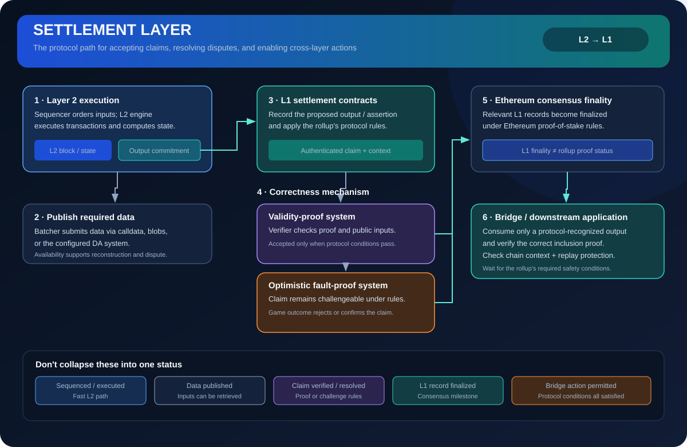

# Settlement Layer: Where Rollup Claims Are Anchored

> **Stage:** 07 — Advanced Layer 2 and Cross-Chain  
> **Priority:** 3  
> **Status:** Reviewed  
> **Last reviewed:** 2026-10-18

## 1. Overview

A settlement layer provides the contracts and consensus environment where a rollup anchors commitments, verifies proofs or resolves disputes, and coordinates messages or withdrawals. For Ethereum rollups, Ethereum Mainnet commonly plays this role. Settlement is not a synonym for execution: the L2 can execute transactions elsewhere while L1 contracts enforce the rules for accepting its state claims.

## 2. Why It Matters to a Developer

Knowing the settlement boundary helps smart-contract developers understand when an L2 result is merely observed, when it is accepted by an L1 contract, and when assets can safely be released. It also helps compare rollups with appchains and sidechains that use different trust models.

## 3. How It Works

1. The L2 executes its own transactions and derives a state commitment.
2. An operator publishes the required data and commitment, or submits a validity proof, to L1 contracts.
3. For a validity rollup, the contract verifies the proof according to its verifier and public inputs. For an optimistic rollup, a dispute window and fraud/fault-proof process may be used.
4. Once the applicable protocol conditions are satisfied, the output or message can be treated as accepted for settlement-sensitive operations.
5. A bridge or messaging contract uses that accepted information to release assets or trigger a destination action.

The exact pipeline differs by rollup. Some split batch posting, proof verification, output proposals, and bridge finalization across multiple contracts.

## 4. Example or Experiment

A token transfer on L2 may appear in an L2 block quickly. A withdrawal to L1, however, may require proving that the withdrawal message is included under an accepted state commitment and then waiting until the rollup's finalization conditions are met. The wallet's fast status and the bridge's finalizable status answer different questions.

## 5. Common Mistakes and Security Considerations

L1 settlement does not mean every aspect of the L2 is automatically trustless. Sequencer control, data availability, upgrade administrators, proof-system security, bridge code, and governance can add assumptions. Also, a rollup that settles to Ethereum is not the same as a chain that merely uses ETH or offers an EVM-like execution environment.

## 6. Key Takeaways

- Settlement anchors rollup claims and governs dispute/proof outcomes and L1-facing messages.
- Execution finality on L2, L1 inclusion, and bridge withdrawal finalization are distinct states.
- Analyze the whole trust model, not just the name of the settlement chain.

## 7. References

- [Ethereum.org — Optimistic Rollups](https://ethereum.org/developers/docs/scaling/optimistic-rollups/)
- [Ethereum.org — Zero-Knowledge Rollups](https://ethereum.org/developers/docs/scaling/zk-rollups/)
- [Ethereum.org — Data Availability](https://ethereum.org/developers/docs/data-availability/)
- [Optimism Specs — Withdrawals](https://specs.optimism.io/protocol/withdrawals.html)
