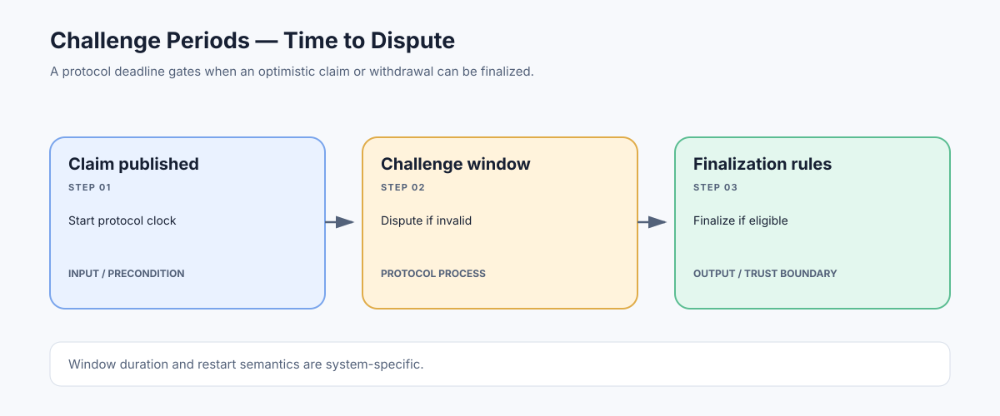

# Challenge Periods: Time Windows for Disputing Rollup Claims

> **Stage:** 07 — Advanced Layer 2 and Cross-Chain  
> **Priority:** 3  
> **Status:** Reviewed  
> **Last reviewed:** 2026-10-18

## 1. Overview

A challenge period is a protocol-defined time window during which an assertion, output, withdrawal, or related claim can be challenged before a later action becomes final. In optimistic rollups, this time allows independent participants to inspect published transaction data, re-execute the computation, and initiate a fault-proof dispute if a proposer has committed an invalid result.

## 2. Why It Matters to a Developer

Challenge periods affect withdrawal delays, capital efficiency, user experience, dispute incentives, and the point at which an application can safely rely on an L2 claim. They are a security parameter, not merely a UX timer.

## 3. How It Works

1. A rollup publishes an output or assertion that is not yet irreversible under the rollup's dispute rules.
2. A deadline is calculated according to the protocol's clock and relevant inclusion/finality rules.
3. During the window, eligible challengers can submit disputes using the required on-chain game or proof process.
4. If a valid challenge succeeds, the disputed claim may be rejected or replaced according to the protocol.
5. If no successful challenge remains and the required conditions are satisfied, the output can proceed to finalization.

Some systems apply challenge delays to outputs or withdrawals rather than to every individual L2 transaction. A validity rollup can follow a different path because an accepted proof may establish state-transition correctness without the same optimistic challenge window.

## 4. Example or Experiment

If a protocol requires a seven-day window after a withdrawal is proven, a user cannot infer that the withdrawal is final immediately after the proof transaction confirms. The contract must also observe that the correct output root was proven, the required window elapsed, and the message was not already finalized. Other protocols may use different durations or additional conditions.

## 5. Common Mistakes and Security Considerations

Never hard-code a generic 'seven days' assumption for all rollups. Periods, clocks, restart rules, security councils, emergency paths, and proof-game semantics are protocol-specific and may change through upgrades. A shorter period improves UX but leaves less time for independent detection and response; fast-bridge services can improve liquidity but introduce their own liquidity/provider assumptions.

## 6. Key Takeaways

- A challenge period defines a dispute window; it is not proof that an assertion is correct.
- Withdrawal finalization must check both the correct proof/output and all timing conditions.
- Read current network documentation and contract parameters before displaying or automating a timer.

## 7. References

- [Ethereum.org — Optimistic Rollups](https://ethereum.org/developers/docs/scaling/optimistic-rollups/)
- [Optimism Specs — Withdrawals](https://specs.optimism.io/protocol/withdrawals.html)
