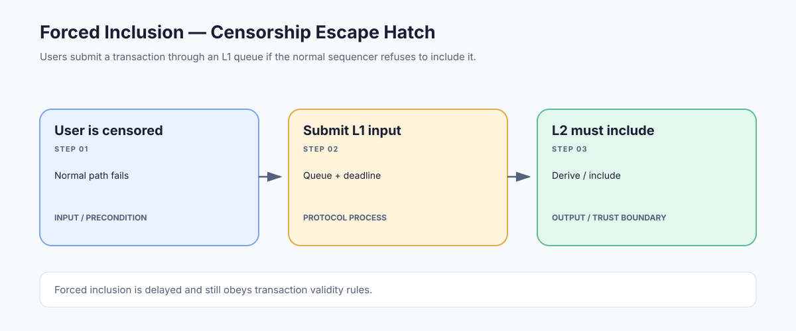

# Forced Inclusion: Bypassing a Censoring L2 Sequencer

> **Stage:** 07 — Advanced Layer 2 and Cross-Chain  
> **Priority:** 3  
> **Status:** Reviewed  
> **Last reviewed:** 2026-10-18

## 1. Overview

**Forced inclusion** is a protocol mechanism that gives users a route to get an eligible transaction or message into a Layer 2 (L2) chain even when the sequencer does not cooperate. Instead of relying only on the ordinary L2 RPC endpoint, the user submits a message through a contract or other designated path on the parent chain—often Ethereum Layer 1 (L1). If the sequencer does not process the message within the protocol's allowed window, a permissionless or designated fallback procedure can advance it into the L2 derivation process.

The mechanism targets an important weakness in many rollups: the sequencer can often provide fast confirmations and choose transaction ordering, but a centralized sequencer can also go offline or censor particular users. Forced inclusion is designed to prevent that operator from having an unlimited veto over eligible transactions.

This is not a universal feature with one shared implementation. Some rollups route L1-originated deposits into L2 blocks through mandatory derivation rules; others expose a delayed inbox and a dedicated force-inclusion call. The target chain's contract interfaces, timing parameters, message types, and upgrade configuration determine exactly what is eligible and when it can be forced.

Forced inclusion also does not mean every submitted transaction is guaranteed to succeed. It provides a path into the protocol's transaction-processing flow. The message may still revert, fail ordinary validation, lack sufficient L2 execution funds, violate application rules, or be affected by protocol-specific constraints.

## 2. Why forced inclusion matters

A sequencer typically receives L2 transactions, chooses their order, and produces blocks. This helps users get fast confirmations without waiting for every transaction to be published and processed on L1. But this privileged position creates a censorship risk: the sequencer might refuse to include a valid transaction, selectively delay a user's transactions, or stop operating.

Publishing data to L1 helps independent participants reconstruct the L2 state, but data publication alone does not necessarily give a censored user a direct way to make progress. A separate inclusion path is needed if the protocol promises a way around the sequencer.

Forced inclusion can support several guarantees:

- **A bounded censorship window:** the sequencer can delay an eligible message only within the limit defined by the protocol, assuming the parent chain and inclusion mechanism remain live.
- **An L1-based fallback:** the user's message is recorded or queued through a contract on the parent chain rather than relying solely on the sequencer's private transaction path.
- **Permissionless recovery in some designs:** after the relevant deadline, anyone can call a function that moves the queued message into the rollup's canonical input sequence.
- **A path toward self-custody:** users may retain a route to interact with the rollup or trigger recovery actions despite sequencer censorship, subject to the mechanism's scope and the protocol's other requirements.

The exact guarantee matters. A transaction inclusion path is not necessarily a complete forced exit path, and a mechanism for including L1 deposits does not automatically allow arbitrary L2 transactions to be submitted from L1.

## 3. A typical forced-inclusion lifecycle

Different rollups implement this differently, but a generalized flow is:

1. **User creates a message.** The user prepares an eligible signed transaction, deposit, or protocol-specific message.
2. **Submit through the parent chain.** The user calls the relevant L1 inbox, bridge, or deposit contract. The parent-chain transaction must be included and meet the contract's validation rules.
3. **The message is recorded.** The contract emits or records a message identifier, position, block number, or other data used to establish ordering and eligibility.
4. **The sequencer gets an opportunity to include it normally.** Some protocols let the sequencer pick up the queued message before the force-inclusion deadline. A message processed normally should not then be forced a second time.
5. **The eligibility window expires.** The protocol computes whether enough parent-chain blocks or time have passed. Some systems use block counts, some have buffers or additional conditions, and deadlines may change as earlier messages are processed.
6. **Someone triggers the fallback.** If the message is still waiting and eligible, anyone authorized by the protocol—or in some designs any account—calls the forced-inclusion function or invokes the protocol's derivation fallback.
7. **L2 nodes derive the message in order.** The message becomes part of the canonical L2 input stream, according to the protocol's validation, ordering, and execution rules.
8. **Applications observe the L2 result.** The transaction may then be included and executed, but the usual L2 execution, receipt, and finality caveats still apply.

This flow intentionally separates the message being recorded on L1 from its eventual L2 execution. Sending the first L1 transaction is not the same as the L2 transaction having already succeeded.

## 4. Two implementation patterns: OP Stack and Arbitrum

Official specifications illustrate why forced inclusion should be understood per implementation.

### OP Stack: L1-originated deposit transactions and sequencing windows

In the OP Stack, deposited transactions are initiated on L1 and executed on L2. The deposit transaction is derived from L1 data and must be included as part of the protocol. L1-originated deposits can therefore supply an input path that does not originate from the sequencer's normal L2 transaction pool.

The derivation process associates L2 epochs with L1 blocks and uses a **sequencing window** to bound the time available for the sequencer to publish the corresponding transaction batch. If the required batch data is not available by the end of the allowed window, the derivation rules can produce the L2 chain from the available L1 inputs with an empty sequenced transaction batch for the affected epoch, while still including protocol-required deposit transactions.

The specification lists 3,600 L1 blocks as the default sequencing-window size in the relevant configuration, which corresponds to roughly 12 hours if L1 blocks average 12 seconds. That figure is a protocol parameter, not a universal duration for all rollups, and timing should be checked against the target chain's deployed configuration and current specification.

This path is often described at a high level as forced inclusion or censorship resistance. Technically, OP Stack's deposit derivation and sequencing-window rules are not identical to Arbitrum's explicit delayed-inbox and forceInclusion call.

### Arbitrum: Delayed Inbox and force inclusion

Arbitrum documents a more explicit mechanism built around its **Delayed Inbox** on the parent chain. A forced transaction is a message sent through the Delayed Inbox rather than solely through the sequencer. If the sequencer does not add the message before the force-inclusion window expires, anyone can call the relevant force-inclusion function to advance it into the Sequencer Inbox. Child-chain nodes then process the message in order.

The Delayed Inbox can carry different message types, including signed transactions, ETH deposits, retryable tickets, and other protocol-defined messages. The allowed content and L2 behavior depend on the message type and contract interface.

Arbitrum's documented force-inclusion deadline is based on parent-chain block numbers and uses a delay buffer, so the window is not necessarily a simple fixed wall-clock timer. Its official documentation lists a longest delay of 7,200 Ethereum blocks for Arbitrum One and Nova in the described configuration, while also documenting a buffer, shorter delays, and a deadline query. These settings can be changed by protocol configuration or implementation updates; integrations should query and verify the current deployed values rather than assume a hard-coded number.

An important operational edge case is that forced inclusion can cause a child-chain reorganization if the sequencer previously issued soft confirmations for L2 blocks that were not yet published to the parent chain. When the forced message is inserted into the canonical input sequence, nodes may have to drop unposted sequencer blocks so that the chain follows the required ordering. The user's earlier soft-confirmed transaction could be lost or need resequencing. This is a deliberate trade-off in favor of the canonical censorship-resistance rule, and it is why soft confirmation is not the same as finality.

## 5. What forced inclusion guarantees—and what it does not

A design review should distinguish the following properties.

### It can limit sequencer censorship

The mechanism can prevent a sequencer from indefinitely excluding an eligible message, as long as the parent chain continues to make progress, the required L1 contracts remain usable, and the protocol's fallback rules are functioning.

### It does not promise immediate execution

The user may have to wait for the parent-chain transaction, the inclusion window, L2 derivation, and subsequent execution. This is intentionally slower than the normal sequencer path. A delay is part of the mechanism, not necessarily a malfunction.

### It does not mean the application call succeeds

Forced inclusion places an eligible input into the chain's processing path. A transaction can still revert because of application logic, missing balances, expired deadlines, changed state, invalid signatures, or ordinary gas and validation rules. Some message types are not arbitrary user transactions at all.

### It does not automatically make a withdrawal final

A forced message may allow a user to make progress with a withdrawal-related action, but proving and finalizing that withdrawal can require additional rollup-specific steps. Challenge periods, proof maturity, L1 inclusion, consensus finality, and bridge verification remain distinct.

### It does not remove all trust assumptions

If an administrator can pause the inbox, allowlist senders, alter the rules, or upgrade the relevant contract, those powers affect the guarantee. The parent chain must also remain live enough for the user to submit the message and for the fallback transaction to be included. An L3 using an L2 parent can inherit the parent's liveness dependencies as well.

## 6. Ordering, deadlines, and message queues

Forced inclusion is not just a timer; it is an ordering protocol.

For a delayed message, the chain needs a canonical way to determine where it sits relative to other messages. If the protocol allowed a later message to jump ahead arbitrarily, users could manipulate order, bypass earlier deposits, or create inconsistent state across nodes.

Arbitrum's documented Delayed Inbox design processes delayed messages in order. When the force-inclusion path advances a delayed message, earlier messages still waiting in the inbox are also included. This preserves the queue's ordering but means one user's forced inclusion may cause multiple messages to enter the L2 input sequence.

Deadlines can also depend on buffer state. The protocol may accelerate or lengthen the effective waiting time based on previous sequencer activity or previous forced inclusions. Thus, an interface should query the protocol's deadline computation rather than estimate the time using only a nominal delay.

In OP Stack-style derivation, the sequencing window defines which L1 blocks are considered when deriving an epoch. The protocol's fallback rules constrain whether a sequencer can retroactively publish data for an old epoch. That window bounds the sequencer's ability to delay or reorder the required inputs.

## 7. Security risks and failure modes

### Parent-chain congestion or failure

The user first needs to submit an L1 message, and someone may need to submit another L1 transaction to trigger inclusion. If L1 fees become prohibitively high or the parent chain stops producing blocks, the fallback path can be delayed. Forced inclusion is only as live as the chain and contracts it depends on.

### Invalid or griefing messages

A system must validate which messages may enter the queue and how they are executed. An attacker who could cheaply force arbitrary invalid execution inputs might cause excessive reorgs or disrupt L2 progress. Protocols need validation, resource limits, and safe handling of unsupported message types.

### Reorganization of soft-confirmed blocks

A forced message may change the L2 canonical input order relative to blocks that a sequencer showed to users but had not yet published. Applications should avoid treating soft confirmations as irrevocable and should handle transaction disappearance or resequencing.

### Inbox pausing and privileged roles

A chain owner or administrator may be able to pause or restrict the delayed inbox. In Arbitrum documentation, the chain owner is a documented exception to the general ability to force inclusion. Such controls should be recorded as explicit trust assumptions and assessed for emergency rationale, timelock, and scope.

### Incorrect timing assumptions

Block-based deadlines do not map exactly to seconds, and buffers or chain-specific configuration can affect the effective wait. A hard-coded timeout in a UI, bot, or contract integration can become wrong after protocol changes or when used on another chain.

### Duplicate or incorrect message handling

The mechanism must ensure a message already processed cannot be inserted again as a new logical transaction. Review message indices, accumulator or message hashes, queue ordering, execution status, and the contract conditions that reject premature or repeated force-inclusion calls.

## 8. Developer and protocol review checklist

When evaluating forced inclusion on a rollup, ask:

- Which exact L1 inbox, portal, bridge, or derivation rule provides the fallback path?
- Which message types can be forced: arbitrary signed L2 transactions, deposits, withdrawals, retryable tickets, or only specific protocol messages?
- Who can trigger inclusion once the deadline expires—only the user, a privileged relayer, or any account?
- Is the deadline based on L1 block numbers, timestamps, an adaptive delay buffer, or several conditions?
- How can an integration query the actual deadline and confirm whether a message has already been processed?
- Are delayed messages strictly ordered, and does forcing one message also include earlier queued messages?
- Can forced inclusion invalidate soft-confirmed but unposted L2 blocks? How do clients and applications handle that reorganization?
- What gas and fees must the user pay on both parent and child chains, and can a low L2 balance prevent the target action from succeeding?
- Can governance pause the inbox or change the relevant contracts and settings?
- What happens if the parent chain or its sequencer is offline, particularly for L3 systems?
- Does the mechanism provide only transaction inclusion, or also a complete route to withdraw or recover assets?

## 9. Key takeaways

- Forced inclusion gives eligible messages an alternate route into an L2 when the normal sequencer path censors or delays them.
- It generally depends on an L1 contract or protocol derivation rule and a defined deadline.
- OP Stack's L1 deposit and sequencing-window rules and Arbitrum's Delayed Inbox/forceInclusion mechanism solve related problems but are not identical implementations.
- A forced message still has to obey ordering, validation, execution, and application rules; inclusion does not guarantee success.
- Some forced inclusions can reorganize unposted soft-confirmed L2 blocks, so users and applications should distinguish soft confirmation from a canonical result.
- Timing, permissions, delay buffers, and emergency controls are chain-specific; verify the deployed configuration instead of assuming a universal window.

## References

1. [Ethereum.org — Optimistic Rollups: Censorship Resistance](https://ethereum.org/developers/docs/scaling/optimistic-rollups/)
2. [OP Stack Specification — Protocol Overview and Sequencing Window](https://specs.optimism.io/protocol/overview.html)
3. [OP Stack Specification — Glossary](https://specs.optimism.io/glossary.html)
4. [OP Stack Specification — Deposits](https://specs.optimism.io/protocol/deposits.html)
5. [OP Stack Specification — Configurability](https://specs.optimism.io/protocol/configurability.html)
6. [Arbitrum Documentation — Forced Transactions](https://docs.arbitrum.io/how-arbitrum-works/deep-dives/forced-transactions)
