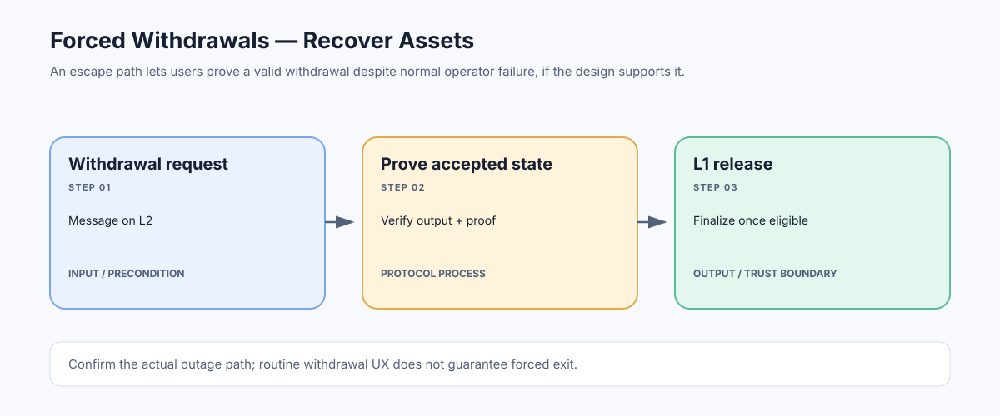

# Forced Withdrawals: Exit Paths When the Normal Operator Fails

> **Stage:** 07 — Advanced Layer 2 and Cross-Chain  
> **Priority:** 3  
> **Status:** Reviewed  
> **Last reviewed:** 2026-10-18

## 1. Overview

Forced withdrawals are mechanisms that allow users to recover or move assets out of an L2 when the normal operator, sequencer, or message path is unavailable or censoring them. The name covers different designs: some systems expose a direct L1 request/escape hatch, while others rely on the ordinary bridge plus forced inclusion or an alternative state-recovery procedure.

## 2. Why It Matters to a Developer

A rollup's bridge is only useful as an exit route if users can satisfy its proof and timing requirements even during an operator failure. Understanding the actual forced-exit path is essential when assessing whether funds are recoverable under censorship or downtime.

## 3. How It Works

1. The user initiates an L1-recognized exit request, or uses the rollup's documented censorship-resistant transaction path.
2. The protocol connects the request to an accepted L2 state, usually through a withdrawal message or state commitment.
3. The user or relayer supplies the required inclusion proof and waits for any challenge/finality delay.
4. The L1 bridge verifies the output, proof, domain, and replay protection before releasing the asset or executing the message.
5. If the normal operator is unavailable, the escape path must specify how a valid state can still be derived, proved, or challenged.

Not every project implements the same mechanism, and some use 'forced withdrawal' loosely to describe functionality that is not a fully permissionless escape hatch.

## 4. Example or Experiment

On an OP Stack-style withdrawal path, an L2 message is recorded by a message-passer contract, then proven against an output root on L1 and finalized after the configured challenge period. This normal flow is not, by itself, proof that every form of forced escape is supported. A developer should separately inspect deposit/forced-inclusion rules, fault-proof assumptions, and what a user can do if the sequencer is offline.

## 5. Common Mistakes and Security Considerations

A bridge may depend on a proposer, proof generator, data publisher, or upgrade council even when the UI describes withdrawals as trustless. A state root is useful only if users can obtain the data and prove the relevant state. Emergency admin controls can also alter or pause exit contracts. Verify the actual contracts and failure procedures rather than relying on a feature label.

## 6. Key Takeaways

- A forced exit is about recoverability under censorship or downtime, not only routine withdrawal UX.
- Users still need a valid state claim and the proof path defined by the protocol.
- Test the advertised escape hatch against sequencer outage, data withholding, and challenged outputs.

## 7. References

- [Optimism Specs — Withdrawals](https://specs.optimism.io/protocol/withdrawals.html)
- [Ethereum.org — Optimistic Rollups](https://ethereum.org/developers/docs/scaling/optimistic-rollups/)
- [Ethereum.org — Bridges](https://ethereum.org/developers/docs/bridges/)
