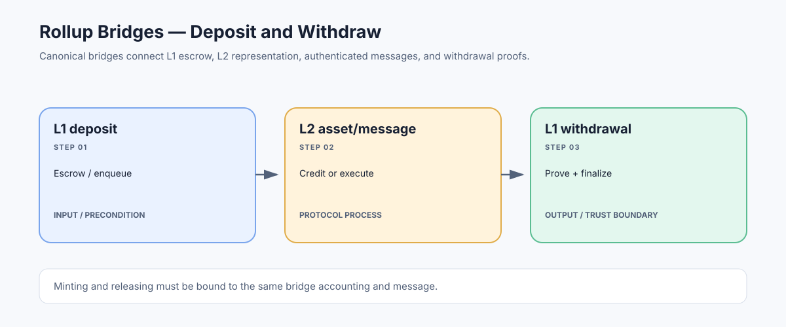

# Rollup Bridges: Moving Assets and Messages Between L1 and L2

> **Stage:** 07 — Advanced Layer 2 and Cross-Chain  
> **Priority:** 3  
> **Status:** Reviewed  
> **Last reviewed:** 2026-10-18

## 1. Overview

A rollup bridge is the contract system that moves assets or authenticated messages between a rollup and its settlement layer. A canonical L1–L2 bridge generally coordinates a deposit path, an L2 representation or message, and a withdrawal path that proves the L2 action before L1 releases assets or executes a message.

## 2. Why It Matters to a Developer

Bridge contracts hold or control substantial value and sit at the boundary between state machines. Developers need to understand which side escrows funds, what evidence authorizes minting or release, and how finality, replay protection, token mapping, and upgrade controls are handled.

## 3. How It Works

**Deposit (L1 → L2):** a user transfers an asset or message to an L1 contract; the event or deposit transaction is incorporated into the L2's input stream; the L2 bridge credits the corresponding asset or executes the message.

**Withdrawal (L2 → L1):** the L2 bridge records a withdrawal message; the message is included in an accepted output/state commitment; the user or relayer submits the required proof to L1; after all proof and timing conditions pass, the L1 bridge releases funds or calls the target.

This differs from third-party liquidity bridges, which may pay a user on the destination chain before canonical settlement finishes and later rebalance liquidity. Their speed comes with distinct provider, inventory, and verification assumptions.

## 4. Example or Experiment

For a canonical lock-and-mint route, 10 tokens are locked on L1 and an equivalent representation is credited on L2. A withdrawal should burn or otherwise invalidate the L2 representation and prove the message before releasing 10 tokens on L1. The invariant is not 'the same token address exists on both chains'—it is that minting and release are authorized by one consistent bridge accounting system.

## 5. Common Mistakes and Security Considerations

Common failures include verifier bugs, incorrect chain/domain binding, replayed messages, mismatched token decimals, incorrect escrow accounting, upgrade-key compromise, validator collusion, and finality assumptions that differ across networks. A token shown as 'bridged' may be an IOU or wrapped representation with separate risks. Check whether the bridge is canonical to the rollup, a third-party service, or both.

## 6. Key Takeaways

- A canonical rollup bridge relies on the rollup's state/settlement design to authorize exits.
- Deposits and withdrawals use different direction-specific proofs and accounting steps.
- Analyze the message verifier, token mapping, escrow invariant, replay protection, and admin/upgrade model.

## 7. References

- [Ethereum.org — Bridges](https://ethereum.org/developers/docs/bridges/)
- [Optimism Specs — Withdrawals](https://specs.optimism.io/protocol/withdrawals.html)
- [Ethereum.org — Zero-Knowledge Rollups](https://ethereum.org/developers/docs/scaling/zk-rollups/)
