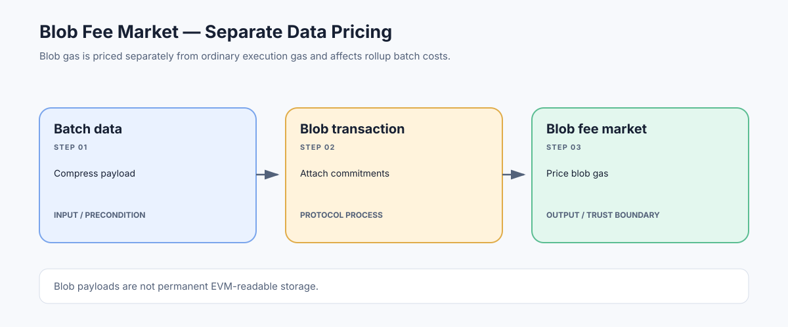

# Blob Fee Market: Pricing Rollup Data on Ethereum

> **Stage:** 07 — Advanced Layer 2 and Cross-Chain  
> **Priority:** 3  
> **Status:** Reviewed  
> **Last reviewed:** 2026-10-18

## 1. Overview

EIP-4844 introduced blob-carrying transactions and a separate pricing mechanism for blob gas. Blobs let rollups publish large data payloads whose contents are not directly accessible to EVM execution, while the transaction carries commitments and references needed by the protocol. The blob fee market is distinct from the execution-gas market used by normal EVM transactions.

## 2. Why It Matters to a Developer

Rollups often pay significant costs to publish data on Ethereum. Understanding blob gas, the blob base fee, and the separation between data and execution helps developers estimate rollup costs and avoid misleading assumptions about how an L2 transaction fee is formed.

## 3. How It Works

1. A blob-carrying transaction includes execution-layer transaction data plus blob commitments and versioned hashes; the large blob payload is propagated through the protocol's data-availability path.
2. The execution layer accounts for blob gas separately from ordinary execution gas.
3. The blob base fee adjusts according to the protocol's excess-blob-gas accounting and fee-adjustment function, rather than being the same as the EIP-1559 execution base fee.
4. A rollup's batcher pays the applicable fees to publish its data. The rollup then allocates shared L1 costs across user transactions according to its own fee policy.
5. Blob data has a protocol-defined availability/storage lifecycle and is not permanent, EVM-readable contract storage.

A transaction can therefore consume execution gas, blob gas, or both, with separate accounting rules. Exact parameters and fee behavior depend on the active Ethereum fork.

## 4. Example or Experiment

At a high level, a batch poster may submit compressed L2 transaction data in blobs. Its bill includes the ordinary L1 transaction execution cost and the blob-gas charge, whose price responds to aggregate blob demand. That total is not automatically identical to the fee an L2 user sees; the rollup also applies its own estimation and cost-allocation logic.

## 5. Common Mistakes and Security Considerations

Do not read blob contents from a Solidity contract as if they were calldata or storage. Do not use the execution base fee as a substitute for blob base fee. Blob capacity, target values, fee parameters, retention, and pricing may evolve through upgrades; production estimators should follow the active protocol rules and the rollup's own fee formula.

## 6. Key Takeaways

- Blob gas and ordinary execution gas are separate fee dimensions.
- Blob payloads improve rollup data economics but are not permanent EVM-accessible data.
- User fees depend on L1 publication cost and the rollup's allocation policy, not only on L2 execution gas.

## 7. References

- [EIP-4844 — Blob-carrying Transactions](https://eips.ethereum.org/EIPS/eip-4844)
- [Ethereum.org — Data Availability](https://ethereum.org/developers/docs/data-availability/)
