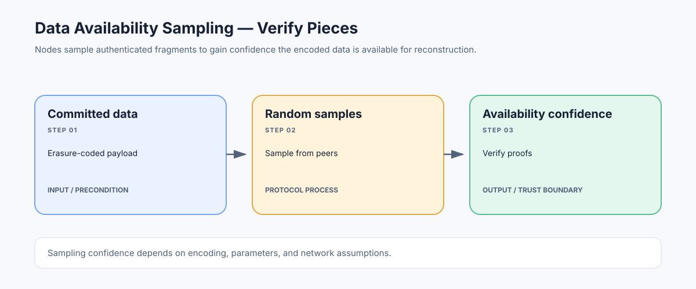

# Data Availability Sampling: Checking That Published Data Exists

> **Stage:** 07 — Advanced Layer 2 and Cross-Chain  
> **Priority:** 3  
> **Status:** Reviewed  
> **Last reviewed:** 2026-10-18

## 1. Overview

Data availability sampling (DAS) is a technique in which a node checks randomly selected pieces of a data set instead of downloading the entire data set. With suitable encoding, commitments, and sampling parameters, a network can gain strong confidence that a large payload is available while each individual node downloads only a fraction of it.

## 2. Why It Matters to a Developer

Rollups need transaction data to be available so independent parties can reconstruct L2 state, verify outputs, and exit safely. Sampling is one way to scale data availability without forcing every node to download every byte, which can help preserve decentralization as throughput grows.

## 3. How It Works

1. The protocol commits cryptographically to a data payload.
2. The payload is encoded with redundancy so that enough available pieces can reconstruct the original data.
3. Nodes request random samples from peers and verify those pieces against the commitment.
4. If a producer withholds too much data, random samples are increasingly likely to fail; nodes can reject or fail to attest to availability according to the protocol.
5. If sufficient encoded data is available, the full payload can be reconstructed by collecting enough pieces.

Sampling confidence depends on the encoding scheme, sample count, distribution of samples, peer diversity, network assumptions, and correct implementation. It is not simply a random download without cryptographic verification.

## 4. Example or Experiment

Suppose a blob is encoded into many authenticated columns. A node samples several columns from different peers and checks each sample with its proof. The node does not reconstruct every byte just to make a local availability check. Other nodes may custody different portions; enough portions must remain accessible to reconstruct the payload under the scheme's threshold.

## 5. Common Mistakes and Security Considerations

A node that samples only from one unreliable or colluding peer has a weaker practical view than the protocol intends. Data availability is not the same as execution validity: data may be fully available but encode an invalid state transition, or a validity proof may verify while required data is unavailable. Sampling systems also depend on correct erasure coding, commitments, networking, and parameter choices.

## 6. Key Takeaways

- DAS aims to reduce per-node download requirements while retaining confidence in data availability.
- Cryptographic sampling checks and data reconstruction thresholds are part of the security argument.
- Availability and execution correctness must be evaluated independently.

## 7. References

- [Ethereum.org — Data Availability](https://ethereum.org/developers/docs/data-availability/)
- [EIP-7594 — PeerDAS](https://eips.ethereum.org/EIPS/eip-7594)
- [Ethereum.org — PeerDAS](https://ethereum.org/roadmap/fusaka/peerdas/)
