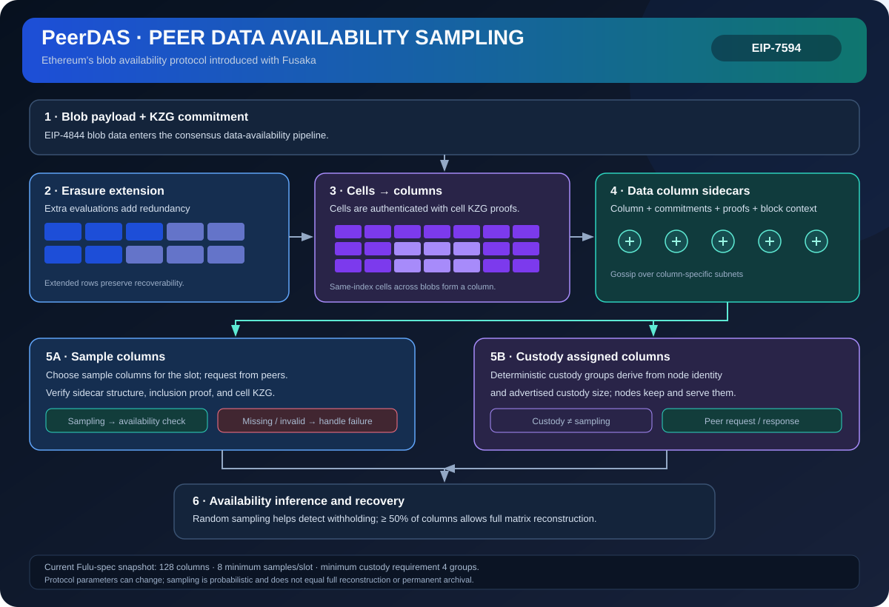

# PeerDAS: Peer-Based Data Availability Sampling in Ethereum

> **Stage:** 07 — Advanced Layer 2 and Cross-Chain  
> **Priority:** 3  
> **Status:** Reviewed  
> **Last reviewed:** 2026-10-18

## 1. Overview

PeerDAS (Peer Data Availability Sampling) is an Ethereum protocol design specified by EIP-7594. It extends the blob data-availability system by organizing encoded blob data into cells and columns and distributing custody and sampling across peers. A node can check samples rather than downloading every blob in full while the network retains enough encoded data to reconstruct the payload.

## 2. Why It Matters to a Developer

PeerDAS is a protocol-level approach to scaling rollup data throughput while limiting bandwidth and storage pressure on individual nodes. It is important for understanding why Ethereum can evolve its blob capacity without assuming every node must independently download all blob data.

## 3. How It Works

1. Blob data is extended with erasure coding into a larger data matrix; the protocol represents pieces as cells that can be authenticated against the blob's commitment.
2. Cells are organized into columns, and nodes have deterministic custody responsibilities based on the protocol's assignment rules.
3. Nodes gossip relevant data and request samples or columns from peers.
4. A node verifies received cells using the associated proofs and performs data-availability sampling for its assigned tasks.
5. The erasure-coded structure allows reconstruction when a sufficient portion of the data is available; the consensus rules and current fork determine the exact parameters and duties.

PeerDAS is more specific than the general idea of DAS: it defines how sampling, gossip distribution, peer requests, custody, and cell proofs fit into Ethereum's networking and consensus protocols.

## 4. Example or Experiment

A node may custody only a subset of columns and sample additional columns from peers. It verifies sampled cells against the blob commitment instead of trusting a peer's word that the full blob exists. A node needing full reconstruction can request enough columns to recover the underlying data, provided the availability assumptions hold.

## 5. Common Mistakes and Security Considerations

Do not confuse a protocol specification with a claim about every network or client version. Mainnet deployment status and active parameters must be checked against the relevant fork and consensus specifications. Correctness depends on erasure coding, proof verification, peer sampling, custody assignments, implementation diversity, and sufficient data being available. PeerDAS scales availability; it does not itself prove rollup execution validity.

## 6. Key Takeaways

- PeerDAS specifies Ethereum's peer-based sampling and distribution mechanism for blob data.
- Cells, columns, custody assignments, and authenticated samples are central building blocks.
- Follow the currently active consensus-spec version for exact parameters and deployment behavior.

## 7. References

- [EIP-7594 — PeerDAS](https://eips.ethereum.org/EIPS/eip-7594)
- [Ethereum.org — PeerDAS](https://ethereum.org/roadmap/fusaka/peerdas/)
- [EIP-4844 — Blob-carrying Transactions](https://eips.ethereum.org/EIPS/eip-4844)
