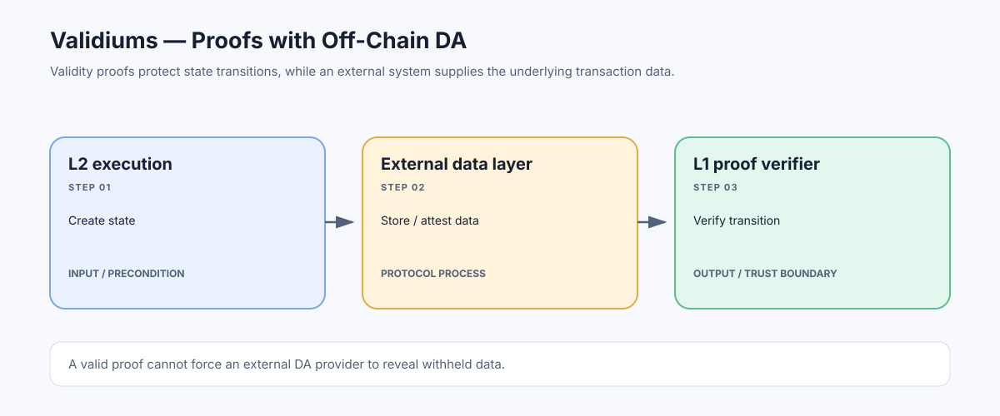

# Validiums: Validity-Proven Execution with Off-Chain Data Availability

> **Stage:** 07 — Advanced Layer 2 and Cross-Chain  
> **Priority:** 3  
> **Status:** Reviewed  
> **Last reviewed:** 2026-10-18

## 1. Overview

A validium is a scaling design that uses validity proofs to establish that state transitions are correct while keeping transaction data outside the rollup's L1 data-availability layer. Rather than publishing enough data to Ethereum for every observer to reconstruct the full L2 state, the design relies on a separate data-availability provider, committee, or another off-chain mechanism.

## 2. Why It Matters to a Developer

Validity proofs and data availability answer different questions. A validium can prove that a state transition follows its rules, yet users may still depend on an external party to obtain the data needed to read state, build new transactions, or recover assets. This changes the trust model relative to a rollup that posts its data to Ethereum.

## 3. How It Works

1. The L2 executes transactions and generates a state transition.
2. A prover produces a validity proof for the relevant transition and public inputs.
3. Transaction/state data is stored or distributed by an external data-availability mechanism rather than being fully published as L1 rollup data.
4. The L1 verifier checks the validity proof and the settlement contracts update or accept the state commitment according to protocol rules.
5. Users depend on the DA system to access the underlying state data needed for independent verification, continued participation, or withdrawal paths defined by the design.

## 4. Example or Experiment

A validium may provide an accepted validity proof for a new state root while storing user transaction data with a DA committee. The proof can show that the transition was valid under the circuit, but if the committee withholds data, ordinary users may not be able to independently reconstruct balances or generate the proofs required by the escape mechanism.

## 5. Common Mistakes and Security Considerations

Do not equate 'validity proof verified' with 'same security as a data-on-Ethereum rollup.' Assess the DA committee's threshold, key management, availability monitoring, data-recovery process, censorship risks, and whether a user can exit when data is unavailable. The exact term and architecture can vary among projects, so read the design rather than relying on a category label.

## 6. Key Takeaways

- A validium combines validity proofs with an off-chain data-availability model.
- Execution correctness and data availability are separate security properties.
- The DA committee/provider and emergency exit/recovery path are central parts of the threat model.

## 7. References

- [Ethereum.org — Validium](https://ethereum.org/developers/docs/scaling/validium/)
- [Ethereum.org — Zero-Knowledge Rollups](https://ethereum.org/developers/docs/scaling/zk-rollups/)
- [Ethereum.org — Data Availability](https://ethereum.org/developers/docs/data-availability/)
