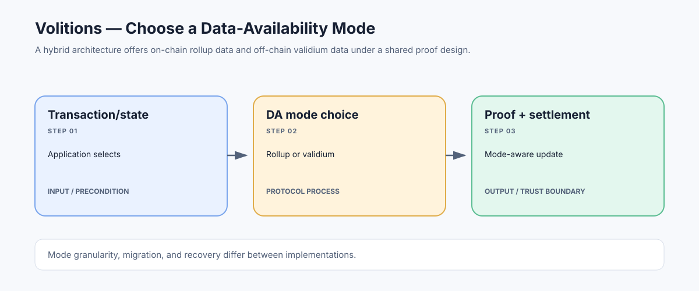

# Volitions: Choosing Between Rollup and Validium Data Availability

> **Stage:** 07 — Advanced Layer 2 and Cross-Chain  
> **Priority:** 3  
> **Status:** Reviewed  
> **Last reviewed:** 2026-10-18

## 1. Overview

A volition is a hybrid scaling design that combines a validity-proof execution system with multiple data-availability modes—commonly an on-chain rollup mode and an off-chain validium mode. Depending on the implementation, a user or application may choose which data-availability mode to use for a transaction, account, asset, or other supported unit of state.

## 2. Why It Matters to a Developer

Volitions expose a trade-off between cost and data-recovery guarantees. On-chain publication can cost more but gives the public a stronger basis for independently reconstructing state; off-chain data availability can lower publication costs but adds reliance on external data providers or committees. A hybrid design can let applications select the trade-off that suits their use case.

## 3. How It Works

1. The system executes transactions in a shared validity-proof framework.
2. A transaction or state component is assigned to an available DA mode according to the protocol's rules.
3. Data assigned to the rollup mode is published to the settlement layer; data assigned to the validium mode is kept in the selected external DA system.
4. The proof and state-transition logic must bind each mode, data commitment, and state update consistently.
5. The system exposes different cost and recovery assumptions for the different modes; the user cannot assume all state has the same DA guarantee.

## 4. Example or Experiment

A low-value, high-frequency application might prefer an off-chain DA mode to reduce fees, while a more sensitive balance or application might choose L1-published data if the system supports that granularity. The example describes the design trade-off—not a guarantee that every volition permits per-transaction selection or that assets can always migrate freely between modes.

## 5. Common Mistakes and Security Considerations

Hybrid flexibility is complex: the UI must accurately disclose the current mode, contracts must prevent inconsistent accounting across modes, and users need to know what exits or state recovery are possible if an external DA provider fails. 'Volition' is not a universal EVM standard; implementations may differ in granularity, migration support, and which components share the validity circuit.

## 6. Key Takeaways

- A volition combines multiple DA choices within a validity-proof scaling architecture.
- Mode selection changes the data-recovery and trust assumptions as well as cost.
- Verify precisely what is selectable, how state moves between modes, and how emergency exits work.

## 7. References

- [Ethereum.org — Validium](https://ethereum.org/developers/docs/scaling/validium/)
- [Ethereum.org — Zero-Knowledge Rollups](https://ethereum.org/developers/docs/scaling/zk-rollups/)
- [Ethereum.org — Data Availability](https://ethereum.org/developers/docs/data-availability/)
