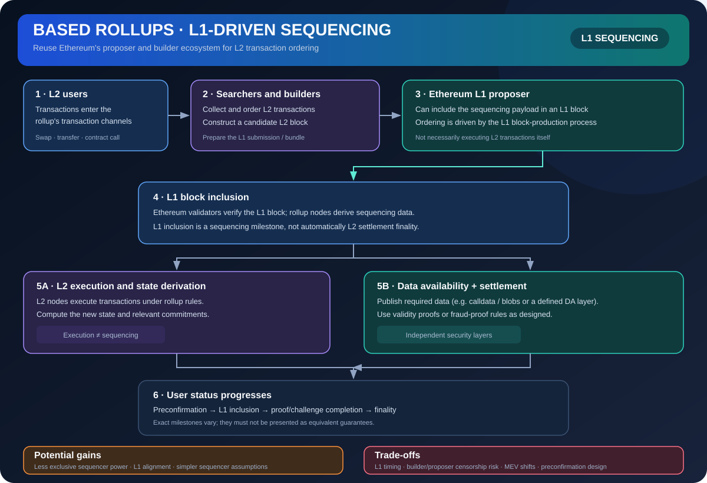

# Based Rollups: Sequencing Through Ethereum L1

> **Stage:** 07 — Advanced Layer 2 and Cross-Chain  
> **Priority:** 3  
> **Status:** Reviewed  
> **Last reviewed:** 2026-10-18

## 1. Overview

A based rollup is a rollup whose sequencing is integrated with the base layer's block-proposer process—on Ethereum, the L1 proposer and related block-building ecosystem can determine or include the next L2 transaction sequence. Instead of depending exclusively on a separate L2 sequencer, it uses L1 ordering as the primary sequencing mechanism.

## 2. Why It Matters to a Developer

Based sequencing can align a rollup's liveness and ordering more closely with Ethereum's proposer path and may reduce the need for a separate sequencer trust assumption. It also changes latency, MEV, fee allocation, and the way L2 blocks fit into L1 blocks.

## 3. How It Works

1. Users submit L2 transactions through the rollup's supported mempool or submission path.
2. An Ethereum L1 proposer or builder includes the relevant rollup sequencing data or payload in an L1 block according to the design.
3. Rollup derivation rules interpret the L1 data as the canonical order of L2 transactions.
4. L2 execution processes that sequence and derives its new state.
5. The rollup still needs its settlement and data-availability rules; based sequencing primarily describes who determines order and how that order is anchored to L1.

Some based-rollup designs add preconfirmations or specialized proposer commitments to improve user latency, but these are additional mechanisms and should not be confused with the underlying L1 sequencing rule.

## 4. Example or Experiment

If an L1 block includes rollup transactions in a particular order, L2 nodes derive that order as the rollup's sequence according to the protocol. A separate fast-confirmation service could offer earlier indications, but the application must label the status clearly: preconfirmed by a service, included by L1, executed on L2, or settled by the rollup are different milestones.

## 5. Common Mistakes and Security Considerations

Using L1 sequencing does not automatically solve rollup correctness, bridge security, or data availability. It can introduce dependencies on L1 inclusion latency, builder/proposer behavior, ordering markets, and how rollup transactions compete for L1 block space. Analyze preconfirmation promises separately, because they may depend on actors or collateral not guaranteed by Ethereum consensus itself.

## 6. Key Takeaways

- Based sequencing makes the base layer's proposer path central to transaction ordering.
- It changes sequencing assumptions, not every other part of the rollup security model.
- Distinguish L1 inclusion from preconfirmation, L2 execution, proof acceptance, and bridge finality.

## 7. References

- [Based Sequencing — Concepts and FAQ](https://www.basedsequencing.org/)
- [Ethereum.org — Optimistic Rollups](https://ethereum.org/developers/docs/scaling/optimistic-rollups/)
